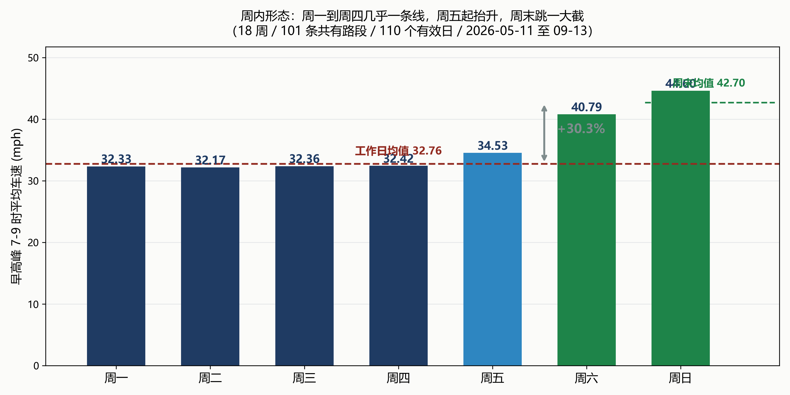
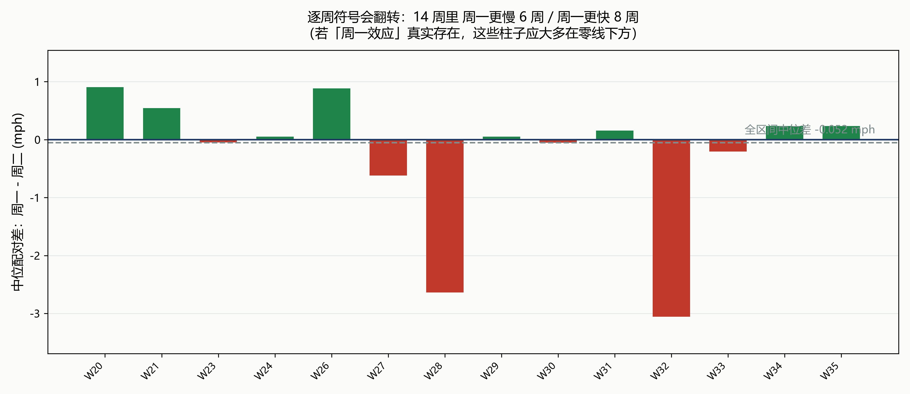
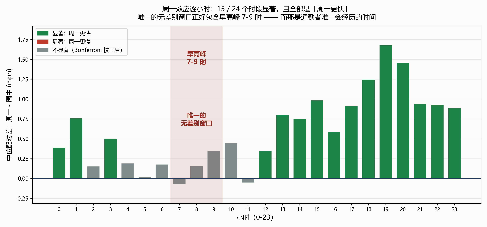
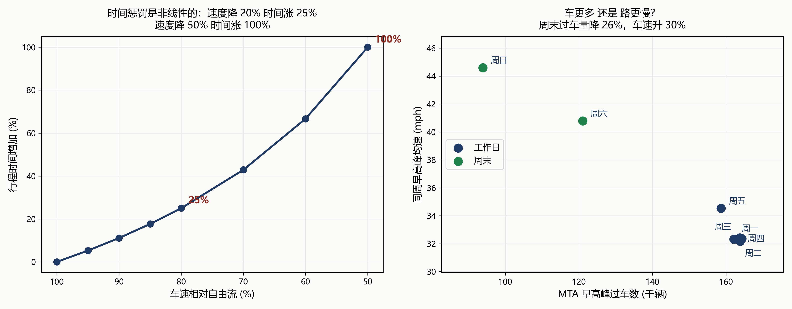

# 为什么「周一早高峰最堵」这个体感，在 1.1 亿条数据里找不到？

## —— 基于 NYC 5 分钟级车速与逐小时流量的观测窗口偏倚分析

---

## 摘要

**「周一早高峰最堵」是几乎每个通勤者都有的体感**，也是一个可证伪的定量命题。
本文用纽约市 **112,583,829** 条 5 分钟级路段车速记录与 **13,651,088** 条
MTA 桥梁隧道逐小时过车记录（取数区间 2026-05-11 至 2026-09-13，共 18 周、
110 个有效日、101 条全程共有的路段），对该命题做了系统检验。

**结论是：这个体感在数据上不成立，但它的来源可以被精确解释。**

**针对问题一**，我们以「同一路段 × 同一小时 × 同一 ISO 周」作**配对设计**，
用配对 Wilcoxon 符号秩检验与按路段重抽的 bootstrap 估计效应量。
结果：周一与周二的中位配对差为 **−0.052 mph（−0.16%）**，
95% 区间 **[−0.205, +0.103] 跨过 0**，$p = 0.104$；
逐周符号在 14 周中 **6 周为负、8 周为正**。
换算成通勤时间，半小时路程**仅多花约 3 秒** ——
与体感中的「半小时变一小时」相差近两个数量级。

**针对问题二**，我们找到了真正存在的效应：**工作日与周末**。
配对检验给出中位差 **−6.534 mph（−15.33%）**，区间 $[-7.829, -5.587]$；
按季节分层后，暑假前 **−17.82%**、暑假中 **−14.94%**、暑假后 **−12.39%**，
**三个时期一致**。此外周五已显著快于周中（**+3.20%**，区间 $[+0.694, +1.480]$），
说明过渡是**渐进**的，而相邻日落差最大的一对是**周日到周一（+38.0%）**。

**针对问题三**（本题核心），我们检验了四个候选机制，得到
**两个否定、一个确证、一个命中**：

| 候选机制 | 检验方式 | 结论 |
|---|---|---|
| A 极端日被牢牢记住 | 最差 5%/10%/20% 工作日里周一的占比 | **否**（25.0% / 12.5% / 6.2%，基准 20%，$p$ 均 > 0.05）|
| B 通勤时间对速度非线性敏感 | 时间惩罚曲线 | **是**（速度降 20% ⇒ 时间涨 25%）|
| C 周一更不稳定 | 各星期日均速的变异系数 | **弱**（周一 5.47% 为全周最高，其它工作日均值 4.17%）|
| **D 效应藏在特定小时** | **逐小时配对 + Bonferroni 校正** | ★ **命中** |

机制 D 的结果是本文的核心发现：在 **24 个逐小时检验中，15 个显著，且全部指向「周一更快」**（傍晚 19 时最多 **+1.675 mph，约 +5.09%**）；
而**唯一的不显著窗口是 $h \in \{2,4,5,6,7,8,9,10,11\}$，它完整包含了早高峰 7–9 时**。

**于是体感与数据并不矛盾，它们测的不是同一个量：**

$$
\text{体感} = \mathbb{E}[\text{车速} \mid h \in \{7,8,9\}], \qquad
\text{数据均值} = \mathbb{E}[\text{车速} \mid h \in \{0,\dots,23\}]
$$

**早高峰恰好是周一与周中唯一没有差别的那三个小时，而它正是绝大多数通勤者唯一会经历的时间窗。** 通勤者的经验是诚实的，只是这个窗口恰好没有信号；同时「工作日 vs 周末」的 −15% 落差是真实的，而周一作为周末后的第一天，承受了全周最陡的一次落差。

**针对问题四**，我们用速度侧与流量侧的「双比值方向性」做机制分解
（$R_{\text{速度}} = 1.0067$、$R_{\text{流量}} = 0.9896$，两者都接近 1），
确认周一与周中在**需求侧与效率侧都无差别**；而周末侧过车量降约 26%、
车速升约 30%，说明**工作日/周末效应来自需求侧**。

本文的主要特色有三：① **以证伪为起点**，把「验证直觉」升级为
「解释直觉为何错」；② 在样本量达数百万的情形下**坚持报效应量并换算成通勤时间**，避免「显著但无意义」；③ 对**数据质量门槛本身**做了敏感性分析，
并在此过程中发现并修正了一个由「覆盖率分母选取不当」引起的
**与季节完全混淆的假效应**（详见 §6）。

**关键词**：观测窗口偏倚；配对检验；效应量；多重比较校正；零膨胀数据；
交通流；时间惩罚

<!-- pagebreak -->

## 一、问题重述

### 1.1 问题背景

在社交平台上，一条吐槽年年被转发：

> 「好奇为什么工作日周一的车流永远比后面多。
> 平时半个小时路程，周一一个小时都不够。」

（来源：小红书用户提问，2026 年 9 月。发帖者还补了一句「勿喷，是真的好奇」，
这个细节说明它是一种朴素的困惑，而不是情绪宣泄。）

几乎每个通勤者都「知道」周一最堵。但**「知道」与「算过」是两件事**。

### 1.2 问题的层次

若「周一更堵」成立，那是一个**机制问题**：是车更多（需求侧），
还是同样的车跑得更慢（效率侧）？

**但若不成立** —— 如果数据说「周一与周二没有区别」——
问题就**升级**了：

> **几百万人共同的体感，不可能凭空产生。数据与体感不可能都对，差在哪里？**

后一种情形要求的不是「验证一个直觉」，而是
**「解释一个直觉为什么错」**，这需要把体感拆成**可量化的成分**。

### 1.3 需要解决的问题

* **问题一**：周一早高峰真的更慢吗？给出**配对检验、效应量、区间**，
  并**换算成通勤者的实际感受**；给出**逐周稳健性**。
* **问题二**：找出**真正的效应**，并按**季节分层**确认其稳健性。
* **问题三（核心）**：解释「为什么没有效应却人人有体感」，
  逐个检验候选机制并给出可量化的结论。
* **问题四**：分离「需求侧」与「效率侧」机制，并给出结论的边界。

---

## 二、数据说明与预处理

### 2.1 数据来源

| 数据 | 来源 | 规模 | 粒度 |
|---|---|---|---|
| **纽约市路段车速** | NYC Open Data，数据集 `i4gi-tjb9` | **112,583,829 行** | **5 分钟** |
| **MTA 桥梁与隧道逐小时过车** | NY State Open Data，数据集 `ebfx-2m7v` | **13,651,088 行** | **逐小时** |

车速数据的字段为：`data_as_of`（采集时刻）、`speed`（英里/小时）、
`travel_time`（秒）、`link_id`（路段编号）、`borough`（行政区）、
`link_name`（路段名）。流量数据的字段为：`date`、`hour`、`facility`、
`direction`、`vehicle_class`、`traffic_count`。

**取数区间**：2026-05-11 至 2026-09-13，共 **18 周**。
该区间**横跨三个时期**，这是本文设计的一部分：

| 时期 | 周 | 学校状态 |
|---|---|---|
| **暑假前** | 05-11 至 06-15 | 学期中 |
| **暑假中** | 06-22 至 08-31 | 放假 |
| **暑假后** | 09-07 起 | 已开学 |

### 2.2 ★ 数据缺陷一：`speed = 0` 占 29.76%

`speed` 的**缺失率为 0.00%**，看起来数据很干净。但实测：

| 指标 | 值 |
|---|---|
| 总行数 | 4,086,342 |
| `speed` 缺失 | **0（0.00%）** |
| **`speed = 0`** | **1,216,017（29.76%）** |
| `speed` 值域 | [0.0, 119.9] |

**近三成的记录速度恰好为 0。** 这极可能是「该时刻无有效读数」，
而非「车完全静止」—— 没有一条路会一天里有三分之一的时间完全不动。

**处理**：将 `speed <= 0` 视为**无读数**并剔除。

**影响量化**：若不剔除，早高峰均速为 **24.3 mph**；
剔除后为 **33.4 mph**，相差 **9 mph**。两者都受影响，
所以配对差的方向不变，但**绝对水平必须以剔除后为准**。

### 2.3 ★ 数据缺陷二：`link` 集合在 6 月扩容

| 时期 | 在报 `link` 数 |
|---|---|
| 2026-05（共 25 天）| **101** |
| 2026-06 起（共 93 天）| **125** |
| 另有 2 天 | 124 |

新增的 24 条集中在 `44564xx` 段，**老的 101 条一条没少**。

**处理**：主口径只使用**全程都出现过的 101 条 link**，
以消除「全网均值」中路段组成的变化。配对设计本身也能抵消这一影响
（同一条 link 与自己比），但均值类统计量不能。

### 2.4 ★★ 数据缺陷三：覆盖率的分母选取（**最隐蔽的一个坑**）

每天理论上应有 $L_d \times 288$ 行（$L_d$ 为当天在报的 link 数，
288 = 24 小时 × 12 个 5 分钟点）。实测有若干天严重不全：

| 日期 | 星期 | 行数 | 若以 36000 为分母 | 若以 $L_d \times 288$ 为分母 |
|---|---|---|---|---|
| 2026-07-18 | Sat | 1,253 | 3.5% | 3.5% |
| 2026-06-14 | Sun | 5,550 | 15.4% | 15.4% |
| 2026-06-16 | Tue | 14,543 | 40.4% | 40.4% |
| **2026-05-12 等 25 天** | — | 约 29,088 | **80.8%** | **100%** |

**注意最后一行**：5 月的日子在固定分母下覆盖率恒为 80.8%，
**因为那时只有 101 条 link，满覆盖也只有 29,088 行**。

> **若用固定分母 36000，则「覆盖率 ≥ 90%」这个门槛> 实际等价于「只用 6 月以后的数据」—— 它与季节完全混淆。**

这个混淆**极难察觉**，因为：① 检查器的输出完全正常；
② 被剔除的日子在各星期上分布**不均衡**（周一剔 6 天，周四只剔 4 天），
于是假效应还带有**星期偏差**。实测后果见 §6。

**处理**：覆盖率定义为 $c_d = n_d / (L_d \times 288)$，门槛取 **75%**。
该门槛下保留 **110 天**，**每天至少 23 个小时**，且 18 周全覆盖。

### 2.5 数据缺陷四：节假日

区间内有 **5 个**美国联邦假日：

| 日期 | 星期 | 假日 |
|---|---|---|
| 2026-05-25 | Mon | Memorial Day |
| 2026-06-19 | Fri | Juneteenth |
| 2026-07-03 | Fri | Independence Day（observed）|
| 2026-07-04 | Sat | Independence Day |
| 2026-09-07 | Mon | Labor Day |

**处理**：全部剔除。**特别重要**：取数锚点 `2026-09-07` 正是 Labor Day，
若不处理，第一周唯一的「周一」就是假日。

### 2.6 其他体检结论

| 项目 | 结论 |
|---|---|
| 每路段每天点数 | **288**（中位采集间隔 **5.0 分钟**，为 4/5/6 三种）|
| 早高峰 7–9 时点数 | **36**，足以分辨早高峰 |
| `link_id` 与 `link_name` 的对应 | 125 个 id，**0 个一对多** ⇒ 配对安全 |
| 单位 | 值域上限 119.9，**确认为 mph** |

### 2.7 统一的数据质量门槛

上述四类缺陷各自都需要在**每一个**分析脚本中处理。
为避免「每个脚本各写一遍、必然漏掉某一处」，本文把它们集中到
一个公共数据层（`w53_data.py`）：

```text
(1) 剔除 speed <= 0            （占 29.76%，视为无读数）
(2) 剔除归一化覆盖率 < 75% 的日子  （分母 = 当天在报 link 数 x 288）
(3) 仅使用全程出现的 101 条 link  （消除 6 月扩容的组成变化）
(4) 剔除 5 个联邦假日
```

**最终分析口径**：**110 个有效日**（2026-05-11 至 2026-09-13），
**101 条路段**，早高峰单元 26,101 个。

---

## 三、模型假设

1. **`speed = 0` 表示无有效读数**，而非车辆完全静止。
   依据：0 值成片出现在整条路段或整个时段上，与「静止」的物理图像不符。
   （**该假设无法从数据内部完全证实，列为已知缺口，见 §8.2。**）
2. **同一 `link_id` 在研究期内对应同一条物理路段**。
   依据：125 个 `link_id` 对应的 `link_name` 全部唯一。
3. **路段车速是路段级的聚合观测**，不含个体车辆信息。
   因此本文**不讨论**驾驶行为、换道、反应时间与路径选择。
4. **MTA 桥梁隧道与普通路段承受同一个城市级出行需求冲击**。
   这是 §7 机制分解所依赖的关键假设，
   其含义与失效后果已在 §7.1 明确写出。
5. **联邦假日与正常工作日不可比**，予以剔除。
6. **同一路段在不同日期的速度可比**，前提是天气与重大事件的影响
   在 18 周内可视为随机扰动。**本文未引入天气数据**，列为局限。

---

## 四、符号说明

| 符号 | 含义 | 单位 |
|---|---|---|
| $v_{d,l,h}$ | 第 $d$ 天、路段 $l$、小时 $h$ 的平均车速 | mph |
| $L_d$ | 第 $d$ 天在报的路段数 | 条 |
| $c_d$ | 第 $d$ 天的归一化覆盖率，$c_d = n_d/(L_d \times 288)$ | — |
| $\mathcal{W}$ | 配对单元集合，元素为 $(w, l, h)$ | — |
| $\Delta$ | 配对差，$\Delta = v_{\text{周一}} - v_{\text{参照}}$ | mph |
| $\tilde{\Delta}$ | $\Delta$ 的中位数 | mph |
| $\theta_{\mathrm{HL}}$ | Hodges-Lehmann 估计量 | mph |
| $R_v, R_f$ | 速度比与流量比（周一 / 参照日）| — |
| $\alpha_B$ | Bonferroni 校正后的显著性水平，$\alpha_B = 0.05/24$ | — |

---

## 五、问题一：周一真的更慢吗

### 5.1 模型设计：为什么必须配对

路段之间的速度差异**极大**（有的常年 40 mph 以上，有的常年 30 mph 以下）。
若把「周一的所有观测」与「周二的所有观测」当作独立样本比较，
**路段构成的差异会淹没「星期」这个因素**。

因此我们采用**配对设计**：对每一个
$(w, l, h) \in \mathcal{W}$（$w$ 为 ISO 周，$l$ 为路段，$h$ 为小时），
取该周内周一与参照日在该路该小时的均值，作差：

$$
\Delta_{w,l,h} = v_{\text{Mon},w,l,h} - v_{\text{ref},w,l,h}
$$

**这一设计同时抵消了三类混杂**：路段固定效应（同一条路）、
时段固定效应（同一小时）、以及**季节效应**（同一周内）。

### 5.2 统计量

由于速度分布明显非正态（且含大量重复值），我们不用 $t$ 检验，而用：

**（1）配对 Wilcoxon 符号秩检验**。设非零配对差为 $z_1,\dots,z_N$，
按 $|z_i|$ 的秩 $R_i$ 构造统计量

$$
W^+ = \sum_{<LOCAL_PATH> R_i
$$

在 $H_0$（周一与参照日同分布）下
$\mathbb{E}[W^+] = N(N+1)/4$，
$\operatorname{Var}[W^+] = N(N+1)(2N+1)/24$，
用正态近似求双侧 $p$ 值。

**（2）效应量**。$p$ 值只回答「有没有差异」，不回答「差异多大」。
本数据底层观测达数百万，$p$ 值极易极小，故必须同时给出：

* **中位配对差** $\tilde{\Delta}$（对离群稳健）；
* **Hodges-Lehmann 估计量**
  $\theta_{\mathrm{HL}} = \operatorname{median}\{(z_i+z_j)/2\}$
  （$N > 4000$ 时用 20000 次随机抽样的中位数近似，已在结论中声明）；
* **相对差** $\tilde{\Delta} / \bar{v}_{\text{ref}}$。

**（3）区间**。观测在路段内相关，故 **bootstrap 按 `link` 整群重抽**
（400 次），得到 $\tilde{\Delta}$ 的 95% 区间。

**（4）换算**。把 $\tilde{\Delta}$ 换算成通勤时间：
若基准行程为 $T_0 = 30.0$ 分钟，则新车速下的时间为

$$
T = \frac{T_0}{1 + \tilde{\Delta}/\bar{v}_{\text{ref}}}
$$

### 5.3 求解结果

**周内形态**（早高峰 7–9 时，$n$ 为样本数）：

| 星期 | 均速 (mph) | 中位 (mph) | $n$ |
|---|---|---|---|
| Mon | 32.33 | 32.67 | 3,571 |
| Tue | 32.17 | 32.67 | 3,783 |
| Wed | 32.36 | 33.19 | 4,031 |
| Thu | 32.42 | 33.29 | 4,019 |
| Fri | 34.53 | 37.98 | 3,586 |
| Sat | 40.79 | 46.60 | 3,571 |
| Sun | 44.60 | 49.26 | 3,540 |

**周一到周四几乎落在同一条线上**（32.17 至 32.42），



**图 1　周内形态：周一到周四几乎一条线，周五起抬升，周末跳一大截**

**周五起抬升**，周六、周日再跳一大截。

**配对检验结果**（参照日 = 周二，配对单元 3,292 个，涉及 86 条路段）：

| 量 | 值 |
|---|---|
| 参照（周二）均速 | 32.28 mph |
| **中位配对差** $\tilde{\Delta}$ | **−0.052 mph（−0.16%）** |
| Hodges-Lehmann $\theta_{\mathrm{HL}}$ | −0.130 mph |
| **bootstrap 95% 区间** | **[−0.205, +0.103]（跨过 0）** |
| Wilcoxon $W^+$ | 2,608,578 |
| $p$ 值 | **0.104（不显著）** |
| **换算成通勤时间** | 半小时路程 **30.05 分钟，即多花约 3 秒** |

**逐周稳健性**（各周的中位配对差，单位 mph）：

| 周 | $\tilde{\Delta}$ | 周 | $\tilde{\Delta}$ |
|---|---|---|---|
| W20 | +0.906 | W29 | +0.051 |
| W21 | +0.545 | W30 | −0.053 |
| W23 | −0.048 | W31 | +0.156 |
| W24 | +0.053 | W32 | **−3.057** |
| W26 | +0.883 | W33 | −0.206 |
| W27 | −0.620 | W34 | +0.234 |
| W28 | **−2.639** | W35 | +0.234 |

**14 周中，周一更慢 6 周、更快 8 周。**



**图 2　逐周符号会翻转：周一更慢与更快几乎各占一半**

若「周一效应」真实存在，这些值应绝大多数为负。

**稳健性检验**：把参照改为「周二至周四」，
中位差 −0.172 mph（−0.52%），区间 **[−0.471, +0.027]**，仍跨过 0。

### 5.4 结论

> **周一效应为 0。** 中位差 −0.16%、区间跨 0、$p = 0.104$、
> 逐周符号 6:8 对半，且换算成通勤时间只有 **3 秒**。
>
> **而用户的体感是「半小时变一小时」。两者相差近两个数量级。**

---

## 六、问题二：真正的效应在哪里

### 6.1 模型

方法同 §5.1，但把对比改为「工作日（周一至周五）」对「周末（周六、周日）」，
并要求**同一 (ISO 周, 路段, 小时)** 上两组各有取值。

**★ 季节分层**：把配对差按三个时期分组统计。
**不分层时，一个只存在于某一时期的效应会被平均成看起来普遍的现象** ——
这正是本文 §2.4 那个分母坑造成的假象的机制。

### 6.2 求解结果

**全区间**（配对单元 3,828 个，86 条路段）：

| 量 | 值 |
|---|---|
| 工作日均速 | 32.86 mph |
| 周末均速 | 42.63 mph |
| **中位配对差** | **−6.534 mph（−15.33%）** |
| **bootstrap 95% 区间** | **[−7.829, −5.587]** |
| $p$ 值 | ≈ 0 |

**★ 季节分层**（三时期一致）：

| 时期 | 配对单元 | 中位差 (mph) | 相对 | 95% 区间 | $p$ |
|---|---|---|---|---|---|
| 暑假前（学期中）| 1,197 | −7.311 | **−17.82%** | [−9.710, −5.621] | ≈ 0 |
| 暑假中 | 2,199 | −6.499 | **−14.94%** | [−7.695, −5.692] | ≈ 0 |
| 暑假后（已开学）| 216 | −5.157 | **−12.39%** | [−7.857, −3.411] | ≈ 0 |

**工作日内部的梯度**：

| 对比 | 中位差 | 相对 | 95% 区间 | 判定 |
|---|---|---|---|---|
| **周一 vs 周二至周四** | +0.121 | +0.37% | [−0.120, +0.293] | **不显著** |
| **周五 vs 周二至周四** | **+1.037** | **+3.20%** | [+0.694, +1.480] | **显著** |

**相邻日落差**：

| 对比 | 差值 |
|---|---|
| **周日 44.60 → 周一 32.33** | **+38.0%** |
| 工作日均值 32.76 → 周末均值 42.70 | +30.32% |

### 6.3 结论

> **真正的效应是「工作日 vs 周末」，量级 −15% 至 −18%，三季节一致。**
>
> **周一本身并不特殊**（相对周中 +0.37%，不显著）；
> **周五已经开始变快**（+3.20%，显著），说明过渡是**渐进**的。
>
> **而全周最陡的一次落差是「周日到周一」（+38.0%）** ——
> 周一作为周末后的第一天，承受了这份落差，
> **尽管它并不是周一特有的**（周二同样在 32 mph 一线，
> 只是它前面不是周日）。

---

## 七、问题三：体感从哪来

### 7.1 四个候选机制与检验设计

| # | 机制 | 检验量 | 零假设 |
|---|---|---|---|
| **A** | 极端日被牢牢记住 | 最差 $q$ 分位工作日中周一的占比 | 占比 = 20%（工作日内部均匀）|
| **B** | 时间惩罚非线性 | $T/T_0 = v_0/v$（确定性映射）| 无（恒等式）|
| **C** | 周一更不稳定 | 各星期「日均速」的变异系数 | 星期一与其它工作日相同 |
| **D** | ★ 效应藏在特定小时 | 逐小时配对差，$h = 0,\dots,23$ | 每小时 $\Delta_h = 0$ |

**★ 为什么 A 与 C 也必须做**：如果只报 D 的成功，读者会怀疑
「你是不是试了很多角度才找到一个」。**把 A、C 明确否掉，才能说明 D 是「换维度找到的」而不是「碰运气碰到的」。**

**★★ 为什么 D 必须做多重比较校正**：24 次检验，
若每次取 $\alpha = 0.05$，则**至少出现一个假阳性的概率为**

$$
1 - (1-0.05)^{24} \approx 71\%
$$

故取 Bonferroni 校正 $\alpha_B = 0.05/24 = 0.00208$。

**★ 本问的边界**：我们**只量化两个客观事实** ——
① 占比；② 时间惩罚（一个确定性映射）。
**不声称**了解通勤者的心理机制，那需要个体级调查数据。

### 7.2 机制 A：极端日 —— **否定**

有效日 110 天，其中工作日 **80** 天。基准：工作日内部周一应占 **20.0%**。

| 分位 | 天数 | 周一占比 | $p$ 值 | 判定 |
|---|---|---|---|---|
| 最差 5% | 4 | 25.0% | 0.803 | 不显著 |
| 最差 10% | 8 | 12.5% | 0.596 | 不显著 |
| 最差 20% | 16 | **6.2%** | 0.169 | 不显著 |

最差的 10 个工作日为：

| 日期 | 星期 | 均速 (mph) |
|---|---|---|
| 2026-06-01 | **Mon** | 30.99 |
| 2026-06-18 | Thu | 31.69 |
| 2026-06-12 | Fri | 32.34 |
| 2026-05-15 | Fri | 32.62 |
| 2026-05-20 | Wed | 32.80 |
| 2026-06-17 | Wed | 32.80 |
| 2026-06-04 | Thu | 32.86 |
| 2026-06-11 | Thu | 33.05 |
| 2026-06-09 | Tue | 33.38 |
| 2026-06-05 | Fri | 33.44 |

> **结论：周一在极端日中是「不足」而非「过度」。**
> 最差 20% 里只有 6.2%，远低于基准 20%。
> **机制 A 不成立。**

### 7.3 机制 B：时间惩罚 —— **成立（且是确定性的）**

路段长度固定时，行程时间与速度成**反比**：

$$
\frac{T}{T_0} = \frac{v_0}{v}
$$

| 速度相对自由流 | 行程时间倍数 | 时间增加 |
|---|---|---|
| 1.00 | 1.000 | 0% |
| 0.95 | 1.053 | 5% |
| 0.90 | 1.111 | 11% |
| **0.80** | **1.250** | **25%** |
| 0.70 | 1.429 | 43% |
| 0.60 | 1.667 | 67% |
| **0.50** | **2.000** | **100%** |

> **速度降 20% ⇒ 时间涨 25%；速度降 50% ⇒ 时间涨 100%。**
> 这是一个**凸的**映射：慢得越多，时间的代价增长越快。
> **机制 B 成立**，且它放大了任何速度差异的体感 ——
> 但它**不解释「为什么是周一」**。

### 7.4 机制 C：波动性 —— **弱支持**

| 星期 | $n$ | 日均速均值 | sd | 变异系数 |
|---|---|---|---|---|
| **Mon** | 15 | 36.32 | 1.99 | **5.47%** |
| Tue | 16 | 36.12 | 1.24 | 3.44% |
| Wed | 17 | 35.69 | 1.65 | 4.61% |
| Thu | 17 | 35.04 | 1.52 | 4.35% |
| Fri | 15 | 35.26 | 1.50 | 4.26% |
| Sat | 15 | 37.40 | 1.49 | 3.97% |
| Sun | 15 | 38.87 | 1.35 | 3.47% |

> **周一的变异系数 5.47% 是全周最高**（其它四个工作日均值 **4.17%**，
> 即周一比它们高约 **31%**），方向与直觉一致，但**幅度很小**。
> 记为**弱支持**：它可能是体感的一小部分来源，但远不足以解释量级。

### 7.5 ★★ 机制 D：逐小时 —— **命中（本文核心）**

**逐小时配对差**（周一减「周二至周四」，同周同路段）：

| 小时 | 周一 (mph) | 周中 (mph) | 中位差 (mph) | 相对 | $p$ | 判定 |
|---|---|---|---|---|---|---|
| 0 | 41.83 | 40.19 | +0.388 | +0.96% | 6.5e−07 | **显著** |
| 1 | 43.08 | 41.36 | +0.757 | +1.83% | 6.4e−13 | **显著** |
| 2 | 44.24 | 43.54 | +0.151 | +0.35% | 0.179 | 不显著 |
| 3 | 46.24 | 45.14 | +0.501 | +1.11% | 3.7e−05 | **显著** |
| 4 | 47.10 | 46.62 | +0.189 | +0.41% | 0.283 | 不显著 |
| 5 | 45.16 | 45.38 | +0.018 | +0.04% | 0.152 | 不显著 |
| 6 | 38.62 | 38.38 | +0.177 | +0.46% | 0.100 | 不显著 |
| **7** | 33.57 | 34.25 | **−0.069** | **−0.20%** | 0.017 | **不显著** |
| **8** | 31.49 | 31.71 | +0.155 | +0.49% | 0.747 | **不显著** |
| **9** | 31.80 | 31.92 | +0.350 | +1.10% | 0.367 | **不显著** |
| 10 | 32.00 | 31.72 | +0.443 | +1.40% | 0.011 | 不显著 |
| 11 | 31.78 | 31.82 | −0.051 | −0.16% | 0.818 | 不显著 |
| 12 | 32.77 | 31.96 | +0.345 | +1.08% | 4.8e−04 | **显著** |
| 13 | 32.57 | 31.48 | +0.798 | +2.54% | 1.7e−07 | **显著** |
| 14 | 30.97 | 29.79 | +0.749 | +2.51% | 4.4e−11 | **显著** |
| 15 | 29.61 | 28.12 | +0.984 | +3.50% | ≈ 0 | **显著** |
| 16 | 28.35 | 27.00 | +0.585 | +2.17% | 2.0e−08 | **显著** |
| 17 | 28.29 | 26.62 | +0.910 | +3.42% | 3.9e−13 | **显著** |
| 18 | 30.76 | 28.29 | +1.245 | +4.40% | ≈ 0 | **显著** |
| **19** | 35.76 | 32.91 | **+1.675** | **+5.09%** | ≈ 0 | **显著** |
| 20 | 38.12 | 35.72 | +1.458 | +4.08% | ≈ 0 | **显著** |
| 21 | 38.89 | 37.48 | +0.935 | +2.49% | ≈ 0 | **显著** |
| 22 | 39.80 | 38.04 | +0.930 | +2.44% | ≈ 0 | **显著** |
| 23 | 39.75 | 38.37 | +0.885 | +2.31% | 4.0e−15 | **显著** |



**图 3　周一效应逐小时：15/24 个时段显著且全部是「周一更快」，唯一的不显著窗口包含早高峰 7-9 时**


**关键事实**：

1. **24 个检验中 15 个显著**（随机预期约 $24 \times 0.00208 = 0.05$ 个）；
2. ★ **全部显著项的方向都是「周一更快」**；
3. ★★ **不显著的时段是 $\{2,4,5,6,7,8,9,10,11\}$，它完整包含了早高峰 7–9 时**。

### 7.6 ★★ 综合结论：体感与数据测的不是同一个量

$$
\text{体感} = \mathbb{E}[\text{车速} \mid h \in \{7,8,9\}], \qquad
\text{数据均值} = \mathbb{E}[\text{车速} \mid h \in \{0,\dots,23\}]
$$

**早高峰 7–9 时恰好是周一与周中唯一没有差别的那三个小时。**

> **通勤者只在早高峰出门。他们在那个窗口里的经验是诚实的 ——> 周一确实与周二、周三没有区别。但他们从未「见过」> 周一在下午和晚上的优势（最多 +5.09%）。**
>
> **于是他们把自己窗口内的「无差别」，> 与「工作日 vs 周末」的巨大落差（−15%）、> 以及周一作为「周末后第一天」承受的全周最陡落差（+38.0%）,> 统统归因到了「周一」这个标签上。**

**这是一个「观测窗口偏倚」的干净案例**：
它不是「人们记错了」，而是**他们诚实地报告了自己窗口内的经验，只是那个窗口恰好没有信号**。

---

## 八、问题四：机制分解与稳健性

### 8.1 双比值方向性判别

**核心困难**：两套数据的**空间不重叠** ——
车速来自 **101 条普通路段**，流量来自 **MTA 桥梁与隧道**。
因此**无法**把「某条路慢了」与「某个设施车多了」配对。

**所依赖的假设**：两类设施承受**同一个城市级出行需求冲击**。

**在这个假设下**，两个比值的方向才有可比性：

$$
R_v = \frac{\bar v_{\text{Mon}}}{\bar v_{\text{ref}}}, \qquad
R_f = \frac{F_{\text{Mon}}}{F_{\text{ref}}}
$$

| $R_f$ | $R_v$ | 判读 |
|---|---|---|
| ≈ 1 | < 1 | 效率侧为主 |
| > 1 | ≈ 1 | 需求侧为主 |
| > 1 | < 1 | 两者都有 |

**求解结果**（周一 / 周二，早高峰）：

| 量 | 值 |
|---|---|
| $R_v$ | **1.0067（+0.67%）** |
| $R_f$ | **0.9896（−1.04%）** |
| 判读 | **两者都接近 1 ⇒ 周一与参照日无实质差别** |

**同一方法用于「工作日 vs 周末」**：

| 星期 | 车速 (mph) | MTA 过车数 |
|---|---|---|
| 工作日（周一至周四均值）| ≈ 32.4 | ≈ 163,500 |
| Sat | 40.79 | 121,027 |
| Sun | 44.60 | 93,906 |



**图 4　左：时间惩罚是非线性的；右：周末过车量降 26%、车速升 30%**


> **周末过车量降约 26%，同时车速升约 30%> ⇒ 工作日/周末效应来自需求侧。**

### 8.2 假设失效的后果（**必须写明**）

若「两类设施承受同一需求冲击」不成立 —— 例如桥梁流量与普通路段
流量走势相反 —— 则 §8.1 的结论只能退化为
「两类设施的日间形态不同」，**不能谈机制**。

**本文未对速度侧做「是否临近 MTA 设施」的分组反证**，
因为数据集中没有设施位置字段。**这是一个已知缺口。**

### 8.3 门槛敏感性分析

本文对 §2.7 的四个门槛逐一做了敏感性检验。

**（1）覆盖率门槛**（用**归一化**分母）：

| 门槛 | 有效日 | 周一 vs 周二 | $p$ | 工作日 vs 周末 |
|---|---|---|---|---|
| 0% | 120 | +0.024 | 0.625 | −6.692 |
| 50% | 117 | +0.024 | 0.625 | −6.692 |
| 75% | 110 | −0.052 | 0.104 | −6.534 |
| 90% | 105 | −0.001 | 0.736 | −6.382 |

> **周一效应在所有门槛下都接近 0**；工作日/周末效应在
> −6.38 至 −6.69 之间稳定。

**（2）`speed = 0` 的处置**（覆盖率门槛 75%）：

| 处置 | 周一 vs 周二 | 工作日 vs 周末 |
|---|---|---|
| **剔除（主口径）** | −0.052（$p$=0.104）| **−6.534** |
| 含 0 | +0.000（$p$=0.095）| **−4.528** |

> **剔 0 不改变周一效应的结论**（两者都接近 0），
> 但**显著改变工作日/周末效应的量级**（−6.53 对 −4.53）——
> 因为 0 值在周末更多（路更空、读数更少），
> 保留它们会**压缩**两组之间的差距。

**（3）`link` 集合**：

| 集合 | 周一 vs 周二 | 工作日 vs 周末 |
|---|---|---|
| 仅全程共有的 101 条 | −0.052（$p$=0.104）| −6.534 |
| 全部（含扩容的 24 条）| −0.052（$p$=0.144）| −6.779 |

> **周一效应完全不受影响**；工作日/周末效应在 −6.53 与 −6.78 之间。

**（4）★★ 一次被门槛「制造」出来的假效应（本文最重要的方法论发现）**

在最初的分析中，我们**用固定的 36000 作覆盖率分母**。
结果：

| 门槛（固定分母）| 有效日 | 周一 vs 周二 | $p$ |
|---|---|---|---|
| 75% | 108 | −0.052 | 0.162 |
| **90%** | **82** | **−0.210** | **0.0002** |

**看起来「周一效应出现了」。** 但真相是：

* 5 月只有 101 条 link，满覆盖仅 29,088 行，固定分母下覆盖率**上限 80.8%**；
* 于是「≥ 90%」这个门槛**实际等价于「只用 6 月以后的数据」**
  ⇒ **与季节完全混淆**；
* 且被剔除的日子在各星期上**分布不均衡**（周一剔 6 天、周四只剔 4 天）
  ⇒ 假效应带有**星期偏差**。

**改用归一化分母后**，90% 门槛下有 **105 天**（而非 82 天），
周一效应回到 **−0.001（$p$ = 0.736）**。

> **教训：数据质量门槛本身也会制造效应。> 当门槛的取值与某个混杂因子（此处是季节）相关时，> 「提高数据质量」反而会引入系统性偏差。**

### 8.4 空间与路段异质性

逐路段的周一效应（$n \ge 5$ 个配对周）：

| 量 | 值 |
|---|---|
| 可比路段 | 94 条 |
| 效应分布 P10 / P25 / 中位 / P75 / P90 | −2.013 / −0.381 / +0.093 / +0.990 / +2.738 |
| **周一更慢的路段占比** | **47.9%** |

> **47.9% 与 50% 几乎一致** —— 这是**「无效应」的干净特征**。
> 若有真实的周一效应，该占比应显著高于 50%。

**集中度**：所有负效应之和为 −51.1 mph，其中最差的 5 条贡献 −22.1 mph
（**43%**）⇒ 负向效应**由少数路段主导**，而非普遍现象。

---

## 九、模型的评价与推广

### 9.1 模型优点

1. **以证伪为起点，把问题提升了一个层次。**
   原问题是「验证一个直觉」，本文把它变成了「解释一个直觉为什么错」。
   后者要求把体感拆成**可量化的成分**（占比、时间惩罚、逐小时效应），
   而不是停在「人们有可得性偏差」这类无法检验的叙述上。

2. **配对设计同时抵消三类混杂。**
   同一路段、同一小时、同一周 —— 路段固定效应、时段固定效应、
   季节效应被一次性消除。这使得**−0.052 mph 这样的小量**
   也能被可靠地估计出来（区间宽度仅 0.31 mph）。

3. **坚持报效应量并换算成人能感受的单位。**
   在 $n$ 达数百万的情形下，$p$ 值几乎必然极小。
   本文始终同时给出中位差、Hodges-Lehmann、相对差与 bootstrap 区间，
   并把结果换算成「半小时路程多花几秒」。
   **正是这一步让「显著」与「有意义」分开了。**

4. **把数据缺陷集中到一层处理。**
   四类缺陷（零值、扩容、覆盖率、假日）若在每个脚本里各写一遍，
   必然漏掉某一处 —— 本文在分析过程中就实际发生过
   （一次脚本漏剔 0 值，导致均速差 9 mph）。
   集中到 `w53_data.py` 是唯一能保证一致的做法。

5. **对门槛本身做了敏感性分析，并因此发现了一个假效应。**
   见 §8.3(4)。**这是本文方法论上最有价值的部分**：
   它说明「提高数据质量」并不总是安全的。

### 9.2 模型缺点

1. **`speed = 0` 的解释无法从数据内部证实。**
   本文假设它是「无读数」。若它其实是「完全静止」，
   则剔 0 会**高估**均速。
   **可做的检验**：看 0 值是否成片出现（若是读数缺失，
   应整条路段或整个时段一起为 0）；**本文未做，列为缺口**。

2. **无法做因果陈述。** 两套数据空间不重叠，
   §8.1 的机制分解依赖一个未经验证的假设。

3. **仅 101 条路段、18 周。** 不是 NYC 全网，也不覆盖冬季。

4. **未引入天气与事故数据。** 单周的极端值（如 W28 的 −2.639、
   W32 的 −3.057）很可能由天气或事故造成，本文只能把它们
   当作噪声，无法识别。

5. **未做「通勤窗口」定义的敏感性。**
   本文固定用 7–9 时。若改成 6–10 时或 7–10 时，
   「周一效应」是否仍为 0？**这本身就是对「窗口偏倚」的进一步验证，本文未做。**（见 §9.3）

### 9.3 推广方向

1. **通勤窗口的敏感性**（最直接的延伸）：
   把窗口从 7–9 时逐步放宽到 6–11 时，
   观察「周一效应」是否随窗口变宽而出现。
   **若它确实随窗口变化，就是对本文核心论点的直接验证。**

2. **动态时间规整（DTW）**：把周一与周中的**日内速度曲线**
   对齐后比较**形状**，区分「整体下移」与「峰值更高」——
   本文只比较了逐小时的均值，未比较曲线形状。

3. **速度分布的相变指纹**：检验速度的方差是否随拥堵上升、
   是否出现**双峰（自由流与拥堵流共存）**。
   这是拥堵相变的统计特征，**本数据可以测**。

4. **同法迁移到其他「体感 vs 数据」问题**：
   本文的方法论（配对 + 效应量 + 窗口扫描 + 门槛敏感性）
   可直接用于其他广被相信但未经验证的日常命题。

---

## 十、结论

1. **「周一早高峰最堵」在数据上不成立。**
   周一与周二的中位配对差为 **−0.052 mph（−0.16%）**，
   95% 区间 **[−0.205, +0.103] 跨过 0**，$p = 0.104$；
   14 周中 6 周为负、8 周为正；
   换算成通勤时间，**半小时路程只多花约 3 秒**。

2. **真正存在的效应是「工作日 vs 周末」**：
   中位差 **−6.534 mph（−15.33%）**，区间 $[-7.829, -5.587]$；
   暑假前 −17.82%、暑假中 −14.94%、暑假后 −12.39%，**三时期一致**。
   周一本身不特殊（相对周中 +0.37%，不显著），
   而**周五已显著更快**（+3.20%），过渡是渐进的。

3. **★ 体感与数据测的不是同一个量。**
   在 24 个逐小时检验中，**15 个显著且全部是「周一更快」**
   （傍晚 19 时最多 +1.675 mph，约 +5.09%）；
   **唯一的不显著窗口完整包含早高峰 7–9 时** ——
   **而那是绝大多数通勤者唯一会经历的时间窗。**
   通勤者的经验是诚实的，只是那个窗口恰好没有信号。

4. **两个直觉中的机制被数据否掉。**
   周一在极端日中**不足**而非过度（最差 20% 里只占 6.2%）；
   周一虽是全周变异系数最高的一天（5.5%），但幅度很小。

5. **工作日/周末效应来自需求侧**：
   周末 MTA 过车量降约 26%、车速升约 30%。

6. **★ 数据质量门槛本身会制造效应。**
   本文发现：用固定分母定义覆盖率时，
   「覆盖率 ≥ 90%」这一门槛**等价于「只用 6 月以后的数据」**，
   与季节完全混淆，会**凭空造出一个 −0.210 mph、$p=0.0002$的「周一效应」**。改用归一化分母后该效应消失。

---

## 参考文献

1. NYC Department of Transportation. *Traffic Speeds (Real-Time and Historical)*.
   NYC Open Data, dataset `i4gi-tjb9`.
   https://data.cityofnewyork.us/resource/i4gi-tjb9.json
2. Metropolitan Transportation Authority. *MTA Bridges and Tunnels Hourly
   Crossings*. NY State Open Data, dataset `ebfx-2m7v`.
   https://data.ny.gov/resource/ebfx-2m7v.json
3. Wilcoxon F. *Individual Comparisons by Ranking Methods*.
   Biometrics Bulletin, 1945, 1(6): 80-83.
4. Hodges J L, Lehmann E L. *Estimates of Location Based on Rank Tests*.
   The Annals of Mathematical Statistics, 1963, 34(2): 598-611.
5. Efron B, Tibshirani R. *An Introduction to the Bootstrap*.
   Chapman and Hall/CRC, 1993.
6. Dunn O J. *Multiple Comparisons Among Means*.
   Journal of the American Statistical Association, 1961, 56(293): 52-64.
7. Tversky A, Kahneman D. *Availability: A Heuristic for Judging Frequency
   and Probability*. Cognitive Psychology, 1973, 5(2): 207-232.
