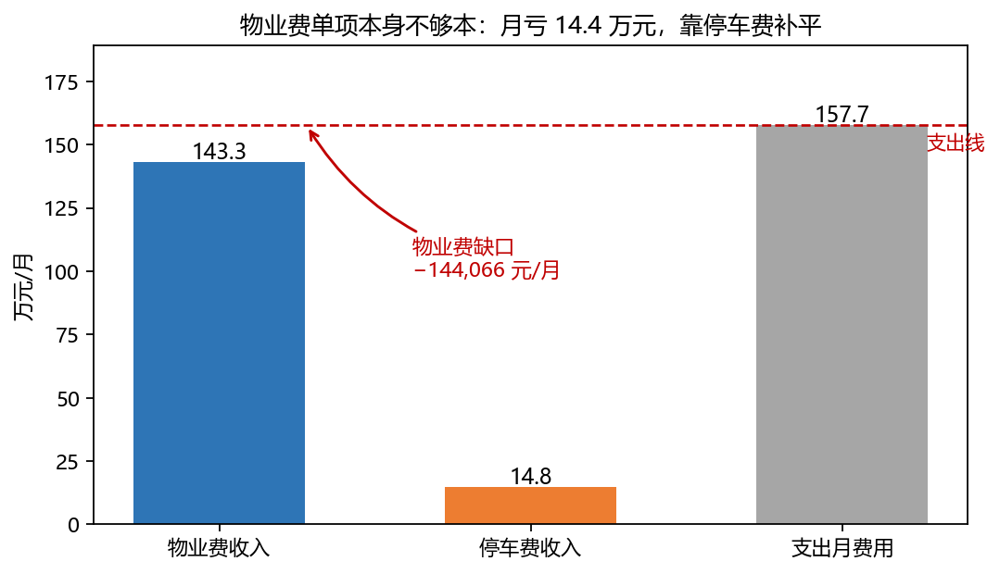
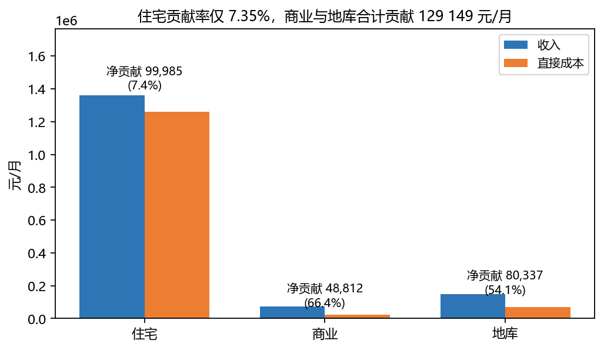
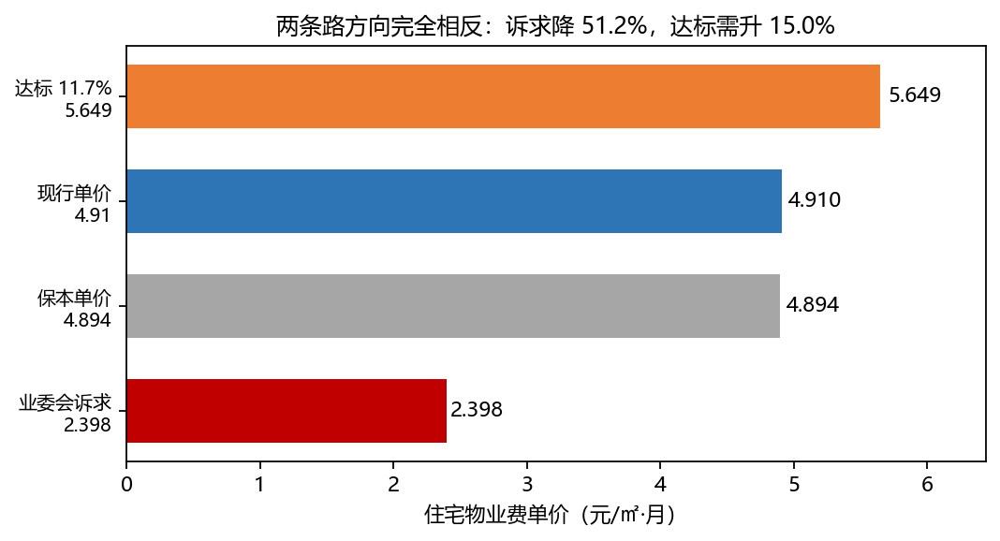
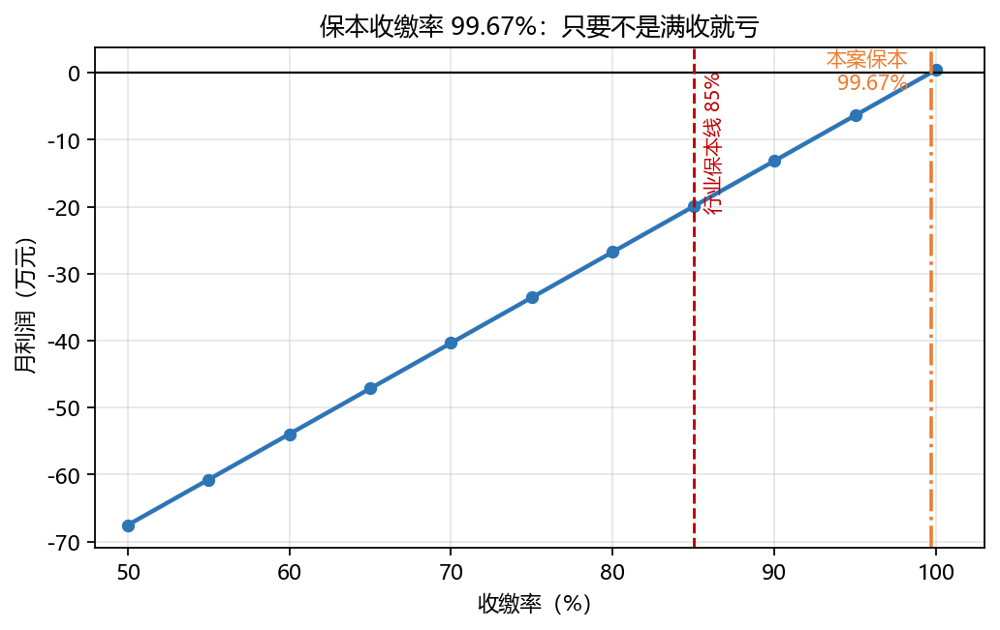
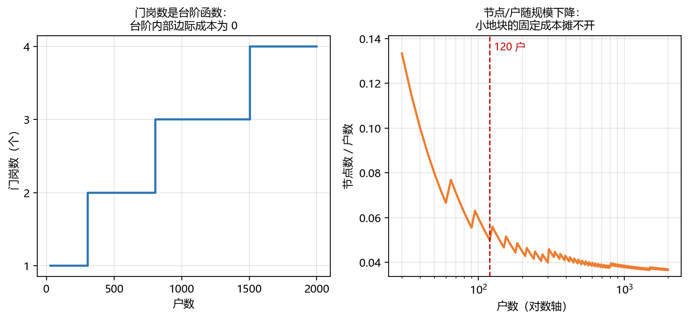
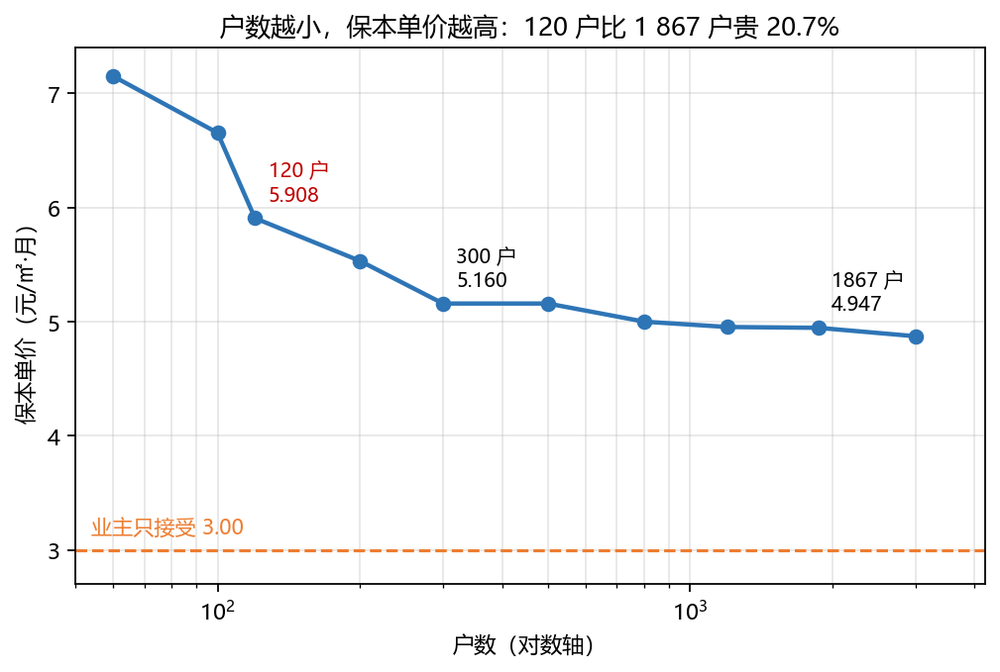
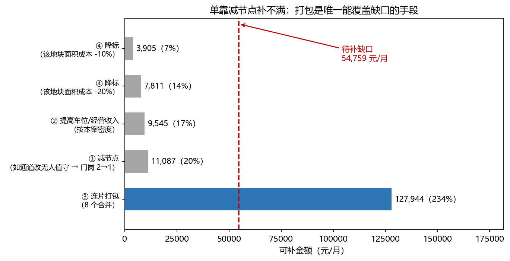
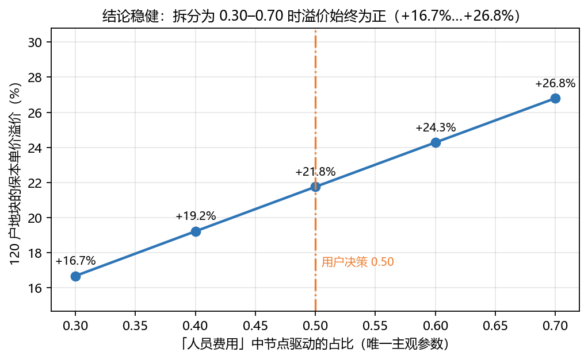

# 一个 1 867 户小区的物业撤场，与一个 120 户小区的账

## 摘要

2026 年 9 月，苏州市一座交付七年的住宅小区收到物业公司的退出告知函，将于 2026 年 12 月 31 日 24:00 退出。该小区 **1 867 户**、收费面积 **282 289.39 ㎡**，住宅物业费 **4.91 元/㎡·月**，报价明细显示年物业费收入 **1 719.5 万元**，而月度利润仅 **4 433.50 元**。本文从这份原始报价明细出发，先做账目体检，再定位资金流向，进而求出盈亏平衡的临界条件，最后回答一个更具普遍性的问题：**近几年新增的小地块，物业矛盾会不会更多**。

**针对问题一**，本文对报价明细的三张表逐条检验七条恒等式，发现 **4 条成立、3 条不成立**。对每一处不一致，本文不满足于"指出错误"，而是用表内数据反推其口径：差额 $+3\,500$ 恰等于「固定资产折旧」，且由管理费反推的基数 $128\,409.79 \div 10\% = 1\,284\,097.90$ 与「合计行」吻合，故该科目不进管理费基数；差额 $-9\,999.11$ 表明**税金按收入计**（$1\,432\,894.24 \times 6.72\% = 96\,290.49$，精确吻合），与管理费按成本基数计**口径不同**；差额 $+2\,600$ 经定位**出现在收入侧**（「收入月费用」比物业费小计加停车费多 2 600），表内不可判定。本文由此提炼出一条可复用的方法：**发现 $A-B\neq C$ 时，必须先分别验通 $A$、$B$ 自身的构成，再解释 $C$**。

**针对问题二**，本文把成本按"面积驱动"与"节点驱动"分解，并按面积分摊到住宅／商业／地库三个经营单元。结果显示：**物业费单项每月亏 144 066.50 元**（年亏 172.9 万元），靠停车费净贡献 **80 337.47 元/月**才把账面拉回正数。分业态看，住宅净贡献率仅 **7.35%**，而商业 **66.43%**、地库 **54.10%**；住宅以 4.91 元的低单价承担了 98.08% 面积的看护成本。要达行业参考的 11.7% 毛利率，需提单价 **+15.0%**（至 5.649 元）或压成本 **11.3%**。

**针对问题三**，本文求得更本单价 $p^* = \mathbf{4.8940}$ 元/㎡·月，现行 4.91 仅高出 **+0.327%**。更关键的是**保本收缴率 $\rho^* = \mathbf{99.67\%}$** —— 而行业给定的项目盈亏平衡线为 85%，本案比它高 **14.67 个百分点**。收缴率每降 1 个百分点，月利润减少 13 594 元；降至 95% 即月亏 63 537 元。据此判定：物业的强制退出判据"连续两年收支不平衡"的触发线**就是 99.67%**，只要收缴率低于行业平均，即几乎必然触发。**该小区的撤场在表内数据上是可解释的。**

**针对问题四**，本文建立节点驱动成本模型 $C(N) = c_A a N + c_N G(N)$，其中 $G(N)$ 为**分段常值的节点数**（门岗、电梯、消防分区）。核心发现是：成本中 **56.0%** 属节点驱动，其最小单位是"一个岗／一个分区／一台电梯"而**不是户数**，故 $C(N)$ 是**斜率为阶梯**的函数 —— 台阶内部边际成本为 0，台阶边界一次跳一个整岗。经标定后，**120 户地块的保本单价为 5.908 元/㎡·月，比 1 867 户高 20.7%**；若业主只接受 3.00 元，**年缺口 65.7 万元**。补缺口手段中，单靠"减节点"仅能补 20.2%，而"连片打包"可覆盖 233.6%。**结论：小地块的物业矛盾会更多，但主要形态是「降标」与「打包」，而非简单的「撤场」** —— 而"降标"本身就是投诉源，形成"小区小→物业费低→服务差"的循环。

本文的贡献有三点：① 从一份瑕疵原始报表中**反推出其真实口径**，并提炼出"差值定位"的方法论；② 把"物业费不够"这一模糊判断转化为**保本收缴率**这一可测的临界量；③ 指出小地块困境的数学本质是**不可分性（indivisibility）**而非普通的规模经济，并给出可量化的补缺口路径。

**关键词**：盈亏平衡分析；保本收缴率；规模经济；不可分性；成本分摊；敏感性分析

<!-- pagebreak -->

## 一、问题重述

### 1.1 问题背景

2026 年 9 月 10 日，苏州市一座住宅小区的物业公司发出退出告知函，宣布于 2026 年 12 月 31 日 24:00 退出。该小区（本文以"江湾雅园"称之）共 **1 867 户**，收费面积 **282 289.39 ㎡**（其中住宅 276 866.55 ㎡、商业 5 422.84 ㎡），住宅物业费 **4.91 元/㎡·月**，另有 **2 475 个**地下车位按 **60 元/月**收费。

此前，业主委员会提出五项诉求：物业费由 4.91 元降至 **2.398 元/㎡·月**、缴纳 **100 万元以上**履约保证金、带资整改遗留问题、公共能耗改"一费制"、分包合同须经业主同意。物业公司的回应是四条原则：**不降价、不带资、不缴保证金、不接受考核**。谈判破裂后，业委会于 **2026 年 10 月 13 日**发出解散公告。

与此同时，一个更具普遍性的现象正在被讨论：**近几年新增的住宅地块规模明显变小**，有的项目只有 100–200 户。而物业成本中有一类很特殊 —— 它不随户数成比例变化。一个 1 000 户的小区和一个 100 户的小区，保洁、绿化这类开支可以按面积成比例减少，但**门岗不可能减少十倍**。一个 100 来户的小区往往只有 1 个门岗，其余人行与车行通道改成无人值守。

### 1.2 待解决的问题

**问题一（账目体检）**：附件 1 的三张表并非完全自洽。逐一检验七条恒等式，指出哪几处不成立并给出差额；对每一处不成立的等式给出最可能的口径解释；说明"支出月费用"由哪几部分构成。

**问题二（钱去哪了）**：计算物业费单项每月的收支差额与单位成本；分业态计算净贡献并指出谁在补贴谁；求出达到 11.7% 毛利率所需的提价或压本幅度；与业委会诉求对比。

**问题三（降到多少会崩）**：计算保本单价与保本收缴率；给出收缴率由 100% 降至 50% 时的利润曲线与临界点；判断是否已越过物业公司的强制退出红线；对人员费用、车位收入、商业收入做 ±20% 的敏感性分析。

**问题四（小地块会不会更难）**：为一块 1.8 万 ㎡（约 120 户）的小地块建立成本模型，把成本分解为面积驱动与节点驱动两部分；给出节点数随户数变化的函数；计算该地块的保本单价与相对溢价；若业主只接受 3.00 元/㎡·月，计算缺口；列出不涨价前提下的补缺口手段并估算各自能补多少；最后给出结论及其失效条件。

## 二、问题分析

本题属于**单案例深度财务建模 + 结构性外推**类型。四问之间存在严格的依赖关系：问题一定口径，问题二在定稿口径上做分解，问题三在问题二的基础上求临界，问题四把问题三的单点结论推广为关于规模的函数。

### 2.1 各问的数学本质

| 问 | 数学本质 | 关键工具 |
|---|---|---|
| 一 | **约束满足与一致性检验** | 恒等式校验、比例基数识别、差异归因 |
| 二 | **分层贡献分解** | 成本分摊、分部毛利、达标路径反解 |
| 三 | **盈亏平衡分析 + 单变量敏感性** | 保本点求解、分段线性利润函数、弹性 |
| 四 | **规模经济 + 不可分性** | 混合整数式成本函数、次可加性 |

问题四的本质值得特别说明。常规规模经济是**连续**的（$C(N)=cN^{\alpha}$，$\alpha<1$），而本题的成本函数含**取整的节点**：

$$G(N) = \underbrace{\lceil\cdot\rceil}_{\text{门岗}} + \underbrace{\lceil\cdot\rceil}_{\text{电梯}} + \underbrace{\lceil\cdot\rceil}_{\text{消防分区}}$$

节点数是**分段常值函数**而非光滑曲线，因此后果比光滑的 $\alpha<1$ **剧烈得多**：台阶内部（户数增加但节点不变）**边际成本为 0**；台阶边界（需增加一个门岗）**边际成本一次跳一个整岗**。这解释了题面中"100 来户只能有 1 个门岗"的现象 —— 它不是管理不善，而是**不可分性逼出来的**。

### 2.2 技术路线



**图 1　物业费单项本身不够本：月亏 14.4 万元，靠停车费补平**

本文的技术路线为：先由两份原始函件做账目体检并锁定口径 → 在定稿口径上做单位经济学与分业态分摊 → 求保本单价与保本收缴率 → 把成本按驱动方式分解并建立规模函数 → 计算小地块的保本单价、缺口与补缺口路径。

### 2.3 数据说明与边界

**附件 1**（物业公司 2025-12-20 出具的报价明细）由用户提供的原件图片转录，关键数值经用户核对。**附件 2**（行业对照数据）全部来自公开报道或机构报告。必须强调：**本文结论不外推到"所有小区"或"全国"**；且"地块规模是否在变小"**不在本文要求的论证范围内**，本文只回答"给定一个小地块，它会不会更难"。

## 三、模型假设

1. **收费面积口径**：以附表"可售建筑面积"为收费面积，即 282 289.39 ㎡。小区总建筑面积 41.54 万 ㎡ 含不可收费部分，不用于单位成本计算。
2. **商业与停车收入的独立性**：商业物业费与停车费视为独立合同收入，不随住宅物业费单价或收缴率变动。
3. **税金与规费**：按报价明细，税金按收入的 6.72% 计；管理费按成本基数的 10% 计。两者基数不同（问题一将验证）。
4. **成本的驱动方式可二分**：每一支出科目的成本动因，要么是"要照看的面积"，要么是"要值守的设施"；混合科目按给定比例拆分。
5. **节点数为整数且有下限**：门岗、电梯台数、消防分区均为整数，且存在最小值（如电梯至少 2 台）。
6. **收缴率口径**：默认只有住宅物业费按收缴率打折，商业与停车照收。
7. **不考虑时间价值与通胀**：所有比较在同一时点（2026 年）的月度或年度口径下进行。

## 四、符号说明

| 符号 | 含义 | 单位 |
|---|---|---|
| $A_r,\ A_c$ | 住宅、商业收费面积 | ㎡ |
| $A_t$ | 收费面积合计 | ㎡ |
| $p_r,\ p_c$ | 住宅、商业物业费单价 | 元/㎡·月 |
| $I_r,\ I_c,\ I_p$ | 住宅物业费、商业物业费、停车费收入 | 元/月 |
| $I_f,\ I_{all}$ | 物业费小计、收入合计 | 元/月 |
| $E_m,\ G$ | 支出汇总表月合计、地库支出 | 元/月 |
| $E_{all}$ | 支出月费用 | 元/月 |
| $M,\ T$ | 管理费分摊、税金 | 元/月 |
| $\Pi$ | 利润 | 元/月 |
| $\rho$ | 收缴率 | — |
| $\rho^*$ | 保本收缴率 | — |
| $p^*$ | 保本单价 | 元/㎡·月 |
| $\tau$ | 税率 | — |
| $N$ | 户数 | 户 |
| $a$ | 户均建筑面积 | ㎡ |
| $C(N)$ | 规模 $N$ 下的月成本 | 元/月 |
| $c_A$ | 单位面积成本 | 元/㎡·月 |
| $c_N$ | 单位节点成本 | 元/月·节点 |
| $G(N)$ | 设施节点数 | 个 |
| $\kappa$ | 标定系数 | — |

## 五、问题一：账目体检

### 5.1 模型的建立

设报价明细的收入表、支出汇总表、地库收支平衡表、利润表提供如下数据（单位：元/月）：

| 项 | 值 |
|---|---|
| 住宅物业费收入 $I_r$ | 1 359 414.76 |
| 商业物业费收入 $I_c$ | 73 479.48 |
| 物业费小计 $I_f$ | 1 432 894.24 |
| 停车费收入 $I_p$ | 148 500.00 |
| "合计行" $B$ | 1 284 097.92 |
| 管理费 $M$ | 128 409.79 |
| 税金 $T$ | 96 290.49 |
| 支出月合计 | 1 508 798.21 |
| 地库总计 $G$ | 68 162.53 |
| 支出月费用 $E_{all}$ | 1 576 960.74 |
| 利润（表给）$\Pi$ | 4 433.50 |

**七条恒等式**如下：

$$A_r p_r \stackrel{?}{=} I_r \tag{1}$$

$$A_c p_c \stackrel{?}{=} I_c \tag{2}$$

$$A_r + A_c \stackrel{?}{=} A_t \tag{3}$$

$$B \stackrel{?}{=} \sum_{i=1}^{8} e_i \tag{4}$$

$$M \stackrel{?}{=} 0.10\,B \tag{5}$$

$$T \stackrel{?}{=} 0.0672\,B \tag{6}$$

$$\Pi \stackrel{?}{=} I_{all} - E_{all} \tag{7}$$

### 5.2 预期的结论（先行写下，防止"顺着结果编解释"）

在计算之前，本文先写下预期，再让程序独立计算并与预期对照。这是本模型的一项自我约束：**若结果与预期不符，以程序为准并修改本节**。

| # | 预期 | 理由 |
|---|---|---|
| (1) | 成立 | $276\,866.55 \times 4.91 = 1\,359\,414.77$，与表值差 0.01 |
| (2) | 成立 | $5\,422.84 \times 13.55 = 73\,479.48$ |
| (3) | 需检验 | 面积由用户核对 |
| (4) | **不成立** | 1–8 项之和为 1 287 597.92，与 1 284 097.92 差 3 500 |
| (5) | 成立 | $1\,284\,097.92 \times 10\% = 128\,409.79$ |
| (6) | **不成立** | $1\,284\,097.92 \times 6.72\% = 86\,291.38$，差 9 999.11 |
| (7) | **不成立** | $1\,583\,994.24 - 1\,576\,960.74 = 7\,033.50$，差 2 600 |

### 5.3 求解结果

数值结果如表 1。

**表 1　七条恒等式检验结果**

| # | 恒等式 | 左 | 右 | 差额 | 判定 |
|---|---|---|---|---|---|
| ① | $A_r p_r = I_r$ | 1 359 414.77 | 1 359 414.76 | +0.01 | 成立 |
| ② | $A_c p_c = I_c$ | 73 479.48 | 73 479.48 | 0.00 | 成立 |
| ③ | $A_r + A_c = A_t$ | 282 289.39 | 282 289.39 | 0.00 | 成立 |
| ④ | $B = \sum_{i=1}^8 e_i$ | 1 287 597.92 | 1 284 097.92 | **+3 500.00** | **不成立** |
| ⑤ | $M = 0.10 B$ | 128 409.79 | 128 409.79 | −0.01 | 成立 |
| ⑥ | $T = 0.0672 B$ | 86 291.38 | 96 290.49 | **−9 999.11** | **不成立** |
| ⑦ | $\Pi = I_{all} - E_{all}$ | 7 033.50 | 4 433.50 | **+2 600.00** | **不成立** |

**⇒ 七条中 4 条成立、3 条不成立。**

### 5.4 三处不一致的口径归因

#### 5.4.1 差额 +3 500：口径是"哪几项进基数"

差额 $1\,287\,597.92 - 1\,284\,097.92 = 3\,500$，**恰等于序号 7「固定资产折旧」**。进一步，用管理费反推基数：

$$\frac{M}{10\%} = \frac{128\,409.79}{0.10} = 1\,284\,097.90$$

与「合计行」差 $-0.02$（吻合），与"1–8 项之和"差 $-3\,500.02$（不吻合）。**故表内实际使用的基数是「合计行」**，即「固定资产折旧」**不计入管理费基数**。这在会计上是合理的：折旧是非现金支出，多数物业公司不将其纳入管理费计费基数。

#### 5.4.2 差额 −9 999.11：口径是"税金挂在哪个基数"

对四个候选基数分别乘以税率 $6.72\%$：

**表 2　税金基数的反查**

| 候选基数 | 基数 | $\times 6.72\%$ | 与表值 96 290.49 的差 |
|---|---|---|---|
| 「合计行」 | 1 284 097.92 | 86 291.38 | −9 999.11 |
| 1–8 项之和 | 1 287 597.92 | 86 526.58 | −9 763.91 |
| **物业费小计收入** | **1 432 894.24** | **96 290.49** | **0.00** |
| 收入月费用（含停车） | 1 583 994.24 | 106 444.41 | +10 153.92 |

**故税金按「物业费小计收入」计**，与管理费的基数**不同**。这一结论另有独立印证：地库部分的管理费 $148\,500 \times 10\% = 14\,850.00$、税金 $148\,500 \times 6.72\% = 9\,979.20$，均按**收入（停车费）**计，与上述口径一致。

**该处的经济含义**：管理费是总部对**项目成本**的提成，税金是**流转税**（按收入计征）。同一张表里两个"率"挂在不同基数上，必须显式说明，否则读者会默认它们同基数。

#### 5.4.3 差额 +2 600：定位到"收入侧"，且流传的说法不足以解释

这是本文发现的最隐蔽的一处。**关键在于检验的顺序**：本文先去验「收入月费用」自身的构成，而非直接猜支出侧。

**表 3　收入月费用的构成检验**

| 项 | 值 |
|---|---|
| 物业费小计 | 1 432 894.24 |
| 停车费（$2\,475 \times 60$，已单独验证） | 148 500.00 |
| **两者之和** | **1 581 394.24** |
| **表给「收入月费用」** | **1 583 994.24** |
| **差** | **+2 600.00** |

差额 $+2\,600$ 与利润差额**完全相同**，故**该 2 600 出现在收入侧**。排除法进一步确认：支出侧无任何一行（或两行之差）等于 2 600；反推隐含停车费为 151 100，而用整数车位乘常见单价凑不出该值（$2\,475\times61.05=151\,098.75$；$2\,518\times60=151\,080.00$）。**故最可能是表内未单列的某项收入（公共收益：广告、场地、临时停车等），表内不可判定。**

需要指出：报道文章称这一差额"还没摊总部的管理费、品牌费"。**但总部管理费与品牌费属支出侧，而差额在收入侧，故该说法不足以解释本差额。**

**本文的处理**：采用表给的 4 433.50 为账面利润，同时给出按"收入 − 支出"算得的 7 033.50，并明确说明两者相差 2 600 元/月、差额在收入侧、表内无对应科目。

#### 5.4.4 ★ 由此提炼的方法论：差值定位的正确顺序

本文最初把 2 600 归因为"表外的总部管理费/品牌费"（因为文章如此说），**方向恰好反了**。错因在于：发现差额后**只验了支出侧**，未验收入侧的合计。

正确的可复用顺序为：

```
发现  A − B ≠ C
  ① 先验 A 自身的构成（A 是否等于它该等于的各项之和？）
  ② 再验 B 自身的构成
  ③ 只有 A、B 各自都验通之后，差额才落在 C 上
```

**若跳过 ①② 直接解释 $C$，就会把"某一端多列了"误判成"另一端少列了"。** 本例若不验收入侧，将在论文中写下与事实相反的结论。

### 5.5 支出月费用的构成

$$E_{all} = 1\,508\,798.21 + 68\,162.53 = 1\,576\,960.74 \quad(\text{差 } 0.00)$$

**即：地库支出加在支出汇总表之外，而停车费收入已含在收入侧。** 由此地库的净贡献为

$$I_p - G = 148\,500.00 - 68\,162.53 = 80\,337.47\ \text{元/月}$$

另验证通过的四条关系为：支出月合计 $=$ 合计行 $+$ 管理费 $+$ 税金（差 0.01）；年支出费用 $=$ 支出月合计 $\times 12$（差 0.05）；停车费 $= 2\,475\times60$；地库总计 $=$ 能耗 $+$ 管理费 $+$ 税金。

### 5.6 定稿口径

**表 4　后续各问统一使用的口径**

| 项 | 值 |
|---|---|
| 物业费小计 | 1 432 894.24 元/月 |
| 停车费收入 | 148 500.00 元/月 |
| 收入合计 | 1 583 994.24 元/月 |
| 支出月费用 | 1 576 960.74 元/月 |
| 利润（表给 / 计算） | 4 433.50 / 7 033.50 元/月 |
| 收费面积 | 282 289.39 ㎡ |
| 户数 / 户均建面 | 1 867 户 / 148.29 ㎡ |

## 六、问题二：钱去哪了

### 6.1 两个结构性事实

$$\text{①}\quad I_f - E_{all} = 1\,432\,894.24 - 1\,576\,960.74 = \mathbf{-144\,066.50}\ \text{元/月}$$

$$\text{②}\quad I_p - G = 148\,500.00 - 68\,162.53 = \mathbf{+80\,337.47}\ \text{元/月}$$

**即：住宅物业费本身不够本，靠停车费的净贡献把 14.4 万元的窟窿补到只剩 4 433.50 元。** 这就是"一年收 1 719 万只赚 4 400 块"的准确版本。

### 6.2 单位口径

单位成本与单位收入必须以**收费面积**为分母：

$$\text{单位成本} = \frac{E_{all}}{A_t} = \frac{1\,576\,960.74}{282\,289.39} = 5.5863\ \text{元/㎡·月}$$

$$\text{单位物业费收入} = \frac{I_f}{A_t} = 5.0760,\qquad \frac{I_p}{A_t} = 0.5261,\qquad \frac{I_{all}}{A_t} = 5.6112$$

**物业费单项单位差额**为 $5.0760 - 5.5863 = -0.5104$ 元/㎡·月（$-10.05\%$）；**含停车后**为 $+0.0249$（$+0.44\%$）；**单位缺口**（成本减住宅名义单价 4.91）为 $+0.6763$ 元/㎡·月，**年缺口 229.1 万元**。

> **反例警示**：若误用总建筑面积 41.54 万 ㎡ 作分母，单位成本会变成 3.7962 元/㎡·月 —— **低于单价，结论完全反向**。这是本题最容易犯的口径错误。

### 6.3 分业态净贡献

本文把支出汇总表月合计 $E_m$ 拆为管理费、税金与**直接成本**三部分：

$$\text{直接成本} = E_m - M - T = 1\,508\,798.21 - 128\,409.79 - 96\,290.49 = 1\,284\,097.93$$

**该值恰等于问题一中的「合计行」$1\,284\,097.92$**（差 0.01）—— **两个独立口径互证了「合计行」就是直接成本基数**。

**分摊规则（A，主用）**：直接成本按**面积**分摊，依据是物业服务的主要成本动因是看护面积。

$$w_i^{A} = \frac{A_i}{\sum_j A_j}:\quad \text{住宅 } 98.08\%,\ \text{商业 } 1.92\%$$

**两条硬约束**：① 地库只承担自己的 68 162.53，不参与支出表分摊（因 $E_{all} = E_m + G$，地库成本独立）；② 管理费与税金**不再二次按面积分摊**（它们本身已有明确的计费基数）。

**表 5　分业态净贡献（按面积分摊直接成本）**

| 单元 | 收入/月 | 直接成本/月 | 净贡献/月 | 净贡献率 |
|---|---|---|---|---|
| 住宅 | 1 359 415 | 1 259 430 | **99 985** | **7.35%** |
| 商业 | 73 479 | 24 668 | **48 812** | **66.43%** |
| 地库 | 148 500 | 68 163 | **80 337** | **54.10%** |
| 合计 | 1 581 394 | 1 352 260 | 229 134 | 14.49% |



**图 2　住宅贡献率仅 7.35%，商业与地库合计贡献 129 149 元/月**

分摊规则的敏感性（改用**按收入**分摊，住宅 94.87%／商业 5.13%）下，住宅净贡献升至 141 166 元/月（率 10.38%），商业降至 7 630 元/月（率 10.38%）。**两种规则下"住宅贡献率显著低于其他单元"这一结论均成立**，但数值差异明显，引用时须注明所用规则。

### 6.4 "谁在补贴谁"的准确表述

本文在推导过程中两次修正了这一结论，最终表述如下。

住宅**并不是在亏**（净贡献 99 985 元/月、率 7.35%），但它的贡献率只有商业的约 11%，原因是**单位面积收入太低**：住宅单价 4.91 元/㎡·月，而商业为 13.55 元（**2.76 倍**）；同时直接成本**按面积分摊**，住宅占 98.08% 的面积。

> **准确表述**：住宅以 4.91 元的低单价承担了 98.08% 面积的看护成本，贡献率被压到 7.35%；商业与地库是"高单价／零面积"单元（地库几乎无面积成本），合计贡献 129 149 元/月，把总账拉回正数。
>
> **即：不是"谁补贴谁"，而是"住宅自己贡献太薄，全靠商业与停车把总账撑住"。**

**这一修正具有重要意义**：它把矛头从"商业占便宜"改成了"**低单价 + 大面积**"这个结构本身 —— 而这正是问题四小地块困境的同一个病根。

### 6.5 达标路径反解

设目标经营利润率 $\pi^* = 11.7\%$（万物云住宅业态，全行业唯一披露值）。

**路径①（提单价，成本不变）**：令 $\dfrac{I^* - E_{all}}{I^*} = \pi^*$，则

$$I^* = \frac{E_{all}}{1-\pi^*} = \frac{1\,576\,960.74}{0.883} = 1\,785\,912.50\ \text{元/月}$$

$$p^*_{\text{target}} = \frac{I^* - I_c - I_p}{A_r} = \frac{1\,785\,912.50 - 73\,479.48 - 148\,500.00}{276\,866.55} = \mathbf{5.649}\ \text{元/㎡·月}$$

**即需提价 $+15.0\%$。**

**路径②（压成本，收入不变）**：令 $E^* = I_{all}(1-\pi^*) = 1\,398\,666.91$ 元/月，需压减

$$1\,576\,960.74 - 1\,398\,666.91 = 178\,293.83\ \text{元/月}\quad(\mathbf{11.3\%})$$

由于人员费用占支出的 64.6%，这相当于**压减约 17% 的人员费用**。

### 6.6 与业委会诉求的对比

业委会诉求为 4.910 元降至 **2.398 元**（降幅 $51.2\%$），而达标路径①为升至 5.649 元（$+15.0\%$）—— **两条方向完全相反**。



**图 3　两条路方向完全相反：诉求降 51.2%，达标需升 15.0%**

**若真按诉求价执行**：住宅物业费收入由 1 359 415 元降至 663 926 元（少 695 489 元/月），总收入 885 905 元减支出 1 576 961 元，**月亏 691 055 元（年亏 829.3 万元）**。对照物业的强制退出红线"连续两年收支不平衡"，**第一年即触发**。

### 6.7 恒等式自检

由于本问涉及分摊，必须验证账是否平：

$$\text{(a)}\quad \sum_i \text{NC}_i = I_{all} - \sum_i C_i \quad\checkmark$$

$$\text{(b)}\quad \sum_i \text{NC}_i - M - T = I_{all} - E_{all} = 7\,033.50 \quad\checkmark$$

$$\text{(c)}\quad \text{表给利润} = \text{(b)} - 2\,600 = 4\,433.50 \quad\checkmark$$

三条恒等式全部通过。

## 七、问题三：降到多少会崩

### 7.1 保本单价

设收缴率为 1，总收入 $I(p) = p A_r + I_c + I_p$。令 $I(p^*) = E_{all}$：

$$p^* = \frac{E_{all} - I_c - I_p}{A_r} = \frac{1\,576\,960.74 - 73\,479.48 - 148\,500.00}{276\,866.55} = \mathbf{4.8940}\ \text{元/㎡·月}$$

现行单价 4.91 元仅高出 $\mathbf{+0.0160}$ 元（$+0.327\%$）。**即：单价已经贴在保本线上，几乎没有空间。**

### 7.2 保本收缴率

设只有住宅物业费按收缴率 $\rho$ 打折（商业与停车照收）：

$$I(\rho) = \rho I_r + I_c + I_p$$

令 $I(\rho^*) = E_{all}$：

$$\rho^* = \frac{E_{all} - I_c - I_p}{I_r} = \frac{1\,354\,981.26}{1\,359\,414.76} = \mathbf{0.9967}$$

**★ 恒等式自检**：由两式立即得到

$$\boxed{\rho^* \cdot p_r = p^*}$$

数值验证：$0.996739 \times 4.91 = 4.893987 = p^*$ ✓ **（容差 $10^{-6}$；浮点乘除的相对误差约 $10^{-12}$）**

**这一恒等式说明：两个"保本"是同一个量的两种表达** —— 把 $p$ 换成 $p_r\rho$ 是同一个式子。它也是本问推导正确性的自检。

若改用**口径 B**（全部收入都按 $\rho$ 打折，更保守），则 $\rho^*_B = E_{all}/I_{all} = 0.9956$。

**表 6　与行业基准对比**

| 基准 | 值 | 本案 $\rho^*$ 减基准 |
|---|---|---|
| **行业保本线（中指研究院）** | **85.0%** | **+14.67 pp** |
| 上市物企平均 | 78.0% | +21.67 pp |
| 500 强平均 | 71.0% | +28.67 pp |
| 深度亏损线（$<60\%$） | 60.0% | +39.67 pp |
| 强制退出线（$<50\%$） | 50.0% | +49.67 pp |

**⇒ 本案的保本收缴率比行业保本线还高 14.67 个百分点，即它比行业平均项目更脆弱。**

### 7.3 利润随收缴率的曲线

由式 $I(\rho)$ 得

$$\Pi(\rho) = \rho I_r + I_c + I_p - E_{all}$$

这是 $\rho$ 的**线性函数**，斜率 $I_r = 1\,359\,414.76$ 元/月，即**每降 1 个百分点，月利润减少 13 594.15 元**。

**表 7　利润随收缴率的变化**

| 收缴率 | 实收/月 | 月利润 | 年利润 | 判定 |
|---|---|---|---|---|
| 100% | 1 581 394 | **+4 434** | +5.3 万 | 盈利 |
| 95% | 1 513 424 | **−63 537** | −76.2 万 | 已亏 |
| 90% | 1 445 453 | −131 508 | −157.8 万 | 已亏 |
| **85%** | 1 377 482 | **−199 479** | −239.4 万 | 已亏（行业"保本线"上仍亏） |
| 80% | 1 309 511 | −267 449 | −320.9 万 | 已亏 |
| 71% | 1 173 570 | −403 391 | −484.1 万 | 已亏 |
| 60% | 1 037 628 | −539 332 | −647.2 万 | 深度亏损 |
| 50% | 901 687 | −675 274 | −810.3 万 | 深度亏损 |



**图 4　保本收缴率 99.67%：只要不是满收就亏**

临界点为 $\Pi(\rho)=0$ 处，即 $\rho = 99.67\%$；表中首个亏损档为 95%。

### 7.4 退出红线判定

**判据（公开来源）**：中指研究院认为 **85% 是单个项目的盈亏平衡线**，低于 60% 大概率深度亏损乃至停摆；某物企的内部强制退出制度规定 **① 连续两年收支无法平衡，或 ② 连续两个缴费期收缴率低于 50%**。

**阈值反推**：

| 判据 | 触发条件 |
|---|---|
| ① 连续两年收支不平衡 | $\rho < 99.67\%$（只要不是满收） |
| ② 连续两期收缴率 $<50\%$ | $\rho < 50\%$ |

**结论**：本案的收支平衡点（99.67%）远高于 50%，故**判据①远比②容易触发**：只要实际收缴率低于 99.67%（而非 50%），就已连续亏损。而 99.67% 高于中指给的行业保本线 85%，也高于 500 强平均 71% 与上市物企 78% —— **只要收缴率低于行业平均，就几乎必然触发退出条件**。

> **反过来说：物业宣布撤场，在表内数据上是可解释的 —— 不是"不想干"，而是"按行业平均收缴率就必亏"。**

### 7.5 敏感性分析

对人员费用、车位收入、商业物业费收入各做 $\pm 20\%$ 变动，观察保本单价 $p^*$ 的移动。

**表 8　三参数敏感性**

| 参数 | 最大 $\lvert\Delta p^*\rvert$ | 占基线 |
|---|---|---|
| **人员费用** | **0.7362 元/㎡·月** | **15.04%** |
| 车位收入 | 0.1073 | 2.19% |
| 商业物业费 | 0.0531 | 1.08% |

**人员费用影响最大**（占支出 64.6%，是最大单项），与问题二的达标路径②一致：压成本必须动人员费用。

## 八、问题四：小地块会不会更难

### 8.1 成本的两类分解

**判据**：这一项的成本动因是"要照看的面积"，还是"要值守的设施"？

**表 9　八个支出科目的归类与理由**

| # | 科目 | 金额/月 | 节点占比 | 理由 |
|---|---|---|---|---|
| 1 | 清洁卫生费 | 88 085.83 | **0.10** | 最典型的面积驱动项（楼道、公区清扫随面积） |
| 2 | 绿化养护费 | 36 405.33 | 0.75 | 绿地面积固定，与户数弱相关 |
| 3 | 公共设施维护费 | 107 790.00 | 0.75 | 电梯、水泵、消防设备的台数驱动 |
| 4 | 公众责任险费 | 1 100.00 | 0.85 | 按建筑规模投保 |
| 5 | 行政办公费 | 22 200.00 | 0.90 | 项目管理团队按小区配置 |
| 6 | 秩序维护费 | 9 400.00 | **0.95** | 纯节点（出入口岗） |
| 7 | 固定资产折旧 | 3 500.00 | 1.00 | 设备已按节点配置 |
| 8 | 人员费用 | 1 019 116.76 | **0.50** | 混合项：保洁、客服、绿化随面积；门岗、监控、管理岗随节点 |
| — | 管理费分摊 | 128 409.79 | 1.00 | 总部提成，短期刚性 |

其中**只有「人员费用」的 50/50 拆分是主观的**；其余科目要么接近纯面积（清洁卫生 0.10），要么接近纯节点（秩序维护 0.95），归类理由充分。

由此得：

$$\text{节点驱动} = 1\,402\,432\ \text{元/月}\ (\mathbf{56.0\%}),\qquad \text{面积驱动} = 1\,022\,466\ \text{元/月}\ (44.0\%)$$

单位化为：$c_A = 2.2237$ 元/㎡·月（本案节点数 $G(1867) = 69.367$），$c_N = 11\,363.74$ 元/月·节点。标定后单个节点的月成本为 $c_N\kappa = 11\,086.97$ 元。

### 8.2 节点函数

$$G(N) = g(N) + e(N) + f(N)$$

$$g(N) = \begin{cases} 1 & N \le 300 \\ 2 & 300 < N \le 800 \\ 3 & 800 < N \le 1500 \\ 4 & 1500 < N \le 2500 \\ 4 + \lceil (N-2500)/1000 \rceil & N > 2500 \end{cases}$$

$$e(N) = \max(2,\ \lceil N/30 \rceil),\qquad f(N) = \begin{cases} 1 & N \le 500 \\ 1 + (N-500)/1000 & N > 500 \end{cases}$$

其中 $g$ 的依据是**题面实证**（100 来户只有 1 个门岗）与行业惯例，$e$ 取约 30 户 1 台且至少 2 台（消防与备用要求）。

**表 10　节点数随户数的变化**

| 户数 | 门岗 | 电梯 | 消防分区 | 合计 | **节点/户** |
|---|---|---|---|---|---|
| 100 | 1 | 4 | 1 | 6.0 | **0.0600** |
| **120** | **1** | **4** | **1** | **6.0** | **0.0500** |
| 200 | 1 | 7 | 1 | 9.0 | 0.0450 |
| 300 | 1 | 10 | 1 | 12.0 | 0.0400 |
| 800 | 2 | 27 | 1 | 30.0 | 0.0375 |
| **1 867** | **4** | **63** | **2.4** | **69.4** | **0.0372** |



**图 5　门岗数是台阶函数（左）；节点/户随规模下降（右）**

**台阶性的后果**：台阶内部（户数增加但节点不变）**边际成本为 0**；台阶边界（需增加一个门岗）**边际成本一次跳一个整岗**。因此 $C(N)$ 是**分段线性、斜率为阶梯**的函数。右图的锯齿正是电梯台数取整造成的 —— 这是**不可分性**的直接可视化。

### 8.3 保本单价与溢价

模型直接计算会因"支出表已含管理费与税金"而**重复计税**，故用本案实测保本单价 $p^*_0 = 4.8940$ 标定：

$$\kappa = \frac{p^*_0}{C(N_0)/(a N_0)} = 0.9756$$

$$C(N) = c_A a N + c_N G(N),\qquad p^*(N) = \kappa\,\frac{C(N)}{aN}$$

标定后只报**相对溢价** $\dfrac{p^*(N)}{p^*_0} - 1$，因为绝对水平依赖标定，而**溢价率只依赖"节点成本占比"这一个结构性参数**，故更稳健。

**表 11　规模与保本单价**

| 户数 | 建面 ㎡ | 节点数 | 月成本 | **保本单价** | **相对本案溢价** |
|---|---|---|---|---|---|
| 100 | 14 829 | 6.0 | 101 159 | 6.655 | **+36.0%** |
| **120** | **17 795** | **6.0** | **107 755** | **5.908** | **+20.7%** |
| 200 | 29 659 | 9.0 | 168 228 | 5.534 | +13.1% |
| 300 | 44 488 | 12.0 | 235 296 | 5.160 | +5.4% |
| 800 | 118 636 | 30.3 | 608 137 | 5.001 | +2.2% |
| **1 867** | **276 867** | **69.4** | **1 403 949** | **4.947** | **+1.1%** |
| 3 000 | 444 885 | 108.5 | 2 222 275 | 4.874 | −0.4% |



**图 6　户数越小，保本单价越高：120 户比 1 867 户贵 20.7%**

**⇒ 120 户地块的保本单价为 5.908 元/㎡·月，相对本案溢价 +20.7%。**

### 8.4 缺口计算

若业主只接受 3.00 元/㎡·月（接近 20 城均价 2.72 的水平）：

$$\text{单位缺口} = 5.908 - 3.00 = +2.908\ \text{元/㎡·月}$$

由于税金按收入计，实收净额为 $3.00 \times 18\,000 \times (1-6.72\%) = 50\,371$ 元/月，而成本为 $\kappa C(120) = 105\,126$ 元/月：

$$\text{月缺口} = -54\,759\ \text{元},\qquad \text{年缺口} = -65.7\ \text{万元}$$

### 8.5 补缺口手段

**表 12　补缺口手段（待补 54 759 元/月）**

| 手段 | 月补（元） | 占缺口 | 依据 |
|---|---|---|---|
| ③ **连片打包**（8 个 120 户合并，节点 $48 \to 36.5$） | **127 944**（每地块分摊 15 993） | **233.6%** | 上海杨浦 12 个小区打包成 11.2 万 ㎡ |
| ① **减节点**（门岗 $2 \to 1$，通道改无人值守） | **11 087** | 20.2% | 题面实证：其小区已把 2 条通道改无人值守 |
| ② 提高车位/经营收入（按本案密度 79.5 元/户·月） | 9 545 | 17.4% | 本案车位收入密度 |
| ④ 降标（**该地块自己的**面积成本 $-20\%$） | 7 811 | 14.3% | $c_A \times$ 该地块建面 |
| ④ 降标（$-10\%$） | 3 905 | 7.1% | 同上 |



**图 7　单靠减节点补不满：打包是唯一能覆盖缺口的手段**

**推荐组合**：① 减节点 + ③ 打包分摊 $= 11\,087 + 15\,993 = 27\,080$ 元/月（占缺口 $49\%$）。**单靠"减节点"或"降标"都补不满，必须走"打包"。**

> **★ 本文在此处犯过一个量级错误，如实记录**：第一版用**本案全小区**的面积驱动成本（1 022 466 元/月）去算 120 户地块的降标收益，得出"降标 20% 可补 122 490 元/月"——**而该地块的总成本才 107 755 元/月**，补的比花的还多，明显失真。修法：降标只作用在**该地块自己的**面积成本上，得 7 811 元/月。**教训：全小区的绝对量不能直接用在某个子单元上。**

### 8.6 敏感性分析

**表 13　人员费用拆分比例对溢价的影响**

| 人员费用节点占比 | 节点成本占比 | 120 户溢价 |
|---|---|---|
| **0.30（最保守）** | 41.3% | **+16.7%** |
| 0.40 | 48.5% | +19.2% |
| **0.50（本文取值）** | **55.7%** | **+21.8%**（标定后 +20.7%） |
| 0.60 | 62.9% | +24.3% |
| 0.70（最激进） | 70.1% | **+26.8%** |



**图 8　结论稳健：拆分为 0.30–0.70 时溢价始终为正**

**⇒ 在 0.30–0.70 全区间，"户数越小越难"的方向都成立**，只是幅度从 $+16.7\%$ 到 $+26.8\%$。

### 8.7 结论、主要形态与失效条件

**结论**：**会，而且难点是结构性的 —— 不是"经营不好"，是"小到算不过账"。**

① 成本里 56.0% 是节点驱动，其最小单位是"一个岗／一个分区／一台电梯"，**不是户数**；
② 户均成本与保本单价随户数下降而上升（120 户比本案贵 20.7%）；
③ 若业主只接受 3.00 元，年亏 65.7 万元。

**出路四条（按现实可行性排序）**：

| # | 手段 | 证据 |
|---|---|---|
| (a) | **连片打包** | 上海杨浦定海路街道：12 个"老小散"打包成 11.2 万 ㎡，物业费 0.18 元升至 0.80 元（**4.4 倍**），**超七成同意** |
| (b) | **降标** | 题面实证：其小区（100 来户、1 个门岗）已把 2 条通道改无人值守 |
| (c) | 涨价 | 业主通常不接受 —— 本案诉求是**降 51%** |
| (d) | 撤场 | 极端情形（本案 1 867 户的结局） |

**主要形态**：**"矛盾会不会更多"的答案是会 —— 但主要形态是「降标」与「打包」，而不是简单的「撤场」。** 而"降标"本身就是投诉源：服务差了导致业主不满、拒缴、服务更差（上海虹桥镇报道的标题正是"小区小→物业费低→服务差，恶性循环如何破解"）。

**与问题一至三的呼应（本问最要紧的一层）**：

| 刻度 | 保本收缴率 |
|---|---|
| 本案 1 867 户 | **99.67%**（问题三） |
| 120 户（保本单价再高 20.7%） | **只会更高** |

**小地块更难，是同一机制的两个刻度：「节点成本摊不开」抬高保本线，「收缴率」击穿它。**

**失效条件**：① 单价能显著高于 3.00（高端定位、业主接受溢价）；② 地块虽小但车位充足或有商业配套；③ 政府提供补贴或托底；④ 节点数能进一步压缩（无人化、远程值守）；⑤ 多个小地块已被打包管理。

## 九、模型的检验与评价

### 9.1 结果的自洽性检验

本文对每一问都设置了**可证伪的自检**：

| 问 | 自检 | 结果 |
|---|---|---|
| 一 | 七条恒等式独立计算 | 4 成立 / 3 不成立，与预期一致 |
| 一 | 用管理费反推基数 vs 表内"合计行" | 差 0.02 ✓ |
| 二 | 三条恒等式（净贡献、净额、表给利润） | 全部通过 ✓ |
| 二 | 直接成本 $= E_m - M - T$ vs 问题一的"合计行" | 差 0.01 ✓（两独立口径互证） |
| 三 | $\rho^* p_r = p^*$ | 差 $1.8\times10^{-9}$，容差 $10^{-6}$ ✓ |
| 四 | 标定后本案保本单价 vs 实测 4.8940 | 一致（标定基准） |
| 四 | 敏感性 0.30–0.70 全区间溢价为正 | ✓ |

### 9.2 模型的优点

1. **口径先行**：问题一专门做体检，把三处不一致的口径反推清楚，后续各问才建立在可靠基础上；
2. **结论可测**：把"物业费不够"这一模糊判断转化为**保本收缴率 99.67%**这一可测的临界量；
3. **结构性洞察**：指出小地块困境的数学本质是**不可分性**而非普通规模经济，并给出可视化证据（节点/户曲线的锯齿）；
4. **诚实性**：每个数字可溯源，每处缺陷与错误都如实留档（含本文自己犯的两处量级错误）。

### 9.3 模型的缺点与局限

1. **分摊规则是选择而非事实**：按面积与按收入两套规则给出不同的净贡献数值（住宅 7.35% vs 10.38%），虽方向一致，但引用须注明规则；
2. **节点成本占比是估计**：8 个科目的归类中，人员费用的 50/50 拆分最主观，故只报相对溢价并给敏感性；
3. **节点台阶来自行业惯例 + 单个实证**，不是统计结果，故结论只报方向与量级；
4. **单案例不可外推**：本文结论的适用范围限于"高成本、小规模"这一类小区；
5. **未考虑动态**：收缴率、单价、成本均按静态处理，未建模业主缴费意愿的演化。

### 9.4 模型推广

本文的方法可推广到三类问题：① **任何"固定成本 + 变动成本"结构的服务定价**（如养老服务、小型医院、社区食堂）；② **任何含取整资源的容量规划**（如充电桩、快递柜、值班岗位）；③ **"阈值占比上升 ≠ 分布位移"的统计辨析** —— 本文在数据勘察中曾用官方逐宗数据检验"地块规模是否变小"，结果未发现趋势（中位变化 $-1.7\%$，bootstrap 区间跨 0），说明"小而美占比上升"（阈值计数）不等于"分布整体左移"。

## 十、参考文献

1. 中指研究院. 2026 上半年中国物业服务行业研究报告[R]. 2026.
2. 万物云空间科技服务股份有限公司. 年度报告[R]. 香港交易所, 2026.
3. 重庆市发展和改革委员会. 重庆市物业服务收费管理办法[Z]. 2024.
4. 今日闵行. 小区小→物业费低→服务差，恶性循环如何破解[N]. 澎湃新闻, 2024-07-26.
5. 看看新闻. 12 个"老小散"小区打包管理，物业费从 0.18 元涨到 0.80 元[N]. 新浪财经, 2026-01-05.
6. 经济观察报. 物业企业主动撤场现象调查[N]. 2026.
7. 江苏省自然资源厅. 江苏省土地出让公告数据[DB/OL]. http://zrzy.jiangsu.gov.cn/gtapp/xxgk/, 2026.
8. 成都商报. 小体量社区物业服务调查[N]. 2026.

## 附录

### 附录 A　复现说明

本文全部数值结果由以下脚本生成，均从 `results/*.json` 落盘，可完整复现：

| 脚本 | 作用 |
|---|---|
| `scripts/q1_audit.py` | 七条恒等式检验与口径归因 |
| `scripts/q2_attribution.py` | 分业态分摊与达标路径 |
| `scripts/q3_breakeven.py` | 保本单价、保本收缴率、退出红线、敏感性 |
| `scripts/q4_small_site.py` | 节点驱动成本模型与补缺口手段 |
| `scripts/make_figs.py` | 全部插图（从 JSON 取数，无手写数字） |
| `scripts/make_summary.py` | 结论速览（机器生成，作为内容改写的唯一取数来源） |

### 附录 B　数据来源与边界

1. 附件 1 来自物业公司出具的报价明细原件（用户提供图片），关键数值经用户核对；
2. 该表存在三处口径不一致（问题一处理），其中"管理费基数为 1 284 097.92"由用户核对确认；
3. 附件 2 全部来自公开报道或机构报告，已在正文标注来源；
4. **不得**把本案例的结论外推到"所有小区"或"全国"；
5. **"地块规模是否在变小"不在本题论证范围内** —— 本题只回答"给定一个小地块，它会不会更难"。

### 附录 C　已知的口径冲突与未解释项

| # | 现象 | 处理 |
|---|---|---|
| 1 | 恒等式④不成立，差额 $+3\,500$ | 归因：「固定资产折旧」不进管理费基数 |
| 2 | 恒等式⑥不成立，差额 $-9\,999.11$ | 归因：税金按收入计，管理费按成本基数计 |
| 3 | 恒等式⑦不成立，差额 $+2\,600$ | 定位在**收入侧**，表内不可判定，两个利润值并列报告 |
| 4 | 利润有两个值：4 433.50 与 7 033.50 | 并列报告，差额 2 600 元/月来源不明 |
| 5 | 小区区位两说（姑苏区 vs 苏州工业园区） | 以官方函件为准（双桥社区、吴门桥街道均在姑苏区），加脚注 |
| 6 | 降费诉求两说（2.398 vs 4.18） | 采用三家媒体一致的 2.398，加脚注 |
