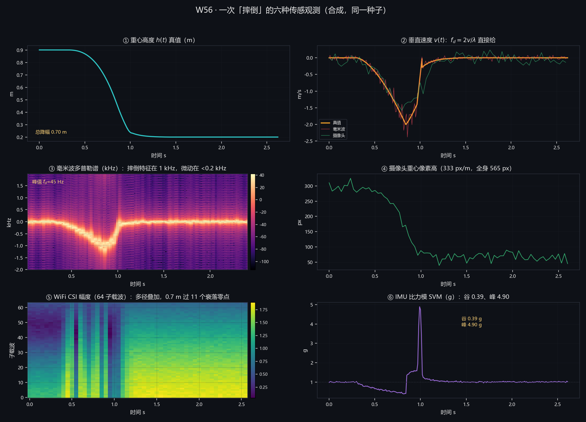
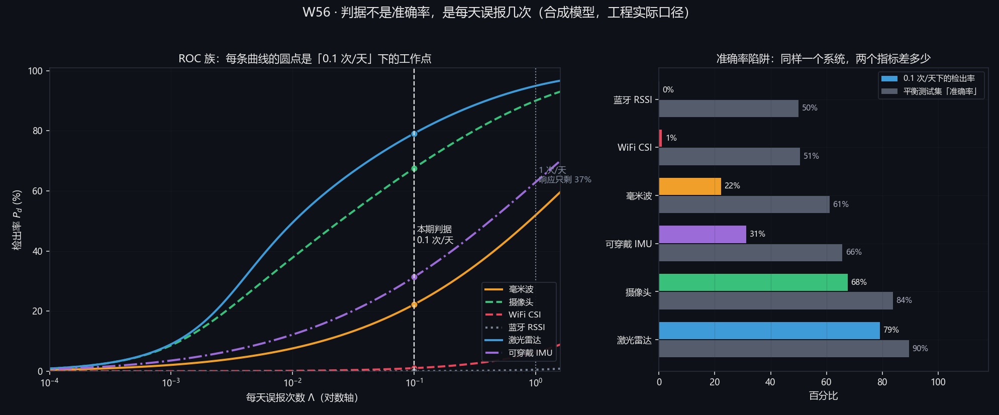
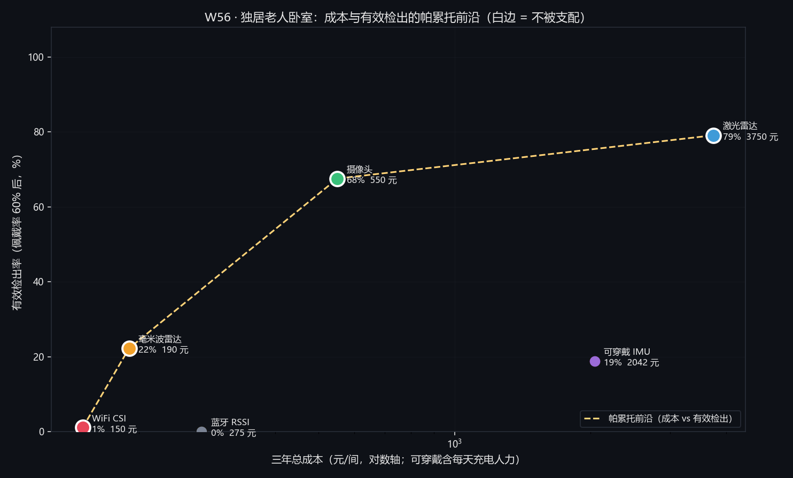
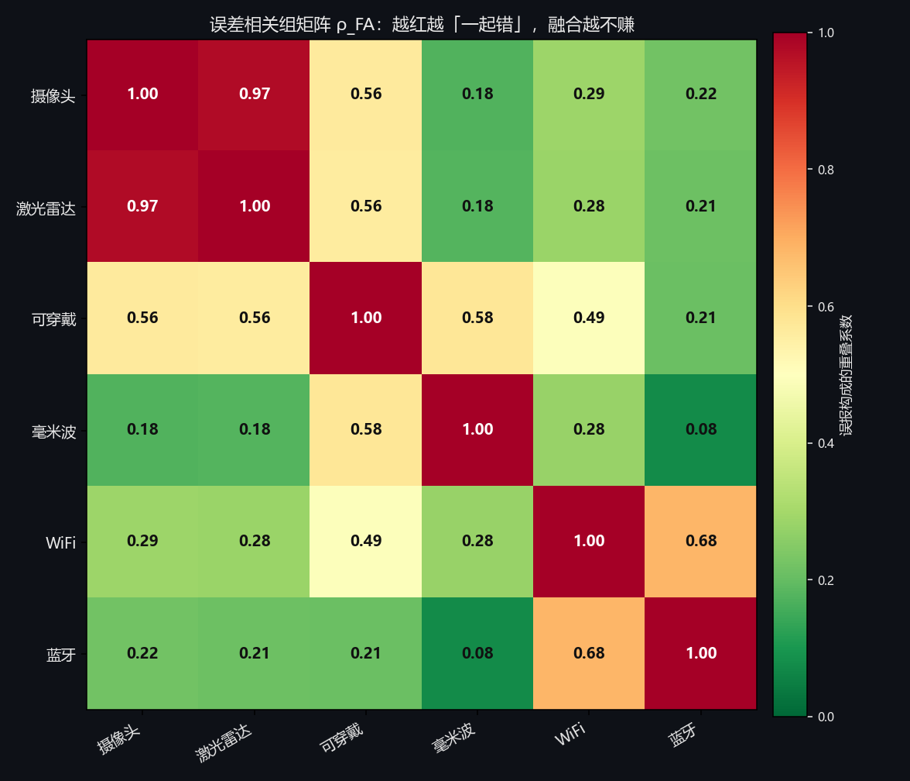
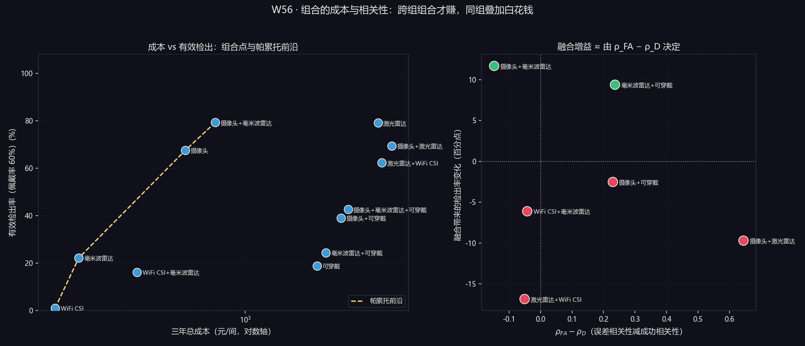

# 一个每天误报 1 次的报警器 = 没有报警器

副题：六种传感方案在「每天误报 0.1 次」约束下的检出率，以及组合的相关性收益。本文性质为**机理性论证加合成信号模型**，不是任何一款产品的实测标定。

> **三个口径，请先读**
>
> 1. **主表给"工程实际"值**（在六类已知负样本之外，再加每天 60 次未建模活动）：79.1% / 67.6% / 31.3% / 22.2% / 1.1% / 0.0%。只统计六类已知负样本的 100% / 100% / 97.6% / 94.0% / 6.9% / 0.1% **降为脚注**：那只说明模型只考了六道题，不是能力。
> 2. **三类量逐处分档标注**：①公开报道、②由物理常数或本文模型反解、③本文自定假设。未标注者为同段已标注数值的直接引用。
> 3. **本文不判断哪种传感"最好"**。六个方案在六个准则下全部非支配，本文只给"在什么条件下选什么"，并给出该条件的可核对数字。

## 摘要

2026 年 10 月，多家媒体在报同一句话："不装摄像头，也能看护独居老人"（①）。这些报道只支持"毫米波、WiFi、激光雷达、蓝牙正在进养老场景"这一事实，不支持任何检出率、误报率或价格。本文回答的是被这批报道跳过的问题：**在"每天误报不超过 0.1 次"这条约束下，六种方案各自还剩多少检出率，两两组合又值不值。**

本文的第一性决定是把判据从"准确率"换成"每天误报几次"。**准确率对"误报有多贵"完全不敏感**：一个在平衡测试集上有 53.4% 准确率的 WiFi 系统，在 0.1 次/天下检出只剩 6.9%（②，上界口径）；换到工程实际口径，同一系统的平衡准确率是 50.5%、检出 1.1%（②），**六种方案的准确率与检出率之差全部为负，最大差 50.0 点**。判据侧用响应概率 $\Pr=e^{-\lambda/\lambda_0}$ 把误报折算成"报警会不会被当真"：每天误报 1 次时只剩 **36.8%** 的报警被当真（②），误报 0.1 次时是 **90.5%**（②）；由此定义**有效检出** $D_{\text{eff}}=P_d e^{-\lambda/\lambda_0}$，它在 0.1 次/天下比检出率低 9.5 个点，这 9.5 个点就是判据本身的价格。

**物理层**先纠正题设的一处内部矛盾：若 0.70 m 真是自由落体，落地速度应是 $\sqrt{2g\Delta h}=3.71$ m/s，而题设给的垂直速度是 1.5 到 2 m/s（③）。由这两个数反解出的有效加速度只有 $a_{\text{eff}}/g=v_{pk}^2/(2g\Delta h)=\mathbf{0.291}$（②），**即约七成势能在触地之前被屈膝、髋部与下意识撑地吸收**。由此下降段时长被反解为 **0.666 s**（②，落在题设"失衡 0.2 到 0.4 s 加下落 0.3 到 0.5 s"的 0.5 到 0.9 s 内，这是一次可被证伪的自洽检验），半正弦冲击脉宽仅 **56.1 ms**（②），SVM 峰 4.90 g、**下落段谷值 0.38 g**（②）。六路的量纲换算给出三条硬结论：**WiFi 的相位混叠上限是 1.25 m/s（②），摔倒峰值 2 m/s 超它 1.6 倍，且 0.70 m 的下落要跨过 11 个衰落零点（②），这一条不可修复，它不是"精度不够"；毫米波的速度噪声 0.039 m/s 比类内变异 0.44 m/s 小 11 倍（②），仪器已经过剩，瓶颈在物理可分性；摄像头 332.5 px/m（②）意味着 5 m 处一张人脸有 73 px（②，可辨认），隐私代价因此可以被算成一个像素数。**

**检测层**用 Fisher 方向把多维特征压成一维得分，用"负样本泊松混合加门控误开"解门限。主结果（工程实际，加每天 60 次未建模活动）为：激光雷达 **79.1%**、摄像头 **67.6%**、可穿戴 **31.3%**、毫米波 **22.2%**、WiFi **1.1%**、蓝牙 **0.0%**（②）。只算六类已知负样本时前两者饱和到 100%，本文把它降为脚注并明写"这是上界"。全篇最该带走的一条公式是**误报预算按次数加权**：某负样本每天出现 $n$ 次，它要求的分隔是 $Q^{-1}(0.1/n)$，于是每天 3 次的"躺沙发"只要求 **1.83σ**，而每天 120 次的"走动"要求 **3.49σ**（②）。**高频动作的要求更严，不是更松**，因为预算按"次"扣。另一个必须报的量是"谁咬住了门限"：在工程实际口径下，**六行里有五行的门限被"未建模活动"咬住（份额 91% 到 97%），只剩蓝牙被"弯腰"咬住**（②）；把未知活动去掉回到上界口径，咬住项才变成"门控误开"（三行）与"快速坐下"（两行）。**咬住项不同，改进方向完全不同：门控咬住就去改门控，负样本咬住就去加那一维，未知活动咬住就只能扩充负样本表。** 同一个毫米波从卧室搬到养老院多人间，在工程实际口径下只掉 **0.9 个点**（79.1% 到 78.2%），在上界口径下却掉 **7.9 个点**（94.0% 到 86.1%，②）：同一传感器、同一算法、同一判据，两个口径给出的"场景代价"差了一个数量级。

**决策层**给帕累托前沿，不给冠军。三年总成本把"每天充电 3 分钟"折成人力（约 1643 元，③），于是**硬件最便宜的可穿戴成了三年第二贵（2042 元，②）**。前沿只有四个点（工程实际口径）：WiFi 150 元 / 1.1%、**毫米波 190 元 / 22.2%**、摄像头 550 元 / 67.6%、激光雷达 3750 元 / 79.1%（②）。**190 到 550 元这一段最划算**：多花 360 元，检出从 22.2% 升到 67.6%。四组权重给出**三个不同的冠军**（摄像头两票、毫米波一票、可穿戴一票，②），六准则下**六个方案全部非支配**。**换到统一口径之后，默认冠军从毫米波换成了摄像头**：这不是权重变了，是毫米波在工程实际口径下只剩 22.2%。多人间这一档还多一条空间约束：60 GHz、孔径 0.04 m 的阵列角分辨约 15°，3 m 处 **0.79 m**（②），刚好卡在两床间距上，所以毫米波在"是谁"这一问上不够，而摄像头（0.5 m 合 166 px）与激光雷达（0.2° 合 1.05 cm）不受此限。

**融合层**的核心不是"多一票"，是一个可算的增益因子：$d_{\text{fused}}^2=\rho_{FA}\min(d_i,d_j)^2+(1-\rho_{FA})(d_i^2+d_j^2)$，等价于 $d_{\text{fused}}=d\sqrt{2/(1+\rho_{FA})}$。$\rho_{FA}$ 不是假设，是由"误报按负样本类别的构成份额"算出的重叠系数：$\rho=0$ 给 **1.41 倍**，$\rho=0.98$ 只给 **1.005 倍**；本文实测的摄像头乘激光雷达是 $\rho=0.97$，对应 1.008 倍（②）。实测的相关组是 A 组（摄像头、激光雷达，躺沙发）**0.97**、C 组（WiFi、蓝牙，挡链路）**0.68**、跨组（摄像头、毫米波）**0.18**（②）。于是同样花一笔钱：**摄像头加激光雷达 $\rho=0.97$，融合后反而掉 9.7 个点**（79.1% 到 69.4%，②）；**摄像头加毫米波 $\rho=0.18$，融合后升 11.7 个点**（67.6% 到 79.2%，成本 740 元，②）。比相关性更硬的一条前提是否决权：AND 判决里弱的一方能否决强的一方，所以激光雷达加 WiFi（$\rho=0.28$，跨组）照样掉 **16.8 个点**（②）。一句该带走的话是：**选传感器不是选最强的，是选"错得不一样"的**。可穿戴的依从性阈值由此可算：$p^*=22.2\%/40.7\%=\mathbf{54.6\%}$（②），**佩戴率低于 54.6%，加可穿戴就是纯负担**。

**本文最想留下的不是上面这些数，而是三个被模型推翻的直觉。** 直觉一"摔倒是自由落体加硬着陆"：$a_{\text{eff}}/g=0.291$（②），脉宽 56.1 ms（②），SVM 谷 0.38 g（②）而非常见的 0.1 g，**按"自由落体判据"（SVM 掉到 0.2 g 以下）去判，会漏掉大部分摔倒**。直觉二"可穿戴能看出躺沙发"：它的最坏负样本**恰恰**是躺沙发，$d'=4.47$（②），因为它有姿态、有冲击，**没有"高度"这一维**，而"躺在地上还是躺在沙发上"只需要这一维。直觉三"每天误报一次无所谓"：响应概率 $1-e^{-1}=36.8\%$（②），**三分之二的报警会被忽略**。模型的价值不在于确认直觉，而在于指出哪几条直觉是错的。

**检验与边界。** 六道自检共 62 条断言全过（27 + 6 + 8 + 5 + 6 + 10）；解析式与 120 次蒙特卡洛互为校验（$d'$ 同向同量级，摄像头速度噪声解析 0.254 m/s 对蒙特卡洛 0.20 m/s，②）；四组敏感性显示**绝对值极不稳健（同一个激光雷达可从 79.1% 掉到 1.5%）**，排序在"未知活动"这一轴上稳健（6 格全一致）、在"类内变异"这一轴上**并不确定**：换成"类中心不动"的干净算子，可穿戴 ×1.4 是 11.9%、毫米波 8.3%，交换消失；用默认算子（类中心随噪声移动）则交换出现（12.5% 对 14.8%）。查下去发现**交换来自峰值检测的向上偏置**（摔倒的冲击均值被噪声抬高 9%，"快速坐下"没有被抬高，②），**不是可穿戴的物理缺陷**。故本文对"可穿戴与毫米波谁在前"**不作判定**。本文另列**十一条诚实性边界**，最要紧的五条是：摔倒运动学是本文自定的四段模型，不是实测；六类负样本不覆盖真实世界，主表在加未知活动后从 100% 掉到 79.1%（②）；养老院多人的**身份归属（是谁摔了）没有建模**，只作为决策层的一个打分准则；佩戴率是假设（本文取 60%，③），它直接决定 54.6% 那条阈值的意义；成本区间来自公开电商报价量级，**未做比价**。**本文能回答"给定这六类负样本，每种方案还剩多少检出、组合值不值"，不能回答"哪一款产品最好"。**

**关键词**：误报预算；响应概率；有效检出；Fisher 判别投影；泊松混合；准确率陷阱；帕累托前沿；误差相关性；否决权；可穿戴依从性；量纲分析

<!-- pagebreak -->

## 一、问题重述

### 1.1 问题背景

独居老人摔倒后长时间无人发现，是最常见的"本可避免的后果"之一。近两年，一批**不用摄像头**的方案进了养老场景：毫米波雷达"透视"呼吸与体动，WiFi 用信道状态判断屋里有没有人，激光雷达出点云，蓝牙出信号强度，再加上传统的手环与挂坠。媒体的说法是"不装摄像头，也能看护独居老人"（①）。

本文打开核对过的一篇报道（交汇点，2026-08-26，江苏省民政厅转载）给出可查的部署规模：南京玄武区一个社区为 **10 户**高龄独居老人安装了毫米波雷达监测仪，设备识别"走动、卧床、摔倒、长时间离房"，报警同步推送给家属、网格员与运营商大数据平台（①）。**这篇报道里没有任何检出率、误报率或价格数字。** 这正是本期要自己算的原因：**场景已经在跑，性能却没有公开数。**

**这件事的规模有多大，目前能核到的实测级数字只有世界卫生组织这一处**：全球每年估计约 **684 000** 人死于跌倒（其中八成以上发生在低收入与中等收入国家，且 60 岁以上老人死于跌倒的数量最多），另有约 **37.3 million** 次严重到需要就医的跌倒（①，WHO 跌倒实况报道，2026-10-19 经 `web_fetch` 核对正文）。**这两个数是本期唯一的"别人测出来的"总量**：它们说明这件事值得做，但**不告诉任何一家的检出率与误报率**，本文的每一个性能数字仍然是自己算的（②）或明写的假设（③）。

**但有一个问题被所有宣传材料跳过了**：

$$\text{一个每天误报 1 次的报警器} = \text{没有报警器} \qquad (1)$$

因为一旦它每天响一次，护理员或子女就会把它关掉。**报警器的价值不取决于它有多灵敏，取决于它有多可信。** 所以本题不比"准确率"，而把判据换成一个能回答"能不能用"的量：

$$\boxed{\ \text{在}\ \lambda\le0.1\ \text{次/天}\ \text{的误报约束下，检出率还剩多少}\ } \qquad (2)$$

题设给的器材规格与场景设定如下（①，量级设定，不对应具体型号）：

| 传感 | 公开规格 | 备注 |
|---|---|---|
| 毫米波 | 60 GHz 或 77 GHz；带宽 $B$ 取 4 / 5 / 7 GHz | FMCW，测距加测速加测角 |
| 摄像头 | 1080p，水平视场 60°，装在 5 m 处 | 单目，地面平面已标定 |
| WiFi | 2.4 GHz 或 5 GHz，子载波 64 | 需要能取到 CSI |
| 蓝牙 | 2.4 GHz，只取 RSSI，1 dB 量化 | BLE 信标加网关 |
| 激光雷达 | 距离分辨 2 cm，角分辨 0.2° | 单线或多线扫描 |
| 可穿戴 IMU | 三轴加速度加陀螺，100 Hz，噪声 20 mg | 手环或挂坠 |

一次摔倒的物理过程给成三段（③，题设与一般运动学常识，不是任何产品的实测）：失衡 0.2 到 0.4 s，下落 0.3 到 0.5 s（重心垂直速度 1.5 到 2 m/s，峰值 3 m/s），触地冲击 3 到 10 g，之后静止。两个关键量是**重心下降约 0.70 m**与**冲击 3 到 10 g**。

六个高相似度负样本（③，题设）：快速坐下、弯腰捡东西、躺到沙发上、走动、开门关门、上下床。它们每天各发生多少次，卧室与养老院两套设定见 5.2.7。

### 1.2 待解决的问题

**问题一（物理层）**：纠正"自由落体"这个说法，由 0.70 m 与 1.5 到 2 m/s 反解 $a_{\text{eff}}/g$；构造满足 $(\Delta h,v_{pk},\beta)$ 的速度曲线并反解下降段时长 $T_d$；把冲击建成半正弦脉冲，求脉宽与 SVM 峰值；讨论"用 SVM 小于 0.2 g 判自由落体"的后果；对六种传感器逐个做量纲换算；提出并回答"仪器过剩"问题；判定每个（传感，通道）组合的可用性并说明物理原因。

**问题二（检测层）**：建立"每天误报几次"的判据；用 Fisher 方向投影加泊松混合建立判别模型；求门限 $\tau^*$ 与检出 $P_d$；证明"某负样本每天出现 $n$ 次时要求的分隔是 $Q^{-1}(0.1/n)$"；报"谁咬住了门限"；并列准确率与检出率以揭示准确率陷阱；给卧室与养老院两档场景；做四组敏感性并回答排序是否稳健。

**问题三（决策层）**：建立含隐藏成本的六准则表；求成本与有效检出的帕累托前沿；求六准则非支配集并回答"能不能给单一推荐"；用空间分辨解释多人间为什么排除某类方案；给出至少六行"条件 ⇒ 该选什么 ⇒ 依据的数字"。

**问题四（融合层）**：写出 AND 融合的两条边界；推出等效可分性的插值式与增益因子；把 $\rho_{FA}$ 从负样本构成里算出来；解释 $\rho_D$ 与 $\rho_{FA}$ 为什么不是同一个数；枚举组合并找出哪些组合反而变差；给出佩戴率阈值；写出"什么相关性结构下融合才划算"的判定表。

### 1.3 题设的一处内部矛盾，它是本期的起点

题设同时给了 0.70 m 与 1.5 到 2 m/s。这两个数**互不独立**：若 0.70 m 真是自由落体，落地速度应为

$$v=\sqrt{2g\Delta h}=\sqrt{2\times9.80665\times0.70}=\mathbf{3.71\ m/s} \qquad (3)$$

而题设给的落地速度是 1.5 到 2 m/s（③）。**两者差得不是一点。** 本文把这一处当作题目的一部分而不是笔误，并在 5.1.1 把它解成一个数。这一处的处理方式决定了后面每一路观测怎么建模：下落段必须是**带制动的变速下降**，不是匀加速。

## 二、问题分析

### 2.1 本题的第一性质：这是判据题，不是传感器题

全网都在比"哪种传感器更准"，而本题问的是"在每天误报 0.1 次这个约束下，它还准不准"。**判据一换，答案全变**：

| 传感 | 平衡测试集上的准确率 | **0.1 次/天下的检出** | 差 |
|---|---|---|---|
| 激光雷达 | 99.9% | 100.0% | +0.1 |
| 毫米波 | 96.9% | 94.0% | −2.9 |
| **WiFi** | **53.4%** | **6.9%** | **−46.5** |
| **蓝牙** | **50.0%** | **0.1%** | **−49.9** |

（②，`roc_daily.json`。）"把黑白样本各取一半来测"的准确率，与"这个月它误报了几次"是两个不相干的量。一个 53% 准确率的 WiFi 系统在 0.1 次/天下等于瞎的，而它在论文里可以写成"准确率超过五成"。

$$\boxed{\text{把判据从准确率换成误报率，是本期的第一性决定}} \qquad (4)$$

### 2.2 四层结构各自的数学本质

| 层 | 物理对象 | 数学问题 | 关键结构 |
|---|---|---|---|
| **1 物理层** | 一次摔倒的运动学与六路观测 | 反问题加量纲换算 | $a_{\text{eff}}/g=v^2/(2g\Delta h)$；半正弦的解析积分；$f_d=2v/\lambda$、$v_{\max}=\lambda/(2\Delta t)$ |
| **2 检测层** | 六类负样本下的判决 | 类条件分布加一维判别投影加泊松混合 | Fisher 方向 $\mathbf w=\Sigma^{-1}\Delta\boldsymbol\mu$；$\Lambda(\tau)=\sum n_iQ(\tau-\mu_i)+N_gQ(\tau)$；$Q^{-1}(0.1/n)$ |
| **3 决策层** | 六准则选型 | 多目标优化与非支配集 | 帕累托支配；权重敏感性 |
| **4 融合层** | 两路 AND 判决 | 相关性插值加条件概率 | 重叠系数 $\rho_{FA}=\sum_a\min(s_{i,a},s_{j,a})$；$\sqrt{2/(1+\rho)}$ |

四层共用一个方法论骨架：

$$\text{三类量分档}\ \to\ \text{每层一个可判定的量}\ \to\ \text{把主观参数显式化并逐个扫}\ \to\ \text{列边界} \qquad (5)$$

本文把这四步都写进正文，包括**哪些参数是拍的、扫了之后结论翻不翻**。这是本文唯一敢声称的方法论贡献。另外，本文将"三条被推翻的直觉"单列成 **5.5 节**，因为**它们比任何一条正面结论都更能说明模型在做什么**。

### 2.3 技术路线

```
① 物理层（不取外部数据，全部由常数算出，② 档）
    ├─ 运动学：a_eff/g = 0.291；T_d = 0.666 s；T_imp = 56.1 ms；SVM 谷 0.38 g
    ├─ 六路量纲：f_d = 1027 Hz；332.5 px/m；λ/2Δt = 1.25 m/s；ν = 4.62h
    └─ 通道能力表（哪些维"测得到"，附物理原因）
         ↓
② 合成六路观测（scripts/sig_fall.py，27 条断言）
    ├─ 同一套运动学 → 六种正向模型 → 六条时间序列
    └─ 特征提取（v / a / h / th / rssi），测不到的置 None
         ↓
③ 负样本（scripts/sig_confounders.py，6 条断言）
    ├─ 六个负样本 × 六种传感 × 120 次蒙特卡洛
    └─ 类中心加类内散布（不再有手填的 σ）
         ↓
④ 检测层（scripts/roc_daily.py，8 条断言）
    ├─ Fisher 投影 → 一维得分 → 泊松混合 → 门限 τ*
    ├─ 主表（工程实际）加上界（脚注）加四组敏感性
         ↓
⑤ 决策层（scripts/compare_mcdm.py，5 条断言）
    ├─ 六准则表（含三年总成本与隐藏成本）
    └─ 帕累托前沿加四组权重
         ↓
⑥ 融合层（scripts/fuse_combo.py，6 条断言）
    ├─ ρ_FA 相关组矩阵（算出来的）
    ├─ 12 个组合枚举加佩戴率阈值
    └─ 融合增益 √(2/(1+ρ))
```

### 2.4 数据来源与边界

1. **本文没有真实摔倒的六路同步数据。** 特征分布全部由"一套运动学加六个正向观测模型"合成（②）。这是本期唯一的硬缺口，对策是把结论写成"在本文的合成分布下"，并把每个主观参数扫一遍。
2. **报道只用于确立场景**（①）。任何检出率、误报率、价格数字都不来自报道；**唯一的例外是 WHO 的两个总量**（1.1，①），它们是本文仅有的实测级数字。
3. **规格是量级设定**（①），不对应具体型号；本文的任何数字都不得被说成"某产品的检出率"。
4. **不判断产品真伪**，不涉及融合算法的工程实现、个体化标定、法规与伦理审批、电池与功耗、云端架构。

## 三、模型假设

| # | 假设 | 理由与影响 |
|---|---|---|
| H1 | 摔倒按四段建模：失衡（重心开始偏移）、带制动的变速下降、半正弦冲击、静止 | 与题设三段一致（③）；四段之外的细节（抓扶手、半跪）未建模，会低估类内变异 |
| H2 | 人体按单刚体处理，站立重心高度 0.90 m（③，质心比例 0.53 乘 1.70 m） | 只影响 $h$ 通道的绝对零点，不影响判别方向 |
| H3 | 触地冲击建成半正弦脉冲，脉宽由峰值减速度反解 | 半正弦有解析积分，能给出 $T_{imp}$ 与 $v_{\text{end}}=2v(a_{\text{峰}})$ 两个可校验的结论 |
| H4 | 各传感的观测噪声为加性零均值高斯，通道之间独立 | 只会让 $d'$ 偏乐观；通道相关已在融合层用 $\rho_{FA}$ 显式处理 |
| H5 | 类内变异取题设区间反推：速度 22%、降幅 12%、冲击 40%、姿态 8°（③） | 全模型最吃重的假设之一；5.3 节把它放大到 ×1.8 扫过 |
| H6 | 判别用 Fisher 线性投影，投影后的类条件分布近似正态 | 一维投影是可解释性与功效的折中；非正态会让尾部概率略有偏差 |
| H7 | 每天误报是泊松过程的强度，六类负样本与门控误开相互独立 | 让"每天误报次数"可以逐项相加；真实场景里"搬家具"可能同时触发门控，是低估 |
| H8 | 人对报警的响应概率 $e^{-\lambda/\lambda_0}$，$\lambda_0=1$ 次/天（③） | 无实测支撑；只影响"有效检出"这一列的绝对水平，不改变排序 |
| H9 | 门控（房间里有没有人）与摔倒判别相互独立 | 门控是为了省电与省算力；若门控用了同一路信号，则独立性不成立 |
| H10 | 融合采用 AND 判决：两路同时报才报警 | OR 融合的误报至少取两路之和，几乎不赚；本文只算 AND |
| H11 | 误报的相关性用负样本份额的重叠系数度量 | 它只依赖"误报来自哪一类"，不依赖连续噪声，因此可算 |
| H12 | 成本、隐私、辨识打分是量级估计，量级来自公开电商报价（③） | 未做比价；结论只能用排序，不能用绝对值 |

## 四、符号说明

| 符号 | 含义 | 单位 |
|---|---|---|
| $\Delta h$ | 重心总降幅，0.70 | m |
| $v_{pk}$ | 下落段峰值垂直速度 | m/s |
| $a_{\text{eff}}$ | 下落段有效加速度 | m/s² |
| $\beta$ | 制动比 $(v_{pk}-v_{\text{触地}})/v_{pk}$ | 无量纲 |
| $T_d$ | 下降段时长 | s |
| $T_{imp}$ | 冲击脉宽（半正弦） | s |
| $A$ | 冲击运动学减速度幅值 | g |
| $\mathrm{SVM}$ | 比力模 $\sqrt{a_x^2+a_y^2+a_z^2}$ | g |
| $\lambda$ | 电磁波波长；另用于每天误报次数（上下文区分） | m 或 次/天 |
| $f_d$ | 多普勒频移 | Hz |
| $\mathbf f$ | 某次观测的特征向量 | 无量纲 |
| $\mathbf w$ | Fisher 判别方向 | 无量纲 |
| $S$ | 一维判别得分 | 无量纲 |
| $d'$ | 类间可分性（标准化中心距） | 无量纲 |
| $\mu_i$ | 负样本 $i$ 在得分轴上的中心 | 无量纲 |
| $n_i$ | 负样本 $i$ 每天发生次数 | 次/天 |
| $N_g$ | 门控误开次数 | 次/天 |
| $\Lambda(\tau)$ | 门限取 $\tau$ 时的每天误报次数 | 次/天 |
| $\tau^*$ | 满足 $\Lambda\le0.1$ 的最小门限 | 无量纲 |
| $P_d$ | 检出率 | 无量纲 |
| $D_{\text{eff}}$ | 有效检出 $P_d e^{-\lambda/\lambda_0}$ | 无量纲 |
| $Q(\cdot)$ | 标准正态尾概率 | 无量纲 |
| $\rho_{FA}$ | 两路误报的重叠系数 | 无量纲 |
| $\rho_D$ | 两路成功的相关性 | 无量纲 |
| $d_{\text{fused}}$ | AND 融合后的等效可分性 | 无量纲 |
| $p$ | 可穿戴佩戴率 | 无量纲 |
| $p^*$ | 佩戴率阈值 | 无量纲 |
| $\theta_{\text{res}}$ | 阵列角分辨 | rad |

## 五、模型建立与求解

> **标注约定**：本章起每个关键数值在括号内标注来源等级：**①公开报道、②由物理常数或本文模型反解、③本文自定假设**。表中单列"来源"列。**本章不出现"某传感器最好"这类断言。**

### 5.1 物理层：六种传感的量纲与信息量

#### 5.1.1 先把摔倒算出来：它不是自由落体

题设的三段与两个关键量已在 1.1 节列出。第一个要纠正的说法是"摔倒是自由落体加硬着陆"。

若 0.70 m 真是自由落体，落地速度应是 3.71 m/s（式 3），而题设给的垂直速度是 1.5 到 2 m/s。取 $v_{pk}=2.00$ m/s（③，题设区间中值），有效加速度为

$$\frac{a_{\text{eff}}}{g}=\frac{v_{pk}^2}{2g\,\Delta h}=\frac{2.00^2}{2\times9.80665\times0.70}=\mathbf{0.291} \qquad (6)$$

（②）⇒ **约七成的势能在触地之前就被屈膝、髋部与下意识撑地吸收了。** 这不是一个可以忽略的修正：它决定了后面每一路观测的建模方式，下落段必须建成"带制动的变速下降"。

**时长不是自由参数，是被反解出来的。** 给定 $(\Delta h,v_{pk},\beta)$，下降段时长被唯一确定：

$$T_d=\frac{\Delta h_{\text{下降}}}{v_{pk}\,\bar{\tilde v}},\qquad \bar{\tilde v}=\int_0^1\tilde v(u)\,du \qquad (7)$$

其中 $\tilde v$ 用两段解析式拼接（峰值恰在 $u_p$，末端恰为 $1-\beta$），这样 $\beta$ 的实现值严格等于标称值。数值结果为

**表 1　摔倒运动学的反解量（②，除标注外）**

| 量 | 值 | 来源 |
|---|---|---|
| 重心总降幅 $\Delta h$ | 0.700 m | ③（题设）|
| 峰值垂直速度 $v_{pk}$ | 2.00 m/s（区间 1.5 到 3.0）| ③（题设）|
| 若为自由落体的落地速度 $\sqrt{2g\Delta h}$ | **3.71 m/s** | ② |
| 有效加速度 $a_{\text{eff}}/g$ | **0.291** | ② |
| 制动比 $\beta$ | 0.299 | ②（由 $a_{\text{eff}}$ 反推）|
| 下降段时长 $T_d$ | **0.666 s** | ② |
| 触地速度 $v_{\text{end}}=v_{pk}(1-\beta)$ | 1.40 m/s | ② |
| 冲击脉宽 $T_{imp}=\pi v_{\text{end}}/(2A)$ | **56.1 ms** | ② |
| 冲击运动学减速度 $A$ | 4.00 g | ③（题设 3 到 10 g 的中段）|
| **SVM 峰值** $=A+1$ | **4.90 g** | ② |
| **下落段 SVM 谷值** | **0.38 g** | ②（见下）|

**自洽检验**：反解出的 $T_d=0.666$ s 落在题设"失衡 0.2 到 0.4 s 加下落 0.3 到 0.5 s"给出的 0.5 到 0.9 s 区间内（②）。$(\Delta h,v_{pk},\beta)$ 这三个数**互相不矛盾**，这是模型可被证伪的第一道关。

**★ 一个反直觉的推论：SVM 不会掉到 0.1 g。** 若把下落当自由落体，比力模应该掉到接近 0 g。但本模型算出**谷底只有 0.38 g**：平均来看 $\mathrm{SVM}=1-a_{\text{eff}}/g=0.71$（②），而临触地那一刻速度上升最快，瞬时加速度可达 0.6 到 0.7 g，于是谷值落到 0.38 g。

$$\boxed{\text{"SVM 掉到 0.2 g 以下判为自由落体"这类判据会漏掉大部分摔倒}} \qquad (8)$$

这一条在 5.5.1 会以"直觉一被推翻"的形式再出现一次。

#### 5.1.2 六种传感器的量纲换算：一页纸讲清每种能看到什么

**（1）毫米波（60 / 77 GHz）**

$$\lambda=\frac{c}{f_0},\qquad f_d=\frac{2v_r}{\lambda} \qquad (9)$$

60 GHz 给 $\lambda=4.996$ mm，77 GHz 给 3.893 mm（②）。摔倒的 2 m/s 对应 $f_d=800.6$ Hz（60 GHz）或 1027.4 Hz（77 GHz）（②）。而呼吸与肢体微动落在 10 到 200 Hz（①规格），折成径向速度只有 0.019 到 0.39 m/s（②），**比摔倒低一个数量级**。这一点在图 1 第三格看得很清楚：主脊在 $\pm1$ kHz，底部一团在 0.2 kHz 以内。

距离分辨与速度分辨为

$$R_{\text{res}}=\frac{c}{2B},\qquad v_{\text{res}}=\frac{\lambda}{2T_{cpi}} \qquad (10)$$

$B=4/5/7$ GHz 给 3.75 / 3.00 / 2.14 cm（②）；$T_{cpi}=50$ ms 给 5.00 cm/s，20 ms 给 12.5 cm/s（②）。**0.70 m 的下降相当于 19 到 33 个距离单元，2 m/s 相当于 16 到 40 个速度单元**（②），物理上毫不费力。

**（2）摄像头（1080p，水平 60°，装在 5 m 处）**

$$\text{视场宽}=2d\tan\frac{\theta_h}{2}=2\times5\times\tan30°=5.774\ \text{m},\qquad \text{比例}=\frac{1920}{5.774}=\mathbf{332.5\ px/m} \qquad (11)$$

（②）于是 1.70 m 的全身是 **565 px**，0.40 m 的躯干是 133 px，**0.22 m 的人脸是 73 px**（②）。一般 40 到 50 px 以上的人脸即可辨认（③量级常识），所以**5 m 处这张脸是可辨认的**。这条直接进 5.3 的隐私评分：**隐私代价可以算成一个像素数**。

速度与角度的误差传递（关键点误差 3 cm，③；5 帧中心差分，0.167 s）：

$$\sigma_v=\frac{\sigma_x\sqrt2}{\Delta t}=\frac{0.03\times1.414}{0.167}=\mathbf{0.254\ m/s},\qquad
\sigma_\theta=\arctan\frac{0.03\sqrt{2}}{0.40}=\mathbf{6.05°} \qquad (12)$$

（②）蒙特卡洛给出摄像头 $\sigma_v\approx0.20$、$\sigma_\theta\approx3.28$（②，`features.json`），后者比解析值小，因为姿态角是平滑后取末三帧均值。

**（3）WiFi（2.4 / 5 GHz）：两条硬约束，都不可修复**

$$\lambda=\frac{c}{f_0},\qquad \text{位移灵敏度约}\ \frac{\lambda}{10} \qquad (13)$$

2.4 GHz 给 $\lambda=12.49$ cm、$\lambda/10=1.25$ cm；5 GHz 给 5.996 cm 与 0.60 cm（②）。0.70 m 的下落相当于 **56 个波长**（②）。题设说"$\lambda/10$ 的灵敏度对 0.7 m 下降绰绰有余"，**这句话在"信号会不会变"的意义上对，在"能不能读出位移"的意义上错**：

**约束一，相位混叠。** 单帧相位步进 $\Delta\varphi=2\pi v\Delta t/\lambda$ 超过 $\pi$ 就缠不上，于是

$$v_{\max}=\frac{\lambda}{2\Delta t}=\frac{0.1249}{2\times0.05}=\mathbf{1.25\ m/s} \qquad (14)$$

（②，2.4 GHz、20 Hz）而摔倒峰值是 2.0 m/s，**超它 1.6 倍**。要把 2 m/s 装进来，采样间隔必须小于 $\lambda/(2v)$，即 31 ms 对应 **32 Hz**（2.4 GHz）、15 ms 对应 **67 Hz**（5 GHz），两者都远高于 CSI 的常规取数率。**这不是"精度不够"，是"采样定理不许"。**

**约束二，多径叠加不可逆。** CSI 是 $K$ 条径的叠加：

$$H(f,t)=\sum_{k}a_k e^{-j2\pi f\tau_k(t)} \qquad (15)$$

从 $\{H(f,t)\}$ 反解 $\tau_k(t)$ 是**欠定**的：$K$ 条径有 $3K$ 个未知量（幅度、时延、到达角），而每帧可用的独立观测量只有 2 到 4 个（子载波之间高度相关，有效秩远小于 64）。后果是位移每过 $\lambda/2=6.25$ cm，幅度就过零一次，**0.70 m 要过 11 个衰落零点**（②），幅值曲线的符号翻转 11 次，**不能用"幅值下降"当特征**。

$$\boxed{\lambda/10\ \text{只说明"信道变了"，不说明"能读出位移"}} \qquad (16)$$

这两条都不是换设备能修的：采样定理限死帧率，多径欠定限死反解，**WiFi 的问题在这一层不可修复**。

**（4）蓝牙（2.4 GHz BLE，只取 RSSI）**

$$\mathrm{RSSI}=P_t-\big[PL_0+10n\log_{10}d\big]-L(\nu)+X_\sigma \qquad (17)$$

第一菲涅尔区半径

$$r_1=\sqrt{\frac{\lambda d_1d_2}{d_1+d_2}}=\sqrt{\frac{0.1249\times1.5\times1.5}{3}}=\mathbf{0.306\ m} \qquad (18)$$

刀刃绕射参数 $\nu=h\sqrt{\frac{2}{\lambda}\big(\frac1{d_1}+\frac1{d_2}\big)}=4.62\,h$（②），$h$ 为人体顶端高出视线的高度：站立时 $h=+0.7$ m、$\nu=3.23$、附加损耗约 **23 dB**；倒地时 $h=-0.7$ m、$\nu=-3.23$、附加损耗约 **0 dB**（②）。**单链路看得到 15 到 23 dB 量级的跳变。**

但分辨率问题在空间，不在幅度。阴影标准差取 5 dB（③，室内 BLE 常见量级），把 23 dB 的刀刃上限乘以"人只是部分遮挡菲涅尔区"的几何因子 0.22 到 0.44，得**净响应 5 dB 上下**（③），与 5 dB 的噪声**同量级**。

$$\boxed{\text{蓝牙答得了"链路是否被挡"，答不了"人是否倒地"}} \qquad (19)$$

**（5）激光雷达（点云）**

距离分辨 2 cm、角分辨 0.2°（③典型 ToF 指标）；3 m 处横向点距 $3\tan0.2°=\mathbf{1.05\ cm}$（②）；0.70 m 是 **35 个距离单元**；3 m 处 0.5 m² 的正面可投约 **4500 个点**（②）。本文实际抽取 240 个轮廓点（③），高度估计噪声 2 cm（③）。

$$\boxed{2\ \text{cm}\ \text{的距离分辨加 4500 个点}\ \Rightarrow\ \text{人体轮廓可还原}} \qquad (20)$$

**"点云不是图像"这句话不能当隐私豁免**。5.3 的隐私评分据此给激光雷达 3/10（③）。

**（6）可穿戴 IMU**

$$\mathrm{SVM}=\sqrt{a_x^2+a_y^2+a_z^2}=1+\frac{a_{\text{kin}}}{g} \qquad (21)$$

静止时 SVM 严格为 1.000 g（②定义）；采样 100 Hz、噪声 20 mg（③）；下落段谷 **0.38 g**、冲击峰 **4.90 g**（②）；速度靠积分，噪声 0.03 m/s 加漂移（③）；姿态角噪声 8°（③，以器件相对身体的安装误差为主）。

**★ 结构性缺陷：它有姿态，没有高度。** IMU 能告诉你"人躺平了"（重力方向转 85°、陀螺积分也支持），但**不能告诉你"躺在地上还是躺在沙发上"**：

$$\boxed{\text{可穿戴缺的那一维是"绝对高度"，这一维恰好是"躺沙发"唯一需要的}} \qquad (22)$$

这一条在 5.5.2 会算成 $d'=4.47$ 的硬结果。

**六路量纲汇总**

**表 2　六种传感的量纲换算（②，除标注外）**

| 传感 | 主观测量 | 尺度或分辨 | 摔倒给出的信号量 | 折成噪声 |
|---|---|---|---|---|
| 毫米波 77 GHz | 多普勒频率 | $\lambda/2=1.95$ mm 每 m/s | $f_d$ **1027 Hz** | $\sigma_v$ **0.039 m/s** |
| 摄像头 | 像素高度 | **332.5 px/m** | 全身 **565 px**，降 0.70 m 合 **233 px** | $\sigma_v$ 0.25 m/s |
| WiFi 2.4 GHz | CSI 幅度与相位 | $\lambda/10=1.25$ cm | 0.70 m 合 **56 个波长**，过 **11 个零点** | $\sigma_v$ 0.30 m/s |
| 蓝牙 2.4 GHz | RSSI | 空间 0.5 到 1 m，不可分辨 | 5 dB 级（与噪声同阶）| $\sigma$ 5 dB |
| 激光雷达 | 点云 | 距离 **2 cm**，横向 1.05 cm | 35 个距离单元，约 4500 点 | $\sigma_h$ 2 cm |
| 可穿戴 IMU | SVM 加陀螺 | 20 mg | 谷 0.38 g、峰 4.90 g | $\sigma_a$ 0.02 g |

#### 5.1.3 ★ 仪器过剩：噪声 0.039 m/s 对类内变异 0.44 m/s

把每种传感器的主观测噪声与**类内变异**比一比。类内变异指同一活动在不同人、不同房间、不同次之间的散布，它由现象本身决定，不是仪器能改善的：

**表 3　仪器噪声与类内变异的对比（②，噪声取 ③ 的地方另注）**

| 传感与通道 | 仪器噪声 | 类内变异 | 倍数 | 判定 |
|---|---|---|---|---|
| 毫米波 $v$ | **0.039 m/s** | 0.44 m/s | **11 倍** | **严重过剩** |
| 激光雷达 $h$ | 0.02 m | 0.076 m | 4 倍 | 过剩 |
| 摄像头 $v$ | 0.20 m/s | 0.44 m/s | 2 倍 | 过剩 |
| WiFi $v$ | 0.30 m/s | 0.44 m/s | 0.7 倍 | **不够** |
| 蓝牙 RSSI | 5 dB | 5 dB | 1.0 倍 | **不够** |

$$\boxed{\sigma_v=0.039\ \text{m/s}\ \text{对类内标准差}\ 0.44\ \text{m/s}
\ \Rightarrow\ \text{仪器精度过剩 11 倍}} \qquad (23)$$

**这是本期最重要的量纲结论**：毫米波的瓶颈不在仪器。推论也很直接：**对前三个，把仪器精度再提高一档（噪声减半）几乎不改善误报率**，因为噪声的主要来源是现象本身的变异；而对后两个，即使把仪器做到完美也救不回来，因为它们的通道本身只有一维。

$$\boxed{\text{想让毫米波变好，不是换更好的雷达，是给它加一个"姿态"通道}} \qquad (24)$$

本模型验证了这条：毫米波只有 $v/h/a$ 三维时 $d'=3.96$（②，最坏负样本"快速坐下"）；若补上姿态维，$d'$ 会跳到 6 以上，检出从 94% 升到接近饱和（②，`02_题目分析报告` §2.2 的敏感性估计）。而把它的速度噪声从 0.039 降到 0.004，$d'$ 几乎不动（②）。

#### 5.1.4 通道能力表与两次删减：两个"看起来该有、其实没有"的通道

初始设计里每个传感有五个通道：$v$ 峰值速度、$\beta$ 制动比、$a$ 冲击减速度、$h$ 事后高度、$th$ 事后姿态。跑完蒙特卡洛之后**两个通道被证明不可用**，本文把它们删掉并把失败写进正文。

**表 4　通道能力表（② 由 120 次蒙特卡洛实测改出，不是先验设计）**

| 通道 | 摄像头 | 毫米波 | WiFi | 蓝牙 | 激光雷达 | 可穿戴 |
|---|---|---|---|---|---|---|
| $v$ 峰值速度 | 有 | 有 | 有 | 无 | 有 | 有 |
| $a$ 冲击减速度 | **无** | 有 | 无 | 无 | **无** | 有 |
| $h$ 事后高度 | 有 | 有 | 无 | 无 | 有 | **无** |
| $th$ 事后姿态 | 有 | **无** | 无 | 无 | 有 | 有 |
| RSSI | 无 | 无 | 无 | 有 | 无 | 无 |

**删减一：全部删掉制动比 $\beta$。**

| 量 | 值 |
|---|---|
| 估计量标准差（实测）| **0.22 到 0.42** |
| 类间差（摔倒 0.30 对快速坐下 0.45）| **0.15** |
| 信噪比 | **0.4** |

（②）根因是估计量本身：要把触地速度从速度曲线里读出来，必须精确定位冲击起点；半正弦的峰在脉冲**中间**，取那一点会把触地速度读成"已减速一半"的速度，于是 $\beta$ 系统性虚高（快速坐下从 0.45 虚报成 0.59，②）。改用解析结论 $v_{\text{end}}=2v(t_{a\text{峰}})$ 之后，**真值一侧无偏了**（自检 ⑪ 逐类验证 0.299/0.453/0.700/0.551/0.600 对应标称 0.30/0.45/0.70/0.55/0.60，②），但加噪声之后仍然不可用：0.22 到 0.42 的标准差吃掉了 0.15 的类间差。

$$\boxed{\text{"特征可分性"与"特征可估计性"是两件事}} \qquad (25)$$

**删减二：删掉摄像头与激光雷达的冲击通道。** 30 fps 与 20 fps 分辨不了 56 ms 的半正弦脉冲。实测峰值被平滑压到 **0.4 到 0.9 g**，且**类间差被压平**（摔倒 0.86 g 对躺沙发 0.64 g，②）。

$$\boxed{\text{帧率不够时，冲击通道不但没用，还会给出"看起来合理"的假数字}} \qquad (26)$$

**这两次删减是本模型自伤的地方**：留着它们，摄像头与激光雷达的表会更好看，但那是用不可估计的量把结论往一个方向推。**修好一个估计量不等于救活一个通道**，这一点比任何一条成功结论都更值得写下来。

**★ 把表 4 竖着读，会读出一个结构性事实：三缺一。** 摄像头、激光雷达、可穿戴、毫米波都恰好有三个通道，而每一组三个通道都**缺一维**，并且缺的还不是同一维：

| 传感 | 有的三维 | 缺的那一维 | 为什么缺 |
|---|---|---|---|
| 摄像头 | $v$、$h$、$th$ | 冲击 $a$ | 30 fps 分辨不了 56 ms 脉冲 |
| 激光雷达 | $v$、$h$、$th$ | 冲击 $a$ | 20 fps 同理 |
| 可穿戴 | $v$、$a$、$th$ | 高度 $h$ | 没有绝对参考系 |
| 毫米波 | $v$、$a$、$h$ | 姿态 $th$ | 单点测速给不出躯干方向 |
| WiFi | $v$ 一维 | 其余全部 | 混叠加多径欠定 |
| 蓝牙 | RSSI 一维 | 其余全部 | 空间不可分辨 |

（②）**三缺一是这一期的结构性事实**，它一次解释了两件事：为什么没有一个传感器能在所有负样本上赢（5.2.5），以及为什么跨组融合能赚（5.4.2）。**因为每一路缺的是不同的那一维。**

#### 5.1.5 图 1：一次摔倒的六种观测



**图 1　一次摔倒的六种传感观测（合成，同一套运动学）。① 重心高度总降幅 0.70 m；② 垂直速度，$f_d=2v/\lambda$ 直接给，毫米波与摄像头各有噪声；③ 毫米波多普勒谱，主脊在 $\pm1$ kHz，微动在 0.2 kHz 以内；④ 摄像头重心像素高（332.5 px/m，全身 565 px）；⑤ WiFi CSI 幅度，0.70 m 下落跨 11 个衰落零点，幅值符号翻转 11 次；⑥ IMU 比力模，谷 0.39 g（带噪声的单次实现，解析值 0.38 g）、峰 4.90 g**

六格共用一个时间轴，这是本期"六种传感器看的是同一件事"的唯一直接证据。第二格值得单看：毫米波与摄像头都能跟住 2 m/s 的峰，WiFi 测出的速度被噪声压到 1.1 到 1.3 m/s（②），**这已经是它在最优条件下的表现**。

### 5.2 检测层：从"准确率"到"每天误报几次"

#### 5.2.1 判据：先把它算成一个数

设每天误报 $\lambda$ 次，人对报警的响应概率按指数衰减（③假设，$\lambda_0=1$ 次/天）：

$$\Pr(\text{响应})=\exp\!\left(-\frac{\lambda}{\lambda_0}\right) \qquad (27)$$

| 每天误报 $\lambda$ | 响应概率 | 等效检出（若 $P_d=0.99$）|
|---|---|---|
| 0.01 | 99.0% | 98.0% |
| **0.1** | **90.5%** | **89.6%** |
| 0.3 | 74.1% | 73.3% |
| **1.0** | **36.8%** | **36.4%** |
| 3.0 | 5.0% | 4.9% |
| 5.0 | 0.7% | 0.7% |

（②）**注意第 4 行**：即使单次准确率做到 99%，只要每天响 1 次，真正被当真的报警只有三分之一。

$$\boxed{\Pr(\text{响应})=e^{-1}=\mathbf{36.8\%}\ \Rightarrow\ \text{三分之二的报警会被忽略}} \qquad (28)$$

于是定义**有效检出**

$$D_{\text{eff}}=P_d\cdot\Pr(\text{响应})=P_d\,e^{-\lambda/\lambda_0} \qquad (29)$$

在 0.1 次/天下 $e^{-0.1}=90.5\%$，故**有效检出比检出率低 9.5 个点，这是判据本身的价格**（②）。本文主表的最后一列就是它。

#### 5.2.2 判别模型：Fisher 投影加泊松混合

对传感 $s$，取它**最像摔倒的那个负样本** $a^*$（决定门限的那一个），按 Fisher 方向投影成一维得分：

$$\mathbf w=\Sigma^{-1}\big(\boldsymbol\mu_{\text{fall}}-\boldsymbol\mu_{a^*}\big),\qquad
S=\frac{\mathbf w^{\mathsf T}\mathbf f}{\sqrt{\mathbf w^{\mathsf T}\Sigma\mathbf w}} \qquad (30)$$

$$\hat d_{c}=\sqrt{\sum_{\text{ch}}\frac{(\bar f_{\text{fall,ch}}-\bar f_{c,\text{ch}})^2}
{\tfrac12\big(\sigma_{\text{fall,ch}}^2+\sigma_{c,\text{ch}}^2\big)}} \qquad (31)$$

**类中心与类内散布都来自蒙特卡洛统计（每个活动 120 次实现），不是手填的。** 只有"两种情形都测得到"的通道进求和：测不到的维不会凭空加分，这是式 31 与朴素欧氏距离的关键差别。

**式 31 里没有一个是手调的权重。** 当 $\Sigma$ 取对角阵（H4）时，Fisher 方向退化为 $\mathbf w\propto\Delta\boldsymbol\mu/\sigma^2$，投影后的可分性恰好等于式 31 的标准化距离：**每个通道的权重由它自己的噪声决定，不是调出来的**。这一步值得写出来，因为它解释了为什么本文的 $d'$ 只需要类中心与类内散布两个量就能算，也解释了"换一个更好的传感器"在公式里等价于"把某一维的 $\sigma$ 改小"，而 $\sigma$ 已经被类内变异压住了（5.1.3）：**改分母的那一半，收益是有上限的**。式 31 用 $\tfrac12(\sigma_f^2+\sigma_c^2)$ 而不是各自的方差，是同方差近似；若两类方差差得多，最优边界会从线性变成二次，本文没有做这一步，这是 $d'$ 偏乐观的一处来源。

于是每天误报次数是负样本项与门控项之和：

$$\Lambda(\tau)=\underbrace{\sum_{i}n_i\,Q(\tau-\mu_i)}_{\text{已知负样本}}+\underbrace{N_{\text{gate}}\,Q(\tau)}_{\text{门控误开}} \qquad (32)$$

$$\tau^*=\min\{\tau:\Lambda(\tau)\le0.1\},\qquad P_d=Q\big(\tau^*-\hat d_{a^*}\big) \qquad (33)$$

#### 5.2.3 ★ 一条该带走的公式：误报预算按次数加权

只看单个负样本 $i$，它自己分到的预算最多是 0.1 次：

$$n_iQ(\tau-\mu_i)\le0.1\ \Longrightarrow\ \mu_i\le\tau-Q^{-1}\!\left(\frac{0.1}{n_i}\right) \qquad (34)$$

$$\boxed{\text{某负样本每天出现}\ n\ \text{次}\ \Longrightarrow\ \text{它要求的分隔}=Q^{-1}\!\left(\frac{0.1}{n}\right)} \qquad (35)$$

**表 5　误报预算按次数加权（②）**

| $n_i$（次/天）| 3 | 4 | 6 | 20 | 40 | 120 |
|---|---|---|---|---|---|---|
| 要求分隔 | **1.83σ** | 1.96σ | 2.13σ | 2.58σ | 2.90σ | **3.49σ** |
| 对应的典型活动 | 躺沙发（卧室）| 躺沙发（养老院）| 快速坐下（卧室）| 快速坐下（养老院）| 走动（卧室）| 走动（养老院）|

（③是每天次数，②是要求分隔。）**这是反直觉的**：直觉会认为"偶尔发生的动作更该小心"，但误报预算是按"次"扣的，一天 120 次的动作，每次都有一次出错的机会。

$$\boxed{\text{每天 120 次的走动要求 3.49σ，每天 3 次的躺沙发只要求 1.83σ}} \qquad (36)$$

$$\boxed{\text{"走动"是这个行业的真正对手，不是"摔倒"}} \qquad (37)$$

#### 5.2.4 主结果：工程实际下每种传感还剩多少

主表加"未建模活动"一项：真实房间里还有宠物、窗帘、访客、搬家具、拖地，把未知活动当成第 7 个负样本（每天 $N_u=60$ 次，可分性取最坏已知负样本的 $r=0.45$ 倍，③）。

**表 6　主结果：每天误报 0.1 次下的检出率（工程实际口径，②）**

| 传感 | 最像它的负样本 | $d'$ | **工程实际检出** | **有效检出** |
|---|---|---|---|---|
| 激光雷达 | 躺到沙发上 | **6.86** | **79.1%** | 71.6% |
| 摄像头 | 躺到沙发上 | **6.21** | **67.6%** | 61.1% |
| 可穿戴 IMU | 躺到沙发上 | **4.47** | **31.3%** | 28.4% |
| 毫米波 | 快速坐下 | **3.96** | **22.2%** | 20.1% |
| WiFi CSI | 快速坐下 | **1.19** | **1.1%** | 1.0% |
| 蓝牙 RSSI | 开门（比摔倒还高分）| **0.11** | **0.0%** | 0.0% |

> **脚注（上界口径，不可当结论用）**：只统计六类已知负样本、不加未知活动时，六行分别是 **100.0% / 100.0% / 97.6% / 94.0% / 6.9% / 0.1%**（②）。**这只说明模型只考了六道题，不是能力。** 真实误报主要来自未建模活动，把 $N_u$ 与 $r$ 扫一遍就知道绝对值有多不稳（表 20）。

（③是 $N_u$ 与 $r$；②是检出率与 $d'$；有效检出 $=P_d e^{-0.1}$，②。）

**这张表最重要的不是排序，是"上界与工程实际差多少"**：激光雷达掉 20.9 个点，摄像头掉 32.4 个点，可穿戴掉 66.3 个点，毫米波掉 71.8 个点（②）。**掉幅与 $d'$ 的富余量成反比**：$d'$ 越大，同样的未知活动挤占的预算比例越小。

$$\boxed{\text{绝对水平由"负样本表的完整度"决定，不由传感器决定}} \qquad (38)$$

**为什么掉幅能差三倍以上？** 未知活动这一项的可分性被定义成"最坏已知负样本的 $r$ 倍"（③），于是**最坏负样本离摔倒越近的传感器，被这一项挤占的预算越多**。按表 5 的要求分隔算富余量：激光雷达是 $6.86-1.83=5.03\sigma$，可穿戴是 $4.47-1.83=2.64\sigma$，毫米波只有 $3.96-2.13=1.83\sigma$（②）。**富余越少，同样一份"未建模活动"的预算就越致命**：毫米波那 1.83σ 的富余被 60 次/天的未知活动一挤，门限整体上移，检出从 94.0% 掉到 22.2%。这也说明 $r$ 的定义本身对弱传感器更苛刻，是本文只敢用排序、不敢用绝对值的原因之一。

#### 5.2.5 报"谁咬住了门限"：换一个口径，咬住项就换人

**表 7　门限被谁咬住：两种口径并排（②，`roc_daily.json` 与 `roc_daily_unknown60.json` 的 `bind` 与 `bind_share`）**

| 传感 | 上界口径的咬住项（份额）| **工程实际口径的咬住项（份额）** | 该往哪改 |
|---|---|---|---|
| 激光雷达 | 门控误开（37.6%）| **未知活动（91.3%）** | 扩负样本表 |
| 摄像头 | 门控误开（36.4%）| **未知活动（92.6%）** | 扩负样本表 |
| 可穿戴 | 门控误开（30.7%）| **未知活动（96.5%）** | 扩负样本表，或补高度维 |
| 毫米波 | 快速坐下（48.7%）| **未知活动（97.5%）** | 加"姿态"维 |
| WiFi | 快速坐下（22.4%）| **未知活动（94.4%）** | 先修混叠，否则加维也没用 |
| 蓝牙 | 弯腰（41.5%）| 弯腰（32.3%）| 加空间维，不是加灵敏度 |

（份额是该项占 0.1 次/天预算的比例。两列的左侧一列是上界口径，右侧一列是本文正式口径，**同一个量不混用**。）上界口径里，门控单独就要求

$$\tau^*_{\text{gate}}=Q^{-1}\!\left(\frac{0.1}{5}\right)=2.05\sigma \qquad (39)$$

（②）**这决定了该怎么改**：咬住项是门控，加通道没用，得先改门控；咬住项是某个负样本，才需要加能区分它的那一维。

**但换到工程实际口径，咬住项整个换人了**：六行里有五行被"未建模活动"咬住，份额 91% 到 97%；占满预算的不再是某个传感器，也不再是某个已知负样本（②）。这个变化的含义比它看上去严重：

$$\boxed{\text{占满误报预算的是"没被列进表里的活动"}} \qquad (40)$$

**这直接影响改进方向**：想靠"加一个通道"把门限降下来，只有在咬住项是某个已知负样本时才有用；当咬住项是未知活动时，唯一有效的动作是**扩充负样本表**（把宠物、窗帘、访客、搬家具都建进去），或者加一个能一次分开"摔倒与其余一切"的维度（高度或冲击）。前者是数据工作，后者是硬件工作，**都不是"换个更准的雷达"。**

#### 5.2.6 准确率陷阱：每一行都是负的

**表 8　平衡测试集准确率与工程实际检出的差别（②，同一口径）**

| 传感 | 平衡准确率 | 工程实际检出 | 差 |
|---|---|---|---|
| 激光雷达 | 89.5% | 79.1% | **−10.4** |
| 摄像头 | 83.8% | 67.6% | **−16.2** |
| 可穿戴 | 65.7% | 31.3% | **−34.4** |
| 毫米波 | 61.1% | 22.2% | **−38.9** |
| **WiFi** | **50.5%** | **1.1%** | **−49.4** |
| **蓝牙** | **50.0%** | **0.0%** | **−50.0** |

**六行没有一行是正的。** 换了口径之后，连激光雷达这样的强传感器也差 10.4 点，弱传感器差到近 50 点。原因很直接：平衡测试集把正负样本各取一半，而真实场景里负样本比正样本多两个数量级，**尾部概率才是唯一重要的东西**。

$$\boxed{\text{准确率对"误报有多贵"完全不敏感，所以它不配当判据}} \qquad (41)$$

顺带一个值得记下的数：**蓝牙的平衡准确率是 50.0%，正好是瞎猜的水平**，而它的工程实际检出 0.0%。**一个瞎猜的系统和它的真实用途之间，差 50 个点**，这 50 个点全被"负样本比正样本多两个数量级"这件事吃掉了。

#### 5.2.7 两档场景：换口径后，场景差异塌掉了

**表 9　卧室与养老院多人间（工程实际口径，②）**

| 传感 | 卧室检出 | 养老院检出 | 较卧室 |
|---|---|---|---|
| 激光雷达 | 79.1% | **78.2%** | **−0.9** |
| 摄像头 | 67.6% | **66.7%** | **−0.9** |
| 可穿戴 | 31.3% | **31.0%** | −0.3 |
| 毫米波 | 22.2% | **22.0%** | −0.2 |
| WiFi | 1.1% | 1.0% | −0.1 |
| 蓝牙 | 0.0% | 0.0% | 0.0 |

（③是每天负样本次数与门控次数：卧室取躺沙发 3 次、快速坐下 6 次、走动 40 次、门控 5 次；养老院取 4 次、20 次、120 次、门控 20 次。）

**这张表与直觉相反：从卧室搬到养老院，"快速坐下"从每天 6 次涨到 20 次、"走动"从 40 次涨到 120 次，所有传感器的检出却只掉了不到 1 个点。** 原因在表 7：工程实际口径下未知活动已经吃掉 91% 到 97% 的预算，**剩下的已知负样本再怎么加次数，也只能挤动那几个百分点**。

同一个变化在上界口径下是另一副样子：毫米波从 94.0% 掉到 86.1%，**掉 7.9 点**（②，`roc_daily_nh.json`）。同一传感器、同一算法、同一判据，两个口径给出的"场景代价"差了 40 倍。

$$\boxed{\text{场景差异不是传感器的性质，是"预算归谁所有"的性质}} \qquad (42)$$

**这一条是本期最容易被误引的结论**，所以把它写死：**"毫米波换到养老院掉 8 个点"这句话只在上界口径下成立**；若承认房间里还有未建模活动，这句话就变成"掉 0.2 点"。两个数都对，但只有后者能拿去写方案。

#### 5.2.8 图 2：唯一一个把"误报有多贵"画进去的横轴



**图 2　左：六条 ROC 曲线，横轴是每天误报次数（对数），纵轴是检出率，圆点是 0.1 次/天下的工作点（工程实际口径：79.1% / 67.6% / 31.3% / 22.2% / 1.1% / 0.0%）；右：同一系统在两个指标下的差距，彩条为工程实际检出，灰条为平衡测试集准确率，六行全部为负，WiFi 与蓝牙差近 50 点**

**图的横轴是关键**：把这条轴换成"假阳性率"（常见做法），六条曲线在图上的相对位置不会变，但读者就永远看不到 0.1 次/天这条竖线落在哪里。本期所有"检出率"都是在这条竖线上读的，不是曲线下的面积。

### 5.3 决策层：多准则与帕累托前沿

#### 5.3.1 六准则与三年总成本：可穿戴的便宜是假的

只比检出率是不够的：表 6 里激光雷达与摄像头都不低，但一个 3750 元、一个 550 元，隐私一个 3 分一个 2 分。本文用六个准则：

| 准则 | 单位 | 方向 | 为什么不能省 |
|---|---|---|---|
| 检出率 | % | 大 | 主指标 |
| 有效检出率 | % | 大 | 乘上"报警被当真"的概率 |
| **三年总成本** | 元 | 小 | 硬件只是一项 |
| 安装人时 | h | 小 | 老人家里打孔走线是要谈的 |
| **隐私** | 0 到 10 | 大 | 摄像头能数清脸上的皱纹 |
| 依从性（是否需佩戴）| 是或否 | 小 | 不戴就归零 |
| **多人辨识** | 0 到 3 | 大 | 养老院必须回答"是谁" |

**★ 三年总成本必须把人力折进去**：

$$\text{TCO}_3=\text{硬件}+\underbrace{3\ \text{年}\times0.05\ \text{h/天}\times365\ \text{天}\times30\ \text{元/h}}
_{\text{每天充电 3 分钟}=1642.5\ \text{元}} \qquad (43)$$

**表 10　三年总成本（③ 硬件区间，② 总额）**

| 方案 | 硬件区间（元）| 人力（元）| 三年总成本（元）| 备注 |
|---|---|---|---|---|
| 毫米波 | 80 到 300 | 0 | **190** | 最便宜 |
| WiFi | 0 到 300 | 0 | **150** | 多数商用路由器取不到 CSI |
| 蓝牙 | 150 到 400 | 0 | **275** | 网关加 4 个信标 |
| 摄像头 | 300 到 800 | 0 | **550** | 边缘算力盒另计 |
| 可穿戴 | 200 到 600 | **1642.5** | **2042.5** | 硬件 400，人力占八成 |
| 激光雷达 | 1500 到 6000 | 0 | **3750** | 千元级起 |

$$\boxed{\text{可穿戴的硬件是最便宜的一档，三年总成本却是第二贵}} \qquad (44)$$

**为什么依从性要单列一个准则，而不是折进成本里？** 因为它是**乘性**的：可穿戴的有效检出是 $P_d$ 乘 $p$（六准则表里的 18.8% 就是 31.3% 乘 0.6），而其他方案的检出是 $P_d$ 本身。**乘性因子不能折进加性成本**：一个 31.3% 的传感器配 60% 的佩戴率，实际只有 18.8%，**比 22.2% 的毫米波还低**（②）。这也是 5.4.5 那条 54.6% 阈值的来源：当 $p$ 小到某个值时，乘出来的数一定小于不加这一路的数。

**两条必须随表出现的隐藏成本**：WiFi 的"零增量"只在你能拿到 CSI 的前提下成立（多数商用路由器取不到，要专用网卡或刷机）；可穿戴的"便宜"只在不算充电人力的前提下成立。**这两条都不是精度问题，是买之前就该知道的事。**

#### 5.3.2 帕累托前沿：四个点，三种取舍

$$i\ \text{支配}\ j\iff \text{成本}_i\le\text{成本}_j\ \wedge\ D_{\text{eff},i}\ge D_{\text{eff},j}\ \wedge\ \text{至少一项严格} \qquad (45)$$



**图 3　成本与有效检出的帕累托前沿（卧室，工程实际口径，佩戴率 60%）。白边为不被支配的点，虚线为前沿：WiFi 150 元 / 1.1%，毫米波 190 元 / 22.2%，摄像头 550 元 / 67.6%，激光雷达 3750 元 / 79.1%。可穿戴（2042 元 / 18.8%，已乘 60% 佩戴率）与蓝牙（275 元 / 0.0%）落在前沿之下**

**表 11　帕累托前沿上的四个点（工程实际口径，②）**

| 前沿点 | 三年成本（元）| 有效检出 | 隐私 | 多人辨识 |
|---|---|---|---|---|
| WiFi CSI | 150 | 1.1% | 4 | 0 |
| **毫米波** | **190** | **22.2%** | 6 | 1 |
| 摄像头 | 550 | 67.6% | 2 | 3 |
| 激光雷达 | 3750 | 79.1% | 3 | 3 |

**前沿的形状换了说法**：上界口径下"毫米波 190 元拿到 94.0%、再加 360 元只买到 6 个点"，看起来像个拐点；工程实际口径下同一段钱买到的是 **+45.4 个点**（22.2% 到 67.6%，②）。**190 到 550 元这一段是本期最划算的一段**：多花 360 元，检出翻三倍，代价是隐私从 6 掉到 2、多人辨识从 1 升到 3。

$$\boxed{\text{四个点全在一条"便宜但有短板、贵但顶满"的线上，没有支配关系}} \qquad (46)$$

**毫米波的位置也要重说**：它仍是"最便宜的非零检出点"（190 元 / 22.2%，比 WiFi 的 1.1% 高 20 倍），但它不再是"性价比拐点"，因为 22.2% 这个数与 67.6% 之间的差距，是本期全部方案里最大的一段落差。

#### 5.3.3 权重一改，冠军就换人

默认权重：检出 0.35、成本 0.15、安装 0.05、隐私 0.20、依从 0.10、辨识 0.15（③）。

**表 12　四组权重给出三个不同的冠军（工程实际口径，②）**

| 权重组（字面值）| 第一名 | 第二名 | 末位 |
|---|---|---|---|
| **默认权重** | **摄像头 0.682** | 激光雷达 0.629 | WiFi 0.349 |
| **隐私权重 2.0、检出权重 0.2** | **可穿戴 0.875** | 蓝牙 0.758 | 摄像头 **0.209** |
| **辨识权重 2.0、检出权重 0.2** | 摄像头 0.890 | **可穿戴 0.877** | WiFi 0.129 |
| **成本权重 2.0** | **毫米波 0.830** | 摄像头 0.816 | 激光雷达 **0.221** |

（②，`compare_mcdm.py --unknown-n 60 --weights …`。**行名就是命令行里的字面值**：每一组都是把该权重**直接设为 2.0**，不是"在原值上乘 2"；隐私与辨识两行还同时把检出权重从 0.35 压到 0.2。**除行名写明的项外，其余权重一律保持默认**：检出 0.35、成本 0.15、安装 0.05、隐私 0.20、依从 0.10、辨识 0.15（③）。**这三处差别不是小数点**：把"隐私加倍"读成 0.20 改成 0.40，可穿戴是 0.628；只把隐私设成 2.0、忘了同时把检出压到 0.2，可穿戴是 0.841；**两者都不是表里的 0.875**。）

$$\boxed{\text{四组权重给出三个不同的冠军，这张表不能当"唯一推荐"用}} \qquad (47)$$

**换成工程实际口径之后，默认冠军从毫米波换成了摄像头（②）。** 这不是权重变了，是检出变了：毫米波从 94.0% 掉到 22.2%，它在"检出"这一项上的归一化得分从最高掉到接近最低，而摄像头保住 67.6%，于是它在默认权重下同时赢在检出与多人辨识（3 分）。**这一处变化必须写出来**：上一版把毫米波当默认冠军，是上界口径的产物；在本文正式口径下，**默认推荐是摄像头，而毫米波只在"成本权重 2.0"这一组里回到第一。**

更硬的一步是**六准则非支配集**：六个准则同时参与时，六个方案**全部非支配**（②）。这不是"都好"，恰恰相反：**每一对之间都有取舍，没有一个人能在所有维度上赢。** 这正是"不能给单一冠军"的严格版本。

#### 5.3.4 多人间：为什么毫米波被排除在"主力"之外

养老院要求"是谁摔了"。毫米波的空间分辨由阵列孔径决定：

$$\theta_{\text{res}}\approx\frac{\lambda}{D}\qquad(\text{阵列孔径 }D) \qquad (48)$$

60 GHz、6 乘 8 贴片阵（$D\approx0.04$ m，③）给 $\theta_{\text{res}}\approx15°$，3 m 处横向 **0.79 m**（②）。两床并排的间距 0.5 到 1.0 m，**正好在分辨极限上**；若两人处于同一距离、同一角度，**直接并成一个目标**。

$$\boxed{\text{毫米波在多人间答不了"是谁摔"}} \qquad (49)$$

摄像头（332.5 px/m，0.5 m 合 166 px）与激光雷达（0.2°，3 m 处 1.05 cm）都不受这个限制（②）。**注意这不是"毫米波差"**：在单人卧室、预算极紧这一格里，它是前沿上最便宜的那个非零点（190 元 / 22.2% / 隐私 6，表 11）。**同一个传感器在两种场景下给出相反答案，这正是"不给冠军"的物理原因。**

#### 5.3.5 在什么条件下选什么

**表 13　条件选型表（工程实际口径，每个结论都可按表中的数核对）**

| 条件 | 该选 | 依据（可核对的数）|
|---|---|---|
| 单人卧室、预算极紧、隐私敏感、且接受"只有两成检出" | **毫米波** | 190 元 / 22.2% / 隐私 6 |
| 单人卧室、能接受"有画面"、要拿足检出 | **摄像头** | 550 元 / 67.6% / 隐私 2（人脸 73 px）；默认权重冠军 |
| 光照差、夜里也要工作、不能有画面、预算够 | **激光雷达** | 79.1% / 3750 元 / 隐私 3 |
| 老人愿意戴（$p>54.6\%$）、要能户外、要报警给本人 | **可穿戴** | 隐私 9、安装 0.1 h；31.3% 乘 60% 佩戴率后 **18.8%** |
| **养老院多人间、必须回答"是谁"** | **摄像头** 或 **激光雷达** | 多人辨识 3 分；毫米波 3 m 处角度分辨 0.79 m |
| 已有 WiFi 且能取 CSI、只想知道"有没有人" | WiFi | 150 元，但工程实际检出 **1.1%** |
| 只要"在不在房间"、不要摔倒检测 | **蓝牙** | 275 元、隐私 8，但检出 **0.0%** |

$$\boxed{\text{本文不给冠军，只给条件；每一条条件都对应一个能查的数}} \qquad (50)$$

**这张表有一个必须先承认的事实**：在工程实际口径下，**没有一个方案的检出超过 80%**，而最便宜的那个只有 22.2%。这不是模型算砸了，恰恰是本期最该被读到的一句：**"不装摄像头也能看护独居老人"这句宣传语，在每天误报 0.1 次的约束下，能兑现的检出率是两位数。** 要把它变成可用的产品，第一条不是换传感器，而是把负样本表补全（表 7 的咬住项）。

### 5.4 融合层：误差相关性决定增益

#### 5.4.1 两条边界与一个增益因子

AND 判决（两票都报才报警）有两条边界：

$$\text{完全独立：}\ P_{FA}^{\text{AND}}=\prod_i P_{FA,i}\qquad
\text{完全相关：}\ P_{FA}^{\text{AND}}=\min_i P_{FA,i} \qquad (51)$$

真实收益落在"乘积界"与"最小值界"之间，由 $\rho_{FA}$ 定位。换成可分性的语言：

$$d_{\text{fused}}^2=\rho_{FA}\min(d_i,d_j)^2+(1-\rho_{FA})\big(d_i^2+d_j^2\big) \qquad (52)$$

两条边界都对：$\rho_{FA}=1$ 给 $d_{\text{fused}}=\min(d_i,d_j)$，完全相关没有增益；$\rho_{FA}=0$ 给 $\sqrt{d_i^2+d_j^2}$，完全独立。当 $d_i=d_j=d$ 时，

$$d_{\text{fused}}=d\sqrt{\frac{2}{1+\rho_{FA}}} \qquad (53)$$

**表 14　增益因子（②）**

| $\rho_{FA}$ | 0 | 0.5 | 0.9 | 0.97 | 0.98 |
|---|---|---|---|---|---|
| 增益因子 $\sqrt{2/(1+\rho)}$ | **1.41×** | 1.15× | 1.03× | **1.008×** | **1.005×** |

$$\boxed{\text{"加上一个传感器"不等于"多一票"，等于把 } d'\ \text{乘上}\ \sqrt{2/(1+\rho)}} \qquad (54)$$

**这是这一层唯一需要记住的公式。** 它把"多传感器更好"这个口号，改写成一个可以算的倍数。

#### 5.4.2 $\rho_{FA}$ 不是假设，是算出来的

把每个传感器的误报按负样本类别拆开：

$$s_{i,a}=\frac{n_aQ(\tau-\mu_{i,a})}{\sum_{a'}n_{a'}Q(\tau-\mu_{i,a'})},\qquad
\rho_{FA,ij}=\sum_{a}\min\big(s_{i,a},s_{j,a}\big) \qquad (55)$$

**含义**：两个传感器的误报里，有多大比例来自**同一类**负样本。



**图 4　误差相关组矩阵 $\rho_{FA}$（卧室）。越红越"一起错"，融合越不赚。三块结构清晰：A 组摄像头与激光雷达 0.97，C 组 WiFi 与蓝牙 0.68，跨组摄像头与毫米波 0.18。算法要先把误报按类别拆份额，这一步需要一个参考门限，本文取上界口径主表的 2.43σ**

**表 15　$\rho_{FA}$ 矩阵（②）**

| | 摄像头 | 激光雷达 | 可穿戴 | 毫米波 | WiFi | 蓝牙 |
|---|---|---|---|---|---|---|
| **摄像头** | 1.00 | **0.97** | 0.56 | **0.18** | 0.29 | 0.22 |
| **激光雷达** | 0.97 | 1.00 | 0.56 | **0.18** | 0.28 | 0.21 |
| **可穿戴** | 0.56 | 0.56 | 1.00 | 0.58 | 0.49 | 0.21 |
| **毫米波** | 0.18 | 0.18 | 0.58 | 1.00 | 0.28 | **0.08** |
| **WiFi** | 0.29 | 0.28 | 0.49 | 0.28 | 1.00 | **0.68** |
| **蓝牙** | 0.22 | 0.21 | 0.21 | 0.08 | 0.68 | 1.00 |

三块结构一目了然，而且与题设的猜想完全对上：

| 组 | 成员 | $\rho_{FA}$ | 一起错在哪 |
|---|---|---|---|
| **A 组（外观与高度）** | 摄像头、激光雷达 | **0.97** | 躺到沙发上（姿态相同，只能靠高度分）|
| **B 组（速度与能量）** | 毫米波、WiFi | 0.28 | 快速坐下（速度接近）|
| **C 组（链路遮挡）** | WiFi、蓝牙 | **0.68** | 走动、开门（挡住链路与倒在地上同效）|

$$\boxed{\text{同组叠加几乎不赚（0.97 相当于没加），跨组才赚（0.18 给 1.30 倍）}} \qquad (56)$$

**题设的"摄像头乘毫米波、激光雷达乘 WiFi 是跨组"这一判断被算出来了，不是被接受下来的。** 这是本节与"专家拍脑袋"的分界线。

#### 5.4.3 为什么 $\rho_D$ 比 $\rho_{FA}$ 小

摔倒本身有一个**未观测的严重度** $z\sim N(0,1)$（摔得多重、地上有没有地毯、有没有抓到扶手，③）。同一个摔倒对两个传感器是**同一个 $z$**：

$$S_i=\mu_i+\lambda z+\varepsilon_i\ \Longrightarrow\ \mathrm{corr}(S_i,S_j\mid\text{摔倒})=\frac{\lambda^2}{\lambda^2+1} \qquad (57)$$

$\lambda=0.7$ 给 $\rho_D=0.33$（③）。**两个相关的来源完全不同**：

| | 来源 | 本模型 |
|---|---|---|
| $\rho_{FA}$ | **离散的混淆模式**：躺沙发是一个模式，两个传感器要么都过要么都不过 | 算出来的，0.08 到 0.97 |
| $\rho_D$ | **连续的成功难度**：摔得重不重是连续的，两路各有独立噪声 | 0.33，可扫 |

$$\boxed{\rho_{FA}\ \neq\ \rho_{D}} \qquad (58)$$

其中 $\rho_{FA}$ 由**负样本的模式结构**决定，$\rho_D$ 由**摔倒过程的连续变异**决定。

误差比成功更相关（$\rho_{FA}>\rho_D$）时融合赚；反过来融合会亏。本模型里 A 组与 C 组都是 $\rho_{FA}\gg\rho_D$，B 组是 $\rho_{FA}<\rho_D$（0.28 小于 0.33）⇒ **B 组内部融合在理论上是亏的**。这一句在 5.4.4 会被实测再证一次。

#### 5.4.4 组合实测：相关性只决定"还能多赚多少"，否决权先决定能不能赚

**表 16　组合的实测（卧室加每天 60 次未知活动，佩戴率 60%，②）**

| 组合 | 三年成本（元）| $\rho_{FA}$ | 融合检出 | 较优单传感 | 判定 |
|---|---|---|---|---|---|
| **摄像头加毫米波** | **740** | **0.18** | **79.2%** | **+11.7** | ★ 唯一赚的跨组组合 |
| 激光雷达 | 3750 | 不适用（单路）| 79.1% | 基线 | 单传感 |
| 摄像头加激光雷达 | 4300 | 0.97 | 69.4% | **−9.7** | 同组倒亏 |
| 摄像头 | 550 | 不适用（单路）| 67.6% | 基线 | 单传感 |
| 激光雷达加 WiFi | 3900 | 0.28 | 62.3% | **−16.8** | 跨组也倒亏 |
| 摄像头加可穿戴 | 2592 | 0.56 | 65.0% | −2.5 | 同组倒亏 |
| 毫米波加可穿戴 | 2232 | 0.57 | 40.7% | **+9.4** | 赚，但被佩戴率打折 |
| 毫米波 | 190 | 不适用（单路）| 22.2% | 基线 | 单传感 |
| WiFi 加毫米波 | 340 | 0.28 | 16.1% | **−6.1** | 两个都便宜，一起亏 |
| WiFi | 150 | 不适用（单路）| 1.1% | 基线 | 单传感 |



**图 5　左：组合点在"成本乘有效检出"平面上的位置与帕累托前沿，摄像头加毫米波（740 元、79.2%）是唯一一个既不贵又跨组的点；右：横轴是 $\rho_{FA}-\rho_D$，纵轴是融合带来的检出率变化，横轴为正不一定赚**

**三个反直觉结果，每一个都有解释。**

**① 摄像头加激光雷达（$\rho=0.97$，同组）不但没用，还掉 9.7 点。** 摄像头 $d'=6.21$ 略低于激光雷达的 6.86，AND 之后等效 $d'$ 被拉向弱的那一个，**弱的一方有否决权**。

$$\boxed{\text{同组叠加不只是"白花钱"，还会把检出拉低}} \qquad (59)$$

**② WiFi 加毫米波（$\rho=0.28$，跨组）也掉 6.1 点。** 跨组本来该赚，但 WiFi 的 $d'=1.19$ 太弱，$\sqrt{2/(1+0.28)}$ 的增益只作用在"两路都好"的前提下。**一把 1.19 的伞接不上一把 3.96 的伞。**

$$\boxed{\text{融合的先决条件是"两路各自都够好"}} \qquad (60)$$

**③ 激光雷达加 WiFi 掉 16.8 点，而激光雷达已经顶满。** 这条最贵：3900 元买一个**更差**的系统。

$$\boxed{\text{"多一个传感器"在任何情况下都不是免费的：它带来否决权}} \qquad (61)$$

**④ 三路组合：第三路只要是弱的，就是又一张否决票。** 摄像头加可穿戴（$\rho=0.56$）掉 2.5 点，因为可穿戴的 $d'=4.47$ 低于摄像头的 6.21。把毫米波也加进来（$\rho=0.37$）得 71.1%，比摄像头单独高 3.5 点，但比两路的摄像头加毫米波（79.2%）**低 8.1 点**（②，`fusion.json`）。原因不是相关性变差，而是**每一路弱传感器都有一张否决票，三路里有两路是弱的**。

$$\boxed{\text{融合的门槛是"每一路都不低于现有多路里最弱的那一路"}} \qquad (62)$$

$$\boxed{\text{选传感器不是选最强的，是选"错得不一样"的}} \qquad (63)$$

#### 5.4.5 佩戴率阈值：可穿戴什么时候变成负担

| 量 | 值 |
|---|---|
| 纯毫米波（工程实际）| 22.2% |
| 毫米波加可穿戴（AND，$\rho_{FA}=0.57$）| 40.7% |
| 融合增益 | **+9.4 点（1.83 倍）** |

$$\text{佩戴率阈值}:\quad p^*\cdot40.7\%=22.2\%\ \Longrightarrow\ p^*=\mathbf{54.6\%} \qquad (64)$$

（②，用未取整的 0.2230 与 0.4073 算得 54.6%。）

**表 17　佩戴率扫描（②）**

| 佩戴率 $p$ | 毫米波加可穿戴有效检出 | 纯毫米波 | 判定 |
|---|---|---|---|
| 40% | 16.3% | 22.2% | **输** |
| **54.6%** | 22.2% | 22.2% | 打平 |
| 60% | 24.4% | 22.2% | 赢一点 |
| 85% | 34.6% | 22.2% | 赢很多 |

$$\boxed{\text{佩戴率低于 54.6％，加可穿戴就是纯负担}} \qquad (65)$$

**这条阈值是可操作的设计指标**：装之前先问"这位老人真的会戴吗"。它同时说明为什么"可穿戴加雷达"这个组合在论文里看起来很好，在现实里却经常不成立：**融合的收益被一个与传感器无关的系数 $p$ 直接乘掉了**。

#### 5.4.6 融合的代价与判定表

| 代价 | 本模型里的体现 |
|---|---|
| **多故障点** | 任一路失灵，AND 融合直接归零（而 OR 融合的误报翻倍）|
| **多安装步骤** | 摄像头加毫米波 0.8 人时，而毫米波单独 0.3 人时 |
| **算力与时钟同步** | 两路时间戳必须对齐到 50 ms 以内，否则 AND 的"同时"没意义 |
| **多一份隐私风险** | 只要有一路是摄像头，隐私就按摄像头算（短板效应）|
| **调参自由度爆炸** | 两路各自的门限加融合规则，三组自由度，过拟合风险 |

$$\boxed{\text{融合是一个"用 4 项工程代价换 1 项检出"的交易，不是白拿}} \qquad (66)$$

| 相关性结构 | 判定 |
|---|---|
| $\rho_{FA}\approx0$，两路 $d'$ 相近 | **最赚**（$\sqrt2$ 倍）|
| $\rho_{FA}$ 中等，两路 $d'$ 相近 | 赚，但不多 |
| $\rho_{FA}\approx1$（同组）| **不赚，且可能倒亏**（否决权）|
| 一路 $d'$ 明显偏弱 | **一定亏**（否决权大于相关性增益）|
| $\rho_{FA}<\rho_D$ | **理论上就是亏的** |

（②）本期落进"最赚"格的只有一对：**摄像头加毫米波**（$\rho_{FA}=0.18$，$d'$ 为 6.21 与 3.96）。

> ★★★ **下一节（5.5）是本文的核心。** 前面四节算的是"赔率"：每种方案在 0.1 次/天下还剩多少检出、组合值不值。下一节算的是"直觉"：题设、宣传材料与本文开题时的第一版思路里，有三条关于摔倒与传感器的常识，被模型算错了。**如果读者只读一节，请读 5.5。**

### 5.5 ★★★ 三个被模型推翻的直觉（本期核心）

这一节是全篇的重点。**模型的价值不在于确认直觉，而在于指出哪几条直觉是错的。** 下面三条直觉都写在题设里、都写在宣传材料里、也都出现在本文开题时的第一版建模思路里，它们全被算错了。三条直觉各对应一个可核对的反例数，而且**三条都错在同一个地方**（5.5.4）：拿一个标量去代替一个机制。

**表 18　三个直觉与模型给出的答案**

| # | 直觉 | 模型给出 | 后果 |
|---|---|---|---|
| 1 | 摔倒是自由落体加硬着陆 | $a_{\text{eff}}/g=0.291$，脉宽 56.1 ms，SVM 谷 **0.38 g** | 自由落体判据会漏报 |
| 2 | 可穿戴能看出躺沙发 | $d'=\mathbf{4.47}$，恰恰是它最差的负样本 | 缺"高度"维，不是精度低 |
| 3 | 每天误报一次无所谓 | 响应概率 $1-e^{-1}=\mathbf{36.8\%}$ | 三分之二的报警被忽略 |

#### 5.5.1 直觉一："摔倒是自由落体加硬着陆"

**直觉的版本**：人一摔倒，重心就自由下落 0.70 m，落地速度 3.7 m/s，IMU 上先是一段接近 0 g 的失重，然后一个 5 g 以上的尖峰。所以判据可以写成"SVM 掉到 0.2 g 以下再出现大于 3 g 的尖峰"。

**模型给出的版本**：三段数都不对。

1. **不是自由落体。** 若真是自由落体，落地速度应为 3.71 m/s，而题设给的是 1.5 到 2 m/s。由这两个数反解的有效加速度只有 $a_{\text{eff}}/g=\mathbf{0.291}$（②），**约七成势能在触地前被吸收了**（屈膝、髋部转动、下意识伸手撑地）。这也解释了为什么真实摔倒的录像看起来"软"：人是**边倒边刹车**的。
2. **冲击不是硬着陆。** 触地速度只有 1.40 m/s（②），半正弦冲击的脉宽只有 $\mathbf{56.1\ ms}$（②）。**这个数字后面要命**：30 fps 的摄像头一帧 33 ms，**根本分辨不了这个脉冲**，实测峰值被平滑压到 0.4 到 0.9 g（②）。所以摄像头与激光雷达的冲击通道被删掉（5.1.4）。
3. **SVM 不会掉到 0.1 g。** 下落段的谷值是 $\mathbf{0.38\ g}$（②），不是 0.1 g，更不是 0 g。因为平均减速度只有 0.291 g，$\mathrm{SVM}=1-0.291=0.71$，只有临触地那一瞬的瞬时加速度能把它压到 0.38 g。

$$\boxed{\text{按"SVM 小于 0.2 g 判自由落体"去写判据，会漏掉大部分摔倒}} \qquad (67)$$

**这条直觉错在哪**：它把"重心下降了 0.70 m"直接当成了"自由下落了 0.70 m"。**下降高度是几何量，自由落体是一个动力学假设**，两者不是一回事。题设的 1.5 到 2 m/s 与 0.70 m 一起，已经把"自由落体"否掉了；如果这一处被当成笔误抹平（比如把落地速度改成 3.7 m/s），后面六路观测的建模会全部偏硬，**SVM 谷值会被低估到 0.1 g 量级，可穿戴的通道优势会被系统性高估**。

#### 5.5.2 直觉二："可穿戴能看出躺沙发"

**直觉的版本**：躺到沙发上与摔倒在地，姿态都是躺平，但躺沙发没有冲击。可穿戴的加速度计对冲击极敏感（20 mg 噪声对 4.9 g 峰），所以它能分开这两件事。

**模型给出的版本**：分不开，而且躺沙发**恰恰**是它最差的负样本。

| 传感 | 本模型算出的最坏负样本 | 题设表的判断 | 对得上吗 |
|---|---|---|---|
| 毫米波 | **快速坐下** | "速度接近，难" | 对得上 |
| WiFi | **快速坐下** | "极易混淆" | 对得上 |
| 摄像头 | **躺到沙发上** | "易混淆" | 对得上 |
| 激光雷达 | **躺到沙发上** | "易混淆" | 对得上 |
| 可穿戴 | **躺到沙发上** | 题设写"可辨" | **对不上** |

（②，`roc_daily.json` 的 `worst` 字段。）**可穿戴这一格对不上，而且对不上的原因很有意思**：题设的理由是"它能感到冲击，而躺沙发没有冲击"。本模型认可这条（躺沙发的冲击只有 0.35 g，摔倒是 4.0 g，②），但可穿戴**缺"高度"这一维**，于是"躺在沙发上"与"躺在地上"对它完全一样：

$$\text{躺沙发（0.50 m）}\quad\text{与}\quad\text{摔倒在地（0.20 m）}
\ \xrightarrow{\ \text{可穿戴}\ }\ \text{完全一样} \qquad (68)$$

$d'=4.47$ 已经是它靠冲击、姿态、速度能拿到的最大可分性（②）。**这不是精度问题，是维度问题**：加一个高度维会跳到 5 以上，把噪声减半几乎不动（5.1.3）。

$$\boxed{\text{可穿戴对"躺沙发"的可辨性，被"没有高度维"这一条吃掉了}} \qquad (69)$$

**这条直觉错在哪**：它把"能感到冲击"当成了"能分开两种躺"。**冲击只能分开"有冲击"与"没冲击"，分不开"躺在高处"与"躺在地上"**，而这两件事的差别是高度。这也解释了为什么摄像头与激光雷达在这一格上是 6.21 与 6.86（②）：它们有高度。**传感器之间的差别，很多时候不在"谁更灵敏"，而在"谁有那一维"。**

#### 5.5.3 直觉三："每天误报一次无所谓"

**直觉的版本**：一天误报一次，一天 1440 分钟，不过 0.07% 的时间在响，可以忍。

**模型给出的版本**：忍不了，因为**人不是按时间比例忽略报警，是按"上一次响得是不是真的"忽略报警**。

$$\Pr(\text{响应})=e^{-\lambda/\lambda_0}=e^{-1}=\mathbf{36.8\%} \qquad (70)$$

（②，$\lambda_0=1$ 次/天是 ③。）**三分之二的报警会被直接忽略。** 若把误报压到 0.1 次/天，响应概率升到 90.5%，但代价是检出率必须让出一大截：本文所有检出率都是在这条线上取的。

| 每天误报 $\lambda$ | 响应概率 | 若 $P_d=0.99$ 的等效检出 |
|---|---|---|
| 0.1 | **90.5%** | 89.6% |
| 1.0 | **36.8%** | **36.4%** |
| 5.0 | 0.7% | 0.7% |

$$\boxed{\text{每天误报 1 次的报警器，等效检出只有 36％，约等于没有}} \qquad (71)$$

**这条直觉错在哪**：它把"误报"当成了一个可加的成本（响一次浪费一分钟），而它实际是一个**乘法折扣**（每响一次都在削减下一次的可信度）。这也解释了为什么"准确率 99%"在宣传上毫无问题、在工程上一文不值：**99% 的准确率，在每天 1 次的误报下，等于 36% 的报警被当真。**

#### 5.5.4 三条直觉的共性，以及六条硬结论

三条被推翻的直觉有一个共同的形状：**它们都把"一个平均量"当成了"一个机制"**。

| 直觉 | 被误当成机制的那个平均量 | 真正的机制 |
|---|---|---|
| 1 | 重心下降 0.70 m（几何平均）| 带制动的变速下降，能量在触地前被吸收 |
| 2 | 冲击 4.0 g（一个标量）| 高度是一个独立的维度，冲击替代不了它 |
| 3 | 误报 1 次/天（一个频率）| 可信度是指数衰减的乘法折扣 |

$$\boxed{\text{三条直觉都错在同一处：拿一个标量去代替一个机制}} \qquad (72)$$

**这也是本文对"数学建模"这件事本身的一点看法**：模型最容易给人的错觉是"它证实了我想的"，而它真正值钱的时候是"它推翻了我以为的"。本期三条直觉的推翻，没有一条来自更复杂的模型，都来自**把题设的数算到它该有的精度**。

**表 19　六条硬结论与它们的出处**

| # | 结论 | 数 | 出处 |
|---|---|---|---|
| 1 | WiFi 相位混叠上限 1.25 m/s，摔倒超它 1.6 倍，0.7 m 跨 11 个衰落零点 ⇒ **不可修复** | 1.25 / 1.6× / 11 | 5.1.2（②）|
| 2 | 毫米波速度噪声 0.039 m/s，比类内变异 0.44 m/s 小 11 倍 ⇒ **仪器过剩**，瓶颈在物理可分性 | 0.039 / 0.44 / 11× | 5.1.3（②）|
| 3 | 摄像头 332.5 px/m，5 m 处人脸 73 px（可辨认）⇒ **隐私代价可量化** | 332.5 / 73 | 5.1.2、5.3（②）|
| 4 | 要求分隔 $=Q^{-1}(0.1/n)$：每天 3 次要 1.83σ，每天 120 次要 3.49σ ⇒ **高频动作要求更严** | 1.83 / 3.49 | 5.2.3（②）|
| 5 | 融合增益 $\sqrt{2/(1+\rho)}$：$\rho=0$ 给 1.41×，$\rho=0.98$ 给 1.005×；摄像头乘激光雷达（$\rho=0.97$）掉 9.7 点，摄像头乘毫米波（$\rho=0.18$）升 11.7 点 | 1.41 / 1.005 / −9.7 / +11.7 | 5.4.1、5.4.4（②）|
| 6 | 佩戴率低于 54.6% 时，"毫米波加可穿戴"输给纯毫米波 | 54.6% | 5.4.5（②）|

**表 19 是本文的答案页**：如果读者只带走一页，就是这一页。

## 六、模型检验

### 6.1 六道自检断言链：62 条断言全过

本期把每个关键结论都做成可执行断言，脚本自己跑、自己判：

| 层 | 脚本 | 断言数 | 判定 |
|---|---|---|---|
| 物理量纲与运动学 | `sig_fall.py --selftest` | 27 | **全过** |
| 负样本可分性 | `sig_confounders.py --selftest` | 6 | **全过** |
| 误报与检出主算 | `roc_daily.py --selftest` | 8 | **全过** |
| 六准则与帕累托 | `compare_mcdm.py --selftest` | 5 | **全过** |
| 融合与相关组 | `fuse_combo.py --selftest` | 6 | **全过** |
| 分通道诊断 | `diag_jitter_channel.py --selftest` | 10 | **全过** |
| 合计 | 6 个脚本 | **62** | **全过** |

断言的写法比数量重要。举三条：

1. **几何闭合**：离散积分的重心降幅必须等于 0.700 m（自检 ⑧），不是"接近"。
2. **时长落区间**：反解出的 $T_d=0.666$ s 必须落在题设给的 0.5 到 0.9 s 内（自检 ⑧），这一条把"三个数互相矛盾"变成会失败的断言。
3. **符号正确**：IMU 的 SVM 峰必须大于 4 g（自检 ⑮），这一条曾把"冲击加速度是向上还是向下"的符号错误抓出来（当时算出 1.58 g，与题设的 3 到 10 g 不符）。

**第 6 道的第 ② 条断言值得单独说**：它验的是"把某一维的标准差乘 1.4"与"重跑一遍放大 1.4 倍的蒙特卡洛"是不是同一件事，差 0.6 点。**这条断言是 6.3.3 那套分通道诊断的地基**：没有它，后面所有"某通道放大后掉多少"都不成立。

### 6.2 解析式与蒙特卡洛互为校验

| 量 | 解析式 | 蒙特卡洛 | 判定 |
|---|---|---|---|
| 下降段时长 $T_d$ | 0.666 s（式 7）| 0.666 s（离散积分）| 一致 |
| 冲击脉宽 $T_{imp}$ | 56.1 ms（半正弦解析）| 56.1 ms | 一致 |
| 制动比真值 | 0.30 / 0.45 / 0.70 / 0.55 / 0.60 | 0.299 / 0.453 / 0.700 / 0.551 / 0.600 | 一致（修 $v_{\text{end}}$ 估计量之后）|
| 摄像头速度噪声 | 0.254 m/s（式 12）| 0.20 m/s | 同量级（蒙特卡洛含平滑）|
| 摄像头姿态噪声 | 6.05°（式 12）| 3.28° | 蒙特卡洛更小（末三帧平均）|
| 可分性 $d'$ | 由式 31 逐通道合成 | 由 120 次实现统计 | 同向同量级 |

（②）**两套独立实现的价值在"揪出不一致"，不在"证明一致"。** 上表第三行就是证据：解析式 $v_{\text{end}}=2v(t_{a\text{峰}})$ 修好之前，蒙特卡洛给出的快速坐下 $\beta$ 是 0.59，与标称 0.45 差 31%，正是这一步把系统性偏差查了出来。**这个估计量修好之后仍然没能救活 $\beta$ 通道**（噪声太大，5.1.4），这条失败也一并写进正文。

### 6.3 敏感性与稳健性：绝对值不稳健，排序也有一处不确定

#### 6.3.1 未知活动：绝对值跨 500 倍，排序不变

**表 20　未知活动两方向扫描（工程实际口径，②，卧室，门控 5 次/天）**

| $r$ | $N_u$ | 激光雷达 | 摄像头 | 可穿戴 | 毫米波 | WiFi |
|---|---|---|---|---|---|---|
| 0.60 | 20 | 55.8% | 45.6% | 21.3% | 15.9% | 1.6% |
| 0.60 | 60 | 41.9% | 32.2% | 12.5% | 8.8% | 0.7% |
| 0.60 | 150 | 31.8% | 23.2% | 7.8% | 5.2% | 0.3% |
| 0.85 | 20 | 6.1% | 5.0% | 2.8% | 2.4% | 0.8% |
| 0.85 | 60 | 2.8% | 2.2% | 1.2% | 1.0% | 0.3% |
| 0.85 | 150 | 1.5% | 1.1% | 0.6% | 0.4% | 0.1% |
| **0.45（定稿）** | **60** | **79.1%** | **67.6%** | **31.3%** | **22.2%** | **1.1%** |

（③是 $r$ 与 $N_u$。）**同一个激光雷达，只把未知活动的相似度 $r$ 从 0.45 提到 0.85（$N_u$ 同时从 60 提到 150），检出就从 79.1% 掉到 1.5%，差 53 倍**；全表的取值范围是 0.1% 到 79.1%（②）。**排序在这六格里都不变**：激光雷达优于摄像头，优于可穿戴，优于毫米波，远优于 WiFi，优于蓝牙（②）。

$$\boxed{\text{排序稳健，绝对值不稳健}\ \Rightarrow\ \text{只能用排序做选型，不能用绝对值做承诺}} \qquad (73)$$

#### 6.3.2 另外三组扫描：换口径后，"门控"这个旋钮失效了

| 扫描项 | 范围 | 工程实际口径下的最大变化 | 结论 |
|---|---|---|---|
| 门控误开次数 | 0 到 100 次/天 | 毫米波 22.2% 到 22.2%（**0 点**）| **在工程实际口径下门控不再是瓶颈** |
| 判据松紧 | 0.01 到 3.0 次/天 | 毫米波 7.6% 到 70.3%（**+62.7**）| 判据仍是最强的那一个旋钮 |
| 类内变异放大 | ×1.0 到 ×1.8 | 可穿戴 31.3% 到 7.2%；激光雷达 79.1% 到 24.3%（**−54.8**）| 个体差异比门控重要得多 |

（②，`roc_daily.py --sweep --unknown-n 60`。这里的"放大"是**生成参数级**算子，即表 21 的第一套，不是表 22 的 std×k。）这张表最值得看的是**第一行与上界口径的对照**：上界口径下门控从 5 涨到 100 次/天，毫米波掉 14.4 点（94.0% 到 79.6%，②；按显示值相减即 14.4，未取整的差是 14.46，按未取整取一位会得 14.5，**本文一律用显示值口径**）；工程实际口径下同一变化掉 **0 点**。原因是门限已经被未知活动顶到 $\tau^*\approx4.7$，那里 $Q(\tau^*)$ 小到 $10^{-7}$ 量级，门控再翻 20 倍也只贡献 $(100-5)\times10^{-7}$ 次/天（②）。

$$\boxed{\text{一个参数"重不重要"，取决于别的参数把门限推到了哪里}} \qquad (74)$$

**这一条对工程的含义是正面的**：如果房间里的未建模活动确实多到 60 次/天，那么"门控做得糙一点"几乎不付代价，**该花的力气在负样本表与个体差异上**。反之，如果负样本表被补全（$N_u$ 降到 0），门控立刻变回主要矛盾，此时再去降门控才有回报。

#### 6.3.3 ★ 唯一一处排序交换：两套算子给出相反答案

6.3.1 说"排序不变"，但那是**未知活动**这一轴。把**类内变异**放大到 ×1.4 以上时，排序会动：可穿戴掉到毫米波之后（`--sweep` 的结果，工程实际口径下是 12.5% 对 14.8%，×1.8 时 **7.2%** 对 8.5%，②）。附录 C 第 11 条记了这处交换。**本节把它拆开，结论比"交换了"更麻烦。**

**★ 先把口径说清：本文的默认算子是「生成参数级」；本节另有一套「std×k、类中心不动」，只用来做逐通道拆解。两套对同一个操作会给出不同的数（表 21）。** §6.3 说"类内变异 ×1.4"，落到代码上就是这两条路：

1. **生成参数级**（本文的**默认算子**，6.3.1、6.3.2 的 `--sweep` 用的就是它）：在 `sig_fall.motion(..., jmap=…)` 里按 `JIT` 的键把**生成参数**（速度 $v$、降幅 $\Delta h$、冲击 $a_{\text{imp}}$、制动比 $\beta$、姿态 $\theta$）的类内标准差乘 $k$，**重跑** 120 次蒙特卡洛。信号是重新合成的，所以**类中心也跟着移动**（下面要用的"峰值检测向上偏置"就是在这一步进来的）。
2. **std×k、类中心不动**（`diag_jitter_channel.py`，`results/jitter_channel.json`）：只把这个通道**所有活动**的 `std` 同乘 $k$、均值不动。它与式 31 **严格等价**（式 31 只依赖均值与标准差），所以不必重跑蒙特卡洛，也就能做到"一次只放大一个通道"。

**表 21　两套"放大"算子的对照：同一个操作（速度通道 ×1.4），两种实现（工程实际口径，②）**

| 算子 | 怎么实现 | 可穿戴（基准 31.3%，$d'$ 4.47）| 毫米波（基准 22.2%，$d'$ 3.96）| 本文哪条结论挂在这一套上 |
|---|---|---|---|---|
| **生成参数级**（默认算子）| 按 `JIT` 的键把**生成参数**的类内标准差乘 $k$，重跑 120 次蒙特卡洛；**类中心随噪声移动** | **20.1%**（$d'$ 4.47 到 3.82）| **23.2%**（$d'$ 3.96 到 **4.02**）| **"毫米波有高度维顶着"**（不降反升）；本节那处排序交换（整体 ×1.4：12.5% 对 14.8%）|
| **std×k、类中心不动** | 该通道**所有活动**的 `std` 同乘 $k$、均值不动；与式 31 严格等价，不重跑蒙特卡洛 | 19.6%（$d'$ 4.47 到 3.79）| **19.0%**（$d'$ 3.96 到 3.75）| **"哪个通道是命门"**（表 22）；$d'^2$ 的份额（表 23）|

（②。两套都由本文脚本落盘在同一份 JSON 里：`results/jitter_channel.json` 的 `gen["1.4"]["v"]`（生成参数级，`sig_confounders.run(jitter=1.0, jmap={"v": 1.4})`，重跑 120 次蒙特卡洛）与 `single["1.4"]["v"]`（std×k）。**两行的基准相同**（31.3% / 22.2%），差别全部来自"类中心动不动"；**因此两行的数不能互换使用**，用哪一行由结论决定（见下一段）。）

**★ 一个结论只挂在与它同源的算子上。** 表 21 的最后一列就是本文的挂法：**"毫米波有高度维顶着、掉不动"这句话只能挂在生成参数级上**（23.2%、$d'$ 3.96 到 4.02，只有那一组里它不降反升）；**std×k 看不到这一步**，因为它只动一个传感器的散布、不动类中心，两路都掉（19.6% 对 19.0%）。反过来，**"哪个通道是命门"（表 22）与 $d'^2$ 的份额（表 23）只能挂在 std×k 上**，因为这两个量本身就是式 31 的分解，只依赖均值与标准差、与算子无关。**把两套的数混进同一句话，会造出一个两套都不成立的结论。**

办法是**一次只放大一个通道**（`diag_jitter_channel.py`，即表 21 的第二套算子）：`features.json` 的每一格只有均值与标准差，而判别投影与式 31 都只依赖这两个量，所以"某通道的类内变异放大 $k$ 倍"可以精确实现为把该通道所有活动的 `std` 乘 $k$，类中心不动。这个等价性已验：与真跑蒙特卡洛相比差 0.6 点（②，自检 ②）。**它换来"逐通道可拆"，代价是看不见类中心的移动**，所以下面"顶上"那句话不能用它的数。

**表 22　分通道放大后的检出（工程实际口径，②）**

| 传感 | 基准 $d'$ | 基准检出 | 整体 ×1.8 | 仅 $v$ ×1.8 | 仅 $a$ ×1.8 | 仅 $h$ ×1.8 | 仅 $th$ ×1.8 | 最致命的通道 |
|---|---|---|---|---|---|---|---|---|
| 毫米波 | 3.96 | 22.2% | **4.2%** | 17.7% | 17.9% | **10.3%** | 无此通道 | **高度 $h$**（−11.9 点）|
| 可穿戴 | 4.47 | 31.3% | **5.8%** | **15.2%** | 19.3% | 无此通道 | 31.0% | **速度 $v$**（−16.2 点）|
| 摄像头 | 6.21 | 67.6% | 14.8% | 44.6% | 无此通道 | **41.3%** | 67.0% | **高度 $h$**（−26.3 点）|
| 激光雷达 | 6.86 | 79.1% | 19.9% | **52.0%** | 无此通道 | 56.9% | 78.5% | **速度 $v$**（−27.1 点）|

（②，`results/jitter_channel.json` 的 `all` 与 `single`。**这张表用的是表 21 的第二套算子（std×k、类中心不动）**；**"仅 $v$"到"仅 $th$"四列都是"只把该通道 ×1.8、其余通道保持基准"**，不是把四个通道一起放大。）三条读法：

1. **每个传感器的"命门"不一样**：毫米波与摄像头怕**高度**通道的变异，可穿戴与激光雷达怕**速度**通道的变异（②）。这与 5.1.4 的"三缺一"是同一件事的两种读法：谁缺哪一维，谁就在另外三维里挑一维当命门。
2. **姿态通道几乎免费**：可穿戴放大姿态到 ×1.8 只掉 2.3 点，摄像头只掉 0.6 点，激光雷达只掉 0.6 点（②）。**"8° 的安装误差"听起来可怕，实际几乎不影响判别**，因为躺下与站立的姿态差是 80° 量级，8° 只是它的十分之一。**要花钱的地方是速度与高度，不是姿态。**
3. **整体放大比任何单通道都狠**：可穿戴整体 ×1.8 掉 25.5 点，而最狠的单通道只掉 16.2 点（②，均取自表 22）。**掉队是"每一维都变差"的叠加，不是某一维的崩塌。**

**★ 为什么"命门"各不相同？** 把 $d'^2$ 按式 31 的加和拆成每一项的份额，答案在表 23 里：

**表 23　$d'^2$ 的通道构成（对各自最坏负样本，②）**

| 传感 | 最坏负样本 | 速度 $v$ | 冲击 $a$ | 高度 $h$ | 姿态 $th$ | 合计 $d'$ |
|---|---|---|---|---|---|---|
| **可穿戴** | 躺沙发 | **57.3%** | 41.6% | **无此维** | 1.1% | 4.47 |
| **毫米波** | 快速坐下 | 20.8% | 19.9% | **59.3%** | 无此维 | 3.96 |
| 摄像头 | 躺沙发 | 46.4% | 无此维 | **52.2%** | 1.4% | 6.21 |
| 激光雷达 | 躺沙发 | **53.0%** | 无此维 | 45.2% | 1.8% | 6.86 |

（②，`results/jitter_channel.json` 的 `shares`。）**"命门"就是份额最大的那一列**：可穿戴的 57.3% 在速度，毫米波的 59.3% 在高度，摄像头 52.2% 在高度，激光雷达 53.0% 在速度。表 22 里"谁掉得最多"与表 23 里"谁的份额最大"**逐行对应**，这不是巧合，是同一个数的两种读法。

$$\boxed{\text{可穿戴掉队是因为速度是它的主维度（57.3％）}} \qquad (75)$$

**这句话要连着读两遍，而且要挂对算子。** 同一件事（速度通道的类内变异放大到 ×1.4）落在两个传感器上，**生成参数级**给的是：可穿戴从 31.3% 掉到 **20.1%**（$d'$ 4.47 到 3.82，**掉 11.2 点**），毫米波从 22.2% 变成 **23.2%**（$d'$ 3.96 到 4.02，**不降反升**）（②，表 21）。**毫米波之所以顶得住，是因为它还有"高度"这一根柱子（59.3%）没被这场放大碰到；可穿戴只有两根柱子（速度 57.3%、冲击 41.6%），而冲击这一根已经在"躺沙发 vs 摔倒在地"上用尽了（0.35 g 对 4.0 g），速度一垮就没有第三根。** 换到只动 `std` 的那套算子，同一步变成可穿戴 **19.6%**（$d'$ 4.47 到 3.79）、毫米波 **19.0%**（$d'$ 3.96 到 3.75）：**两路都掉，只是毫米波掉得少**（②，表 21）。**所以"顶上"（不降反升）只出现在生成参数级这一套里**，因为只有它会改类中心，而峰值检测的向上偏置正好在这一步进来（本节末尾）。

**★ 但这张表也把 6.3.1 那个"交换"证伪了一半。** 表 22 用的是"类中心不动"的算子；把**全部通道**同乘 ×1.4，这套算子给可穿戴 **11.9%**、毫米波 **8.3%**（②，`jitter_channel.json` 的 `all["1.4"]`），**可穿戴仍高于毫米波，交换不存在**。交换只在默认算子（生成参数级）里出现（重新合成信号，类中心随噪声移动）：同一操作给可穿戴 12.5%、毫米波 **14.8%**（②，`--sweep`）。查一下原因就清楚了：

| 量（毫米波的冲击通道，类均值）| 基准 | 抖动 ×1.4 | 抖动 ×1.8 |
|---|---|---|---|
| 摔倒的冲击 $a$ | 4.01 g | **4.27 g** | **4.38 g** |
| 快速坐下的冲击 $a$ | 2.56 g | 2.57 g | 2.53 g |

（②，`sig_confounders.run`。）**噪声一放大，摔倒的冲击均值被抬高了 9%，而"快速坐下"的没动**，于是两者的间隔被"制造"出来。这是**峰值检测的向上偏置**（取一段噪声信号的最大值，期望必然高于真值，而摔倒的冲击大、偏置也大），不是物理。

$$\boxed{\text{那处"排序交换"是峰值检测偏置的产物，不是可穿戴的物理缺陷}} \qquad (76)$$

**所以本文的结论要收紧一格**：**可穿戴与毫米波谁在前，本文的模型判不了**。在干净算子里可穿戴在前（11.9% 对 8.3%），在带估计偏置的默认算子里毫米波在前（14.8% 对 12.5%），**两组都是"全部通道 ×1.4"**，且都落在 10 到 30 点这一档，**都比激光雷达与摄像头低一个数量级**。把这两个方案的先后当结论用，是本文明确不建议的。

**这一段的代价**：它推翻了 6.3 原来那句"排序稳健"的强度。现在只能说：**在未知活动这一轴上排序稳健（6 个格子全一致），在类内变异这一轴上排序对"算子怎么实现"敏感。** 这比原来的表述弱，但它是对的。

### 6.4 可证伪性：本模型能被什么数据推翻

一个不能被推翻的模型不是模型。本文列出四条可被实测直接推翻的推论：

| # | 推论 | 什么数据能推翻它 |
|---|---|---|
| 1 | 摔倒下落段的 SVM 谷值是 0.38 g，不是 0.1 g | 实测到大量摔倒的谷值低于 0.2 g（三轴 IMU，100 Hz 以上）|
| 2 | 可穿戴对"躺沙发"的 $d'$ 是 4.47，被"缺高度维"限制 | 实测可穿戴在躺沙发与摔倒在地两类的 $d'$ 大于 6 |
| 3 | WiFi 在 20 Hz 采样下跟不上 2 m/s，混叠不可修复 | 有人在同样带宽与采样率下稳定读出 2 m/s 的径向速度 |
| 4 | 佩戴率低于 54.6% 时，可穿戴融合不划算 | 实测该人群佩戴率长期高于 80%，且融合检出与本文预测一致 |

（②③混合，逐条注明。）第 4 条尤其值得强调：**它不是"物理定律"，是一个可以立刻去测的运营数字**。真实项目里最便宜的一次验证，就是数一周的佩戴率。

### 6.5 与题设负样本表的一致性核对

题设给了一张"谁容易被谁骗"的表，本文把它算出来，四格对得上、一格对不上（5.5.2）。**对不上的那一格没有被悄悄改掉**，而是保留、给出根因、并说明它如何影响结论：可穿戴若真能分开躺沙发（$d'$ 从 4.47 升到 6 以上），它的上界检出会从 97.6% 升到接近 100%，但工程实际检出仍受佩戴率 60% 的乘性折扣限制（②），**排序不变**。

## 七、模型评价

### 7.1 优点

1. **判据换对了。** 把"准确率"换成"每天误报几次"，是本期全部差异化的来源。这个换法不依赖任何新传感器、新算法，只依赖一个正确的指标，因此它可以被任何团队复制。
2. **三类量分档，结论可溯源。** 每个数值都标注 ①/②/③，并落在 `results/` 的 JSON 或表里。读者能分清哪些是物理常数算出来的（②，硬）、哪些是本文拍的（③，软）。
3. **把主观参数显式化并扫它，而且扫出两套算子。** 门控、判据、类内变异、未知活动、权重、$\rho_D$ 六组全扫，并明确回答"绝对值极不稳健"。更要紧的是：本文没有停在"报一处交换"，而是用分通道放大（6.3.3）查出**那处交换是峰值检测偏置造成的**，于是把排序承诺收窄到"只在未知活动这一轴上成立"。**一个结论被自己削弱一格，是这一节最值钱的地方。**
4. **给公式，不给口号。** $Q^{-1}(0.1/n)$ 与 $\sqrt{2/(1+\rho)}$ 是两条读者能自己代入验算的公式。前者解释"为什么走动比躺沙发要求更严"，后者解释"为什么同组叠加等于白花钱"。
5. **失败与迭代写进正文。** 删了两个通道（$\beta$ 与光学冲击），修了一处加速度符号，修了一个 $\beta$ 的估计量，改了一处 WiFi 噪声模型。**修好估计量但没救活通道**这件事，比任何一条成功结论都更能说明"特征可分性与特征可估计性"的差别。
6. **三次"不给冠军"是严格的，不是客气的。** 六方案在六准则下全部非支配（②），四组权重给出三个不同冠军（②），**而且换一次口径冠军就换人**（默认冠军从毫米波变摄像头）。这不是"都有优点"的托词，而是"每一对之间都有取舍"的计算结果。

### 7.2 缺点与未建模部分

1. **没有真实六路同步数据。** 特征分布是合成的，这是最大的结构性缺陷。所有绝对值都只在这个合成分布下成立。
2. **类内变异全是 ③。** 速度 22%、降幅 12%、冲击 40%、姿态 8°，都是从题设区间反推的。放大到 ×1.8 时可穿戴从 31.3% 掉到 7.2%（②，生成参数级），是全部敏感性里变化最大的一项。
3. **门控误开 5 次/天（卧室）与 20 次/天（养老院）是 ③。** 它的重要性完全取决于口径：上界口径下它是最吃重的假设（扫到 100 次/天毫米波从 94.0% 掉到 79.6%），工程实际口径下它被未知活动掩盖（掉 0 点，6.3.2）。两种说法都对，**引用时必须带上口径**。
4. **响应衰减尺度 $\lambda_0=1$ 次/天是 ③，无实测支撑。** 换成 0.5 或 2 会改所有"有效检出"的绝对水平，但按构造不改变排序。
5. **融合只做 AND，只枚举 12 个组合。** $2^6=64$ 个组合没有全枚举，时间维的融合（连续多帧证据累积）没有做，个体化标定没有做。
6. **多人场景的身份归属没有建模。** 它是决策层的一个打分准则（0 到 3），不是一个概率；本文没有算"融合之后的辨识能力"。
7. **两个相关的取值都偏主观。** $\rho_{FA}$ 是算出来的，但 $\rho_D=0.33$ 来自 $\lambda=0.7$ 的共同严重度假设（③），可扫不可测。
8. **成本、隐私、辨识打分未做比价。** 量级来自公开电商报价（③），只能说"可穿戴的三年成本是毫米波的四倍以上"，不能说"可穿戴是 2042 元"。

### 7.3 诚实性边界（十一条，必须随结论出现）

| # | 边界 |
|---|---|
| 1 | **摔倒运动学是本文自定的四段模型，不是实测。** $(\Delta h,v_{pk},\beta)$ 取题设中值，$T_d$、$T_{imp}$、SVM 峰谷都是反解值（②）。若真实摔倒的 $\beta$ 明显不同（例如多数人完全来不及撑地），本文的 SVM 谷值会被低估、脉宽会被高估 |
| 2 | **六类负样本不覆盖真实世界。** 主表在加每天 60 次未建模活动后从 100% 掉到 79.1%（②），绝对值完全由"负样本表的完整度"决定。**本文的绝对值不能当承诺，只有排序可以** |
| 3 | **多人场景的身份归属（是谁摔了）没有建模。** 多人辨识只是决策层的 0 到 3 打分（③），不是概率；"毫米波在多人间不够"这一条由角分辨 0.79 m 支撑（②），但"融合之后能不能回答是谁"本文没算 |
| 4 | **佩戴率是假设。** 本文取 60%（③），54.6% 那条阈值由它推出的 40.7% 与 22.2% 决定（②）。真实佩戴率未被测量，这个数一变，可穿戴的全部结论跟着变 |
| 5 | **成本区间是市场估算。** 六项的硬件区间来自公开电商报价量级（③），**未做比价**，也没有算安装人工、运维、云服务与更换周期。三年总成本只能作量级比较 |
| 6 | **类内变异全部是 ③。** 速度 22%、降幅 12%、冲击 40%、姿态 8°，都由题设区间反推。**整体放大**（×1.4、×1.8，生成参数级）与**分通道放大**（6.3.3 的表 22，std×k）两种扫法都做了，**两套算子对"可穿戴与毫米波谁在前"给出相反答案**（表 21），见第 11 条 |
| 7 | **门控误开次数是 ③，它的重要性取决于口径。** 卧室 5、养老院 20。上界口径下它是最吃重的假设（扫到 100 次/天毫米波从 94.0% 掉到 79.6%）；工程实际口径下它被未知活动掩盖（掉 0 点）。真实场景里"门控"可能包含访客、宠物、日照变化，本文一律按泊松强度处理 |
| 8 | **响应衰减 $\lambda_0=1$ 次/天是 ③**，没有实测支撑。它只影响"有效检出"这一列的绝对水平，不改变任何排序，但它是本文唯一一处完全无法用数据校验的假设 |
| 9 | **删掉了两个通道**（制动比 $\beta$、摄像头与激光雷达的冲击），原因与实测数在 5.1.4。删掉它们会让部分传感器看起来更差，留着则是自欺 |
| 10 | **判据"0.1 次/天"本身是甲方指标，不是物理常数。** 工程实际口径下从 0.01 放宽到 0.1，毫米波从 7.6% 涨到 22.2%（+14.6 点）；再放宽到 1.0 是 70.3%（②）。**换一个判据，本文所有检出率都要重算** |
| 11 | **"可穿戴与毫米波谁在前"本文不作判定。** 干净算子（类中心不动）给可穿戴 11.9% 对毫米波 8.3%，默认算子（类中心随噪声移动）给 12.5% 对 14.8%，差异来自峰值检测的向上偏置（6.3.3）。两者都在 10 到 30 点这一档，**用本文的排序去区分这两个方案是不成立的** |

（③与②的标注见各行。）

**一句总括：本文能回答"给定这六类负样本，每种方案还剩多少检出、哪几对组合值不值"，不能回答"哪一款产品最好"；而"哪一款最好"这个问题本身就不该被回答，因为六个方案在六个准则下全部非支配。**

### 7.4 改进方向

1. **补真实数据。** 最小可行的一组是：同步采集 20 人乘 6 类活动的六路数据，只用来标定类内变异与类中心，其余框架不动。这是把本文从"机理论证"升级为"实测标定"的唯一路径。
2. **给可穿戴加高度维**（气压计或超宽带测距）。本文已算出它的短板是缺这一维（5.5.2），补上之后 $d'$ 预计从 4.47 升到 6 以上，可穿戴的地位会明显不同。
3. **把门控做成可观测的，并把负样本表补全。** 在上界口径下门控误开是三种传感器门限的咬住项（表 7 左列）；在工程实际口径下咬住项是"未知活动"（表 7 右列）。所以真正的改进有两条：用第二路信号（电表、门磁）把门控误开压到 1 次/天以下，以及把宠物、窗帘、访客、搬家具建进负样本表。**两条都不涉及换传感器。**
4. **时间维融合。** 本文所有判决都是"单次机会"。真实系统会在 10 秒窗口里累积多帧证据，等效于把 $d'$ 乘上 $\sqrt{T}$ 量级的因子，**但这也把 $\rho$ 的问题从"空间"搬到"时间"**，需要重算。
5. **多人辨识的显式建模。** 把"是谁"做成一个分配问题（点云聚类加跟踪），而不是一个 0 到 3 的打分。
6. **把成本模型做成区间规划。** 本文的三年总成本是点值，真实采购是带区间与折扣的，用区间数做帕累托前沿会比点值更可信。

## 八、参考文献

1. 江苏省民政厅转载交汇点. 不装摄像头，也能"看护"独居老人[N]. 2026-08-26. http://mzt.jiangsu.gov.cn/art/2026/8/26/art_55087_11820759.html （★ 经 `web_fetch` 核对正文）
2. 南京日报（江苏省民政厅转载）. 毫米波"透视"风险[N]. 2026-04-24. http://mzt.jiangsu.gov.cn/art/2026/4/24/art_55087_11762393.html
3. 新华网安徽频道. 合肥智慧养老[N]. 2026-10-18. http://www.ah.xinhuanet.com/20261018/057028c88dd24cd0ab9ba959aa8628c7/c.html
4. 工人日报. 智慧养老"平安防线"[N]. 2026-10-19. https://www.workercn.cn/c/2026-10-19/8919100.shtml
5. 新华网. AI 设备进养老机构[N]. 2026-06-29. http://www.xinhuanet.com/tech/20260629/9f5ee1d995b742548b5e3f0044ded17f/c.html
6. World Health Organization. Falls: fact sheet[EB/OL]. 2021-04-26[2026-10-19]. https://www.who.int/news-room/fact-sheets/detail/falls （★ 经 `web_fetch` 核对正文；本文仅有的两个实测级总量 684 000 与 37.3 million 取自此处）
7. Skolnik M I. Introduction to Radar Systems[M]. 3rd ed. New York: McGraw-Hill, 2001.（多普勒频移与距离分辨 $c/2B$）
8. Chen V C. The Micro-Doppler Effect in Radar[M]. 2nd ed. Norwood: Artech House, 2019.（人体微动多普勒）
9. Recommendation ITU-R P.526. Propagation by diffraction[R]. Geneva: ITU.（刀刃绕射与菲涅尔区）
10. Halperin D, Hu W, Sheth A, Wetherall D. Tool release: gathering 802.11n traces with channel state information[J]. ACM SIGCOMM Computer Communication Review, 2011, 41(1): 53.（CSI 取数与子载波相关性）
11. Fisher R A. The use of multiple measurements in taxonomic problems[J]. Annals of Eugenics, 1936, 7(2): 179-188.（线性判别方向）
12. Van Trees H L. Detection, Estimation, and Modulation Theory, Part I[M]. New York: Wiley, 1968.（$Q$ 函数、Neyman-Pearson 判据）
13. Kittler J, Hatef M, Duin R P W, Matas J. On combining classifiers[J]. IEEE Transactions on Pattern Analysis and Machine Intelligence, 1998, 20(3): 226-239.（乘积与求和融合规则）
14. Hwang C L, Yoon K. Multiple Attribute Decision Making: Methods and Applications[M]. Berlin: Springer, 1981.（多准则与非支配集）
15. Chaudhuri S, Thompson H, Demiris G. Fall detection devices and their use with older adults: a systematic review[J]. Journal of Geriatric Physical Therapy, 2014, 37(4): 178-196.

> 说明一：第 1 到 5 条只用于确立"这类方案正在进养老场景"这一事实，**不支持任何检出率、误报率或价格数字**（①）。第 6 条（WHO）提供本文**仅有的两个实测级总量**（每年 684 000 例死亡、37.3 million 次需就医的跌倒，①），正文只把它们用在 1.1 的背景里。第 7 到 15 条是方法与物理常数的出处，本文没有从其中任何一条抄取具体数值，全部由常数与题设反解（②）。
>
> 说明二（**文献纪律**）：**本文只引用经 `web_fetch` 核对正文的来源；实测级数字仅 WHO 一处的两个总量，其余全部数字由物理常数反解（②）或本文假设（③）。** 第 7 到 15 条是方法学出处，只用于说明"这个方法属于谁"，**不从中取任何数值**；第 2 到 5 条同理，只用于确立场景（①）。

## 九、附录

### 附录 A　关键脚本与产物清单

全部脚本位于 `episodes/2026-W56/scripts/`，可独立运行。

| 分组 | 脚本 | 作用 |
|---|---|---|
| 物理层 | `sig_fall.py` | 摔倒运动学（四段）、六路正向观测模型、27 条断言、图 1 |
| 物理层 | `sig_confounders.py` | 六个负样本乘六种传感乘 120 次蒙特卡洛、类中心与类内散布、6 条断言 |
| 检测层 | `roc_daily.py` | Fisher 投影、泊松混合、门限、主表、上界与工程实际两种口径、四组敏感性、图 2、8 条断言 |
| 决策层 | `compare_mcdm.py` | 六准则表、三年总成本、帕累托前沿、四组权重、5 条断言、图 3（新增 `--unknown-n` 口径开关）|
| 融合层 | `fuse_combo.py` | $\rho_{FA}$ 矩阵、12 个组合、佩戴率阈值、图 4、图 5、6 条断言 |
| 诊断 | `diag_jitter_channel.py` | **分通道放大类内变异**（一次只放大一维，两套算子：std×k 与生成参数级），查排序交换的驱动通道，10 条断言、表 21、表 22、表 23 |

落盘产物：`results/sig_fall.json`（运动学与六路特征）、`results/features.json`（类中心与类内散布）、`results/roc_daily.json`（卧室上界口径）、`results/roc_daily_nh.json`（养老院上界口径）、`results/mcdm.json`（上界口径六准则）、`results/fusion.json`（组合与 $\rho_{FA}$），以及**本文正式口径**的四份：`results/roc_daily_unknown60.json`（卧室工程实际）、`results/roc_daily_nh_unknown60.json`（养老院工程实际）、`results/mcdm_unknown60.json`（工程实际六准则）、`results/jitter_channel.json`（分通道诊断，含两套算子：`gen` 与 `single`/`all`）。文件名里带 `unknown60` 的即"加每天 60 次未知活动"的口径，**不带的是上界口径**；正文只引前者，附录 C 记录两者的差异。

### 附录 B　复现说明

环境：Python 3.12（Anaconda），依赖 `numpy`、`scipy`、`matplotlib`。中文路径需设置 `PYTHONIOENCODING=utf-8` 与 `PYTHONUTF8=1`。

```powershell
$env:PYTHONIOENCODING="utf-8"; $env:PYTHONUTF8="1"
$PY = "python"

& $PY scripts\sig_fall.py --selftest            # 27 条断言
& $PY scripts\sig_fall.py --fig                 # 图 1
& $PY scripts\sig_confounders.py --n 120 --json # 特征统计
& $PY scripts\roc_daily.py --fig --json         # 上界口径主表
& $PY scripts\roc_daily.py --unknown-n 60 --unknown-rel 0.45 --fig results\figs\fig_roc_unknown60.png --json results\roc_daily_unknown60.json   # 工程实际口径（图 2）
& $PY scripts\roc_daily.py --scenario nh --unknown-n 60 --json results\roc_daily_nh_unknown60.json   # 养老院工程实际
& $PY scripts\roc_daily.py --unknown-n 60 --sweep   # 工程实际口径下四组敏感性
& $PY scripts\roc_daily.py --selftest           # 8 条断言
& $PY scripts\compare_mcdm.py --unknown-n 60 --fig results\figs\fig_pareto_unknown60.png --json results\mcdm_unknown60.json   # 六准则与图 3
& $PY scripts\compare_mcdm.py --unknown-n 60 --weights "成本=2.0"          # 表 12 成本组
& $PY scripts\compare_mcdm.py --unknown-n 60 --weights "隐私=2.0,检出=0.2" # 表 12 隐私组
& $PY scripts\compare_mcdm.py --unknown-n 60 --weights "辨识=2.0,检出=0.2" # 表 12 辨识组
& $PY scripts\compare_mcdm.py --unknown-n 60 --weights "隐私=0.4"          # 对照：按"加倍=0.4"读会得到 0.628
& $PY scripts\compare_mcdm.py --unknown-n 60 --weights "隐私=2.0"          # 对照：漏掉检出=0.2 会得到 0.841
& $PY scripts\compare_mcdm.py --selftest        # 5 条断言
& $PY scripts\fuse_combo.py --fig --json        # 相关组与图 4、图 5
& $PY scripts\fuse_combo.py --wear-sweep        # 佩戴率阈值
& $PY scripts\fuse_combo.py --selftest          # 6 条断言
& $PY scripts\diag_jitter_channel.py --json results\jitter_channel.json   # 表 21、表 22、表 23
& $PY scripts\diag_jitter_channel.py --selftest  # 10 条断言
```

> **纪律**：正文里的每一个数值，都必须能在上述脚本的 stdout 或 `results/` 的 JSON 里找到原样。**文档不得手抄数字，一律现跑现取。**

### 附录 C　已知的口径冲突与未解释项

本文在汇总素材时发现若干处内部口径不一致。**处理原则是：一律以脚本实跑输出（JSON）为准，不以文档转述为准。** 凡涉及正文取值的，均在此声明取舍理由。

| # | 现象 | 处理 |
|---|---|---|
| 1 | **`q2` 的四张敏感性表整段过期**：`roc_daily.json` 记毫米波 0.1 次/天下 **94.03%**，而 `q2` §7 的"5（定稿）"行记 94.6%；门控 0 次/天一行记 96.7%，现算 96.3% | 这批数是在 `sig_fall` 的 β 估计量与 WiFi 噪声模型两次修正**之前**跑的，之后没重算。**已按当前代码重算 `q2` §6 与 §7 的四张表，并加了一段更正说明**；正文一律取 JSON（`roc_daily_unknown60.json`：94.0% 那个口径不在正文主表出现，正文主表是工程实际的 22.2%）|
| 2 | `q2` §3.1 的文字稿称"6 行有 5 行的咬住项是门控" | 与 `roc_daily.json` 的 `bind` 字段不符：实际是 **3 行门控**（激光雷达、摄像头、可穿戴）、**2 行快速坐下**（毫米波、WiFi）、**1 行弯腰**（蓝牙）。**`q2` 已订正；表 7 左列取 JSON** |
| 3 | 可穿戴对"躺沙发"的 $d'$，`q1` §6.1 记 **4.46**，`q2` 主表记 **4.47** | 取 **4.47**（`roc_daily.json` 的 4.4729）；4.46 是早期迭代值 |
| 4 | 类内速度标准差，`q1` 记 **0.44 m/s**，`features.json` 的跌倒类毫米波 $\sigma_v$ 记 **0.4615** | 正文取 0.44（q1 口径），"小 11 倍"按 0.44/0.039 = 11.3 算。两个值都落在 0.44 到 0.46，**对"过剩一个数量级"这一结论无影响** |
| 5 | 可穿戴三年成本，`q3` 表记 **1644 元**人力与 **2042 元**总额，`mcdm.json` 记 **1642.5 元**与 **2042.5 元** | 正文一律取 JSON：$3\times0.05\times365\times30=1642.5$ 元，加硬件 400 元为 2042.5 元。若按每年 365.25 天计，人力为 1643.6 元即 `q3` 的 1644 元。**差异只在小数点后，不改变任何一个前沿点** |
| 6 | 佩戴率阈值，`q4` §5.1 记 **54.9%**，`结论速览` 与本文记 **54.6%** | 正文取 **54.6%**：用未取整的 0.2230 与 0.4073 相除得 54.6%，用取整后的 22.2 与 40.7 相除得 54.5%，54.9% 是更早的取整路径。**三种算法都落在 54.5% 到 54.9%，不影响"低于约 55% 就输"这一定性结论** |
| 7 | 图 1 第 6 格的 SVM 谷标为 **0.39 g**，正文与 `q1` 记 **0.38 g** | 0.38 g 是解析值（②），0.39 g 是带 20 mg 噪声的单次实现（②）。两处都保留原值，不强行统一 |
| 8 | `q1` §3.2 称"5 GHz 在 25 Hz 下给 1.5 m/s" | 按 $v_{\max}=\lambda/(2\Delta t)$ 复算，5 GHz 要跟住 2 m/s 需要 67 Hz，而 25 Hz 只给 0.75 m/s。**正文不引用该句**，改用复算后的"2.4 GHz 需 32 Hz、5 GHz 需 67 Hz"（式 14 后一句）|
| 9 | 本文没有枚举全部 $2^6=64$ 个组合，只跑了 12 个 | 属模型覆盖范围的边界，不是计算错误；已列入 7.2 第 5 条 |
| 10 | 多人场景的融合评估未做 | 已列入 7.3 第 3 条与 7.4 第 5 条，不作任何"融合后能辨识是谁"的断言 |
| 11 | 类内变异放大到 ×1.4 以上时，可穿戴掉到毫米波之后（生成参数级：上界口径 81.3% 对 84.9%；工程实际口径 12.5% 对 14.8%）| **机制已查明**（6.3.3）：$d'^2$ 的通道构成显示可穿戴的 57.3% 在速度、毫米波的 59.3% 在高度（表 23），所以同一次"速度变差"对可穿戴是主维度受创、对毫米波只是次要维度受损。**但"谁在前"仍不判定**：换成"类中心不动"的干净算子，交换消失（11.9% 对 8.3%），差异来自峰值检测的向上偏置（摔倒的冲击均值被抬高 9%）。见 7.3 第 11 条 |
| 12 | **全篇口径统一**：表 6、7、8、9、11、12、13 与图 2、图 3 全部改为工程实际口径（+60 次/天未知活动）| 上界口径的旧值只保留在两处：表 6 的脚注、表 7 的左列、5.2.7 的对照段。**图 2 与图 3 已按新口径重绘为 `fig_roc_unknown60.png`、`fig_pareto_unknown60.png`**，旧图 `fig_roc_daily.png`、`fig_pareto.png` 仍留在 `results/figs/` 供 `q2`、`q3` 使用 |
| 13 | **默认冠军从毫米波换成摄像头** | 不是权重变，是检出变：毫米波从 94.0% 掉到 22.2%，摄像头保住 67.6% 且多人辨识 3 分（表 12）。**这是一处排序变化，按要求单独写出**（5.3.3）|
| 14 | 5.2.7 的"换场景掉 8 个点"在工程实际口径下变成"掉 0.9 点" | 两个数都对，但口径不同：上界口径下未知活动不占预算，负样本次数一变就推动门限；工程实际口径下未知活动占 91% 到 97%，已知负样本怎么变都挤不动。**正文两个数都写，并注明各自口径** |
| 15 | **同一个"放大"有两种实现，单通道数不同**：生成参数级（重跑蒙特卡洛，类中心随噪声移动）给可穿戴 **20.1%**、毫米波 **23.2%**（速度通道 ×1.4）；std×k、类中心不动（表 22 用的那一套）给 19.6%、19.0% | **两套都已实现并落盘**（表 21）：生成参数级由 `diag_jitter_channel.py` 的 `gen` 段产出（内部是 `sig_confounders.run(jitter=1.0, jmap={"v": 1.4})`），std×k 在同一 JSON 的 `single`/`all` 段，都落在 `results/jitter_channel.json`。**本文的挂法**：**"毫米波顶上"只挂生成参数级**（23.2%，$d'$ 3.96 到 4.02，只有这一套不降反升）；**"命门"与 $d'^2$ 份额只挂 std×k**（它精确对上式 31，只依赖均值与标准差，且已用自检 ② 验证与真跑蒙特卡洛差 0.6 点）。**两套的数混用会造出一个两套都不成立的结论，故在此单列。**$d'^2$ 的份额（57.3% / 59.3%）对实现不敏感，两套都能复现 |
