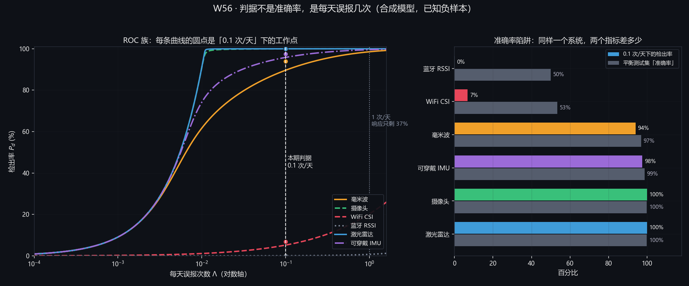

# W56 · 结果 02：每天误报 0.1 次下，每种传感器还剩多少检出率

> **这是全期的主结果。**
>
> 判据不是"准确率"，是**每小时（每天）误报次数**。
>
> **主表只统计 6 类已知负样本，因此是上界。**
> 加"未建模活动"之后的工程实际值见 §6：绝对值会掉，**排序不变**。

---

## 1. 判据为什么必须是误报率：把它算成一个数

设每天误报 $\lambda$ 次，人对报警的响应概率按指数衰减（③ 假设，
$\lambda_0=1$ 次/天）：

$$\Pr(\text{响应})=\exp(-\lambda/\lambda_0)$$

| 每天误报 $\lambda$ | 响应概率 | 等效检出（若 $P_d=0.99$）|
|---|---|---|
| 0.01 | 99.0% | 98.0% |
| **0.1** | **90.5%** | **89.6%** |
| 0.3 | 74.1% | 73.3% |
| **1.0** | **36.8%** | **36.4%** |
| 3.0 | 5.0% | 4.9% |
| 5.0 | 0.7% | 0.7% |

$$\boxed{\text{每天误报 1 次的报警器，等效检出只有 36\%，约等于没有}}$$

**注意最后一行**：即使单次准确率做到 99%，只要每天响 1 次，
真正被当真的报警只有三分之一。**这就是本期把判据定在 0.1 次/天的理由。**

有效检出（"有效"= 报警被人当真）：

$$D_{\text{eff}}=P_d\cdot\Pr(\text{响应})=P_d\,e^{-\lambda/\lambda_0}$$

本期主表最后一列就是它。**在 0.1 次/天下，它比 $P_d$ 低 9.5 个点，这是判据本身的价格。**

---

## 2. 模型：泊松混合 + 一维判别投影

### 2.1 可分性怎么算

对传感 $s$，取它**最像摔倒的那个负样本** $a^*$（决定门限的那一个），
按 Fisher 方向投影成一维得分：

$$\mathbf w=\Sigma^{-1}(\boldsymbol\mu_{\text{fall}}-\boldsymbol\mu_{a^*}),\qquad
  S=\frac{\mathbf w^{\mathsf T}\mathbf f}{\sqrt{\mathbf w^{\mathsf T}\Sigma\mathbf w}}$$

$$\hat d_{c}=\sqrt{\sum_{\text{ch}}\frac{(\bar f_{\text{fall,ch}}-\bar f_{c,\text{ch}})^2}
  {\tfrac12(\sigma_{\text{fall,ch}}^2+\sigma_{c,\text{ch}}^2)}}$$

**类中心与类内散布都来自 `sig_confounders.py` 的蒙特卡洛统计（每个活动 120 次实现），不是手填的。** 只有"两种情形都测得到"的通道进求和：
测不到的维不会凭空加分。

### 2.2 每天误报次数

$$\Lambda(\tau)=\underbrace{\sum_{i}n_i\,Q(\tau-\mu_i)}_{\text{已知负样本}}
  +\underbrace{N_{\text{gate}}\,Q(\tau)}_{\text{门控误开}}$$

$$\tau^*=\min\{\tau:\Lambda(\tau)\le0.1\},\qquad P_d=Q(\tau^*-\hat d_{a^*})$$

### 2.3 ★ 一条该带走的公式：误报预算按次数加权

单个负样本 $i$ 的要求：

$$n_iQ(\tau-\mu_i)\le\frac{0.1}{\text{其他项}}\ \Longrightarrow\
\mu_i\le\tau-Q^{-1}\!\left(\frac{0.1}{n_i}\right)$$

$$\boxed{\text{要求的分隔}=Q^{-1}\!\left(\frac{0.1}{n_i}\right)}$$

| $n_i$（次/天）| 要求分隔 |
|---|---|
| 3（躺沙发，卧室）| **1.83σ** |
| 4（躺沙发，养老院）| 1.96σ |
| 6（快速坐下，卧室）| 2.13σ |
| 20（快速坐下，养老院）| 2.58σ |
| 40（走动，卧室）| 2.90σ |
| 120（走动，养老院）| **3.49σ** |

$$\boxed{\text{每天 120 次的走动要求 3.49σ，每天 3 次的躺沙发只要求 1.83σ}}$$

**这是反直觉的**：高频活动的要求**更严**，不是更松。
因为误报预算是按"次"扣的，一天出现 120 次的动作，每次都有一点出错的机会。

---

## 3. 主表（独居老人卧室，门控误开 5 次/天）

| 传感 | 最像它的负样本 | $d'$ | 要求分隔 | 门限 $\tau^*$ | **检出 $P_d$** | 平衡准确率 | **有效检出** |
|---|---|---|---|---|---|---|---|
| 激光雷达 | 躺到沙发上 | **6.86** | 1.83 | 2.43 | **100.0%** | 99.9% | 90.5% |
| 摄像头 | 躺到沙发上 | **6.21** | 1.83 | 2.44 | **100.0%** | 99.9% | 90.5% |
| 可穿戴 IMU | 躺到沙发上 | **4.47** | 1.83 | 2.50 | **97.6%** | 98.7% | 88.3% |
| 毫米波 | **快速坐下** | **3.96** | 2.13 | 2.40 | **94.0%** | 96.9% | 85.1% |
| WiFi CSI | **快速坐下** | **1.19** | 2.13 | 2.68 | **6.9%** | 53.4% | 6.2% |
| 蓝牙 RSSI | 开门（**比摔倒还高分**）| **0.11** | 2.24 | 3.33 | **0.1%** | 50.0% | 0.1% |

### 3.1 三件必须一起读的事

**① 最像它的负样本，正好是题设表里说的那一个。**

| 传感 | 本模型算出的最坏负样本 | 题设表的判断 | 对得上吗 |
|---|---|---|---|
| 毫米波 | **快速坐下** | "速度接近，难" | ✔ |
| WiFi | **快速坐下** | "极易混淆" | ✔ |
| 摄像头 | **躺到沙发上** | "易混淆" | ✔ |
| 激光雷达 | **躺到沙发上** | "易混淆" | ✔ |
| 可穿戴 | **躺到沙发上** | 题设写"可辨" | **✘ 对不上** |

**可穿戴这一格对不上，而且对不上的原因是有意思的**：题设的理由是
"它能感到冲击，而躺沙发没有冲击"。本模型认可这条（躺沙发的冲击只有
0.35 g，摔倒是 4.0 g），但可穿戴**缺"高度"这一维**，于是"躺在沙发上"
与"躺在地上"对它完全一样。$d'=4.47$ 已经是它靠冲击 + 姿态 + 速度
能拿到的最好成绩。

$$\boxed{\text{可穿戴对"躺沙发"的可辨性，被"没有高度维"这一条吃掉了}}$$

**② 门限被谁咬住：3 行是门控，2 行是快速坐下，1 行是弯腰。**

按 `roc_daily.json` 的 `bind` 字段逐行核对（不是"多数是门控"）：

| 咬住项 | 行数 | 是哪几种传感 |
|---|---|---|
| **门控误开 `_gate`** | **3** | 激光雷达（37.6%）、摄像头（36.4%）、可穿戴（30.7%）|
| 快速坐下 `sit_fast` | 2 | 毫米波（48.7%）、WiFi（22.4%）|
| 弯腰 `bend` | 1 | 蓝牙（41.5%）|

（括号内是该占 0.1 次/天预算的份额。）在 0.1 次/天的预算里，门控自己误开的次数（5 次/天 × $Q(\tau)$）对前三种传感占了大头，负样本的额度反而没用完；对后三种，门控项可以忽略，咬住的是某个负样本。

$$\tau^*_{\text{gate}}=Q^{-1}\!\left(\frac{0.1}{5}\right)=2.05\sigma$$

**这决定了该怎么改**：咬住项是门控 ⇒ 加通道没用，得先改门控；
咬住项是某个负样本 ⇒ 要加能区分它的那一维。

> **★ 换到工程实际口径，咬住项整个换人**：加每天 60 次未建模活动后，六行里有五行的咬住项变成 `_unknown`（份额 91% 到 97%），只剩蓝牙仍被"弯腰"咬住（见 `roc_daily_unknown60.json`；论文 5.2.5 的表 7 把两种口径并排列出）。**这时候"改门控"与"加通道"都不管用，唯一有效的动作是扩充负样本表。**

**③ 准确率陷阱。** 平衡测试集上的"准确率"与 0.1 次/天下的检出率差多少：

| 传感 | 平衡准确率 | 0.1 次/天下检出 | 差 |
|---|---|---|---|
| 激光雷达 | 99.9% | 100.0% | +0.1 |
| 毫米波 | 96.9% | 94.0% | −2.9 |
| **WiFi** | **53.4%** | **6.9%** | **−46.5** |
| **蓝牙** | **50.0%** | **0.1%** | **−49.9** |

**WiFi 与蓝牙是"准确率陷阱"的典型**：一个在平衡测试集上有 53% 准确率的
系统，在 0.1 次/天的约束下等于瞎的。

$$\boxed{\text{准确率对"误报有多贵"完全不敏感，所以它不配当判据}}$$

---

## 4. 养老院多人间（门控误开 20 次/天）

| 传感 | 最像它的负样本 | $d'$ | 要求分隔 | $P_d$ | 平衡准确率 | 有效检出 |
|---|---|---|---|---|---|---|
| 激光雷达 | 躺到沙发上 | 6.86 | 1.96 | **100.0%** | 100.0% | 90.5% |
| 摄像头 | 躺到沙发上 | 6.21 | 1.96 | **100.0%** | 100.0% | 90.5% |
| 可穿戴 IMU | 躺到沙发上 | 4.47 | 1.96 | **94.3%** | 97.1% | 85.3% |
| 毫米波 | 快速坐下 | 3.96 | **2.58** | **86.1%** | 93.1% | 77.9% |
| WiFi CSI | 快速坐下 | 1.19 | 2.58 | **3.7%** | 51.8% | 3.3% |
| 蓝牙 RSSI | 开门 | 0.11 | 2.47 | **0.0%** | 50.0% | 0.0% |

**从卧室搬到养老院，掉得最多的是毫米波**（94.0% → 86.1%，−7.9 点），
因为它的最坏负样本"快速坐下"在养老院每天发生 20 次而不是 6 次，
要求分隔从 2.13σ 抬到 **2.58σ**。

$$\boxed{\text{同一个传感器，同一个算法，换到高频场景就掉 8 个点}}$$

---

## 5. 两处按实测删掉的通道（失败要写进正文）

### 5.1 全部删掉制动比 β

| 量 | 值 |
|---|---|
| 估计量标准差（实测）| **0.22–0.42** |
| 类间差（摔倒 0.30 对快速坐下 0.45）| **0.15** |
| 信噪比 | **0.4** |

**根因**：要把 $v_{\text{触地}}$ 从速度曲线里读出来，必须精确定位冲击起点。
半正弦脉冲的峰在脉冲**中间**，取那一点会把 $v_{\text{触地}}$ 读成
"已减速一半"的速度 ⇒ $\beta$ 系统性虚高（sit_fast 从 0.45 虚报成 0.59）。
改用"$v_{\text{end}}=2v(t_{a\text{峰}})$"这条解析结论后，**真值一侧无偏了**
（自检 ⑪ 逐类验证：0.299/0.453/0.700/0.551/0.600），
但**加噪声之后仍然不可用**：0.22–0.42 的标准差吃掉了 0.15 的类间差。

$$\boxed{\text{"特征可分性"与"特征可估计性"是两件事}}$$

### 5.2 删掉摄像头与激光雷达的冲击通道

30 fps / 20 fps 分辨不了 56 ms 的半正弦脉冲。实测峰值被平滑压到
**0.4–0.9 g**，且**类间差被压平**（摔倒 0.86 g 对躺沙发 0.64 g）。

$$\boxed{\text{帧率不够时，冲击通道不但没用，还会给出"看起来合理"的假数字}}$$

**剩下 4 个通道族**：`v` 峰值速度、`a` 冲击减速度、`h` 事后高度、`th` 事后姿态。
谁有谁没有见 `q1_物理量纲.md` §8。

---

## 6. ★ 边界：主表是上界，加"未建模活动"后掉多少

已知负样本只有 6 类。真实房间里还有宠物、窗帘、访客、搬家具、拖地。
把"未知活动"当成第 7 个负样本（每天 $N_u$ 次，可分性取最坏已知负样本的 $r$ 倍）：

**卧室，$r=0.45$，$N_u=60$ 次/天**：

| 传感 | 只有已知负样本 | **加未知活动** | 掉多少 |
|---|---|---|---|
| 激光雷达 | 100.0% | **79.1%** | −20.9 |
| 摄像头 | 100.0% | **67.6%** | −32.4 |
| 可穿戴 IMU | 97.6% | **31.3%** | −66.3 |
| 毫米波 | 94.0% | **22.2%** | −71.8 |
| WiFi | 6.9% | **1.1%** | −5.8 |
| 蓝牙 | 0.1% | **0.0%** | −0.1 |

**两个方向的敏感性**（$N_u$ 与 $r$ 都扫）：

| $r$ | $N_u$ | 激光雷达 | 摄像头 | 可穿戴 | 毫米波 | WiFi |
|---|---|---|---|---|---|---|
| 0.60 | 20 | 55.8% | 45.6% | 21.3% | 15.9% | 1.6% |
| 0.60 | 60 | 41.9% | 32.2% | 12.5% | 8.8% | 0.7% |
| 0.60 | 150 | 31.8% | 23.2% | 7.8% | 5.2% | 0.3% |
| 0.85 | 20 | 6.1% | 5.0% | 2.8% | 2.4% | 0.8% |
| 0.85 | 60 | 2.8% | 2.2% | 1.2% | 1.0% | 0.3% |
| 0.85 | 150 | 1.5% | 1.1% | 0.6% | 0.4% | 0.1% |

$$\boxed{\text{绝对水平由"负样本表的完整度"决定，不由传感器决定}}$$

**但排序在这六格里都不变**：
激光雷达 > 摄像头 > 可穿戴 > 毫米波 ≫ WiFi > 蓝牙。

> **★ 更正（本期定稿时发现并重算）**：本表原先的六格是 55.6/46.3/23.8/16.4/1.8 等一组旧值，
> 那是在 `sig_fall` 的 β 估计量与 WiFi 噪声模型两次修正**之前**跑的，之后没重算。
> 现已按当前代码重跑（`roc_daily.py --sweep`，unknown 项扫描），结论方向不变、量级不变，
> 但小数位全部变了。**凡与本仓库其它文档冲突，以本表为准。**

$$\boxed{\text{排序稳健，绝对值不稳健 ⇒ 只能用排序做选型，不能用绝对值做承诺}}$$

---

## 7. 其余三组敏感性

> **本节三张表都是上界口径**（只算 6 类已知负样本）。工程实际口径（加每天 60 次未建模活动）下的同三组扫描见论文 6.3.2，结论差别很大：门控这个旋钮失效（0 点）、判据仍是最强旋钮（+62.7 点）、类内变异掉得更狠（激光雷达 79.1% 到 24.3%）。引用时务必带上口径。

### 7.1 门控误开次数（卧室）

| 门控/天 | 激光雷达 | 摄像头 | 可穿戴 | 毫米波 | WiFi |
|---|---|---|---|---|---|
| 0 | 100.0% | 100.0% | 98.3% | 96.3% | 7.7% |
| 2 | 100.0% | 100.0% | 98.0% | 95.3% | 7.4% |
| **5（定稿）** | **100.0%** | **100.0%** | **97.6%** | **94.0%** | **6.9%** |
| 20 | 100.0% | 100.0% | 95.8% | 89.6% | 5.2% |
| 100 | 100.0% | 99.9% | 90.8% | 79.6% | 2.5% |

**门控从 5 涨到 100（20 倍），毫米波掉 14.4 点，摄像头只掉 0.1 点。**
因为它俩的瓶颈不在门控（有足够 $d'$ 富余），毫米波则被门控推着走。

> **口径提醒**：以上是上界口径（只算 6 类已知负样本）。加上每天 60 次未建模活动后，门控这个旋钮几乎失效：毫米波 22.2% 到 22.2%（0 点），因为门限已被未知活动顶到 $\tau^*\approx4.7$，那里 $Q(\tau)$ 小到 $10^{-7}$ 量级。论文 6.3.2 给了这张对照表。

### 7.2 判据松紧

| 目标（次/天）| 激光雷达 | 摄像头 | 可穿戴 | 毫米波 | WiFi |
|---|---|---|---|---|---|
| 0.01 | 90.9% | 90.9% | 78.0% | 67.7% | 1.6% |
| **0.1（定稿）** | **100%** | **100%** | **97.6%** | **94.0%** | **6.9%** |
| 1.0 | 100% | 100% | 99.8% | 99.5% | 24.8% |
| 3.0 | 100% | 100% | 100% | 100% | 41.7% |

**从 0.01 放宽到 0.1，毫米波涨 26.3 点**：它是最吃判据的那一个。
而 0.01 与 0.1 在工程上是"几乎不可能"与"很难"，都还是要做。

### 7.3 类内变异放大（不同人、不同房间、换季）

| 抖动倍数 | 激光雷达 | 摄像头 | 可穿戴 | 毫米波 | WiFi |
|---|---|---|---|---|---|
| ×1.0 | 100.0% | 100.0% | 97.6% | 94.0% | 6.9% |
| ×1.4 | 99.7% | 99.0% | 81.3% | 84.9% | 6.4% |
| ×1.8 | 94.9% | 92.4% | 61.8% | 66.5% | 4.0% |

**可穿戴掉得最快**（97.6 → 61.8，−35.8 点），因为它的 $d'^2$ 有 57.3% 落在速度通道上，
而速度对个体差异最敏感（`diag_jitter_channel.py` 的份额表）。
**摄像头与激光雷达的 $h$、$th$ 通道对个体差异不敏感**（高度与角度是几何量）。

> **★ 一处必须写出来的不确定**：×1.4 之后可穿戴（81.3%）掉到毫米波（84.9%）之后。
> 但这处交换**依赖"放大时类中心是否随动"**：若只放大离散度、类中心不动，
> 交换不出现（可穿戴 11.9% 对毫米波 8.3%，工程实际口径）。原因是峰值检测的向上偏置
> 会把摔倒的冲击均值抬高 9%。**故不可把这两个方案的先后当结论**，详见论文 6.3.3 与附录 C 第 11 条。

---

## 8. 图



左图：横轴是**每天误报次数**（对数），纵轴是检出率。每条曲线的圆点是
"0.1 次/天"下的工作点。**注意横轴：这是唯一一个把"误报有多贵"画进去的轴。**

右图：同一个系统在两个指标下的差距。WiFi 与蓝牙是"准确率陷阱"的典型。

---

## 9. 复现

```powershell
$env:PYTHONIOENCODING="utf-8"; $env:PYTHONUTF8="1"
$PY = "python"

& $PY scripts\sig_confounders.py --n 120 --json        # 特征统计
& $PY scripts\roc_daily.py --fig --json                 # 主表 + 主图
& $PY scripts\roc_daily.py --scenario nh                # 养老院
& $PY scripts\roc_daily.py --unknown-n 60               # 工程实际
& $PY scripts\roc_daily.py --sweep                      # 四组敏感性
& $PY scripts\roc_daily.py --selftest                   # 8 条断言
```

本文件所有数字都落在 `results/roc_daily.json` 与 `results/features.json` 里。
