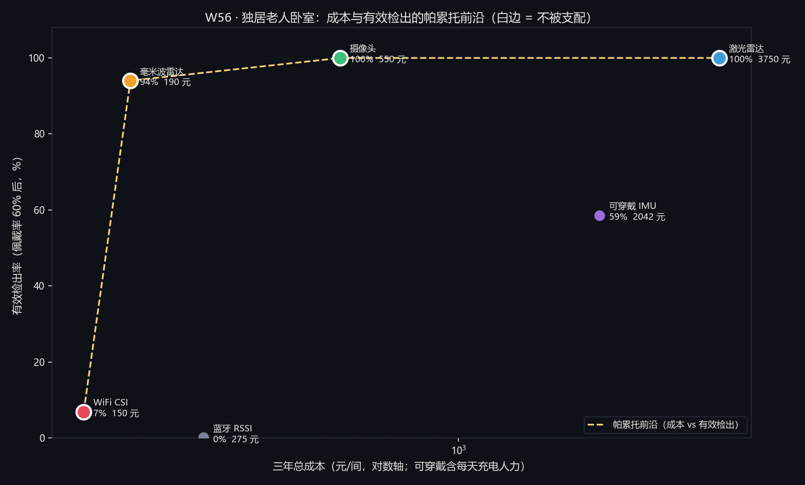

# W56 · 结果 03：六准则决策，给帕累托前沿，不给单一冠军

> **本文件所有成本、安装、隐私、辨识打分都是 ③ 自定假设**，
> 量级来自公开电商报价与常识，**未做比价，只能作量级比较**。
> 检出率来自 `q2_误报率与检出率.md`（② 由模型算出）。

---

## 1. 六准则

为什么不能只比检出率：q2 的表里激光雷达与摄像头都是 100%，
但一个 3750 元、一个 550 元，隐私一个 3 分一个 2 分。

| 准则 | 单位 | 方向 | 为什么不能省 |
|---|---|---|---|
| 检出率 | % | 大 | 主指标 |
| 有效检出率 | % | 大 | 乘上"报警被当真"的概率 |
| **三年总成本** | 元 | 小 | 硬件只是一项 |
| 安装人时 | h | 小 | 老人家里打孔走线是要谈的 |
| **隐私** | 0–10 | 大 | 摄像头能数清脸上的皱纹 |
| 依从性（是否需佩戴）| 是/否 | 小 | 不戴就归零 |
| **多人辨识** | 0–3 | 大 | 养老院必须回答"是谁" |

### 1.1 ★ 三年总成本：可穿戴的便宜是假的

$$\text{TCO}_3=\text{硬件}+\underbrace{3\ \text{年}\times0.05\ \text{h/天}\times365\times30\ \text{元/h}}
_{\text{每天充电 3 分钟}=1644\ \text{元}}$$

| 方案 | 硬件区间 | 三年总成本 | 备注 |
|---|---|---|---|
| 毫米波 | 80–300 | **190** | 最便宜 |
| WiFi | 0–300 | **150** | 但多数商用路由器取不到 CSI |
| 蓝牙 | 150–400 | **275** | 信标 + 网关 |
| 摄像头 | 300–800 | **550** | 边缘算力盒另计 |
| 可穿戴 | 200–600 | **2042** | ★ 硬件 400，人力 1644 |
| 激光雷达 | 1500–6000 | **3750** | 千元级起 |

$$\boxed{\text{可穿戴的硬件是最便宜的一档，三年总成本却是第二贵}}$$

---

## 2. 六准则表（卧室，佩戴率 60%）

| 方案 | 检出 | 有效检出 | $d'$ | 三年成本 | 安装 | 隐私 | 需佩戴 | 多人辨识 |
|---|---|---|---|---|---|---|---|---|
| 激光雷达 | 100.0% | **100.0%** | 6.86 | 3750 | 0.5 | 3 | 否 | 3 |
| 摄像头 | 100.0% | **100.0%** | 6.21 | **550** | 0.5 | **2** | 否 | 3 |
| 可穿戴 | 97.6% | 58.5% | 4.47 | 2042 | **0.1** | **9** | **是** | 3 |
| 毫米波 | 94.0% | 94.0% | 3.96 | **190** | 0.3 | 6 | 否 | 1 |
| WiFi | 6.9% | 6.9% | 1.19 | 150 | 0.2 | 4 | 否 | 0 |
| 蓝牙 | 0.1% | 0.1% | 0.11 | 275 | 0.5 | 8 | 否 | 1 |

**两条必须随表出现的隐藏成本**：

* **WiFi**：多数商用路由器**取不到 CSI**，要专用网卡或刷机。
  "零增量"只在你能拿到 CSI 的前提下成立。
* **可穿戴**：硬件 200–600 元，但"每天充电"是三年 1644 元的人力。

---

## 3. 帕累托前沿（成本 × 有效检出）

> **口径**：本文件（含本图与本节表）全部是**上界口径**（只算 6 类已知负样本），对应 `results/mcdm.json`。
> 工程实际口径（加每天 60 次未建模活动）在 `results/mcdm_unknown60.json` 与论文 5.3：
> **WiFi 1.1% / 毫米波 22.2% / 摄像头 67.6% / 激光雷达 79.1%**，
> 且**默认权重冠军由毫米波变为摄像头**。同一个量在论文里只取工程实际口径，本文件保留上界作为对照。



| 前沿点 | 成本 | 有效检出 | 隐私 | 多人辨识 |
|---|---|---|---|---|
| WiFi CSI | 150 | 6.9% | 4 | 0 |
| **毫米波雷达** | **190** | **94.0%** | 6 | 1 |
| 摄像头 | 550 | 100.0% | 2 | 3 |
| 激光雷达 | 3750 | 100.0% | 3 | 3 |

$$\boxed{\text{四个点全在一条"便宜但有短板 / 贵但顶满"的线上，没有支配关系}}$$

**毫米波是"性价比拐点"**：190 元拿到 94.0%，再加 360 元（摄像头）
才买到剩下的 6 个点，而隐私从 6 掉到 2。

---

## 4. 加权得分：权重一改，冠军就换人

默认权重：检出 0.35 / 成本 0.15 / 安装 0.05 / 隐私 0.20 / 依从 0.10 / 辨识 0.15。

| 权重组 | 第一名 | 第二名 | 末位 |
|---|---|---|---|
| **默认** | 毫米波 0.768 | 摄像头 0.733 | WiFi 0.368 |
| **隐私加倍** | **可穿戴 0.901** | 蓝牙 0.758 | 摄像头 **0.220** |
| **辨识加倍** | **可穿戴 0.903** | 摄像头 0.901 | WiFi 0.133 |
| **成本加倍** | **毫米波 0.911** | 摄像头 0.834 | 激光雷达 **0.221** |

$$\boxed{\text{四个权重组给出三个不同的冠军 ⇒ 这张表不能当"唯一推荐"用}}$$

---

## 5. 在什么条件下选什么（不给冠军，给条件）

| 条件 | 该选 | 依据（可核对的数）|
|---|---|---|
| 单人卧室、预算极紧、隐私敏感 | **毫米波** | 190 元 / 94.0% / 隐私 6 |
| 单人卧室、能接受"有画面"、要顶满检出 | **摄像头** | 550 元 / 100% / 隐私 2（人脸 73 px）|
| 光照差、夜里也要工作、不能有画面 | **激光雷达** | 点云不依赖光照，但 3750 元、隐私 3 |
| 老人愿意戴、要能户外、要能报警给本人 | **可穿戴** | 隐私 9、安装 0.1 h，但佩戴率 < 55% 就输给毫米波 |
| **养老院多人间、必须回答"是谁"** | **摄像头** 或 **激光雷达** | 多人辨识 3 分（2 cm 角分辨）；毫米波只有 1 分 |
| 已有 WiFi 且能取 CSI、只想做"有没有人" | WiFi | 150 元，但 0.1 次/天下检出 6.9% |
| 只要"在不在房间"、不要摔倒检测 | **蓝牙** | 275 元、隐私 8，但检出 0.1% |

### 5.1 ★ 多人间为什么把毫米波排除在"主力"之外

养老院要求"是谁摔了"。毫米波的空间分辨：

$$\theta_{\text{res}}\approx\frac{\lambda}{D}\quad(\text{阵列孔径 }D)$$

60 GHz、6×8 贴片阵（$D\approx0.04$ m）给约 15°，3 m 处 **0.79 m**。
两床并排的间距 0.5–1.0 m，**正好在分辨极限上**；
若两人处于同一距离、同一角度，**直接并成一个目标**。

$$\boxed{\text{毫米波在单人卧室够用，在多人间"是谁"这一问上不够}}$$

摄像头（332.5 px/m，0.5 m = 166 px）与激光雷达（0.2°，3 m 处 1.05 cm）
都不受这个限制。

---

## 6. 六准则非支配集

六个准则**同时**参与时（不再只看成本与检出）：

| 方案 | 是否非支配 | 被谁支配（若被支配）|
|---|---|---|
| 毫米波 | ★ 是 | — |
| 摄像头 | ★ 是 | — |
| 可穿戴 | ★ 是 | — |
| 激光雷达 | ★ 是 | — |
| 蓝牙 | ★ 是 | — |
| WiFi | ★ 是 | — |

**六个全非支配**。这不是"都好"，恰恰相反：
**每一对之间都有取舍，没有一个人能在所有维度上赢。**
这正是"不能给单一冠军"的严格版本。

---

## 7. 复现

```powershell
$env:PYTHONIOENCODING="utf-8"; $env:PYTHONUTF8="1"
$PY = "python"

& $PY scripts\compare_mcdm.py --fig --json
& $PY scripts\compare_mcdm.py --weights "隐私=2.0,检出=0.2"
& $PY scripts\compare_mcdm.py --weights "辨识=2.0,检出=0.2"
& $PY scripts\compare_mcdm.py --weights "成本=2.0"
& $PY scripts\compare_mcdm.py --selftest
```

结果落在 `results/mcdm.json`。
