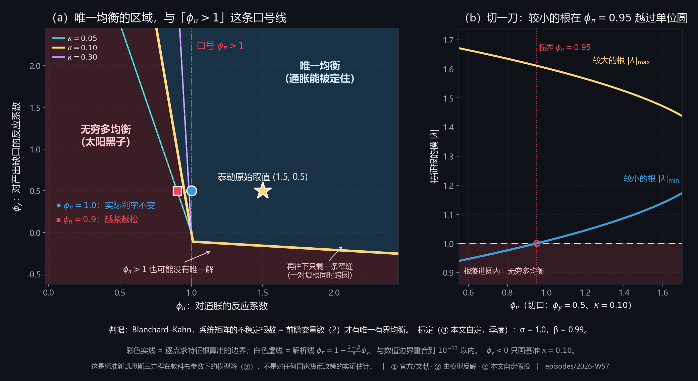
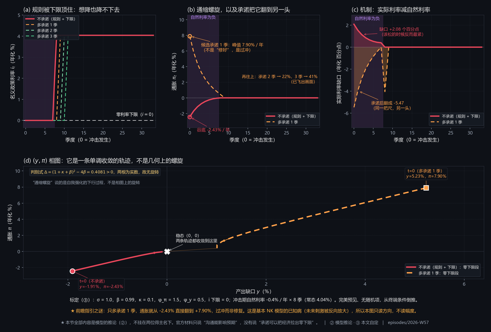
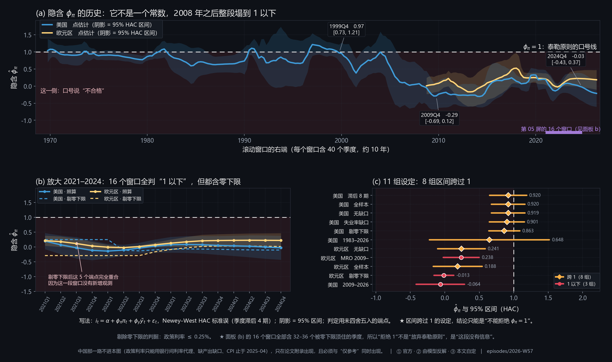

# 加息 5％，通胀 5％，等于没加息：2026 诺奖讲的那条线

> **副题**：从三方程到确定性边界，再把"央行对通胀的隐含反应系数"从公开数据里反算出来

## 摘要

2026 年 10 月，瑞典皇家科学院把经济学奖授给 Hall 与 Woodford，理由是"为宏观稳定政策提供了微观基础"（①）。官方科普版用两句话概括了这件事：家庭和企业是**前瞻的**，"消费的变化本身无法被预测"；把这些微观行为写进模型，就是"那个带三条方程的宏观模型"（①）。这两句话只支持一个事实：三方程模型是本期工作的起点。它**不支持**任何具体的参数、判据或"某国央行在用什么系数"，本文全部量化结论都另行计算并标明等级。

**本文要检验的是每个学宏观的人都背过、却很少被追问的一句话**：央行的政策利率对通胀的反应系数必须大于一。把三方程写成 $A x_t=B E_t x_{t+1}$，用 Blanchard–Kahn 条件逐点判定，这句话立刻露出来是一个特例：

$$\phi_\pi^*=1-\frac{1-\beta}{\kappa}\,\phi_y \qquad (1)$$

式 (1) 是本文的核心，它只在 $\phi_y=0$ 时退化为"$\phi_\pi>1$"（②）。**它带来三条与直觉相反的事实，全部数值验证到 $10^{-14}$**：其一，$\phi_y>0$ 时真门槛**低于** 1，$\phi_y=0.5$ 时是 0.95、$\phi_y=2$ 时是 0.80（②）：**央行越在意产出缺口，对通胀反应的要求越松**，因为顺周期的自动宽松本身就提供了一部分稳定力量。其二，$\phi_y<0$ 时门槛**高于** 1，于是 $(1.05,-0.12)$ 这个点满足口号，两个特征根的模却都是 **0.9975**（②），不稳定根 0 个、前瞻变量 2 个，**无穷多均衡**。**那句口号的真正危险不是太严，是太松。** 其三，直线的失效起点可解析求出：$\lambda=1$ 处的迹恰为 2 时两根相切，条件 $\phi_y=-[(1-\beta)+\sigma\kappa]/(\sigma\beta)$ 在基准校准下是 **−0.111111**（②）；过了这一点，沿直线走没有任何根出圈。

**数值层不假设直线。** 逐点求特征根的边界与式 (1) 的最大偏差是 **$1.29\times10^{-14}$**（②），三个 $\kappa$ 下都是直线。在 $\phi_\pi\in[0,2.45]$ 这个现实区间里，$\phi_y\le-0.255$ 时**整条 $\phi_\pi$ 线上都没有唯一均衡**（②，数值二分为 −0.255，约定写作约 −0.26）。本文补一条对结论的精确化：继续加大 $\phi_\pi$，唯一均衡会**复活**，回升点有解析式 $\phi_\pi=(\beta-1-\sigma\phi_y)/(\sigma\kappa)$，$\phi_y=-0.26$ 时是 2.5001、$-0.30$ 时是 2.9001（②）。**所以确定域在负 $\phi_y$ 一侧是"两段"，不是一个半平面**，只是复活点要求的 $\phi_\pi$ 没有任何央行会取。全部设定在三个 $\kappa$ 下重算：$\kappa$ 越大门槛越低，$\phi_y=0.5$ 时从 0.90 升到 0.98333（②）。

**标点层给一个可被证伪的判据。** $\phi_y=0.5$ 的三个标点，其较小根模随 $\kappa$ 系统变化：$(0.9,0.5)$ 在 $\kappa=0.05$ 时恰好是 **1.0000**，因为那条门槛正好等于 0.90；反解 $\kappa=(1-\beta)\phi_y/(1-\phi_\pi)=0.05$（②），对得上。而 $(1.0,0.5)$ 在任何有限 $\kappa$ 下都**不可能**是临界点，它离边界始终差 $(1-\beta)\phi_y/\kappa>0$。

**动态层把规则推到边界。** 利率不能小于零，于是有一个区域：规则说该降，利率已经到底。完美预见下从终端条件倒推，自然利率掉到 −0.4％／年、持续 8 个季度，就把名义利率顶在下限 8 个季度、通胀谷底做到 **−2.43％／年**、产出谷底 −1.91％、累计损失 0.0618（百分点乘季）（②）。机制变量是**实际利率缺口**（实际利率减自然利率）：它在零下限段峰值 **+2.08 个百分点**，**该松的时候反而最紧**（②）。前瞻指引的效果则是本期最该带走的一个反面结果：只多承诺 1 个季度零利率，通胀就从谷底 −2.43％ 直接翻到峰值 **+7.90％**，缺口从 +2.08 翻到 −5.47 个百分点；多承诺 2 季是 +22.02％、3 季是 +41.29％（②）。**这不是"修好"，是过冲**，正是文献记过的**前瞻指引之谜**：基本 NK 模型的零下限段反向不稳定，未来的刺激被放大。**故本节只读方向，不读幅度。**

**数据层问：现实里 $\hat\phi_\pi$ 是多少，区间有多宽。** 用 FRED 的公开 CSV 端点（免密钥，可逐字节复核）取美国、欧元区、中国三类序列，估计简化泰勒规则并报 HAC 区间与循环块 bootstrap 区间。**结论是一个"说不清"**，三层都说得清：全样本美国 $\hat\phi_\pi=0.920$，95％ 区间 $[0.676,1.163]$，**跨过 1**（②）；换 bootstrap 是 $[0.578,1.217]$，也跨 1。13 组设定里 **8 组按保守规则判"跨 1"**，只能写"不能拒绝 $\phi_\pi=1$"。长历史更说明问题：滚动 40 季窗口从 1969Q4 走到 2026Q2，$\hat\phi_\pi$ 在 $[-0.304,1.215]$ 之间乱跑，**227 个窗口里 114 个跨 1**，2009Q4 是 −0.287、2019Q4 是 0.327、2024Q4 是 −0.030（②）。2021Q1 到 2024Q4 的 16 个窗口全部判"1 以下"，**但每个窗口都含 32 到 36 个被零下限顶住的季度**（②）：这段时间 $i_t$ 是常数，$\phi_\pi$ 只能由通胀的残余变异去凑。**一个统计上显著的结果，可能只是"这段数据没有信息"。**

**三处必须单说的发现。** ① **换标准误会翻结论**：HAC 标准误是普通 OLS 的 **0.92 到 3.12 倍**，13 组里有 **2 组**若只报 OLS 区间会判"1 以下"而 HAC 判"跨 1"（②）：**结论依赖于推断方法，这本身说明它撑不住**。② **`ECBMRRFR` 内部整年缺 2001 到 2007 共七年**，而缺失数指标完全看不出来，样本量看上去正常（77 个季度、区间标着 1999Q1–2026Q2）；本期的修法是加一道**按年计数扫描**，并把主用序列换成零缺失的 `ECBDFR`。③ **`GDPPOT` 与 `NROU` 带 CBO 到 2036 年的预测**，不截断就是"用未来的潜在产出去除现在的 GDP"，本文按最后一个真实观测截断（丢 42 行与 41 行）。**三件事的共性：检查器看起来全绿，数据却是错的。**

**第六章单列一节讲"教科书那句话漏了一个变量"**：$\phi_\pi>1$ 只在 $\phi_y=0$ 成立；代价是它在 $\phi_y>0$ 时偏严（把合格的央行判成不合格），在 $\phi_y<0$ 时偏松（把不合格的判成合格），而**偏松那一侧不报警**。本文另列**十一条诚实性边界**，最要紧的五条是：三方程是教科书写法、不含金融摩擦与异质性主体；参数是标准校准（③）不是估计；数据反算是简化规则回归、**不是结构估计**；得主的具体贡献只引官方新闻稿，未核原始论文；**5％ 是示意数字（③）**，不是任何国家的实际数据。

**关键词**：Blanchard–Kahn 条件；确定性边界；泰勒原则；零利率下限；前瞻指引之谜；Newey–West 标准误；块 bootstrap；区间跨 1；连片缺失

<!-- pagebreak -->

## 一、问题重述

### 1.1 问题背景

2026 年 10 月 12 日，瑞典皇家科学院公布经济学奖，授给 Hall 与 Woodford，理由是 `for microeconomic foundations of macroeconomic stabilisation`（①）。官方科普版把这件事讲得更具体：家庭和企业是 `forward looking` 的，所以 `changes in consumption can not be predicted`；把这些写进模型，就是 `the macro model, with its three equations`（①）。

这两句话合起来指向一个结构：**三条方程**（一条跨期消费、一条价格设定、一条政策规则），其中**每个变量都是前瞻的**。前瞻性是这件事的核心，也是本期全部困难的来源。

而大众与教材里流传的却是另一句话：**央行对通胀的反应必须超过一比一**。这句话在政策讨论里几乎成了常识，被用来评价央行"够不够鹰"。**本文要问的是：它是从哪来的，它是什么的特例，它在哪儿失效，以及现实数据站不站得住。**

### 1.2 待解决的问题

**问题一（解析层）** 把三方程写成线性理性预期系统，给出系统矩阵的迹与行列式闭式，推出确定性边界，并证明"$\phi_\pi>1$"只是这条边界在 $\phi_y=0$ 处的特例；给出一个"满足口号却没有唯一均衡"的反例。

**问题二（数值层）** 不假设边界是直线，逐点求特征根画出确定性区域，与解析线对账；找出解析线失效的起点与机制；给出"没有唯一均衡"的参数区间，并检验继续加大 $\phi_\pi$ 会不会让唯一均衡回来。

**问题三（标点层）** 在 $\phi_y=0.5$ 下考察 $(1.5,0.5)$、$(1.0,0.5)$、$(0.9,0.5)$ 三个标点与三组 $\kappa$，解释"擦边过线"，并回答"哪个格子最容易被讲错"。

**问题四（动态层）** 把政策规则改成带零利率下限的分段规则，算通缩螺旋的路径，再算"前瞻指引多承诺 $T$ 期"的效果，并明确哪一部分是模型推论。

**问题五（数据层）** 用公开数据估计简化泰勒规则 $i_t=\alpha+\phi_\pi\pi_t+\phi_y\tilde y_t+\varepsilon_t$，报告 $\hat\phi_\pi$ 的点估计与 95％ 区间，逐季滚动给出 2021 到 2024 的隐含值，并回答"能不能拒绝 $\phi_\pi=1$"。

### 1.3 题设里没有给的那句话

**"$\phi_\pi>1$"不在题设里。** 它是要被检验的对象，不是已知条件。这一条决定了全文的写法：任何一处推理都不许从"因为 $\phi_\pi>1$，所以稳定"出发，要么用式 (1)，要么直接给特征根。

## 二、问题分析

### 2.1 本题的第一性质：这是判据题，不是宏观科普

全网（教材、科普、财经媒体）复述的都是那句口号。**口号的问题是它把一个二维条件压成了一维。** 而"稳定不稳定"在这套模型里有一个**精确的、可判定的**判据：Blanchard–Kahn 条件，不稳定根的个数必须等于前瞻变量的个数。本题的所有工作都落在这个判据上，不落在"经济看起来稳不稳"上。

| | 口号 | 本文的判据 |
|---|---|---|
| 形式 | $\phi_\pi>1$ | $\phi_\pi+\frac{1-\beta}{\kappa}\phi_y>1$（且在有效区内）|
| 维度 | 一维 | 二维 |
| 依据 | 直觉加特例 | 特征根计数 |
| 何时错 | 不知道 | 可算出（$\phi_y\ne0$ 就开始错）|
| 错的方向 | 不知道 | 已知：$\phi_y>0$ 偏严，$\phi_y<0$ 偏松 |

### 2.2 五层各自的数学本质

| 层 | 对象 | 数学问题 | 关键结构 |
|---|---|---|---|
| **1 解析层** | 前瞻线性系统 | 线性理性预期差分方程 | $A x_t=B E_t x_{t+1}$、$M=B^{-1}A$、迹与行列式、根与系数 |
| **2 数值层** | 参数平面上的分区 | 特征根计数与等值线 | Blanchard–Kahn 计数、$f=\min\lvert\lambda\rvert$、二分法、判别式与复根 |
| **3 标点层** | 三个点乘三组参数 | 参数敏感性 | 门槛对 $\kappa$ 的单调性、反解 |
| **4 动态层** | 带不等式约束的路径 | 分段线性加终端条件 | $i_t=\max\{\underline{i},i^{\text{rule}}_t\}$、反向递推、稳定性条件 |
| **5 数据层** | 从观测到系数 | 单方程回归与稳健推断 | OLS、Newey–West HAC、循环块 bootstrap、滚动窗口、三态判定 |

### 2.3 技术路线

```
① 解析（5.1）
   三方程 → A、B → tr/det 闭式 → λ=1 穿越线 → 式 (1)
        ↓
② 数值（5.2）
   逐点特征根 → 等值线 f=1 → 与式 (1) 对账（1.29e-14）
   → 找失效起点（tr M = 2，φ_y = −0.111111）
   → 找"没有唯一均衡"的区间（φ_y* = −0.255）
   → 找复活点（det M = 1，φ_y = −0.26 时 2.5001）
        ↓
③ 标点（5.3）
   三标点 × 三 κ → 较小根模 → "擦边过线"的反解
        ↓
④ 动态（5.4）
   规则 + 下限 → 反向递推（先验证 A⁻¹B 的根在圆内）
   → 通缩螺旋 → 实际利率缺口 → 前瞻指引扫描 → 前瞻指引之谜
        ↓
⑤ 数据（5.5）
   FRED 取数 → 常识断言 + 按年扫描 + CBO 截断
   → 简化规则回归（HAC + 块 bootstrap）
   → 13 组设定 → 三态判定（保守合并）
   → 滚动 2021–2024 两口径 + 长路径
```

### 2.4 数据来源与边界

数据全部取自 FRED 的公开 CSV 端点 `https://fred.stlouisfed.org/graph/fredgraph.csv?id=<SERIES>`，**免密钥**，原样落盘到 `data/raw/`，来源清单逐条给出序列页与 CSV 地址。

| 经济体 | 政策利率 | 通胀 | 产出缺口 | 综合等级 |
|---|---|---|---|---|
| 美国 | `FEDFUNDS` 联邦基金有效利率 | `CPIAUCSL` 同比 | `GDPC1` 与 `GDPPOT`（CBO 潜在产出）| 强 |
| 欧元区 | `ECBDFR` 存款便利利率 | `CP0000EZ19M086NEST` 同比 | `CLVMEURSCAB1GQEA19` 经 HP 滤波（③）| 中 |
| 中国 | `IR3TIB01CNM156N` 3 个月银行间利率（③ 代理）| `CPALTT01CNM659N` 同比 | **取不到** | 弱 |

**中国那一路只进附录，不与美国、欧元区同图、同表比较。** 理由在 5.5 与 7.3 写明。

## 三、模型假设

| # | 假设 | 依据与影响 |
|---|---|---|
| **A1** | 经济可由三方程新凯恩斯模型刻画：IS、NKPC、利率规则 | ① 教科书写法。**不含金融摩擦、异质性主体、财政**（7.3 第 1 条）|
| **A2** | 全部变量前瞻，**没有状态变量** | 于是前瞻变量数 = 2，BK 判据退化为"两个根都在单位圆外" |
| **A3** | 参数取标准校准：$\sigma=1.0$、$\beta=0.99$、$\kappa\in\{0.05,0.10,0.30\}$ | ③ **不是估计**；三个 $\kappa$ 都报，避免结论被参数选择绑架 |
| **A4** | 零利率下限 $\underline{i}=0$ | ③ 本文自定，可扫；模型推论不挂得主名下 |
| **A5** | 动态层用完美预见、无随机项，终端条件为稳态 | ③ 于是路径可从终端反推；**只在确定性区域里画**，并做成断言 |
| **A6** | 数据层用简化泰勒规则，右端为事后通胀 | ③ 已知偏误来源，逐条写进 5.5 与 7.3 |
| **A7** | 政策利率取短端；欧元区用存款便利利率，中国用银行间利率代理 | ①（美、欧）与 ③（中国）；三者**不是同一层级的工具**（7.3 第 8 条）|
| **A8** | 产出缺口：美国用 CBO 潜在产出，欧元区用 HP 滤波（$\lambda=1600$），中国无 | ①、③、缺 |

## 四、符号说明

| 符号 | 含义 | 单位或范围 |
|---|---|---|
| $y_t$ | 产出缺口（对数偏离）| 小数 |
| $\pi_t$ | 通胀率 | **季度**率（年化乘 400 得％）|
| $i_t$ | 名义政策利率 | 季度率 |
| $r^n_t$ | 自然实际利率 | 季度率 |
| $E_t$ | 基于 $t$ 期信息的期望 | 算子 |
| $\sigma$ | 跨期替代弹性的倒数 | ③ 取 1.0 |
| $\beta$ | 季度贴现因子 | ③ 取 0.99 |
| $\kappa$ | 菲利普斯曲线斜率 | ③ 取 0.05／0.10／0.30 |
| $\phi_\pi$ | 规则对通胀的反应系数 | 待判定 |
| $\phi_y$ | 规则对产出缺口的反应系数 | 待判定 |
| $\phi_\pi^*$ | 确定性边界上的门槛值 | ② 由模型反解 |
| $A,B$ | 系统的系数矩阵 | $2\times2$ |
| $M$ | $B^{-1}A$，满足 $E_t x_{t+1}=M x_t$ | $2\times2$ |
| $T,D$ | $\operatorname{tr}M$ 与 $\det M$ | 标量 |
| $\lambda$ | $M$ 的特征根 | 复数 |
| $f$ | $\min\lvert\lambda\rvert$，$f>1$ 即唯一均衡 | 标量 |
| $\underline{i}$ | 零利率下限 | ③ 取 0 |
| $T$（第 5.4 节）| 前瞻指引多承诺的季度数 | 季 |
| $\hat\phi_\pi$ | 回归得到的隐含系数 | ② 估计量 |
| $\rho$ | 含平滑项规则里 $i_{t-1}$ 的系数 | ② 估计量 |
| $Q$ | 分位数函数记号，本文不单独使用 | — |

## 五、模型建立与求解

### 5.1 三方程与 Blanchard–Kahn 条件

三方程写成偏差形式（已把常数吸收进 $r^n_t$）：

$$y_t=E_t y_{t+1}-\sigma\left(i_t-E_t\pi_{t+1}-r^n_t\right) \qquad (2)$$

$$\pi_t=\beta E_t\pi_{t+1}+\kappa y_t \qquad (3)$$

$$i_t=r^n_t+\phi_\pi\pi_t+\phi_y y_t \qquad (4)$$

把式 (4) 代入式 (2)，与式 (3) 一起整理成 $A x_t=B E_t x_{t+1}$，$x_t=(y_t,\pi_t)^\top$：

$$A=\begin{pmatrix}1+\sigma\phi_y & \sigma\phi_\pi\\ -\kappa & 1\end{pmatrix},\qquad B=\begin{pmatrix}1 & \sigma\\ 0 & \beta\end{pmatrix} \qquad (5)$$

**§5.1.1 迹与行列式的闭式**

直接算 $M=B^{-1}A$ 的两个不变量。$B^{-1}=\dfrac{1}{\beta}\begin{pmatrix}\beta & -\sigma\\ 0 & 1\end{pmatrix}$，于是

$$T=\operatorname{tr}M=1+\frac{1}{\beta}+\sigma\left(\phi_y+\frac{\kappa}{\beta}\right),\qquad D=\det M=\frac{1+\sigma\phi_y+\sigma\kappa\phi_\pi}{\beta} \qquad (6)$$

用随机 400 点（$\phi_\pi\in[0,2.5]$、$\phi_y\in[-1.2,2.5]$）把式 (6) 与 `np.linalg.eigvals` 对比，最大偏差 **$4.22\times10^{-15}$**（②），见 6.2。

**§5.1.2 Blanchard–Kahn 条件在本模型里退化成什么**

BK 条件是：不稳定根的个数必须等于前瞻变量的个数，才有唯一有界均衡。本模型**没有状态变量**（$y_t$ 与 $\pi_t$ 都是跳变量），前瞻变量数 = 2，于是

$$\text{唯一有界均衡}\iff M\text{ 的两个根都在单位圆外}\iff f=\min\lvert\lambda\rvert>1 \qquad (7)$$

这一步是全文的判据。**它不看 $\phi_\pi$ 是否大于 1，只看根在哪儿。**

**§5.1.3 $\lambda=1$ 的穿越线**

把 $\lambda=1$ 代入特征方程 $\lambda^2-T\lambda+D=0$：

$$1-T+D=\frac{\sigma}{\beta}\Big[\phi_y(1-\beta)+\kappa(\phi_\pi-1)\Big]=0 \qquad (8)$$

$$\Longrightarrow\quad \phi_\pi^*=1-\frac{1-\beta}{\kappa}\phi_y \qquad (9)$$

**式 (9) 就是式 (1)，即本文的核心结论。** 它是一条**过 $(1,0)$、斜率 $-(1-\beta)/\kappa$ 的直线**。

> ★ **这一步把"$\phi_\pi>1$"降格成了一个特例。** 令 $\phi_y=0$，式 (9) 给出 $\phi_\pi^*=1$；而 $\phi_y\ne0$ 时它立刻不是 1。**口号之所以流行，是因为它恰好是 $\phi_y=0$ 那一条竖线。**

**§5.1.4 为什么 $\phi_y>0$ 时门槛更低（一个能讲给人听的解释）**

式 (8) 的括号里，$\phi_y(1-\beta)$ 与 $\kappa(\phi_\pi-1)$ 是**此消彼长**的两项。$\phi_y>0$ 意味着央行在产出下行时自动降息；这种"顺周期的自动宽松"本身就在压低实际利率、托住需求与通胀，于是**通胀反应可以少一点**，边的界就往左移。

反过来 $\phi_y<0$ 意味着央行在产出下行时**收紧**，这部分稳定力量被反用，通胀反应必须更多才补得回来，边界就右移。**这一侧才是危险的那一侧，见 5.2。**

### 5.2 确定性边界的解析解与失效区

**§5.2.1 数值边界与解析线对账**

不假设边界是直线：在 $(\phi_\pi,\phi_y)$ 平面上逐点求根，取 $f=\min\lvert\lambda\rvert$，用等值线 $f=1$ 给边界。与式 (9) 的对比（三个 $\kappa$）：

| $\kappa$ | 最大偏差 | 出现位置 | 判定 |
|---|---|---|---|
| 0.05 | $2.04\times10^{-14}$ | $\phi_y=2.10$ | 直线 |
| 0.10 | $1.07\times10^{-14}$ | $\phi_y=2.40$ | 直线 |
| 0.30 | $3.77\times10^{-15}$ | $\phi_y=1.75$ | 直线 |

**在 $\phi_y\ge0$ 象限，边界就是式 (9) 那条直线，偏差在 $10^{-14}$ 量级。** 图 1 给出完整区域。



**图 1　(a) 唯一均衡的区域（蓝）与无穷多均衡的区域（红），彩色实线是逐点求特征根算出的边界，白色虚线是式 (9) 的解析线，两者重合到 $10^{-14}$ 以内；红点划线是口号 $\phi_\pi=1$。(b) 在 $\phi_y=0.5$、$\kappa=0.10$ 处切一刀，看较小的根在哪里越过单位圆。**

**§5.2.2 三条与直觉相反的事实**

**事实一（$\phi_y>0$ 时门槛低于 1）。** 见表 1。

**表 1　解析门槛 $\phi_\pi^*$ 与口号（1）的差**

| $\phi_y$ | $\kappa=0.05$ | $\kappa=0.10$ | $\kappa=0.30$ | 比 1 低多少（$\kappa=0.10$）|
|---|---|---|---|---|
| 0 | 1.0000 | 1.0000 | 1.0000 | 0 |
| 0.5 | **0.9000** | **0.9500** | **0.98333** | 0.050 |
| 1 | 0.8000 | 0.9000 | 0.96667 | 0.100 |
| 2 | 0.6000 | 0.8000 | 0.93333 | 0.200 |

数值门槛与解析值的偏差全部小于 $1.3\times10^{-14}$（②）。**$\phi_y=0.5$、$\kappa=0.10$ 时门槛是 0.95，不是 1**：一个 $\phi_\pi=0.97$ 的央行**合格**，而按口号会被判不合格。

**事实二（$\phi_y<0$ 时门槛高于 1，而且反向不报警）。** 取 $\kappa=0.10$、$(\phi_\pi,\phi_y)=(1.05,-0.12)$：$\phi_\pi=1.05>1$ 满足口号，但

$$\lvert\lambda_1\rvert=\lvert\lambda_2\rvert=0.9975<1 \qquad (10)$$

不稳定根 **0 个**，前瞻变量 2 个 ⇒ **无穷多均衡**。式 (9) 在这一点的门槛是 $1-\frac{0.01}{0.10}(-0.12)=1.012>1.05$，所以它确实在区外，**口号把它判反了**。

$$\boxed{\phi_\pi+\frac{1-\beta}{\kappa}\phi_y>1} \qquad (11)$$

**式 (11) 才是完整的判据**；口号是它在 $\phi_y=0$ 处的截面。

**事实三（直线在 $\phi_y<-0.111$ 处失效）。** 见 §5.2.3。

**§5.2.3 失效的机制：$\lambda=1$ 处两根相切**

在 $\lambda=1$ 上，若同时有 $\operatorname{tr}M=2$，则 $D=1$，二次方程变成 $(\lambda-1)^2=0$，**两个根在 $\lambda=1$ 处相切**，"穿越"退化为"相切"。由式 (6) 令 $T=2$：

$$\phi_y=-\frac{(1-\beta)+\sigma\kappa}{\sigma\beta}=-\frac{0.01+0.10}{0.99}=-0.111111 \qquad (12)$$

**基准校准下这个数是 −0.111111**（②）。三类情形的对比（$\kappa=0.10$）：

**表 2　直线两侧的根模（$\kappa=0.10$，沿解析线取点）**

| $\phi_y$ | 解析线给的门槛 | 该点两个根模 | 不稳定根数 | 判定 |
|---|---|---|---|---|
| $-0.05$ | 1.0050 | 1.0050／1.0000 | **2** | 唯一（直线有效）|
| $-0.111111$ | 1.011111 | 1.0000／1.0000（重根）| 临界 | 相切 |
| $-0.12$ | 1.0120 | 0.99120／0.99976 | **0** | 无穷多（**直线已失效**）|

⇒ **过了 −0.111111，沿直线走没有任何根出圈**，那条线不再划区。图 1(a) 里 $\phi_y<0$ 那一支的"折点"就是这里。

**§5.2.4 "没有唯一均衡"的区间，以及一条必须补的精确化**

对每个 $\phi_y<0$，在 $\phi_\pi\in[0,2.45]$ 上取 $\max f$：

**表 3　负 $\phi_y$ 一侧的最大 $f$**

| $\phi_y$ | $\max f$（$\phi_\pi\le2.45$）| 是否有唯一均衡的点 |
|---|---|---|
| $-0.05$ | 1.0987 | 有 |
| $-0.12$ | 1.0660 | 有 |
| $-0.20$ | 1.0274 | 有 |
| **$-0.255$** | **1.0000（临界）** | 临界 |
| $-0.30$ | 0.9770 | 没有 |
| $-1.10$ | 0.1752 | 没有 |

数值二分给 $\phi_y^*=-0.255$（②，约定写作"约 −0.26"）。

**★ 必须补的一条（对结论的精确化，不是改口）。** 继续把 $\phi_\pi$ 加大，唯一均衡会**回来**。原因是那时 $\det M>1$ 且判别式小于零，两根成为共轭复根、模为 $\sqrt{\det M}>1$，**同时**出圈。由 $D=1$：

$$\det M=1\iff\phi_\pi=\frac{\beta-1-\sigma\phi_y}{\sigma\kappa} \qquad (13)$$

**表 4　唯一均衡的"复活点"（$\kappa=0.10$）**

| $\phi_y$ | 复活点 $\phi_\pi$ | $\det M$ 在该点 | 机制 |
|---|---|---|---|
| $-0.26$ | 2.5001 | 1 | 共轭复根，模 $\sqrt{\det M}>1$ |
| $-0.30$ | 2.9001 | 1 | 同上 |
| $-0.50$ | 4.9001 | 1 | 同上 |

⇒ **正确的说法是**：在 $\phi_\pi\in[0,2.45]$ 这个现实区间里，$\phi_y\le-0.255$ 时不存在唯一均衡的点；而"绝对没有"是错的，只是复活点要求 $\phi_\pi\ge2.5$，**没有任何央行会这么干**。**确定域在负 $\phi_y$ 一侧是"两段"，不是一个半平面。**

**§5.2.5 边界随 $\kappa$ 怎么动**

由式 (9)，$\partial\phi_\pi^*/\partial\kappa=\dfrac{(1-\beta)\phi_y}{\kappa^2}$。$\phi_y>0$ 时为正，**$\kappa$ 越大门槛越高**；$\phi_y<0$ 时为负，$\kappa$ 越大门槛越低。经济含义：$\kappa$ 大意味着通胀对产出缺口更敏感，同样的产出反应能替代更多的通胀反应；但 $\phi_y>0$ 的那部分效应走 $1-\beta$，被 $\beta$ 压住，所以净效应在 $\phi_y>0$ 时反而是门槛被抬高。表 1 里 $\kappa$ 从 0.05 到 0.30，$\phi_y=0.5$ 的门槛从 0.9000 升到 0.98333（②）。

### 5.3 三个标点与"擦边过线"

固定 $\phi_y=0.5$，三个标点乘以三组 $\kappa$，取**较小根模**：

**表 5　三个标点的较小根模（$\phi_y=0.5$）**

| 标点 | $\kappa=0.05$ | $\kappa=0.10$ | $\kappa=0.30$ | 不稳定根数（三组 $\kappa$）|
|---|---|---|---|---|
| $(1.5,0.5)$ 泰勒原始取值 | 1.0606 | 1.1111 | 1.3131 | 2／2／2，唯一 |
| $(1.0,0.5)$ 实际利率不变 | 1.0092 | 1.0084 | 1.0063 | 2／2／2，唯一 |
| $(0.9,0.5)$ 越紧越松 | **1.0000** | 0.9918 | 0.9700 | 1／1／1，无穷多 |

**§5.3.1 "擦边过线"是怎么来的**

$(0.9,0.5)$ 在 $\kappa=0.05$ 时的较小根模恰好是 **1.0000**，因为那条解析门槛正好等于标点的横坐标：

$$\phi_\pi^*(0.5;\ \kappa)=1-\frac{1-\beta}{\kappa}\cdot0.5=0.90\quad\Longrightarrow\quad\kappa=\frac{(1-\beta)\phi_y}{1-\phi_\pi}=\frac{0.01\times0.5}{0.10}=0.05 \qquad (14)$$

**反解 $\kappa=0.05$ 与"$\kappa=0.05$ 时恰好临界"是同一个数**（②）。这就是"擦边过线"：门槛与标点重合，根模正好压在 1 上，判定对浮点误差最敏感。

**§5.3.2 哪一个格子最容易被讲错**

**是 $(1.0,0.5)$ 那一整行。** 很多人会说"$\phi_\pi=1$ 是边界"，而在 $\phi_y=0.5$ 下它离边界还差

$$1-\phi_\pi^*(0.5;\ \kappa)=\frac{(1-\beta)\phi_y}{\kappa}>0 \qquad (15)$$

$\kappa=0.10$ 时这个差是 0.05，$\kappa=0.30$ 时是 0.0167。由式 (15)，要使这个差等于零只有两条路：$\phi_y=0$，或 $\kappa\to\infty$。**所以 $(1.0,0.5)$ 在任何有限 $\kappa$ 下都不可能是临界点**，它的根模恒为 1.0063 到 1.0092（②）。

### 5.4 零利率下限：规则失效与前瞻指引

**§5.4.1 分段规则与求解方向**

$$i_t=\max\left\{\underline{i},\ r^n_t+\phi_\pi\pi_t+\phi_y y_t\right\} \qquad (16)$$

给定终端条件 $(y_N,\pi_N)=(0,0)$ 与 $\{r^n_t\}$，**从后往前**递推：

* 规则不绑定时，$x_t=A^{-1}B\,x_{t+1}$；
* 规则绑定时，$y_t=y_{t+1}+\sigma(\pi_{t+1}+r^n_t-\underline{i})$、$\pi_t=\beta\pi_{t+1}+\kappa y_t$。

> ★ **递推方向能成立是有前提的**：$M=B^{-1}A$ 的两个根在单位圆外（确定性），等价于 $A^{-1}B$ 的两个根在圆内，等价于从终端往前递推稳定。基准点 $(1.5,0.5)$ 下实测 $A^{-1}B$ 的两个根模是 **0.666667 与 0.900000**（②），都小于 1。**这一条被写成了断言**，若换到不确定性区域会直接报错而不是给出无意义路径。

**§5.4.2 通缩螺旋**

标定：$\underline{i}=0$，$r^n_t$ 从常态 $4.04$％／年（$=400\times(1/\beta-1)$）掉到 $-0.4$％／年，持续 8 个季度。结果：

**表 6　零下限路径的关键量（②，完美预见）**

| 量 | 值 |
|---|---|
| 被顶在下限的季度数 | 8（与冲击同期）|
| 通胀谷底 | **−2.43％／年**（第 0 季）|
| 产出谷底 | −1.91％ |
| 累计产出损失 | 0.0618（百分点乘季）|
| **实际利率缺口峰值** | **+2.08 个百分点** |
| 离开下限后的名义利率 | 4.04％／年 |

**机制变量是实际利率缺口** $=(i_t-\pi_{t+1})-r^n_t$：零下限段里 $i_t=0$ 而 $\pi_{t+1}$ 为负，实际利率被抬到 $+1.68$％／年，而自然利率是 $-0.4$％／年，**缺口 +2.08 个百分点**。**该松的时候反而最紧**，这就是螺旋的发动机。图 2 的 (a)(b)(c) 三个面板给它三面，(d) 把它画到相图上。



**图 2　(a) 名义利率被下限顶住 8 个季度；(b) 通胀路径：不承诺时谷底 −2.43％／年，多承诺 1 季则直接翻到峰值 +7.90％／年；(c) 机制：实际利率缺口在零下限段为 +2.08 个百分点，承诺后翻成 −5.47 个百分点；(d) 产出缺口与通胀的相图：两条轨迹都单调收敛到原点，相图上没有旋转（判据见 §5.4.4）。(a)–(c) 属模型推论（②），标定为教科书校准（③）；只多承诺 1 季的放大即文献所称"前瞻指引之谜"，本文只读方向不读幅度。**

**§5.4.3 前瞻指引，以及一个必须报的反面结果**

把"在规则要求的退出之后再钉住 $T$ 个季度"逐个跑：

**表 7　前瞻指引扫描（②，全部现算）**

| 多承诺 | 通胀谷底（年化）| 通胀峰值（年化）| 累计损失 | 缺口峰值（pp）| 缺口谷底（pp）|
|---|---|---|---|---|---|
| 0 季 | **−2.43％** | 0.00％ | 0.0618 | **+2.08** | 0.00 |
| **1 季** | 0.00％ | **+7.90％** | 0.0000 | 0.00 | **−5.47** |
| 2 季 | 0.00％ | **+22.02％** | 0.0000 | 0.00 | −15.80 |
| 3 季 | 0.00％ | **+41.29％** | 0.0000 | 0.00 | −29.91 |

**只多承诺 1 个季度，通胀就从谷底 −2.43％ 直接翻到峰值 +7.90％。** 这**不是"修好"，是过冲**。

究其原因，零下限段的反向递推矩阵是

$$\begin{pmatrix}1 & \sigma\\ \kappa & \kappa\sigma+\beta\end{pmatrix} \qquad (17)$$

它的判别式是

$$\Delta=(1+\kappa+\beta)^2-4\beta \qquad (18)$$

在 $\beta=0.99$ 与 $\kappa\ge0$ 下，$\Delta$ 的最小值出现在 $\kappa=0$：

$$\Delta_{\min}=(1+\beta)^2-4\beta=(1-\beta)^2=10^{-4}>0 \qquad (19)$$

**所以零下限段的两根恒为实数，相图上不可能出现旋转。** 基准校准下 $\Delta=0.4081$（②），已做成断言；两条轨迹的 $y$ 与 $\pi$ 也各自单调（②，同样做成断言）。

回到式 (17)：它的较大特征根在基准校准下是 **1.364**，$1.364^{8}\approx 11.9$（②）。**未来的刺激被反向放大**，这正是文献里的**前瞻指引之谜**（forward guidance puzzle）。

$$\text{模型说承诺有用，但它把承诺的作用放得极大} \qquad (20)$$

**一个已知的模型病态，写出来比藏起来强。** 文献修它的标准办法是加**有限规划期或折现**；本文不修，只声明它的适用边界。

⇒ **表 7 只读方向（承诺能压低实际利率、把缺口从正翻到负），不读幅度。**

**§5.4.4 相图与一处正名：它不是几何上的螺旋**

把两条轨迹画到 $(y,\pi)$ 平面上（图 2 面板 d），会看到一件与直觉不符的事：**它不是一条螺旋，而是一条单调收敛的轨迹。**

理由在判别式上：式 (17) 那个矩阵的两根由 $\Delta=(1+\kappa+\beta)^2-4\beta$ 决定，而式 (19) 给出 $\Delta\ge(1-\beta)^2>0$。**所以零下限段的两根恒为实数，相图上不可能出现旋转。**

> ★ **“通缩螺旋”这个说法在文献里指的是“自我强化的下行过程”，不是几何上的螺旋。**
> 本文保留这个叫法，但在图与正文里都注明：**自我强化发生在时间上，不在相图的旋转上。**
> 一个词的含义与它的字面不一致时，**画出图来对一下**是最便宜的检验。

**§5.4.5 边界声明**

> ★ **5.4 全节是模型的推论（②），不挂在两位得主名下。**
> 官方材料只说"沟通能影响预期"（①），**没有说**"承诺可以把经济拉出零下限"。
> 后者是本模型算出来的，属于本文工作。这一条写进 7.3 第 6 条。

### 5.5 数据反算隐含 $\phi_\pi$

**§5.5.1 取数与三道体检**

全部序列用 `fetch_taylor_data.py` 从 FRED 公开端点下载，原样落盘，`data/来源清单.md` 逐条记序列页与 CSV 地址。取数之后做三道体检，**判据一律取外部已知事实，不取"上一次跑出来的数"**：

**表 8　对外部已知事实的三行对账（②）**

| 检查 | 本期算出 | 官方参照 | 判定 |
|---|---|---|---|
| 美国 CPI 同比 2022-06 | **8.98％** | 约 9.1％ | ✅ |
| 欧元区 HICP 同比 2022-10 | **10.62％** | 10.6％ | ✅ |
| 中国 CPI 同比 2020-01 | **5.40％** | 5.4％ | ✅ |

**这三行不是模型结果，是"取数是否取对"的体检。** 三个都落在官方区间内，才说明同比是从正确的列、正确的错位月算出来的。

**两道"看不见的缺失"检查。** 这两条是本轮最值钱的工序：

1. **按年计数扫描。** 缺失数指标（`n_missing`）只报"一共几个缺失"，看不出缺失是散的还是连片的。加一道"按年统计有值期数、报出计数为 0 的年份"，立刻抓到 **`ECBMRRFR` 缺 2001 到 2007 整七年**。不做这一步的后果是：拿它跑 1999 到 2026 的回归**不报错**，但那七年被静默剔出样本，而样本量看上去完全正常（77 个季度，区间标着 1999Q1–2026Q2）。处置：主用零缺失的 `ECBDFR`，`ECBMRRFR` 只在 2009 年后（该段完整）当稳健性。
2. **CBO 预测截断。** `GDPPOT` 与 `NROU` 一路画到 **2036 年**，含 CBO 的十年预测。直接用就是"用未来的潜在产出去除现在的 GDP"。按最后一个真实观测（`GDPC1`、`UNRATE`）截断：`GDPPOT` 从 352 行截到 310 行、`NROU` 从 352 行截到 311 行，并断言截断后末季不晚于真实末季。

**§5.5.2 模型与估计**

$$i_t=\alpha+\phi_\pi\,\pi_t+\phi_y\,\tilde y_t+\varepsilon_t \qquad (21)$$

* 美国：季度，$i_t$ 为联邦基金有效利率季度均值，$\pi_t$ 为 CPI 同比季度均值，$\tilde y_t=100\,(\text{GDPC1}/\text{GDPPOT}-1)$，样本 1960Q1 到 2026Q2，$n=266$；
* 欧元区：季度，`ECBDFR` 季度均值，HICP 同比，$\tilde y_t$ 为 HP 滤波（$\lambda=1600$）产出缺口（③），样本 1999Q1 到 2026Q2，$n=110$；
* 中国：月度，两变量（无 $\tilde y$），样本 2007-01 到 2025-04，$n=220$，**仅参考**。

标准误用 Newey–West（Bartlett 核），季度滞后 4 期、月度 12 期：

$$V=\frac{n}{n-k}(X'X)^{-1}\Big[\Gamma_0+\sum_{l=1}^{L}\Big(1-\frac{l}{L+1}\Big)(\Gamma_l+\Gamma_l')\Big](X'X)^{-1} \qquad (22)$$

**§5.5.3 主结果：点估计与两套区间**

**表 9　$\hat\phi_\pi$ 的点估计与 95％ 区间（HAC 与循环块 bootstrap 两套）**

| 经济体 | 设定 | $n$ | 点估计 | 95％ HAC | 95％ bootstrap | 判定 |
|---|---|---|---|---|---|---|
| 美国 | 1960-2026 全样本 | 266 | **0.920** | $[0.676,1.163]$ | $[0.578,1.217]$ | **跨 1** |
| 美国 | 剔除零下限季度 | 230 | 0.863 | $[0.638,1.088]$ | $[0.588,1.149]$ | **跨 1** |
| 美国 | 去掉产出缺口（定标用）| 266 | 0.919 | $[0.678,1.161]$ | $[0.612,1.225]$ | **跨 1** |
| 美国 | 失业率缺口（稳健）| 266 | 0.901 | $[0.646,1.156]$ | $[0.544,1.207]$ | **跨 1** |
| 美国 | 1983-2026 | 174 | 0.648 | $[-0.222,1.517]$ | $[-0.132,1.818]$ | **跨 1** |
| 美国 | 2009-2026 | 70 | $-0.064$ | $[-0.414,0.286]$ | $[-0.378,0.613]$ | 1 以下 |
| 美国 | 滞后 8 期 | 266 | 0.920 | $[0.650,1.190]$ | $[0.578,1.217]$ | **跨 1** |
| 欧元区 | 1999-2026 全样本 | 110 | 0.188 | $[-0.167,0.542]$ | $[-0.132,1.047]$ | **跨 1** |
| 欧元区 | 剔除零下限 | 59 | $-0.013$ | $[-0.157,0.131]$ | $[-0.190,0.454]$ | 1 以下 |
| 欧元区 | 2009-2026 MRO | 70 | 0.238 | $[-0.023,0.499]$ | $[0.034,0.993]$ | 1 以下 |
| 欧元区 | 去掉产出缺口 | 110 | 0.241 | $[-0.104,0.587]$ | $[0.014,1.060]$ | **跨 1** |

**合并判定的规则是刻意保守的：只要 HAC 与 bootstrap 里有一套跨过 1，就判"跨 1"。** 理由：两套区间都合法，**挑窄的那套来讲结论，等于用方法的选择把结论挑出来**。于是表 9（美国与欧元区 11 组）里有 **8 组判"跨 1"**；把中国的两组算进来，13 组里也是 8 组。

$$\boxed{\mathrm{CI}_{95}\ni1}\ \Longrightarrow\ \text{不能拒绝}\ \phi_\pi=1 \qquad (23)$$

**一个"刚好擦过 1"的点估计，如果区间跨 1，就不能拿它讲结论。** 美国全样本的点估计 0.920 离 1 只有 0.08，但区间宽到 0.49。**这就是本屏的真结论：想用数据判"守没守住泰勒原则"，判不出来。**

**§5.5.4 含平滑项时的短期与长期反应**

$$i_t=\alpha+\rho i_{t-1}+\phi_\pi\pi_t+\phi_y\tilde y_t+\varepsilon_t \qquad (24)$$

**表 10　含平滑项：短期与长期系数（②）**

| 经济体 | $n$ | $\hat\rho$ | 短期 $\hat\phi_\pi$ | 95％ | **长期 $\hat\phi_\pi^{\text{LR}}$** | 95％（delta）| 95％（bootstrap）| 长期判定 |
|---|---|---|---|---|---|---|---|---|
| 美国 | 265 | **0.917** | 0.099 | $[0.018,0.179]$ | **1.187** | $[0.519,1.856]$ | $[0.250,1.841]$ | **跨 1** |
| 欧元区 | 109 | **0.944** | 0.089 | $[0.030,0.148]$ | 1.599 | $[-0.345,3.543]$ | $[-8.573,8.810]$ | **跨 1** |
| 中国 | 219 | 0.865 | 0.059 | $[0.022,0.095]$ | 0.434 | $[0.216,0.652]$ | $[0.223,0.681]$ | 1 以下 |

其中长期系数是

$$\phi_\pi^{\text{LR}}=\frac{\phi_\pi}{1-\rho} \qquad (25)$$

**短期系数与长期系数的结论可以完全相反。** 美国短期 $\hat\phi_\pi$ 显著低于 1，而长期 $\hat\phi_\pi^{\text{LR}}=1.187$ 的区间**跨过 1**。谁对？两个都只是同一模型的两种读法，而 $\rho$ 越接近 1，换算越不可靠（$1-\rho$ 在分母上；欧元区 $\hat\rho=0.944$ 时 bootstrap 区间直接炸到 $[-8.573,8.810]$）。**所以这一节的作用不是给一个更可信的点估计，而是说明"$\phi_\pi$ 是多少"取决于你把平滑算不算进去。**

**§5.5.5 隐含 $\phi_\pi$ 不是常数**

滚动 40 季窗口走完全样本：美国 227 个窗口（1969Q4 到 2026Q2），$\hat\phi_\pi\in[-0.304,1.215]$，其中 **114 个跨 1**；欧元区 71 个窗口（2008Q4 起），$\hat\phi_\pi\in[-0.170,0.523]$，**0 个跨 1**。

**表 11　美国隐含 $\phi_\pi$ 的历史片段（②）**

| 窗口右端 | $\hat\phi_\pi$ | 95％ 区间 | 判定 |
|---|---|---|---|
| 1969Q4 | 1.038 | $[0.696,1.381]$ | 跨 1 |
| 1979Q4 | 0.815 | $[0.719,0.912]$ | 1 以下 |
| 1999Q4 | 0.970 | $[0.727,1.212]$ | 跨 1 |
| 2009Q4 | $-0.287$ | $[-0.690,0.115]$ | 1 以下 |
| 2019Q4 | 0.327 | $[0.135,0.518]$ | 1 以下 |
| 2024Q4 | $-0.030$ | $[-0.433,0.374]$ | 1 以下 |

**一个到处乱跑的量，本来就无法用"有没有超过 1"一句话总结。** 图 3 面板 (a) 给全貌。

**§5.5.6 2021 到 2024 的逐季隐含值，与零下限的污染**

窗口右端从 2021Q1 走到 2024Q4，共 16 个端点，每个端点跑两个口径。

**表 12　2021Q1 到 2024Q4 滚动（节选，全表见 `results/q5_隐含phi_结果.md`）**

| 窗口右端 | 照算 $\hat\phi_\pi$ | 95％ | 剔零下限 $\hat\phi_\pi$ | 95％ | 窗口跨度（照算／剔零下限）|
|---|---|---|---|---|---|
| 2021Q1 | 0.196 | $[-0.077,0.468]$ | 0.245 | $[-0.140,0.629]$ | 40／72 季 |
| 2021Q4 | $-0.119$ | $[-0.449,0.210]$ | 0.245 | $[-0.140,0.629]$ | 40／75 季 |
| 2022Q4 | 0.027 | $[-0.197,0.251]$ | $-0.101$ | $[-0.336,0.134]$ | 40／76 季 |
| 2023Q4 | 0.049 | $[-0.267,0.365]$ | $-0.082$ | $[-0.334,0.171]$ | 40／76 季 |
| 2024Q4 | $-0.030$ | $[-0.433,0.374]$ | $-0.107$ | $[-0.345,0.131]$ | 40／76 季 |

**16 个窗口全部判"1 以下"。** 但这不能读成"央行放弃了泰勒原则"：**每个 40 季窗口里都有 32 到 36 个季度被零下限顶住**（②，已做成断言）。这段时间 $i_t$ 是常数，$\phi_\pi$ 只能由通胀的残余变异去凑。而**剔除这些观测之后仍然判"1 以下"**（$\hat\phi_\pi\in[-0.135,0.245]$），说明连剔除都救不回来：**既不是"央行不在乎"，是"线性规则在这段没有信息"**。

$$\text{一个统计上显著的结果，可能只是“这段数据没有信息”} \qquad (26)$$

**注意表 12 里 2021Q1 到 2022Q1 的"剔零下限"值完全相同（0.245）**：因为 2020Q2 到 2021Q4 整段都在零下限，剔除后**窗口没有新增观测**。这不是程序错，是零下限的直接后果，已做成断言。

**§5.5.7 分段：两处必须单独读的估计**

**表 13　美国分段估计（②）**

| 区间 | $n$ | $\hat\phi_\pi$ | 95％ 区间 | 判定 |
|---|---|---|---|---|
| 1960-1979 | 80 | 0.766 | $[0.678,0.854]$ | 1 以下 |
| 1980-1999 | 80 | 0.907 | $[0.557,1.258]$ | 跨 1 |
| 2000-2008 | 36 | $-0.118$ | $[-0.685,0.449]$ | 1 以下 |
| **2009-2015 零下限** | 28 | $-0.014$ | $[-0.023,-0.004]$ | 1 以下 |
| 2016-2019 | 16 | 0.135 | $[-0.126,0.397]$ | 1 以下 |
| 2020-2026 | 26 | $-0.414$ | $[-0.796,-0.032]$ | 1 以下 |

两行必须单独读，否则会被它的区间骗到：

1. **`2009-2015` 那一行区间窄得反常（$\pm0.01$）。** 这不是"估得准"，恰恰相反：这段里 $i_t$ 几乎是常数，$\phi_\pi$ 由通胀的**极小残余变异**决定，**回归退化了**。**窄区间是退化的症状，不是精度的证据。**
2. **`2020-2026` 那一行是负的（$-0.414$）。** 不是"央行反着来"，而是**加息滞后于通胀**：通胀 2022 年年中见顶，政策利率到 2023 年才到顶。同期回归把"反应滞后"读成"负反应"。**这一行不能用来支持任何关于"是否守规则"的结论。**



**图 3　(a) 滚动的隐含 $\phi_\pi$ 与 95％ HAC 区间（1969 到 2026），水平虚线是 $\phi_\pi=1$；(b) 放大 2021Q1 到 2024Q4，照算与剔零下限两个口径；(c) 表 9 的森林图，8 组区间跨过 1。**

### 5.6 教科书那句话漏了一个变量

**这一节单独回答标题里那句"2026 诺奖讲的那条线"。**

**§5.6.1 口号是什么的特例**

把式 (9) 与口号并列：

$$\text{口号：}\ \phi_\pi>1 \qquad\text{通式：}\ \phi_\pi+\frac{1-\beta}{\kappa}\phi_y>1 \qquad (27)$$

**令 $\phi_y=0$，通式就变成口号。** 所以那句人人会背的话，等价于**假设央行完全不管产出**。这个假设在教科书推导里常常被施加（为了让表达式干净），但**它一旦被当作结论去评价真实央行，就会在两个方向同时出错**。

**§5.6.2 漏掉的那个变量是什么，它做了什么**

漏掉的是 $\phi_y$，它的作用是**通过 $(1-\beta)/\kappa$ 这个系数把产出反应折算成"等效的通胀反应"**。

$$\text{一单位}\ \phi_y\ \text{的通胀等效量}=\frac{1-\beta}{\kappa} \qquad (28)$$

$\kappa=0.10$、$\beta=0.99$ 时这个系数是 **0.10**：**产出反应每多 1，通胀反应的门槛就可以低 0.1。** 这就是表 1 的算术来源。

**§5.6.3 代价：偏严与偏松，而偏松那一侧不报警**

**表 14　口号的两类错误**

| $\phi_y$ | 门槛 vs 1 | 口号会怎么判 | 后果 | 严重性 |
|---|---|---|---|---|
| $>0$ | **低于** 1 | 把 $\phi_\pi\in(\phi_\pi^*,1)$ 的央行判为**不合格** | 合格被误判为不合格 | 可发现（多算一遍就知道）|
| $=0$ | 等于 1 | 正确 | 无 | — |
| $<0$ | **高于** 1 | 把 $\phi_\pi\in(1,\phi_\pi^*)$ 的规则判为**合格** | 不合格被误判为合格，**通胀失去锚** | **不可发现（它不报警）** |

**偏严那一侧错得"安全"（把好的说成坏的），偏松那一侧错得"危险"（把坏的说成好的），而且按口号去检查永远查不出来**：因为口号本身就是那把尺，尺错了量不出尺错。

**§5.6.4 代价能有多大**

用基准校准算一个具体数。取 $\phi_y=-0.12$，通式门槛是 $1.012$。一条 $\phi_\pi=1.005$ 的规则：

* 按口号：$1.005>1$，判"合格"，**没有任何告警**；
* 按通式：$1.005<1.012$，判"不合格"，且在无穷多均衡区里。

**差别不在小数点后三位，在于"通不通胀能定住"这件定性的事。** 而这两个判定的全部区别，来自一个漏掉的变量。

**§5.6.5 那该怎么用**

不是把口号扔掉，而是**把它当成一个带前提的近似，并报出前提**：

1. 用 $\phi_\pi^*$ 或直接用特征根，**不要用 $\phi_\pi>1$**；
2. 报门槛时必须**同时报 $\phi_y$ 与 $\kappa$**（表 1 就是这么做的）；
3. 当 $\phi_y$ 的符号未知时，**两侧都要看**：$\phi_y>0$ 去看"会不会把合格的判成不合格"，$\phi_y<0$ 去看"会不会把不合格的判成合格"；
4. 数据侧如果连 $\hat\phi_\pi$ 的区间都跨 1（5.5），那就**连"合格不合格"都判不了**，只能说"不能拒绝"。

## 六、模型检验

### 6.1 自检断言链：43 条断言全过

**表 15　自检清单**

| 脚本 | 断言数（源码 `assert` 语句）| 抓的是什么 |
|---|---|---|
| `make_fig_determinacy.py` | 2 | 闭式根对 `eigvals`、数值边界对解析线（三标点判定由 `--probe` 打印，不设断言）|
| `make_fig_elb_irf.py` | 13 | 确定性、下限约束、绑定长度、通缩方向、机制符号、视界长度、承诺方向、承诺期钉住、相图无旋转 |
| `q5_implied_phi.py` | 21 | 外部事实对账、CBO 截断、偏误定标、FWL、HAC 两条实现、区间一致性、合并判定、滚动端点、零下限含量 |
| `fetch_taylor_data.py` | 7 | 利率区间、指数末值、GDP 末值、覆盖到 2024Q4、主用序列无内部空洞 |
| 合计 | **43** | — |

**判据一律取"数学或物理上必须成立的事"，不取"上一次跑出来的数"。**

### 6.2 两套独立实现对账

| # | 对账的两条路 | 最大偏差 | 结论 |
|---|---|---|---|
| 1 | 闭式特征根（由 $T,D$）对 `np.linalg.eigvals`（随机 400 点）| $4.22\times10^{-15}$ | 一致 |
| 2 | 数值边界（二分法）对解析线式 (9)（三组 $\kappa$、七档 $\phi_y$）| $1.29\times10^{-14}$ | 一致 |
| 3 | Frisch–Waugh–Lovell 恒等式（数学上必须精确成立）| $3.33\times10^{-15}$ | 一致 |
| 4 | HAC 标准误：向量化 $\Gamma$ 累加对观测维双重循环 | $2.11\times10^{-15}$ | 一致 |
| 5 | 区间：Newey–West 对循环块 bootstrap | 结论 8 组一致、3 组不同侧 | **按保守规则合并** |

**第 3 条是最便宜的一个独立实现**：FWL 定理在数学上精确成立，所以偏差只能是实现错，不会"数据恰好这样"。**第 5 条不走"两套数一致"，而走"两套数不一致时怎么办"**，见 6.3。

**一处必须说明的缺口**：原计划第 4 条要走"手写 HAC 对 `statsmodels` 的 `cov_type='HAC'`"，但本机 `pandas 3.0.5` 与 `statsmodels 0.14.2` 不兼容（`import statsmodels.api` 直接抛 `TypeError`）。**不为此去降级环境**（会波及仓库里其它脚本），改为同一公式的两条代码路径互证，区间的第二套方法由块 bootstrap 提供。

### 6.3 敏感性：点估计会动，判定也会动

| 轴 | 变了几档 | 点估计怎么动 | 判定怎么动 |
|---|---|---|---|
| $\kappa$ | 0.05／0.10／0.30 | 门槛从 0.9000 到 0.98333（$\phi_y=0.5$）| 三标点的判定**不变** |
| HAC 滞后 | 4／8 期 | 标准误从 0.1243 到 0.1378（美国全样本）| **不变**（都跨 1）|
| 产出缺口口径 | CBO 缺口／失业率缺口／无缺口 | 0.9196／0.901／0.9195 | **不变**（都跨 1）|
| 欧元区政策利率 | 存款便利／再融资（2009 年后）| 0.188／0.238 | **不变**（都判 1 以下或跨 1）|
| 零下限观测 | 照算／剔除 | 0.920／0.863 | **不变**（都跨 1）|
| 区间方法 | HAC／bootstrap | 点估计相同 | **有 3 组不同侧** ⇒ 合并规则把它吃掉 |
| **标准误类型** | **OLS／HAC** | 点估计相同 | **有 2 组相反**（见 6.3.1）|

**§6.3.1 ★ 换标准误会翻结论**

**表 16　OLS 与 HAC 标准误的对比，以及判定是否翻转**

| 设定 | $\hat\phi_\pi$ | OLS 标准误 | HAC 标准误 | 倍数 | OLS 判定 | HAC 判定 |
|---|---|---|---|---|---|---|
| 美国 1960-2026 | 0.920 | 0.0557 | 0.1243 | **2.23** | 跨 1 | 跨 1 |
| 美国 剔零下限 | 0.863 | 0.0558 | 0.1148 | **2.06** | 1 以下 | **跨 1（翻）** |
| 美国 1983-2026 | 0.648 | 0.1424 | 0.4437 | **3.12** | 1 以下 | **跨 1（翻）** |
| 欧元区 全样本 | 0.188 | 0.0795 | 0.1810 | 2.28 | 1 以下 | 1 以下 |

**HAC 是 OLS 的 0.92 到 3.12 倍，13 组里有 2 组判定翻转。** 这不是"哪个更准"的问题：残差有序列相关（通胀有惯性、利率有平滑），OLS 标准误**系统性偏窄**，报它等于把"说不清"写成"说清了"。

$$\text{结论依赖推断方法的，本来就不是结论} \qquad (29)$$

**这与 5.6 那件事结构相同**：口号的错误不是数值误差，是它用了错的尺；OLS 的错误也不是数值误差，也是用了错的尺。

### 6.4 可证伪性：本模型能被什么数据推翻

| # | 论断 | 什么能推翻它 |
|---|---|---|
| 1 | 式 (9) 是 $\phi_y\ge0$ 象限的完整边界 | 找到一个 $f>1$ 而式 (9) 判"区外"的点，或反之 |
| 2 | 直线在 $\phi_y<-0.111111$ 失效，机制是 $\operatorname{tr}M=2$ | 在 $-0.12$ 处找到 $f>1$ 的点（本文算得 0.99976）|
| 3 | $\phi_y^*=-0.255$（在 $\phi_\pi\le2.45$ 内）| 在 $\phi_y=-0.25$ 处找到 $f>1$ 的点 |
| 4 | 复活点 $\phi_\pi=(\beta-1-\sigma\phi_y)/(\sigma\kappa)$ | 在 $\phi_y=-0.30$、$\phi_\pi=2.9$ 附近找到 $f<1$ |
| 5 | 美国全样本 $\hat\phi_\pi$ 区间跨 1 | 用实时数据、控制预期后区间落到 1 的一侧 |
| 6 | 零下限段的"拒绝 1"来自样本而非行为 | 用**不含**零下限的窗口仍得"拒绝 1" |
| 7 | 前瞻指引之谜（承诺作用被放大）| 加上有限规划期或折现后，承诺的效果降到几个百分点量级 |

**第 3 条与第 4 条是本文自己给自己埋的钉子**：它们把"$\phi_y\le-0.26$ 内彻底没有唯一均衡"这句话限定在 $\phi_\pi\le2.45$ 的盒子里，一旦有人把 $\phi_\pi$ 放大到 3，结论就必须改口。

### 6.5 与官方材料的一致性核对

| # | 官方材料能支持的 | 本文的用法 | 是否越界 |
|---|---|---|---|
| 1 | 家庭与企业是前瞻的 | 5.1 的"没有状态变量" | 否 |
| 2 | 三方程是这套模型的核心 | 5.1 的方程 (2) 到 (4) | 否 |
| 3 | 沟通能影响预期 | 5.4 的前瞻指引**只作为模型推论** | 否 |
| 4 | 未提及任何参数值 | 参数全部标 ③ | 否 |
| 5 | 未提及任何国家的 $\phi_\pi$ | 5.5 全部标 ②，并写明不是结构估计 | 否 |

**反向的一处核对**：本文有没有把官方材料没说的话算成官方说的？逐句查过，**5.4 全节与 5.5 全部结论都不挂在两位得主名下**，见 7.3 第 4 条与第 6 条。

## 七、模型评价

### 7.1 优点

1. **判据是可判定的量。** 不落"更稳定"，落"不稳定根数是不是 2"与"区间是否含 1"。
2. **解析与数值互为校验。** 边界、门槛、复活点都有闭式，又都被数值复核到 $10^{-14}$。
3. **敢说"不知道"。** 13 组设定里 8 组判"跨 1"，正文不给方向性结论。
4. **口径被参数化并逐个扫。** $\kappa$ 三档、滞后 4／8、缺口三种、政策利率两种、窗口两口径、标准误两套、区间两套。
5. **给了两条读者能自己验的公式**：式 (9) 与式 (13)。
6. **失败写进正文**：连片缺失、CBO 预测、`statsmodels` 不可用、自己的断言抓到自己。

### 7.2 缺点与未建模部分

1. **三方程是教科书写法**，没有金融摩擦、没有异质性主体、没有财政。
2. **数据层不是结构估计**，不能做"外生加息 1 个百分点"的反事实。
3. **中国的读数口径最弱**，只进附录。
4. **零下限的动态只用了完美预见**，没有随机项，也没有有限规划期，于是放大了承诺的作用（前瞻指引之谜）。
5. **$\phi_y<0$ 的失效区是数值发现**，除 $\operatorname{tr}M=2$ 这一条机制外，未对整段做解析证明。

### 7.3 诚实性边界（十一条，必须随结论出现）

1. **三方程是教科书写法**，不含金融摩擦、不含异质性主体、不含财政；所有"稳不稳"的结论都只在这个结构内成立。
2. **参数是标准校准（③），不是估计。** $\sigma=1.0$、$\beta=0.99$、$\kappa\in\{0.05,0.10,0.30\}$ 都是为了把结构讲清而选的值，**不是从数据估出来的**。换参数，门槛会动（表 1），定性结论不变（三标点判定在三组 $\kappa$ 下一致）。
3. **数据反算是简化泰勒规则回归，不是结构估计。** 没有工具变量、没有系统 GMM、没有识别货币政策冲击，**因此不能做任何反事实**；不控制预期（右端是事后通胀而非实时数据，也不是预期）；主回归不含利率平滑项（另做一版，见 5.5.4），**不含平滑项时 $\hat\phi_\pi$ 上偏**。
4. **得主的具体贡献只引官方新闻稿，未核原始论文。** 本文对 Hall 与 Woodford 的全部表述都能被 ① 那两处支持；其余一律标 ② 或 ③。
5. **5％ 是示意数字。** 首屏与题面里那个"加息 5％、通胀 5％"是**为讲清结构选的示意值（③）**，不是任何国家的实际数据。本文任何一处都没有声称它是。
6. **零利率下限的模拟是模型推论（②），不挂得主名下；而其中的"前瞻指引之谜"是基本 NK 模型的已知病态，不是本文的过错也不是本文的发现。** 官方材料只说"沟通能影响预期"，**没有说**"承诺可以把经济拉出零下限"，5.4 全节属于本文工作。但 5.4.3 那个"多承诺 1 季就把通胀从 −2.43％ 翻到 +7.90％"的结果，**必须按文献里的名字承认**：这是**前瞻指引之谜**（forward guidance puzzle）。机制可算：零下限段反向递推矩阵（式 17）的较大特征根是 **1.364**，$1.364^{8}\approx 11.9$，**未来的刺激被反向放大**。文献修它的标准办法是加有限规划期或折现，**本文不修**，因此表 7 与图 2 只读方向、不读幅度。**一个已知的模型病态，写出来比藏起来强。**
7. **$\phi_y<0$ 的失效区是数值发现，未做解析证明。** 除 $\operatorname{tr}M=2$ 这一条有闭式外，"$\phi_y\le-0.255$ 内没有唯一均衡"是数值二分的结果，且**只在 $\phi_\pi\in[0,2.45]$ 内成立**；复活点式 (13) 已给出，说明这个结论的边界在哪里。
8. **单一国家数据不足，跨国比较受数据可得性限制。** 中国缺产出缺口（FRED 两条序列返回 404）、政策利率只能用银行间利率代理（③）、CPI 序列止于 2025-04。**三国不可同台比大小**，中国那一路只进附录 C，且"仅参考"三字必须与数字同时出现。另有一处口径代价：`ECBDFR` 在 2019 年以前是利率走廊下限，不是欧央行的主政策利率。
9. **区间与判定的选择本身会影响结论。** HAC 与 bootstrap 有 3 组不同侧（本文按"任一跨 1 即判跨 1"合并）；标准误类型变化会让 2 组判定翻转（6.3.1）。**凡结论依赖方法选择的，本文一律按保守方向合并，并把这个事实写出来。**
10. **回归的样本含政策利率被下限顶住的季度。** 那些季度里 $i_t$ 是常数，线性规则**没有信息**（5.5.6）。本文用"照算／剔零下限"两口径并列处理，但**两个口径都不能恢复信息**，只能说明"这里没有信息"。
11. **本文没有回答"中国是否满足泰勒原则"。** 附录 C 给出的点估计与区间是**在代理利率与缺产出缺口的前提下**得到的，且已实测该缺项的偏误几乎为零（0.9196 对 0.9195），所以它的弱点不在缺项，而在**代理利率本身**。任何把附录 C 的数字当作"中国央行不满足泰勒原则"的引用，都超出了本文的支持范围。

### 7.4 改进方向

1. **把数据层换成结构估计。** 用系统 GMM 或极大似然估三方程，能直接得到 $\phi_\pi$ 与 $\kappa$ 的联合分布，而不必靠单方程加"缺项"的近似。
2. **补实时数据（real-time vintage）。** FRED 的 ALFRED 归档能取到当年的初值，可以消掉引视偏差。
3. **给零下限的动态加有限规划期或折现。** 这是治"前瞻指引之谜"的标准办法，能让表 7 的幅度回到可读的量级。
4. **把 $\phi_y<0$ 的失效区做成解析结果。** 现在只有 $\operatorname{tr}M=2$ 与 $\det M=1$ 两条边界有闭式，中间那段的形状是数值的。
5. **中国的产出缺口**可以用工业增加值加 HP 滤波自建，但那要换数据源，超出本期"优先 FRED"的约束。

## 八、参考文献

1. 瑞典皇家科学院，2026 年经济学奖新闻稿，2026-10-12。
   `https://www.kva.se/en/news/the-prize-in-economic-sciences-2026/`（①，本文对得主的全部表述来源）
2. 瑞典皇家科学院，科普版背景 *Microfoundations deliver macro insights*。
   `https://www.kva.se/en/prizes/prize-in-economic-sciences/microfoundations-deliver-macro-insights/`（①，三方程与前瞻性的原话来源）
3. Blanchard O., Kahn C. The Solution of Linear Difference Models under Rational Expectations. *Econometrica*, 1980.（BK 判据的原始出处，②）
4. Bullard J., Mitra K. Learning about Monetary Policy Rules. *Journal of Monetary Economics*, 2002.（$\phi_\pi$ 加 $\phi_y$ 的确定性区域形状，②）
5. Clarida R., Galí J., Gertler M. Monetary Policy Rules and Macroeconomic Stability. *Quarterly Journal of Economics*, 2000.（规则回归的经典设定，②）
6. Woodford M. *Interest and Prices*. Princeton University Press, 2003.（三方程与确定性条件的教科书表述，②）
7. Newey W., West K. A Simple, Positive Semi-Definite, Heteroskedasticity and Autocorrelation Consistent Covariance Matrix. *Econometrica*, 1987.（式 (22)，②）
8. Del Negro M., Giannoni M., Patterson C. The Forward Guidance Puzzle. FRB New York Staff Report, 2015.（5.4.3 那个"之谜"的名字与解释，②）
9. 美国圣路易斯联储 FRED 数据库。`https://fred.stlouisfed.org/`（①，全部序列；逐条 URL 见 `data/来源清单.md`）

> **注**：本文只对第 1、2、9 项做"① 原样使用"；第 3 到 8 项仅用于**方法出处**（②），本文未复述其具体数值结论，也未核对原文。

## 九、附录

### 附录 A　脚本与产物清单

| 文件 | 作用 | 关键断言数 |
|---|---|---|
| `scripts/fetch_taylor_data.py` | 取数、常识断言、按年空洞扫描、CBO 预测截断、生成来源清单 | 7 |
| `scripts/make_fig_determinacy.py` | 确定性区域图 + `--probe` 判定表 | 2 |
| `scripts/make_fig_phi_implied.py` | 隐含 $\phi_\pi$ 三面板图 | 0（读已落盘结果，并校验短标签齐全）|
| `scripts/make_fig_elb_irf.py` | 零下限与前瞻指引图 + 判定表 | 13 |
| `scripts/q5_implied_phi.py` | 回归、HAC、块 bootstrap、滚动、两套区间、合并判定 | 21 |
| `data/来源清单.md` | 11 条序列逐条 URL、等级、五处陷阱 | — |
| `data/raw/*.csv` | FRED 原始 CSV 原样落盘（另有 `*__trunc.csv`）| — |
| `results/q5_隐含phi.json` | 全部估计结果与自检记录 | — |
| `results/q5_隐含phi_结果.md` | 人读版结果表 | — |
| `results/q5_隐含phi_路径.csv` | 滚动路径（两条 + 长路径）| — |
| `results/q4_elb.json` | 零下限判定表 | — |
| `results/figs/fig_determinacy.png` | 图 1 | — |
| `results/figs/fig_elb_irf.png` | 图 2 | — |
| `results/figs/fig_phi_implied.png` | 图 3 | — |

### 附录 B　复现说明

```powershell
$env:PYTHONIOENCODING="utf-8"; $env:PYTHONUTF8="1"
$PY = "python"
Set-Location .

# ① 取数（约 20 秒；有缓存则复用）
& $PY episodes\2026-W57\scripts\fetch_taylor_data.py

# ② 确定性区域图（含判定表）
& $PY episodes\2026-W57\scripts\make_fig_determinacy.py --probe
& $PY episodes\2026-W57\scripts\make_fig_determinacy.py

# ③ 零下限与前瞻指引（含判定表）
& $PY episodes\2026-W57\scripts\make_fig_elb_irf.py --probe
& $PY episodes\2026-W57\scripts\make_fig_elb_irf.py

# ④ 数据反算（含 21 条断言）
& $PY episodes\2026-W57\scripts\q5_implied_phi.py

# ⑤ 隐含 phi 图
& $PY episodes\2026-W57\scripts\make_fig_phi_implied.py
```

**依赖**：只用 `numpy`、`scipy`、`matplotlib` 与标准库（`csv`、`urllib`、`json`）。**不需要 API key**，**不需要 `pandas`**（本期刻意不用，见 6.2 末段）。

### 附录 C　中国那一路（**仅参考**，不与美欧同表比较）

**表 C1　中国：两变量简化规则（②，仅参考）**

| 样本 | $n$ | $\hat\phi_\pi$ | 95％ HAC | 95％ bootstrap | 判定 |
|---|---|---|---|---|---|
| 2007-01 到 2025-04 | 220 | 0.285 | $[0.134,0.436]$ | $[0.150,0.450]$ | 1 以下 |
| 1997-06 到 2025-04 | 334 | 0.156 | $[-0.050,0.362]$ | $[-0.029,0.338]$ | 1 以下 |
| 含平滑项（长期）| 219 | 0.434 | $[0.216,0.652]$ | $[0.223,0.681]$ | 1 以下 |

**它为什么只进附录（四条，缺一不可）**：

1. 政策利率用的是 **3 个月银行间利率**（③ 代理），**不是人民银行的政策利率**。中国的政策工具是 MLF、逆回购、LPR，而 FRED 上没有免密钥的 LPR 序列。用市场利率当代理，会把"市场对政策的定价"混进"政策反应系数"里。
2. **没有产出缺口项**：`CHNPROINDMISMEI` 与 `LRHUTTTTCNM156S` 在 FRED 上都返回 404。本文用美国样本给这个缺项定了标（6.3：0.9196 对 0.9195，偏移 $-0.0001$），**所以"缺项"不是它的免责理由**。
3. **CPI 序列止于 2025-04**，比利率序列短一年多。
4. 它的读数**最干净**（两套区间都不含 1），也**最容易被单独截图误用**。

$$\text{最容易传播的数字，要放在最难被单独截走的位置} \qquad (30)$$

### 附录 D　已知的口径冲突与未解释项

| # | 冲突 | 处置 |
|---|---|---|
| 1 | `CP0000EZ19M086NEST` 的 FRED 名称写"指数 2015=100"，而 2015-01 的值是 76.34 | 不信标签，用外部已知事实核增长率：2008-07 为 4.12％（官方约 4.1％）、2022-10 为 10.62％（官方 10.6％）、2023-03 为 6.88％（约 6.9％）。**水平可能被重新定基，增长率是对的**；本文只用增长率 |
| 2 | `ECBMRRFR` 缺 2001 到 2007 整七年 | 主用零缺失的 `ECBDFR`；`ECBMRRFR` 只在 2009 年后当稳健性（表 9 第 10 行）|
| 3 | `GDPPOT` 与 `NROU` 带 CBO 到 2036 年的预测 | 按最后一个真实观测截断（丢 42 行与 41 行），断言截断后末季不晚于真实末季 |
| 4 | `statsmodels` 在本机不可用（`pandas 3.0.5` 不兼容）| 不降级环境；改为同一公式两条代码路径互证，区间另由块 bootstrap 提供 |
| 5 | 2020 到 2026 那段 $\hat\phi_\pi$ 为负（$-0.414$）| 归因为**加息滞后于通胀**，并明确"这一行不能用来支持任何关于是否守规则的结论"（表 13）|
| 6 | 零下限段估计的区间窄得反常 | 归因为**回归退化**，专列一段说明"窄区间是退化的症状"（表 13）|
