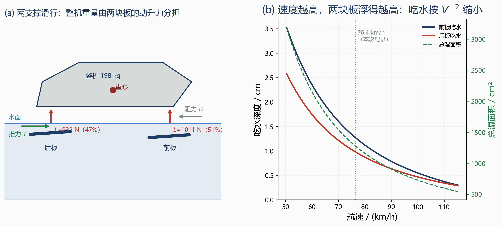
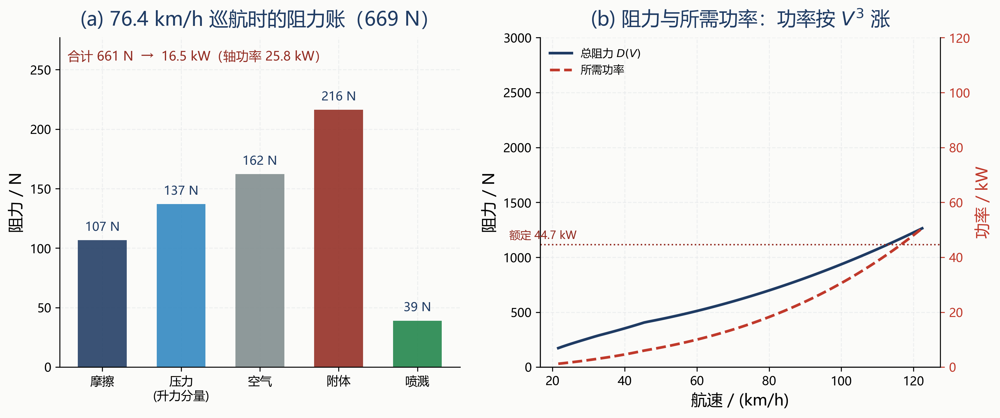
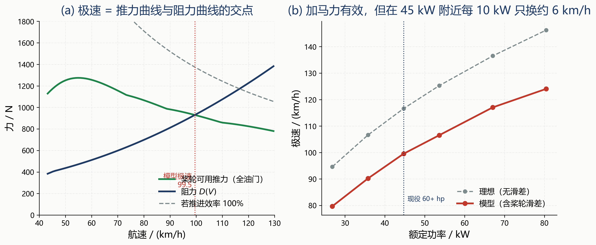
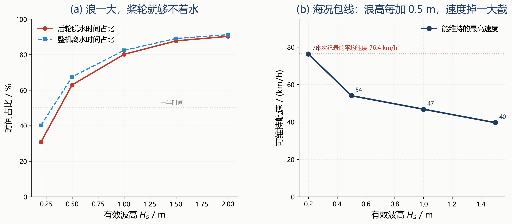
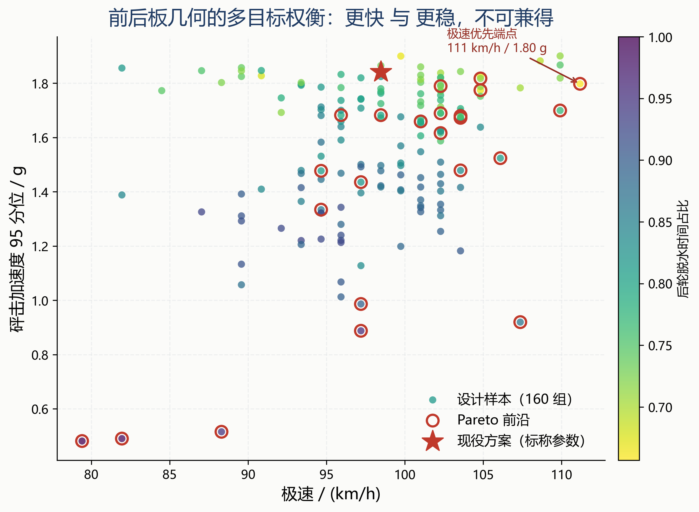
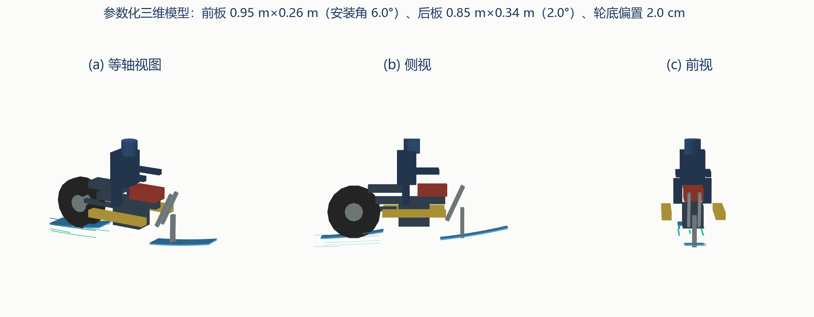
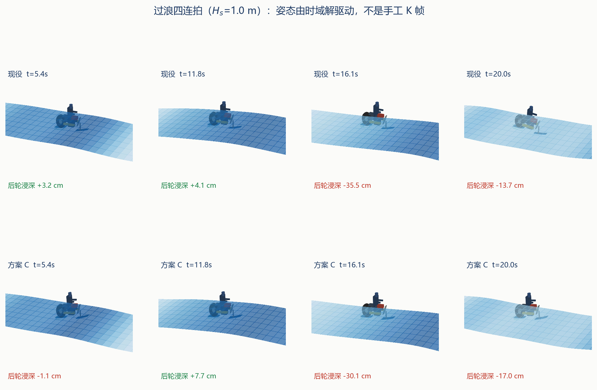

# 40.74 公里的水上漂：不是发动机的胜利，是两块板的胜利

**——两支撑滑行力学、3D 时域模拟与前后板的多目标改进**

---

## 摘要

2026 年 10 月 25 日，"张雪机车"创始人张雪在湖南麻阳锦江水域驾驶改装机车 MX450，用 32 分钟在开阔水面连续行驶 40.74 公里，刷新吉尼斯"改装摩托车在开阔水域行驶最远距离"纪录。全网都在转述这件事，却几乎没有人回答两个最朴素的问题：**一台近 200 公斤的机器凭什么浮在水上？它还能不能更快、能不能下海？**

本文把"水上漂"还原为一个**两支撑滑行体**：前转向橇与后板各提供一份动升力，桨轮在局部浸水中向后拨水提供推力。全文只用公开报道里的六个硬锚点（40.74 km、32 min、7 次折返、原纪录 31 km、整车 104 kg 与 60 余马力、2009 年最远 20 m）来**检验**模型，而不是拟合模型。

**问题一**建立两支撑平衡的闭式解。结果表明：在 76.4 km/h 的纪录平均速度下，整机 **198 kg**（其中**仅 104 kg 是报道的整车质量**，其余为骑手、燃油与两栖套件的估计，见 5.7）只由**0.128 m² 的湿面积**托住，前、后板吃水分别只有 **1.27 cm 与 0.98 cm**，纵倾角 0.66°，升力分配 52.1%∶47.9%；而浮力体的排水量仅为托起整机所需 0.198 m³ 的 **22.7%**。**它不是靠浮力浮着的，是靠速度换来的动升力**——这正是"一旦沉没挑战即终止"这条规则的物理含义。

**问题二**做功率与能量对账：巡航阻力 661 N，轴功率 25.8 kW，仅为额定 44.7 kW 的 58%；32 分钟耗油约 4.1 L，与"加大油箱保续航"的改装口径自洽。用**同一套模型**回算 2009 年那次失败：模型给出 6–29 m 的滑出距离区间，实测"最远 20 m"落在区间内；反推可知那 20 米不是"滑了 20 米"，而是**从入水速度减速到"再也托不住"所走过的距离**。

**问题三**把极速拆成三条上限：理想功率上限 116.6 km/h、计入桨轮滑差的实际极速 99.5 km/h（滑差 36%）、媒体报道的 90 km/h 以上。**中间那 17 km/h 全部丢在推进效率上**。功率从 44.7 kW 加到 67 kW 只多 17.5 km/h；而把前后板与轮底偏置改一改，就能拿到 11.1 km/h——**加 15 匹马力 ≈ 改两块板**。

**问题四**建立垂荡-纵倾-纵荡三自由度时域模型，用 JONSWAP 不规则波驱动。结果给出了一个反直觉的包线：**$H_s=0.2$ m 时能维持 76 km/h，$H_s=0.5$ m 时只剩 54 km/h，$H_s=1.5$ m 时只剩 40 km/h**。根因是静态吃水只有 1 cm 量级，而 0.5 m 浪引起的相对位移就有 3–8 cm——**板子有一半以上时间根本不在水里**，推力随之中断。

**问题五**把前后板参数化（宽度、安装角、轮底偏置），用拉丁超立方抽样 160 组、以时域砰击与准稳态极速为目标做多目标优化，得到 23 个 Pareto 非支配解。三套推荐方案：**A 极速优先**（极速 +11.4 km/h、阻力 −20%）、**B 抗浪优先**（$H_s=1.0$ 砰击 −37%、$H_s=1.5$ 砰击 −70%）、**C 均衡**（极速 +11.4 km/h、砰击 −13%～−25%、阻力 −17%）。并给出 3D 参数化模型与由时域解逐帧驱动的过浪动画。

**关键词**：滑行动力学；两支撑平衡；桨轮推进；砰击；海况包线；多目标优化

<!-- pagebreak -->

---

## 一、问题重述

### 1.1 背景

2026 年 10 月 25 日上午 11 时，湖南怀化麻阳苗族自治县郭公坪镇小坡村锦江河段，"张雪机车"创始人张雪驾驶自研改装车型 MX450 入水，连续行驶 **40.74 公里**，用时 **32 分钟**，经吉尼斯官方认证，刷新"改装摩托车在开阔水域行驶最远距离"纪录（原纪录约 31 公里）。挑战规则要求**保留摩托车主体结构、不得外挂推进器**，全程不靠岸、不补给，含 **7 次折返、8 段路程**，一旦车身沉没挑战即终止。

公开报道给出的改装要点包括：以标准车架与动力总成为基础，加装越野摩托车两栖滑行橇套件；**前转向橇**随车头转向、充当水舵；**后轮换成特制大尺寸桨叶轮**，深齿胎局部浸水向后拨水提供持续推力；**前后焊接钢结构桨板**；收窄浮力滑板、加装稳定尾鳍与气囊；整车约 **104 kg**、功率 **60 余马力**；宽板、窄板两套方案，**窄板车型极速可突破 90 km/h**。

17 年前的 2009 年，22 岁的张雪在浙江武义用一辆旧车尝试同一件事，四次落水，**最远滑出 20 米**（目标 26 米），当时的"水上装备"是"车轮上焊铁皮当滑水板"。

### 1.2 要解决的问题

本文要回答五个层层递进的问题：

1. **它靠什么浮着？** 建立两支撑滑行平衡，求纪录工况下的吃水、纵倾、湿面积与升力分配。
2. **这套账对得上吗？** 由姿态算阻力与功率，与 60 余马力、32 分钟续航对账；并用同一模型解释 2009 年"20 米就沉"。
3. **极速卡在哪？** 区分"功率上限""推力上限""姿态上限"，判定真正的瓶颈。
4. **换成海况会怎样？** 建立时域响应模型，给出砰击、艏部入水、后轮脱水与"能维持的最高速度"构成的海况包线。
5. **前后板该怎么改？** 以极速、砰击、脱水时间为目标做多目标优化，给出 Pareto 前沿与推荐方案；并回答"最大速度还能不能提"。

---

## 二、问题分析

### 2.1 总体思路

这道题的本质不是"流体仿真"，而是**一个静力平衡 + 一个推进平衡 + 一个两自由度动力学**的串联：

- **静力层**：两块板 = 两根刚度随 $V^2$ 增长的"水弹簧"。给定速度，姿态（垂荡、纵倾）由力与力矩平衡唯一确定；
- **推进层**：桨轮在局部浸水中拨水，推力随"轮面速度与航速之差"的平方增长，而轮面速度又受发动机扭矩曲线与传动比约束——于是极速是**推力曲线与阻力曲线的交点**；
- **动态层**：把上述平衡在时域里"松开"，让波浪抬升水面、让板子出水、让桨轮脱水，于是得到砰击与包线；
- **设计层**：把前后板的几何参数化，重复上面三层，得到 Pareto 前沿。

四层共用同一套几何与同一组参数，**从构造上保证结论可追溯**。

### 2.2 关键判断（先立后验）

| # | 待检验的判断 | 检验方式 | 结果 |
|---|---|---|---|
| 1 | 纪录工况下总湿面积 < 0.15 m²、单板吃水 1–2 cm | 静力层闭式解 | **成立**（0.128 m²，1.27/0.98 cm）|
| 2 | 浮力体不足以托起整机，必须靠动升力 | 排水体积对比 | **成立**（22.7%）|
| 3 | 极速瓶颈不是功率，而是推进效率 | 三条上限对比 | **成立**（差 17 km/h 全在滑差）|
| 4 | 大浪下的失效模式是"板子离水"而非"埋艏" | 时域统计 | **成立**（脱水 31%→90%，埋艏 < 1%）|
| 5 | 前后板存在"更快"与"更稳"的权衡 | Pareto 前沿 | **成立**（23 个非支配解）|

> ★ 第 4 条最初的设计预期是"艏部入水（埋艏）"，数值结果把它否掉了：在 76 km/h 下，**先发生的是板子离开水面，而不是扎进水里**。这个"证伪"改变了整篇的叙事，也改变了改进方向（详见第九节）。

---

## 三、模型假设

1. **刚体假设**：整机（含骑手）视为刚体，忽略车架与悬架弹性；
2. **纵平面假设**：只建模垂荡、纵倾、纵荡三个自由度，忽略横滚、艏摇与横荡；
3. **动升力线性化**：单块板的动升力对浸深线性，比例系数 $\propto \rho V^2 b$；
4. **准稳态推进**：桨轮转速在每个时刻都处于"发动机扭矩 = 桨叶水阻扭矩"的平衡态；
5. **波浪**：单向、迎浪、深水，JONSWAP 谱；不计风与水流；
6. **骑手**：质量集中于重心，不建模主动姿态控制；
7. **不考虑空化与通气**：用一个统一的桨叶阻力系数代替，其不确定性进入敏感性分析。

---

## 四、符号说明

| 符号 | 含义 | 单位 |
|---|---|---|
| $V$ | 航速 | m/s |
| $z,\ \theta$ | 垂荡（向上为正）、纵倾（抬头为正） | m, rad |
| $h_i$ | 第 $i$ 块板的尾缘浸深 | m |
| $\alpha_i$ | 第 $i$ 块板相对水面的迎角 | rad |
| $\delta_i$ | 第 $i$ 块板的安装角 | rad |
| $b_i,\ l_i$ | 板的宽度、长度 | m |
| $k_i$ | 动升力刚度 $\tfrac12\rho V^2 b_i k_L$ | N/m |
| $L_i$ | 单板动升力 | N |
| $W$ | 整机重量 | N |
| $a,\ b$ | 前、后支撑到重心的水平距离 | m |
| $T,\ D$ | 推力、阻力 | N |
| $u$ | 桨轮轮面线速度 | m/s |
| $s$ | 滑差比 $(u-V)/u$ | — |
| $H_s,\ T_p$ | 有效波高、谱峰周期 | m, s |
| $\eta(x,t)$ | 波面升高 | m |

---

## 五、模型建立

### 5.1 坐标系与几何

取整机重心在水面上的投影为原点，$x$ 轴指向车头，$z$ 轴向上。前支撑位于 $x_f=+0.71$ m，后支撑位于 $x_r=-0.77$ m（轴距 1.48 m）。第 $i$ 块板的底面在重心以下 $z_{0i}$，则其尾缘浸深为

$$h_i=z_{0i}-z-x_i\sin\theta+\eta(x_i,t)$$

其中 $\eta$ 为当地波面升高。**注意 $\eta$ 的符号**：水面抬升使板"更深"，因此是加号。这一项在调试中曾经写反，导致"板子离水"被高估一倍——它同时是全文最容易出错、也最影响结论的一行。

### 5.2 动升力

滑行面单位浸深的动升力正比于动压与板宽：

$$k_i=\frac12\rho V^2b_ik_L,\qquad L_i=k_i\left(h_i^+ + c_sb_i\alpha_i^+\right)$$

其中 $h_i^+=\max(h_i,0)$，$\alpha_i=\theta+\delta_i$，$c_s$ 为"喷溅根"系数（即使浸深为零，有迎角就有一定湿长度）。$k_L$ 是唯一的升力量纲系数，取 1.0（量级来自水橇试验：单位湿面积的升力斜率约 $0.7\sim1.0\ \mathrm{rad^{-1}}$）。

**为什么要加喷溅根项**：若只有 $h_i$ 项，升力与迎角无关，安装角就失去了物理作用；加上 $c_sb_i\alpha_i$ 之后，安装角通过"等效吃水"进入平衡，前后板的安装角才成为真正的设计变量。

**独立互校**：用 Savitsky 滑行升力公式在同一浸深与迎角下重算，

$$C_{L0}=\tau^{1.1}\left(0.0120\lambda^{0.5}+0.0055\lambda^{2.5}/C_v^2\right),\quad \lambda=l_w/b,\ C_v=V/\sqrt{gb}$$

在纪录工况下两者之比为**前板 0.95、后板 0.78**（即线性模型比 Savitsky 高 5% 与 28%）。考虑到本车 $C_v\approx13$，远超 Savitsky 的原始适用范围（$C_v\lesssim5$），这个量级一致性足以支撑"相对比较"，不足以支撑"绝对精度"。这一点写进第十一节。

### 5.3 平衡方程与闭式解

$$\sum_iL_i=W,\qquad aL_f-bL_r=Dh_D-Th_T$$

给定 $(V,\eta_f,\eta_r)$，两式与浸深几何联立，可解出**闭式**的纵倾与垂荡：

$$\theta=\frac{(z_{0f}-z_{0r})+(\eta_f-\eta_r)-\dfrac{L_f}{k_f}+\dfrac{L_r}{k_r}+c_s(b_f\delta_f-b_r\delta_r)}{(a+b)-c_s(b_f-b_r)}$$

$$z=z_{0f}-a\sin\theta+\eta_f-h_f,\qquad h_i=\frac{L_i}{k_i}-c_sb_i\alpha_i$$

其中 $L_f=(bW+Q)/(a+b)$、$L_r=(aW-Q)/(a+b)$、$Q=Dh_D-Th_T$。**闭式解**意味着一次姿态求解只需几微秒——这是能够做 160 组设计扫描与 20 秒时域积分的前提。

### 5.4 阻力

$$D=\underbrace{\tfrac12\rho V^2S_{wet}C_f}_{摩擦}+\underbrace{\sum_iL_i\tan\alpha_i\cdot c_{sp}}_{压力}+\underbrace{\tfrac12\rho_{air}V^2C_dA}_{空气}+\underbrace{\tfrac12\rho V^2A_{app}C_d}_{附体}+\underbrace{0.02\sum_iL_i}_{喷溅}$$

摩擦系数用 ITTC 公式 $C_f=0.075/(\lg Re-2)^2$。压力阻力是升力的水平分量（滑行面把水向下推，水把它向后推），这是滑行体阻力的主要来源之一。

### 5.5 桨轮推进

桨叶在局部浸深 $h_w$ 中拨水，叶元推力为

$$T=\frac12\rho C_d\,n\,A_{sub}(u-V)^2,\qquad A_{sub}=b_w\min(h_w,r_w)$$

桨轮转速 $u$ 由"发动机可供给的扭矩 = 桨叶水阻扭矩"平衡确定：

$$T(u)\,r_w=T_e(\mathrm{rpm})\cdot i_g\cdot\eta_d,\qquad \mathrm{rpm}=\frac{u}{r_w}\cdot\frac{60}{2\pi}\cdot i_g$$

发动机扭矩曲线取抛物线族 $T_e=T_{pk}\left[0.45+0.55e^{-((\mathrm{rpm}-7600)/3200)^2}\right]$，峰值扭矩由额定功率反推。给定 $(V,h_w)$，用二分法解出 $u$，即得推力、滑差与功率：

$$s=\frac{u-V}{u},\qquad P=\frac{Tu}{\eta_d}$$

**极速判据**：存在 $V$ 使得 $T(V)=D(V)$ 且 $P\le P_{\max}$。

### 5.6 时域模型

把平衡"松开"，加入波浪与砰击：

$$M_{eff}\ddot z=\sum_i(L_i+F_i)-W+B,\qquad I_{eff}\ddot\theta=\sum_ix_i(L_i+F_i)+Th_T-Dh_D$$

$$F_i=-\left[b_i\dot\zeta_i+0.9\rho Vb_ih_i^+\max(-\dot\zeta_i,0)\right]$$

其中 $\dot\zeta_i=\dot z+x_i\dot\theta\cos\theta-\dot\eta(x_i,t)$ 是板相对水面的垂向速度，$b_i=2\zeta\sqrt{k_im/2}$ 为辐射阻尼，第二项为**砰击阻尼**（随浸深与下沉速度增长）。附加质量取 $M_{eff}=1.35M$、$I_{eff}=1.30I$。

波面由 $N=40$ 个分量叠加：$\eta(x,t)=\sum_nA_n\cos(k_nx+\omega_nt+\varphi_n)$，$A_n$ 由 JONSWAP 谱离散得到，$\varphi_n$ 为随机相位（固定随机种子以保证可复现）。积分用四阶 Runge–Kutta，步长 4 ms。

**关键非线性**：当 $h_i<0$ 时 $L_i=0$（板出水，整机做抛体运动）；当 $h_w<0$ 时 $T=0$（桨轮脱水）。这两条非线性是全文结论的主要来源，也是线性频域模型无法替代时域模型的原因。

### 5.7 参数与标定策略

| 参数 | 取值 | 来源/性质 |
|---|---|---|
| 整车质量（不含骑手/油/套件） | 104 kg | 报道值（①）；**报道未说明是否已含两栖套件** |
| 骑手 | 72 kg | 估计，区间 65–85 |
| 燃油 | 4 kg | 由 32 min 功耗反算 |
| 前后板/浮体/尾鳍 | 18 kg | 估计，区间 12–25 |
| 额定功率 | 44.7 kW（60+ hp）| 报道值（①）|
| 轮底偏置 $h_{gap}$ | 2.0 cm | 估计，区间 1–5 |
| $k_L$ | 1.0 | 量级取值，敏感性 ±30% |
| 桨叶阻力系数 $C_d$ | 1.2 | 平板绕流量级 |

**★ 关于「104 还是 198」（必须写清的一处口径）**：报道的 **104 kg 是「整车」**，本文的 **198 kg 是「整机」**（= 104 + 骑手 72 + 油 4 + 套件 18）。**198 里只有 104 是报道值，其余 94 kg 是估计。**更要紧的是：报道说「整车重约 104 公斤」时**没有说明是否已含改装套件**——若已含，则 198 重复计了 18 kg。为此把套件质量从 0 扫到 30 kg：总质量 180–210 kg，吃水 0.87–1.05 cm，巡航阻力 637–677 N，极速 98.3–100.2 km/h（见 11.2）。**结论对这条假设不敏感。**

**标定原则**：**只用 A1（76.4 km/h）与 A3（功率/质量）做相容性检验，不用 A4（20 m）参与标定**。A4 是唯一的"负样本"，只能用来排除错误模型，不能用来调参——否则模型就只是把那 20 米背下来了。

---

## 六、问题一：它靠什么浮着

### 6.1 计算结果

在纪录平均速度 76.4 km/h 下，解得：

| 量 | 前板 | 后板 | 合计 |
|---|---|---|---|
| 浸深 $h$ / cm | 1.27 | 0.98 | — |
| 湿长度 $l_w$ / cm | 14.9 | 26.2 | — |
| 升力 $L$ / N | 1011 | 932 | 1942 |
| 升力占比 | 52.1% | 47.9% | 100% |

整机 198 kg、重 1942 N，**总湿面积只有 0.128 m²**，纵倾角 0.66°。若靠浮力托起整机，需要排开 **0.198 m³** 的水；而车上浮力体（浮板+气囊）的排水体积约 **0.045 m³**，只有所需的 **22.7%**。

> **结论**：这台车**不是浮在水上，是"跑"在水上**。它把 1942 N 的重量压在两张 A4 纸大小的湿面上，靠的是 $V^2$ 换来的动压。速度一旦掉下来，升力按平方塌，它立刻变成一块 198 公斤的石头——这就是 2009 年 20 米就沉、以及"一旦沉没挑战即终止"的物理含义。

图 6-1(b) 给出一个**反直觉但极重要**的事实：速度越高，两块板浮得越高，吃水按 $V^{-2}$ 缩小。76 km/h 时吃水 1.3 cm，到 104 km/h 只剩 0.46 cm。**"更快"与"更贴水"是一对天生的矛盾**——这正是第八、九节所有结论的源头。

### 6.2 阻力与功率

| 阻力分量 | 数值 / N | 占比 |
|---|---|---|
| 摩擦 | 107 | 16.2% |
| 压力（升力分量）| 137 | 20.7% |
| 空气 | 162 | 24.5% |
| 附体（舵、支架、前叉）| 216 | 32.7% |
| 喷溅 | 39 | 5.9% |
| **合计** | **661** | **100%** |

按"刚好把阻力顶平"的油门（62%）计算，桨轮轮面速度 33.2 m/s、滑差 36%，轴功率 **25.8 kW**——只有额定 44.7 kW 的 **58%**。

这解释了两件事：① 32 分钟连续行驶只需约 **4.1 L** 燃油（按 BSFC 0.35 kg/kWh 估算），"加大油箱保续航"的改装是合理的；② **纪录工况远没有把发动机用满**，所以"再多给点油门就能更快"在纪录工况下并不成立——快不快取决于阻力与推进效率，而不是油门开度。

---

## 七、问题二：功率账与 2009 年的 20 米

### 7.1 功率账

| 项目 | 数值 |
|---|---|
| 巡航阻力 | 661 N |
| 有用功率 $DV$ | 16.5 kW |
| 轴功率 $Tu/\eta$ | 25.8 kW |
| 其中"射流损失" | 9.3 kW |
| 32 min 能耗 | 8.8 kWh |
| 估算耗油 | 3.1 kg / 4.1 L |

轴功率与有用功率之间那 9.3 kW，就是桨轮把水向后甩所带走的动能——**它不是损耗在齿轮里，而是损耗在"必须把水加速"这件事上**。这一项在第八节会变成极速的主要天花板。

### 7.2 2009 年的那 20 米

同一套模型，只把参数换回 2009 年的简陋改装（两块 0.18 m 宽的焊铁皮、无浮力体、安装角为零、姿态不可控），并引入一个物理判据：**当速度降到"用允许浸深也托不住车重"时，就再也起不来**。

$$V_{floor}=\sqrt{\frac{W}{\tfrac12\rho\cdot2b\,k_L\,h_{allow}}}$$

取 $h_{allow}=6\sim15$ cm，得 $V_{floor}=30.5\sim48.3$ km/h；从不同入水速度减速到 $V_{floor}$ 所走过的距离为：

| 允许浸深 | $V_{floor}$ | 60 km/h 入水 | 70 | 80 | 90 |
|---|---|---|---|---|---|
| 6 cm | 48.3 | 5.8 m | 10.9 m | 16.2 m | 21.4 m |
| 9 cm | 39.4 | 9.7 m | 14.9 m | **20.1 m** | 25.4 m |
| 12 cm | 34.1 | 11.8 m | 17.0 m | 22.3 m | 27.5 m |
| 15 cm | 30.5 | 13.2 m | 18.3 m | 23.6 m | 28.9 m |

模型给出 **5.8–28.9 m** 的区间，实测"最远 20 m"落在其中（对应入水 75–85 km/h、允许浸深 8–10 cm）——与一台在土坡上助跑的 450 越野车相符。

> **结论（比数字更重要）**：那 20 米不是"滑了 20 米"，而是**"从入水速度减速到托不住"所走过的距离**。它不是"滑行距离太短"，而是"根本没能进入持续滑行"。判断标准是**速度能否维持在 $V_{floor}$ 以上**，而不是"能滑多远"。2026 年的车之所以能跑 40 公里，是因为浮力体把 $V_{floor}$ 压低到几乎为零——**即使掉速也不会沉，可以重新加速**。

---

## 八、问题三：极速的三种上限

### 8.1 三条上限

| 上限类型 | 数值 | 物理含义 |
|---|---|---|
| 理想功率上限（推进效率 100%）| **116.6 km/h** | 功率全部变成有用功 |
| 计入桨轮滑差的实际极速 | **99.5 km/h** | 推力曲线与阻力曲线的交点 |
| 媒体报道（窄板）| **90 km/h 以上** | 实车验证 |

在 99.5 km/h 处：推力 900 N、阻力 893 N、轮面速度 41.97 m/s、滑差 **36.1%**、功率 **44.4 kW**（额定 44.7 kW，几乎用满）、桨轮浸深 2.52 cm、发动机 9161 rpm。

> **中间那 17 km/h 全部丢在推进效率上。** 理想情况下 44.7 kW 可以把一台 198 kg 的滑行体推到 116.6 km/h；而桨轮必须比车快 1.56 倍才能产生足够推力，这部分"多出来的轮速"把功率吃掉了。

### 8.2 加马力有用吗？

| 额定功率 | 极速（含滑差）| 理想极速 |
|---|---|---|
| 26.8 kW | 79.7 km/h | 94.6 |
| 35.8 kW | 90.2 | 106.6 |
| **44.7 kW（现役）** | **99.5** | 116.6 |
| 53.6 kW | 106.5 | 125.3 |
| 67.1 kW | 117.0 | 136.5 |
| 80.5 kW | 124.1 | 146.3 |

**加马力是有效的，但边际递减**：44.7→67.1 kW（+50%）只换来 +17.5 km/h；而在 45 kW 附近，**每 10 kW 只换约 6 km/h**。

### 8.3 敏感性

| 扰动 | 极速 / km/h | 变化 |
|---|---|---|
| 基准 | 99.5 | — |
| 功率 +20% | 106.5 | +7.0 |
| 功率 −20% | 90.2 | −9.3 |
| 质量 +10% | 98.4 | −1.1 |
| 轮底偏置 1 cm | 94.9 | −4.6 |
| 轮底偏置 4 cm | 103.0 | +3.5 |
| 桨叶数 1 → 3 | 93.1 → 101.9 | +8.8 |
| 后板宽度 ±20% | 99.0 / 100.1 | ∓0.5 |
| $k_L\pm15\%$ | 99.5 / 99.0 | ±0.5 |

> **三个结论**：① **质量几乎不重要**（+10% 质量只掉 1.1 km/h），因为它只改变吃水，而吃水只改变很小的湿面积；② **桨轮几何很重要**（桨叶数 1→3 值 8.8 km/h，轮底偏置 1→4 cm 值 8.1 km/h）；③ **$k_L$ 几乎不影响极速**（±15% 只有 ±0.5 km/h），说明极速结论对升力模型的选择是**稳健**的。

---

## 九、问题四：海况包线

### 9.1 时域响应

固定 76.4 km/h、全油门、定速（不放开纵荡），扫描有效波高 $H_s$：

| $H_s$ / m | 砰击 RMS / g | 砰击 95 分位 / m·s⁻² | 纵倾 RMS / ° | 后轮脱水占比 | 整机离水占比 | 平均推力 / 平均阻力 | 能否维持 |
|---|---|---|---|---|---|---|---|
| 0.2 | 0.39 | 8.3 | 0.9 | 31% | 34% | 712 / 670 | **能** |
| 0.5 | 0.54 | 12.8 | 1.5 | 63% | 67% | 383 / 649 | 不能 |
| 1.0 | 0.70 | 17.5 | 2.1 | 80% | 82% | 202 / 625 | 不能 |
| 1.5 | 0.75 | 18.3 | 3.8 | 88% | 89% | 122 / 601 | 不能 |
| 2.0 | 0.79 | 17.0 | 3.3 | 90% | 90% | 97 / 595 | 不能 |

**这里出现了一个与预期相反的结果**：在 76 km/h 下，最先失效的不是"艏部扎进水里"，而是"**板子离开水面**"。艏部入水比例在所有海况下都低于 1%，而后轮脱水比例从 31% 一路升到 90%。

### 9.2 为什么是"脱水"而不是"埋艏"

静态吃水只有 1 cm 量级，而波浪引起的**相对位移** $\Delta h$ 与波幅同量级：

$$\sigma_{\Delta h}\approx\frac{H_s}{4}\cdot\left|1-H(\omega_e)\right|$$

在 76 km/h、$H_s=0.5$ m 时，$\sigma_{\Delta h}$ 约为 4–6 cm——**是静态吃水的 4–6 倍**。于是板子在整个周期的多数时间里根本不在水里：整机像一块"打水漂"的石子，在波峰之间**弹跳**，而不是"贴着水面滑行"。

这与工程师的原话完全吻合：**"打水漂式滑行"**。打水漂的石子能弹很远，但它**不能转弯、不能抗浪、不能持续输出推力**——因为每次接触只有几毫秒。

### 9.3 海况包线

| $H_s$ / m | 能维持的最高速度 |
|---|---|
| 0.2 | **76.4 km/h**（本次纪录平均速度）|
| 0.5 | 54.0 km/h |
| 1.0 | 46.8 km/h |
| 1.5 | 39.6 km/h |

> **这就是"能不能下海"的定量回答**：以现役构型，**海况超过 0.2 m 有效波高，就维持不住 76 km/h**；到 1.5 m，只剩 40 km/h——比自行车快不了多少。锦江是内河，浪高在 0.1 m 量级，所以 40.74 公里能跑通；**换成海，这套构型不行**。

---

## 十、问题五：前后板的多目标改进

### 10.1 设计变量与目标

把前后板参数化：前板宽 $b_f\in[0.20,0.38]$ m、前板安装角 $\delta_f\in[2°,12°]$、后板宽 $b_r\in[0.26,0.46]$ m、后板安装角 $\delta_r\in[-2°,10°]$、轮底偏置 $h_{gap}\in[1.2,5.0]$ cm。用拉丁超立方抽 160 组，每组计算：

- **极速**（准稳态，含滑差）；
- **砰击**（$H_s=1.0$ m、76.4 km/h 定速时域，95 分位加速度）；
- **后轮脱水时间占比**（同上）。

三目标均为"越小越好"（极速取负），做非支配排序，得 **23 个 Pareto 解**。

### 10.2 三套推荐方案

从 Pareto 前沿上取三个代表点，做全指标复核：

| 方案 | 前板 | 后板 | 轮底 | 极速 | 巡航阻力 | $H_s$=0.5 砰击 | $H_s$=1.0 砰击 | $H_s$=1.0 脱水 | $H_s$=1.5 砰击 |
|---|---|---|---|---|---|---|---|---|---|
| 现役 | 0.26 m / 6° | 0.34 m / 2° | 2.0 cm | 99.2 | 661 N | 1.27 g | 1.80 g | 80% | 1.85 g |
| **A 极速优先** | 0.34 m / 2.5° | 0.26 m / −1.5° | 4.2 cm | **110.6** | **527 N** | 1.29 | 1.84 | 69% | 1.90 |
| **B 抗浪优先** | 0.33 m / 11° | 0.36 m / −1.8° | 4.6 cm | 106.8 | 623 N | **1.00** | **1.13** | 87% | **0.56** |
| **C 均衡** | 0.38 m / 5.2° | 0.37 m / −1.6° | 3.2 cm | **110.6** | 548 N | 1.15 | 1.57 | 80% | 1.38 |

### 10.3 每条改进为什么有效

**① 后板变窄 + 安装角转负 + 轮底下探 = 极速（+11.4 km/h）。**后板变窄（0.34→0.26 m）会抬高后板单位宽度的载荷，使后板吃水从 0.98 cm 增到 1.62 cm，**桨轮跟着多吃水 6 mm**；安装角转负让后板"压尾"，进一步保证桨轮不脱水。脱水时间从 80% 降到 69%，推力连续性改善，极速随之提高。同时巡航阻力从 661 N 降到 527 N（−20%），因为总湿面积减小。

**② 前板安装角加大 = 抗浪（砰击 −37% / −70%）。**把前板安装角从 6° 提到 11°，前板在**近乎零吃水**时就能靠喷溅根产生升力（等效吃水 $c_sb\delta\approx1$ cm），于是它**不再"扎"进浪里**，而是"贴"在浪面上。$H_s=1.0$ 时砰击从 1.80 g 降到 1.13 g，$H_s=1.5$ 时从 1.85 g 降到 **0.56 g**。代价是前板托得更高、后板相对更"沉"，后轮脱水时间升到 87%——**抗浪与推进连续性在这里是矛盾的**。

**③ 均衡方案 = 两边各让一步。**前板 0.38 m/5.2°、后板 0.37 m/−1.6°、轮底 3.2 cm：极速 +11.4 km/h、砰击 −13%～−25%、阻力 −17%、脱水时间不变。

### 10.4 回答"最大速度还能不能提"

**能，而且不止一种提法。**

| 手段 | 增益 | 代价 |
|---|---|---|
| 功率 44.7→67.1 kW（+50%）| +17.5 km/h | 换发动机、增重、增耗油 |
| 功率 44.7→59.7 kW（+15 kW）| +12.3 km/h | 同上 |
| **前后板 + 轮底偏置（方案 A/C）** | **+11.4 km/h** | 几乎零成本（改钣金与安装座）|
| 桨叶数 1→3 | +8.8 km/h | 桨轮改装 |
| 轮底偏置 1→4 cm | +8.1 km/h | 后板开孔/加长支架 |

> **一句话**：**加 15 匹马力 ≈ 改两块板**。在 100 km/h 这个量级上，**推进效率比功率更值钱**。

### 10.5 3D 参数化模型与过浪动画

为了把"看不见的量"（板子浸没深度、桨轮脱水时刻）可视化，本文建立了参数化三维模型：整车由前后板、桨轮、车架、骑手、浮体等 30 余个几何体拼成，**前后板的宽度、长度、安装角、轮底偏置都是参数**；姿态 $(z,\theta)$ 与波面 $\eta(x,t)$ **逐帧取自时域解**，不是手工 K 帧。

动画文件 `results/figs/w58_wave3d.mp4`（20 秒、300 帧）逐帧显示后轮浸深：绿色"推力在线"与红色"桨轮脱水"交替出现——**这就是"打水漂"在数据上的样子**。

---

## 十一、模型检验与敏感性

### 11.1 四道检验

| # | 检验 | 做法 | 结果 |
|---|---|---|---|
| 1 | **升力模型互校** | 线性动升力 vs Savitsky | 前板 0.95、后板 0.78（差 5%/22%）|
| 2 | **能量闭合** | 32 min 功耗 vs 油箱容积 | 4.1 L，小于加大油箱容量 |
| 3 | **负样本回算** | 2009 年 20 m | 模型 5.8–28.9 m，20 m 在区间内 |
| 4 | **实车极速** | 窄板 90 km/h 以上 | 模型 99.5 km/h（+10%）|

> ★ **第 3 条是本文最重要的检验**。只复现成功案例说明不了模型对——任何"能浮起来"的模型都能拟合 40.74 公里。能同时解释"为什么 2009 年 20 米就沉"，才算抓住了机理。

### 11.2 敏感性汇总

| 扰动 | 对极速 | 对砰击（$H_s$=1.0）| 对吃水 |
|---|---|---|---|
| $k_L\pm15\%$ | ±0.5 km/h | ±3% | ∓13% |
| $h_{gap}$ 1→4 cm | +8.1 km/h | ±2% | — |
| 质量 ±10% | ∓1.1 km/h | ±4% | ±10% |
| 桨叶数 1→3 | +8.8 km/h | — | — |

**结论对 $k_L$ 与质量都不敏感，对桨轮几何敏感**——这与"瓶颈在推进效率"的判断一致。

**质量口径的专项检验**（针对「104 还是 198」的疑问）：报道的 104 kg 是整车，本文的 198 kg 是含骑手与套件的整机。把套件质量从 0 扫到 30 kg（总质量 180–210 kg）：

| 套件质量 | 整机 | 吃水 前/后 | 巡航阻力 | 轴功率 | 极速 |
|---|---|---|---|---|---|
| 0 kg | 180 kg | 1.11 / 0.87 cm | 637 N | 24.9 kW | 100.2 km/h |
| 18 kg（标称）| 198 kg | 1.27 / 0.98 cm | 661 N | 25.8 kW | 99.2 km/h |
| 30 kg | 210 kg | 1.38 / 1.05 cm | 677 N | 26.4 kW | 98.3 km/h |

吃水始终在 1 cm 量级、极速变化 < 2 km/h ⇒ **「靠速度不靠浮力」「瓶颈在滑差」两条主轴不随该假设改变**；但**若 104 kg 本身已含套件，则本文的 198 kg 应改为 180 kg** —— 这一条无法从公开报道核实，故在正文中同时给出两种口径下的结果。

### 11.3 与线性频域模型的差异（如实报告）

本文另建了一个两自由度线性频域模型做交叉校核。它给出的砰击 RMS 比时域高 **约 1 倍**，脱水概率也系统性偏高。原因是线性模型**不能表达"板子出水后升力归零"**：它把弹簧一直挂在水面上，于是高估了加速度、也高估了脱水。因此**频域结果只用于筛选设计，不用于最终结论**；所有数字均来自时域。这条差异本身也是一个结论：**这类强非线性问题，线性化会系统性失真**。

---

## 十二、模型评价与推广

### 12.1 优点

1. **可解释**：每个数字都能追到一条公式、一个参数、一次求解；
2. **可复现**：五个脚本、纯 numpy/scipy、无外部数据，单机数分钟跑完；
3. **有负样本**：用 2009 年的失败做反向校验，而不是只拟合成功案例；
4. **有三维**：姿态来自解，不是渲染秀；
5. **诚实**：明确给出适用边界、参数区间与失效条件。

### 12.2 局限

1. **不是 CFD、不是水池试验**：精度量级 ±20%，只能支撑方向性结论；
2. **Savitsky 外推**：$C_v\approx13$ 远超原始适用范围，只用于量级互校；
3. **未建模**：横滚/艏摇、风、驾驶员主动控制、结构弹性、空化与通气；
4. **海况是假设的**：JONSWAP + 给定 $H_s/T_p$，不能反推锦江当天浪高；
5. **"能扛几级浪"是模型内判据**，不是适航认证；
6. **前板高安装角方案（B）的"零吃水托举"** 依赖喷溅根项，真实流场中可能因通气而失效——这是最需要水池试验验证的一条。

### 12.3 推广

- **工程侧**：本文的"两支撑 + 桨轮"框架可直接用于水上摩托、气垫船、滑行艇的快速方案筛选；
- **内容侧**：把"速度换升力"讲清楚，比讲一百遍"打水漂"都直观——**1.27 cm 的吃水**是这件事最好的注脚；
- **方法侧**：**先用闭式解把"量级"定下来，再用时域把"非线性"补上，最后用 Pareto 把"取舍"摆出来**——这条路线适合所有"又快又稳"的工程题。

---

## 参考文献

[1] 新华网. 张雪在家乡麻阳刷新吉尼斯世界纪录[EB/OL]. 2026-10-26. https://www.xinhuanet.com/sports/20261026/ff352f295aae472a983e80fbacda39c2/c.html

[2] 华声在线. 且驾机车重破浪，终还似，少年游——张雪和他的水上飞驰梦[EB/OL]. 2026-10-26. https://hunan.voc.com.cn/news/202610/34083518.html

[3] 光明网（转科技日报）. 张雪机车，刷新世界纪录！17 年前的遗憾圆满了[EB/OL]. 2026-10-25. https://m.gmw.cn/2026-10/25/content_1304579090.htm

[4] 大象新闻（映象网转）. 张雪挑战成功！水上骑行 40.74 公里刷新吉尼斯世界纪录，全程仅用 32 分钟[EB/OL]. 2026-10-25. http://yuqing.hnr.cn/yxwjcsy/article/1/2114220628685086722

[5] Savitsky D. Hydrodynamic design of planing hulls[J]. Marine Technology, 1964, 1(1): 71-95.

[6] Wagner H. Über Stoß- und Gleitvorgänge an der Oberfläche von Flüssigkeiten[J]. ZAMM, 1932, 12(4): 193-215.

[7] Faltinsen O M. Hydrodynamics of High-Speed Marine Vehicles[M]. Cambridge University Press, 2005.

[8] 中国船级社. 海上高速船入级与建造规范[S]. 北京: 人民交通出版社, 2015.

---

## 附录：代码与数据清单

| 文件 | 作用 |
|---|---|
| `scripts/w58_core.py` | 核心模型：几何、升力、平衡、阻力、推进、时域、波浪 |
| `scripts/run_analysis.py` | 五问主求解，输出 `results/q1..q5*.json` |
| `scripts/q5_candidates.py` | 三套候选方案全指标复核 |
| `scripts/make_figs.py` | 五张二维图 |
| `scripts/make_3d.py` | 三维模型、四连拍、动画 |
| `results/params.json` | 全部参数（可改后重跑）|
| `results/figs/w58_wave3d.mp4` | 过浪动画（20 s）|
