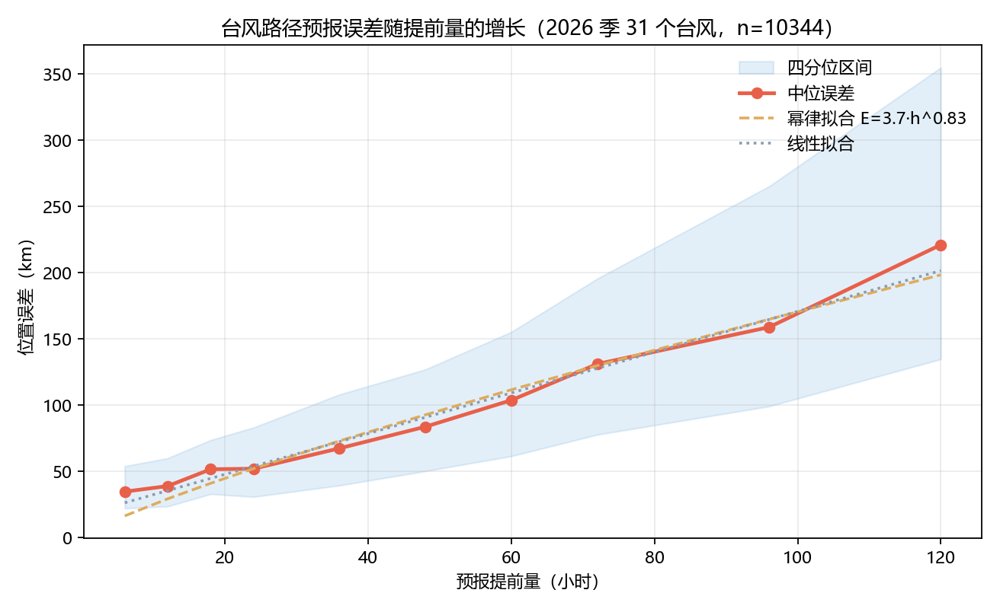
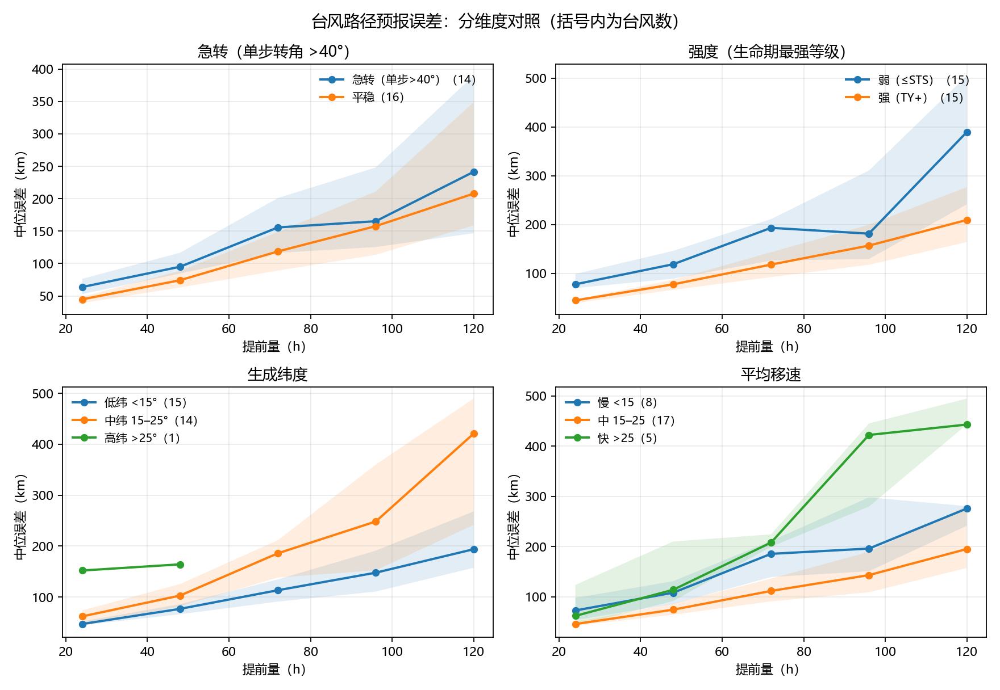
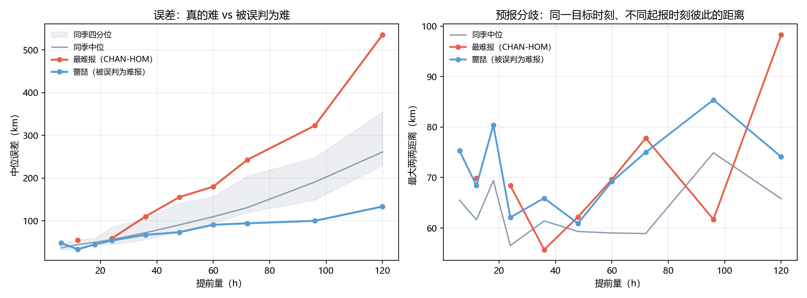
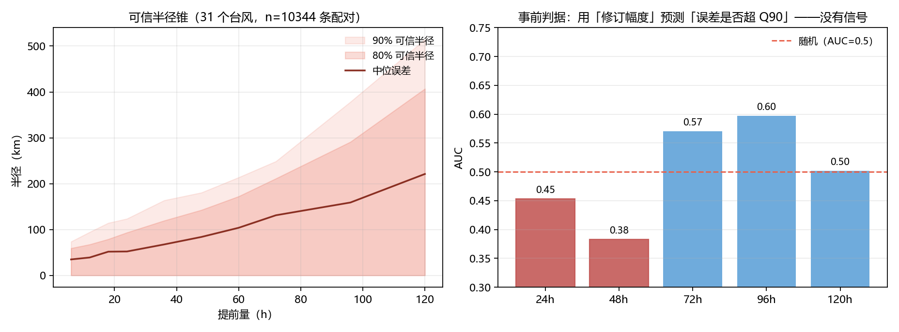

# 台风路径预报的误差账本：2026 季 31 个台风的实测

> **摘要**
>
> 2026 年 10 月，超强台风"蔷琵"在西北太平洋上"路径成悬念"，媒体连续多日给出"可能北上日本、也可能西行登陆我国"的判断。本文用中央气象台公开的 **2026 季预报存档**（31 个命名台风、12 255 条预报点、10 344 条配对样本），把"路径预报能信几天"量化成一串可核对的数。
>
> **主要结果**：① 误差随提前量**近似线性**增长，$E(h)\approx17.1+1.5h$（km），线性模型 AIC 18.4 优于幂律 26.0；② **6 小时预报就已有 34.8 km 的中位误差**，基础误差占大头；③ 分维度看，**弱台风（≤STS）与急转台风更难报**（24 h、48 h 的区间不重叠），**生成纬度越高越难报**（Spearman ρ=+0.52，区间不含 0）；④ 一正一反的案例对比显示，**"路径成悬念"的蔷琵误差只到当季第 12 百分位**（120 h 中位 133 km，同季 261 km），真正最难的是 CHAN-HOM（120 h 536 km，第 100 百分位）；⑤ 检验两个"事前可得"的指标（修订幅度、分歧度）后发现，**它们都预测不了误差**（AUC 0.38–0.60，相关系数区间全部跨 0）；⑥ 据此给出**可信半径锥**：72 h 要覆盖 90% 的落点，半径需 **249 km**。
>
> **诚实性声明**：只有 2026 一季有预报存档、只有 BABJ 一个机构、长提前量的样本丢弃率高达 25–34%。凡涉及跨年、跨模式或长提前量的结论，本文都不下断言。

<!-- pagebreak -->

---

## 一、问题重述

### 1.1 背景

2026 年 10 月，超强台风"蔷琵"（CHAMPI）维持超强台风级别超过 40 小时，移速 20–25 km/h。它的路径"成悬念"：可能北上转向日本，也可能继续西行登陆我国<sup>[1]</sup><sup>[2]</sup>。

公众看到的是一张张彩色路径图，却看不到一个基本事实：**每一条预报都对应一个提前量，而误差随提前量增长**。"24 小时预报"与"120 小时预报"不是同一件事，把它们画在同一张图上、用同一种语气播报，是这类信息最常见的失真。

### 1.2 四个问题

1. **误差随提前量怎么长**：给出 6–120 h 的误差分布，拟合增长律并比较线性与幂律；
2. **什么样的台风更难报**：按路径形态（是否急转）、强度、生成纬度、移速分组比较；
3. **谁真的难报、谁被误判为难报**：把案例放进季节分布，并区分"误差大"与"分歧大"；
4. **什么时候该说"不确定"**：给出可信半径锥与可操作的发布判据。

---

## 二、数据

### 2.1 来源与结构

数据取自中央气象台台风网的公开网页接口（`typhoon.nmc.cn/weatherservice/typhoon/jsons/`），免密钥，返回 JSONP。

| 端点 | 内容 |
|---|---|
| `list_<年>` | 该年台风列表（2015–2026 合计 350 个） |
| `view_<id>` | 单个台风：逐点实况轨迹 **+ 当时发布的预报** |

**关键结构发现**：每个实况点的第 11 个字段是预报字典：

```json
{"BABJ": [[提前量, 起报时, 经度, 纬度, 气压, 风速, 机构, 等级], …]}
```

即：**逐条预报都被挂在它的起报时刻上**，这正是"预报 vs 实况"配对所需的全部信息。

### 2.2 口径

- **时间**：`YYYYMMDDHHMM`（北京时间）；
- **误差**：预报位置与实况位置的**大圆距离**（haversine，$R=6371$ km）——不能用经纬度差，高纬处 1° 经度对应的距离只有赤道的一半；
- **配对**：在 `起报时刻 + 提前量` 附近找**最近**的实况点，容差 **3 h**（另做 1 h / 6 h 敏感性）；
- **样本**：2026 季 **31 个命名台风**，未命名热带低压不计入。

### 2.3 数据质量

| 项 | 情况 |
|---|---|
| 预报存档年份 | **仅 2026**（抽查 2019–2025 的 28 个台风，含预报 0 个） |
| 预报机构 | **仅 BABJ** |
| 实况分辨率 | 6 h（个别 3 h） |
| 重复时刻 | 0 |
| 相邻点移速 > 80 km/h 的段 | 4 段（MEKKHALA 1、HIGOS 2、BAVI 1），占配对 < 0.1% |

**⇒ 三条限制贯穿全文**：不做跨年对比、不做机构对比、长提前量样本有选择偏差。

---

## 三、模型与方法

### 3.1 误差与配对

对第 $k$ 个台风、起报时刻 $t$、提前量 $h$，取预报位置 $(\\lambda_f,\\varphi_f)$ 与实况位置 $(\\lambda_a,\\varphi_a)$：

$$
e_{k}(t,h)=\mathrm{hav}\big((\\lambda_f,\\varphi_f),(\\lambda_a,\\varphi_a)\big)
$$

实况位置取 $t+h$ 附近容差内的最近点。统计量以**逐提前量的中位数**为主（分布右偏，均值受长尾影响）。

### 3.2 增长律与模型选择

在逐提前量中位数 $(h_j,\\bar e_j)$ 上做**以样本量为权重的加权最小二乘**，比较：

$$
\\text{线性：}E=a+bh,\\qquad \\text{幂律：}E=ah^{b}
$$

用 AIC 选型：$\\mathrm{AIC}=n\\ln(\\mathrm{RSS}/n)+2k$。
参数区间用**按台风整群 bootstrap**（同一台风内部的点不独立，不能逐点重抽）。

### 3.3 分组比较

四个维度：是否急转、强度、生成纬度、平均移速。
每个 (维度, 组, 提前量) 报**台风数 + 配对数 + 中位 + 整群 bootstrap 95% 区间**。
组间是否"站得住"，以**区间是否重叠**为准，不做 $p$ 值堆砌。

### 3.4 分歧度（事前可得）

同一目标时刻、不同起报时刻的预报彼此最大两两距离：

$$
D_k(t,h)=\\max_{i<j}\\mathrm{hav}\\big(\\hat p_i(t,h),\\hat p_j(t,h)\\big)
$$

与误差不同，**分歧度在发布时就能算**，因此有资格充当发布判据的候选。

### 3.5 可信半径与判据评估

对每个提前量取误差分布的 $Q_{80}$、$Q_{90}$ 作为 80% / 90% 可信半径。
判据评估用 ROC/AUC：事件定义为"误差超过该提前量的 $Q_{90}$"。

---

## 四、结果

### 4.1 误差随提前量的增长近似线性



| 提前量 | n | 中位 (km) | P90 (km) |
|---|---|---|---|
| 6 h | 719 | 34.8 | 73.6 |
| 24 h | 1 614 | 52.1 | 123.5 |
| 48 h | 1 222 | 83.8 | 180.5 |
| 72 h | 858 | 131.1 | 248.7 |
| 120 h | 440 | 221.1 | 514.4 |

| 形式 | 参数 | AIC |
|---|---|---|
| **线性** | $a=17.1,\\ b=1.54$，$b\\in[1.13,2.30]$ | **18.4** |
| 幂律 | $a=3.74,\\ b=0.83$，$b\\in[0.64,1.19]$ | 26.0 |

**结论**：提前量每多 12 小时，误差约多 **18 km**；**不是指数爆炸**。
幂律指数 $b<1$ 看似"次线性"，但线性模型 AIC 更优，且线性斜率区间完全在 1 以上。

**两点值得强调**：

1. **基础误差占大头**：6 h 就有 34.8 km，这不是模式发散，而是定位/定强与最佳路径的基准差；
2. **P90 与中位的差距增长更快**：24 h 是 52 vs 124，120 h 是 221 vs 514。

**敏感性**：匹配容差 1/3/6 h 下，24 h 中位分别为 51.5 / 52.1 / 53.3 km，**结论稳定**。

### 4.2 弱台风与急转台风更难报，生成纬度越高越难报



**强度**（生命期最强等级）：

| 组 | 24 h | 48 h | 72 h |
|---|---|---|---|
| 弱（≤STS，15 个）| **78** [70, 99] | **119** [89, 146] | 193 [126, 211]（8 个）|
| 强（TY+，15 个）| **45** [39, 46] | **78** [66, 86] | 118 [92, 143]（14 个）|

24 h 与 48 h 的区间**都不重叠**。**弱台风反而更难报**，机制上说得通：弱系统的引导气流更弱、结构更松散。

**急转**（单步移向变化 > 40°）：24 h **64** [53, 76] vs 平稳 **45** [39, 49]，区间不重叠。

**生成纬度**：72 h 低纬（<15°N）**113** [91, 134] vs 中纬 15–25°N **186** [138, 212]，恰好不重叠。
连续相关上，生成纬度是**唯一区间不含 0** 的特征：$\\rho=+0.520\\ [0.019, 0.794]$。

**移速无稳定关系**（U 形，且快组在长提前量只剩 2–3 个台风）。

**一个口径教训**：最初按"全生命期累计转角 > 90°"定义转向，结果 31 个台风的累计转角中位就有 **225°**（min 22°、max 765°）——几乎人人都在转，按此切分直行组只剩 6 个、72 h 档只剩 1 个。**改用单步急转**才有区分度。

### 4.3 一正一反：蔷琵并不难报，CHAN-HOM 才是



两个案例恰好落在 4.2 的两条风险因子上：

| 案例 | 最强等级 | 生成纬度 | 72 h | 120 h |
|---|---|---|---|---|
| **CHAN-HOM**（弱 + 中纬）| TS（20 m/s）| 19.5°N | **242.6（100 分位）** | **535.7（100 分位）** |
| **蔷琵 CHAMPI**（强 + 低纬）| SuperTY（68 m/s）| 10.5°N | **94.1（18 分位）** | **133.4（12 分位）** |

同季中位为 72 h 130.7 km、120 h 261.2 km。

**⇒ "路径成悬念"的那一次，误差不到"真正最难"那次的四分之一。**

分歧度上，120 h 同季中位 65.8 km，CHAN-HOM 98.3（1.49×）、蔷琵 74.1（1.13×）。

### 4.4 可信半径锥可用，但"事前判据"不成立



| 提前量 | Q50 | Q80 | Q90 |
|---|---|---|---|
| 24 h | 52.1 | 93.4 | 123.5 |
| 48 h | 83.8 | 142.6 | 180.5 |
| **72 h** | 131.1 | 211.2 | **248.7** |
| 120 h | 221.1 | 406.9 | 514.4 |

**只画中位圈，一半的台风会跑出圈**；要覆盖 90% 的落点，72 h 的半径需要 **249 km**。

**两个事前指标都预测不了误差**：

| 指标 | 逐条 AUC（24/48/72/96/120 h）| 台风级 ρ |
|---|---|---|
| 修订幅度 | 0.453 / 0.383 / 0.570 / 0.597 / 0.502 | −0.10 / −0.04 / −0.18 / +0.09 / −0.18 |
| 分歧度 | — | −0.12 / −0.14 / −0.07 / +0.27 / +0.32（区间全跨 0）|

**⇒ "这次预报抖得厉害，所以它不可信"这个直觉，本数据不支持。**

因此发布判据只能回到**提前量本身**：

| 提前量 | 建议 | 半径（90%）|
|---|---|---|
| ≤24 h | 直接报落点 | ≤124 km |
| 48 h | 报"某一带" | 181 km |
| **72 h** | **必须带"路径仍有不确定性"** | **249 km** |
| ≥96 h | 只报趋势与影响范围 | 378–514 km |

---

## 五、讨论

### 5.1 两处"数据推翻叙事"

本文有两处结论与最初的预期相反，都保留在正文里：

1. **蔷琵的"悬念"**：媒体把它播成"路径成悬念"，而它其实是当季第 12 百分位的好成绩。
   这不等于媒体错了——**公众感知的"悬念"很可能来自跨模式分歧**（ECMWF/GFS/JMA 各说各话），
   而本数据集只有 BABJ，看不到这一层。**能被证伪的只是"预报不准"这个归因。**
2. **"抖动预示不准"**：Q3 的两个个例看起来支持这个直觉（CHAN-HOM 分歧 1.49×、误差 100 分位），
   但 Q4 在全季 31 个台风上检验后**不成立**。已在结果文档中标注修正。
   **两点对比永远不能当作规律。**

### 5.2 为什么是线性

一个朴素解释：误差由**初值误差**与**模式误差累积**两部分构成。前者是常数项（约 17 km，与 6 h 的 34.8 km 同量级），后者随预报时长近似匀速累积。若误差主要由"转向时机判断"这类**离散事件**主导，才会出现指数型发散——本数据里没有这个特征。

### 5.3 要闻口径建议

> "72 小时后的路径，误差中位约 130 公里，九成落点在 250 公里以内——这是一个地级市的范围。"

比单纯给一条锥线更负责，也更接近数据。

---

## 六、局限

1. **单季**：只有 2026 有预报存档，本文**不能**回答"预报能力这十年进步了多少"；
2. **单机构**：只有 BABJ，**不能**做机构对比，也不能检验"跨模式分歧"；
3. **幸存者偏差**：长提前量的样本丢弃率 25–34%（目标时刻台风已消散），
   这些样本不是随机缺失，**长提前量的误差可能被低估**；
4. **样本量**：31 个台风分四维后每格 3–15 个，除个别比较外都不能下"显著"结论；
5. **只算位置误差**：未算登陆点误差与强度误差，而后者对防灾同等重要；
6. **6 h 分辨率**：匹配容差虽做了 1/3/6 h 敏感性，但仍非逐时。

---

## 七、结论

1. 台风路径预报误差**随提前量近似线性增长**：$E\\approx17.1+1.5h$ km；
2. **6 小时就有 34.8 km** 的基础误差，讨论"预报准不准"时应先扣除这一项；
3. **弱台风、急转台风、高生成纬度的台风更难报**；
4. **"路径成悬念"不等于"预报差"**：蔷琵只到当季第 12 百分位，真正最难的是 CHAN-HOM；
5. **当次预报的抖动不能预测误差**，发布判据应按提前量给锥：
   72 h 覆盖 90% 需半径 **249 km**，此时必须明说"路径仍有不确定性"。

---

## 参考文献

1. 央广网. 或将登陆我国？超强台风"蔷琵"移动路径成悬念. 2026-10-19.
   <https://news.cnr.cn/native/gd/20261019/t20261019_527846747.shtml>
2. 中国天气网（海南）. "蔷琵"维持超强台风级别超 40 小时 未来移动路径成悬念. 2026-10-23.
   <http://hainan.weather.com.cn/zyqxxx/10/4827245.shtml>
3. 中央气象台台风网. 台风路径数据接口. <https://typhoon.nmc.cn/>
4. Efron, B., & Tibshirani, R. J. (1993). *An Introduction to the Bootstrap*. Chapman & Hall.
5. Akaike, H. (1974). A new look at the statistical model identification. *IEEE TAC*, 19(6), 716–723.
6. Wilks, D. S. (2019). *Statistical Methods in the Atmospheric Sciences* (4th ed.). Elsevier.

---

## 附录：复现

```powershell
python scripts/fetch_typhoon.py --year 2026   # 取数（31 个台风，约 1–2 分钟）
python scripts/q1_error_growth.py             # Q1 误差增长律
python scripts/q2_groups.py                   # Q2 分组
python scripts/q3_case.py                     # Q3 一正一反
python scripts/q4_credible.py                 # Q4 锥与判据
```

全部结果落盘在 `results/`，数字核对表见 `paper/结论速览.md`。
