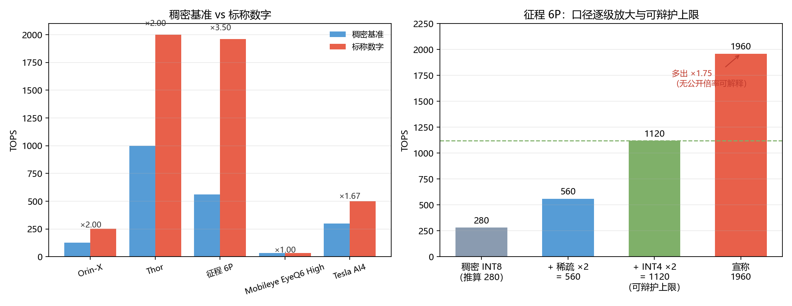
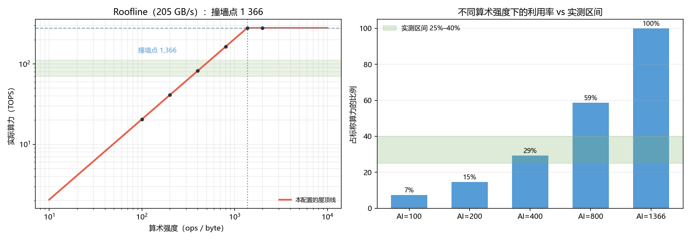
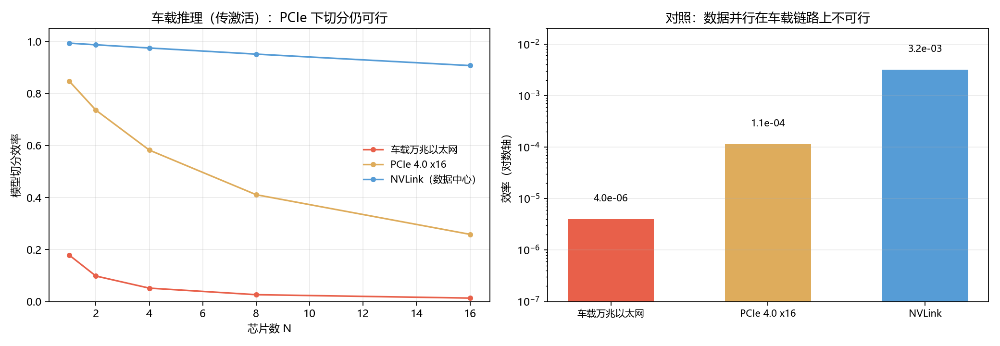
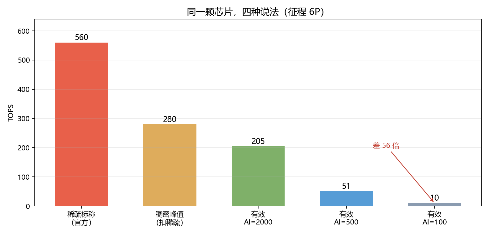

# 等效算力是怎么"算"出来的：一个数字拆成三个 2 倍，再乘上一整个机柜

> **摘要**
>
> 2026 年 10 月底，地平线创始人余凯在微博上把智驾芯片的"算力竞赛"摆上台面：英伟达按稠密算力的 2 倍标注，而业界近两年流行的"等效算力"已经吹到 6–7 倍。同一块硅片，标称可以是 127、254、560、1960。
>
> 本文把"算力标称"拆成**可对账的口径代数**，并用公开数据回答四个问题：**倍率能不能因式分解**、**在车上能不能兑现**、**多芯片能不能叠加**、**横向比较该用什么尺子**。
>
> **主要结果**：① 业界公认的技术倍率只有**稀疏 ×2** 与**精度每档 ×2**，因此**技术上限是稠密 ×4**；而"等效"口径需要**稠密 ×7**，多出的 **1.75 倍不对应任何已公开的技术倍率**。② 在 280 TOPS 稠密峰值、205 GB/s 带宽下，**要跑满算力需要每字节 1 366 次运算**；而典型车载模型的算术强度只有几十到几百 ops/byte，**只能用掉标称算力的 25%–40%**。③ 车载万兆以太网的带宽比算力低五个数量级，**紧耦合并行的扩展效率约为 0**，因此"多芯"在车上只能是功能分工或冗余，不是算力叠加。④ 同一颗芯片可以同时是 **560 TOPS（稀疏标称）与 10 TOPS（带宽受限下的有效值）**，两者相差 **56 倍**。
>
> **诚实性声明**：1960 是余凯的反讽示例而非厂商宣称；280 TOPS 是反推值；带宽、算术强度、兑现率区间均为本文假设或量级估计，已做敏感性分析。本文不评价任何产品的优劣，只讨论数字的口径。

<!-- pagebreak -->

---

## 一、问题重述

### 1.1 背景

2026 年 10 月 29 日，地平线创始人余凯发微博谈智驾芯片"算力虚标"：

- 英伟达 Orin-X 的**稠密算力 127 TOPS**，标称写成 **254 TOPS**（稠密 ×2）；
- 业界近两年流行"**等效算力**"，把标称推到稠密算力的 **6–7 倍**；
- 有网友问地平线能否做"几千 TOPS"的芯片，他答："当然可以，如果大家把算力的计算口径一起放大，征程 6P 也能从 560 TOPS 变成 1960 TOPS。**新芯片没发布，计算单元也没增加**。"

⇒ **1960 是一句反讽，不是规格**。但它精确地暴露了一个问题：**"TOPS"这个词缺少限定词**。

### 1.2 四个问题

1. **口径代数**：每个标称数能否写成"稠密 × 2 的幂 × 芯片数"？
2. **兑现条件**：这些倍率在车上能不能拿到？
3. **多芯片**：×N 能兑现几成，代价是什么？
4. **一把尺子**：横向比较该怎么标？

---

## 二、数据

### 2.1 来源与等级

| 来源 | 内容 | 等级 |
|---|---|---|
| 地平线官网（征程 6 页面） | 全系 10–560 TOPS；6P 标 560 TOPS | ② |
| 百度百科（J6P） | 「AI 算力在**等效 1/2 稀疏网络**下达到 560 TOPS」 | ③（口径明确）|
| 余凯微博（OFweek 转述） | 「按**稠密峰值乘 2** 的标称口径是 560」；1960 的反讽原文 | ① |
| IT之家 / EETrend / Pandaily | Orin-X 127/254；"等效算力无统一定义" | ① |
| Mobileye 官方 | EyeQ6 High = 34 DL TOPS (INT8) | ② |
| 华勤方案页 / GTC 2026 报道 | Thor：1000 INT8 TOPS、2000 FP4 | ① |

**四源互证 ⇒ 征程 6P 的 560 = 稠密 ×2（2:4 稀疏）⇒ 稠密 = 280 TOPS**（详见 `data/征程6P查证.md`）。

### 2.2 三条数据缺陷

1. **口径标注缺失**：官网的 `560 TOPS*` 星号未展开脚注，"稀疏"这层是在别处补上的；
2. **部分数字只有发布会口径**（无第三方复现）；
3. **"等效算力"没有统一定义**，本文必须自己定义并声明边界。

---

## 三、方法

### 3.1 口径代数

$$\text{标称}=\text{稠密}\times 2^{s}\times 2^{p}\times N,\qquad s,p\in\{0,1,\dots\}$$

**判据**：标称 ÷ 稠密 必须是 2 的幂。若非 2 的幂，则存在不对应任何技术倍率的乘数。

### 3.2 Roofline

$$\text{实际算力}=\min\left(\text{峰值},\ AI\times BW\right),\qquad AI^{*}=\frac{\text{峰值}}{BW}$$

$AI$ 为算术强度（ops/byte），$AI^{*}$ 为撞墙点。

### 3.3 多芯片扩展

数据并行 + AllReduce：

$$c=\frac{N-1}{N}\cdot\frac{w\cdot\text{peak}}{B\cdot BW},\qquad E(N)=\frac{1}{1+(N-1)c}$$

**关键性质**：通信量与 batch 无关，计算量与 batch 成正比。

### 3.4 量化信噪比

对 $N(0,1)$ 权重做均匀量化，$\mathrm{SNR}=10\log_{10}(\sigma_x^2/\sigma_e^2)$；
另设"含 1% 的 10σ 离群值"情形，考察低精度的鲁棒性。

---

## 四、结果

### 4.1 口径代数：技术上限 ×4，"等效"要 ×7



| 型号 | 稠密基准 | 标称 | 倍数 | 判定 |
|---|---|---|---|---|
| Orin-X | 127 INT8 | 254 | ×2.00 | ✅ 稀疏 |
| Thor | 1 000 INT8 | 2 000 FP4 | ×2.00 | ✅ 精度 |
| 征程 6P | 280（反推）| 560 | ×2.00 | ✅ 稀疏 |
| EyeQ6 High | 34 INT8 | 34 | ×1.00 | ✅ 不放大 |
| Tesla AI4 | 300 | 500 | ×1.67 | — 口径不明 |
| NVL144 | 1.2 EF FP8 | 3.5 EF FP4 | ×2.92 | — 口径不明 |

**技术上限**：稀疏 ×2 × 精度 ×2 = **×4**。
**"等效"口径**：$1960/280=7$，即 **×7 = 4 × 1.75**。

$$\frac{1960}{1120}=1.75,\qquad \frac{1960}{280}=7$$

**7 不是 2 的幂**（$2^2=4$，$2^3=8$），**1.75 不对应任何已公开倍率**。

> ★ 三个"干净"的对照说明：**放大本身不是问题**。Orin-X 与 Thor 都在 ×2，
> 但它们**倍数能拆成 2 的幂、且口径公开**。问题在于倍数**超出了自己承认的口径**。

### 4.2 兑现条件：跑满算力需要每字节 1 366 次运算



$$\text{撞墙点}=\frac{280\times10^{12}}{205\times10^{9}}\approx 2\,734\ \text{ops/byte}$$

| 算术强度 | 实际算力 | 占峰值 |
|---|---|---|
| 50 ops/B | 20.5 TOPS | 7.3% |
| 100 ops/B | 41.0 TOPS | 14.6% |
| 500 ops/B | 164.0 TOPS | 58.6% |
| 2 000 ops/B | 280.0 TOPS | 100% |

**带宽敏感性**（80 / 102 / 160 GB/s）：撞墙点 1 750 / 1 366 / 1 094，**结论量级不变**。

**量化代价**：

| 位宽 | 常规 | 含 1% 离群值 |
|---|---|---|
| INT8 | 39.8 dB | 25.2 dB |
| 4-bit | 15.7 dB | **3.4 dB** |

**⇒ INT8 对离群值有韧性，4-bit 没有**——这是低精度落地的第一道墙。

**兑现率**：稀疏 1.3–1.7×、低精度 1.4–1.8×，叠加后 **1.8–3.1×**（标称 ×4）。

### 4.3 多芯片：车载互联上式并行效率约为 0



| 互联 | N=2, B=1 | N=8, B=4096 |
|---|---|---|
| 车载万兆以太网（1.25 GB/s）| **10%** | 0.2% |
| PCIe 5.0（64 GB/s）| 0.002% | 12% |
| NVLink（900 GB/s）| 0.1% | 67% |

**原因**：算力 $2.8\times10^{14}$ ops/s 与万兆带宽 $1.25\times10^{9}$ B/s 相差**五个数量级**，
任何"搬参数"的并行都会被通信卡死。

⇒ **车上的"多芯"只能是功能分工或冗余，不是同一模型的算力叠加**。超节点的真正卖点是互联带宽（900 vs 1.25 GB/s，720 倍），而非卡数。

### 4.4 一把尺子：同一颗芯片可以是 560，也可以是 10



| 说法 | 数值 | 占比 |
|---|---|---|
| 稀疏标称 | 560 TOPS | 1.00 |
| 稠密峰值 | 280 TOPS | 0.50 |
| 有效（AI=2000）| 205 TOPS | 0.37 |
| 有效（AI=100）| **10 TOPS** | **0.018** |

**560 与 10 差 56 倍，但描述的是同一块硅片。**

**可比算力**的五项乘积式：

$$\text{可比}=\text{峰值}\times 2^{-s}\times 2^{-p}\times \frac{1}{N_e}\times \min\left(1,\frac{AI\cdot BW}{\text{峰值}}\right)$$

并给出**八字段的"算力说明卡"**（峰值口径 / 基准精度 / MAC 计数 / 稀疏条件 / 覆盖范围 /
等效基准 / 真实运行 / 功耗散热）。对征程 6P 实填的结果：**8 项里只有 3 项确定**。

---

## 五、讨论

### 5.1 这不是"谁造假"，是"词缺限定词"

"TOPS"本身是一个**理论峰值**，它先天不含：什么精度、是否含稀疏、单芯还是多芯、什么模型。
把它当"能力"比较，就像**用马力比较整车**——马力重要，但解释不了加速、刹车和赛道成绩。

### 5.2 为什么"等效算力"会走到 7 倍

技术倍率只有两个旋钮（稀疏、精度），合起来 ×4。要做到 6–7 倍，必须引入**第三个非技术旋钮**：
把"某个模型上的效率优势"折成通用 TOPS、把"多芯片规模"直接乘进去、或换一个更有利的基准。
**这三个操作都不算错，但它们必须被写出来**，否则数字不可比。

### 5.3 对买方的直接含义

**在 TOPS 高于某个值之后，边际收益趋近于零**——因为瓶颈转到带宽、算子覆盖与功耗。
真正该问的是：*这个模型在这块芯片上，有准确率约束时能跑多少帧、P99 时延多少、持续功耗多少。*

---

## 六、局限

1. **280 TOPS 是反推值**（560 ÷ 2），厂商未公开承认；
2. **带宽 205 GB/s 是假设**，官方未公开（已做 80–160 敏感性）；
3. **算术强度区间（50–2 000 ops/byte）是量级估计**，未针对具体模型实测；
4. **4-bit 用均匀量化近似 FP4**，实际 FP4（E2M1）动态范围更小，3.4 dB 应视为上限；
5. **兑现率区间来自文献量级**，非本机实测；
6. **不评价产品优劣**，只讨论口径。

---

## 七、结论

1. **技术上限是稠密 ×4**（稀疏 ×2、精度 ×2）；**"等效算力"要到 ×7**，多出的 1.75 倍没有对应的技术倍率。
2. **跑满 280 TOPS 需要每字节 1 366 次运算**；典型车载模型通常只用掉 25%–40%。
3. **车载互联上式并行效率约为 0**；"多芯"只能是分工或冗余。
4. **同一块硅片可以是 560，也可以是 10**；横向比较只能用"同模型、同精度、同稀疏、同功耗下的实测吞吐"。

---

## 参考文献

1. IT之家. 地平线创始人余凯吐槽智驾芯片 PPT 算力虚标. 2026-10-29.
   <https://m.ithome.com/html/1020358.htm>
2. OFweek. 一颗 560 TOPS 芯片，怎么就算出了 1960 TOPS？. 2026-11-02.
   <https://ee.ofweek.com/2026-11/ART-8420-2801-30709892.html>
3. EETrend. 智驾芯片的 TOPS 竞赛，什么时候才能停止数字游戏？. 2026-11-01.
   <https://www.eetrend.com/content/2026-11/80cfeaf8-bfa5-429d-9627-4919fbdd56e0-100605316.html>
4. 地平线官网. 征程 6 系列产品页. <https://www.horizon.auto/solutions/horizon-journey/horizon-journey6>
5. Mobileye. EyeQ Chip 技术页. <https://www.mobileye.com/technology/eyeq-chip/>
6. Williams, S., Waterman, A., & Patterson, D. (2009). Roofline: An insightful visual performance model
   for multicore architectures. *Communications of the ACM*, 52(4), 65–76.
7. NVIDIA. Ampere 架构结构化稀疏文档. NVIDIA Developer Blog.

---

## 附录：复现

```powershell
python scripts/q1_algebra.py      # 口径代数
python scripts/make_q1_fig.py     # Q1 图
python scripts/q2_effective.py    # Roofline / 量化 / 兑现率
python scripts/q3_scaling.py      # 多芯片扩展
python scripts/q4_metric.py       # 归一化指标与说明卡
```

全部结果落盘在 `results/`，数字核对表见 `paper/结论速览.md`。
