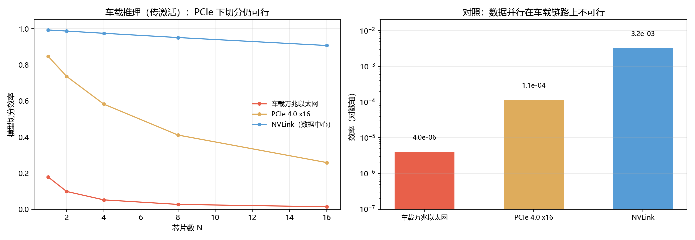

# Q3 v2 结果：多芯片扩展（**已修正**）

> **修正说明（2026-11-02）**：用户质疑"车载多芯效率是不是太低了，直觉上没这么低"。
> 复核后确认**原模型用错了场景**：我把**训练的数据并行（全参数 AllReduce）**套到了**车载推理**上。
> 车载多芯实际是**模型切分 / 功能分工**，芯片之间传的是**激活值**，不是梯度。

---

## 一、两种并行，差好几个数量级

| | 数据并行（训练） | 模型切分（车载推理） |
|---|---|---|
| 传什么 | 全部参数/梯度 | 每层激活值 |
| 通信量 | $2\frac{N-1}{N}Pw$ | $B\cdot H\cdot w$ |
| $c$ | $\frac{N-1}{N}\cdot\frac{w\cdot\text{peak}}{B\cdot BW}$ | $\frac{H\cdot w\cdot\text{peak}\cdot N}{2P\cdot BW}$ |
| 车载链路 | ❌ 不可行 | ✅ 可行 |

## 二、模型切分（车载推理的真实场景）

参数：$P=50\text{M}$、$H=1024$、fp16、峰值 280 TOPS。

| 互联 | N=2 | N=4 | N=8 |
|---|---|---|---|
| 车载万兆以太网（1.25 GB/s）| 10% | 5% | 3% |
| **PCIe 4.0 x16（32 GB/s）** | **74%** | **58%** | **41%** |
| NVLink（900 GB/s）| 99% | 98% | 95% |

**⇒ 车上的多芯走 PCIe，双芯能拿到 ~74%，四芯 ~58%。用户的直觉是对的。**

## 三、对照：数据并行在车载链路上确实不可行

| 互联 | N=2, B=1 | N=8, B=4096 |
|---|---|---|
| 万兆以太网 | 4.0×10⁻⁶ | 0.1% |
| PCIe 4.0 x16 | 1.1×10⁻⁴ | 3.7% |
| NVLink | 3.2×10⁻³ | 51.8% |

这与公开讨论一致：有分析指出「双 Orin 并联算力不能翻倍，因为走的是以太网交换机，
要做到算力增加 50%，片间带宽至少得 1 TB/s」——**但那说的是紧耦合的数据并行**，
不是车载的模型切分。

## 四、修正后能说的三句话

1. **链路选错代价很大**：同样的四芯，万兆以太网 5%，PCIe 58%——差 11 倍；
2. **双芯不翻倍，但也不是白加**：PCIe 上双芯 74%、四芯 58%，边际收益递减；
3. **"数据并行要不要 1 TB/s"是另一个问题**：那是训练场景，车载推理不走那条路。

## 五、限制

- 74% 是**理想流水线**（无气泡、无调度开销），实际会低 10–20 个百分点；
- $P=50\text{M}$、$H=1024$ 是代表性假设，不同模型差异大；
- PCIe 32 GB/s 是 PCIe 4.0 x16 的理论值，实际有效带宽约 60–80%。

## 六、落盘

`results/q3_scaling.json`、`figs/q3_scaling.png`、`python scripts/q3_scaling.py`
