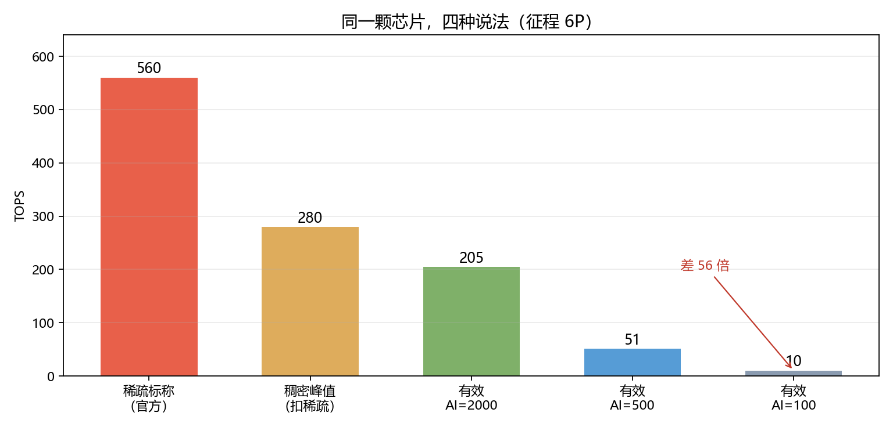

# Q4 结果：一把能横向比较的尺子

> 前三问拆了倍率、算了兑现、看了扩展。这一问给出**可操作**的东西：
> 一个算力数字要可比，必须绑定哪几个字段；以及同一颗芯片能给出几种说法。

---

## 一、核心主张

$$\text{可比算力}=\text{峰值}\times\underbrace{2^{-s}}_{\text{稀疏}}\times\underbrace{2^{-p}}_{\text{精度}}\times\underbrace{\frac{1}{N_e}}_{\text{扩展效率}}\times\underbrace{\min\left(1,\frac{AI\cdot BW}{\text{峰值}}\right)}_{\text{带宽约束}}$$

**五项缺一，这个数就不可比。** 前两项是口径，后三项是兑现。

---

## 二、同一颗芯片，四种说法（征程 6P）

| 说法 | 数值 | 相对稀疏标称 |
|---|---|---|
| 稀疏标称（官方） | **560 TOPS** | 1.00 |
| 稠密峰值（扣稀疏） | **280 TOPS** | 0.50 |
| 有效（AI=2000，算力受限） | **205 TOPS** | 0.37 |
| 有效（AI=500，中等） | **51 TOPS** | 0.09 |
| 有效（AI=100，带宽受限） | **10 TOPS** | **0.018** |

**560 与 10 之间差 56 倍**——但它们描述的是**同一块硅片**。

> ★ 这不是"厂商骗人"，而是**"TOPS"这个词天生缺了四个限定词**。

---

## 三、算力说明卡（可直接作为标注规范）

| # | 字段 | 为什么必须 |
|---|---|---|
| 1 | 峰值口径：**单芯片 / 多芯片** | 多芯是分工还是并行，差一个数量级 |
| 2 | **基准精度**（INT8/FP8/FP4） | 精度每降一档就要 ×2 |
| 3 | **MAC 计数约定**（1 MAC=2 ops？） | 有的厂商按 1 次乘法算 1 op |
| 4 | **稀疏条件**（稠密值 / 稀疏值分别给） | 2:4 是理论上限，实测拿不满 |
| 5 | **覆盖范围**（BPU / 含 CPU·GPU / 整板） | 只算 NPU 还是整机，差很多 |
| 6 | **等效基准**（等效于谁、什么模型、什么精度） | "等效算力"必须给参照物 |
| 7 | **真实运行**（有准确率约束的 FPS、P99 时延） | 唯一能跨厂商比的量 |
| 8 | **功耗与散热**（持续功耗、是否降频） | 车规是 30–100 W 的硬约束 |

模板与逐项填写见 `results/算力说明卡.md`。

**对征程 6P 的实填结果：8 项里只有 3 项是确定的**（峰值口径、基准精度、稀疏条件），
第 6、7 项厂商未给。**⇒ 560 TOPS 是一个可核对的峰值，不是一个可横向比较的能力。**

---

## 四、买方该问的五个问题

1. 这个数是**稠密还是稀疏**？稀疏倍率算进去了吗？
2. **什么精度**？INT8 / FP8 / FP4 各是多少？
3. **单芯片还是多芯片**？多芯是**功能分工**还是**同一模型并行**？
4. **什么模型、什么 batch 实测**？有准确率约束的 FPS 与 P99 时延是多少？
5. **持续功耗**多少？跑 30 分钟会不会降频？

> 这五问能筛掉大部分"发布会数字"。它们不需要专业知识，只需要**要求对方把口径补齐**。

---

## 五、可写的结论

1. 跨厂商比较时，**唯一可比的是"同模型、同精度、同稀疏、同功耗下的实测吞吐"**；
2. 其余任何数字（含"等效算力"）**至少要附带八项字段才具备可比性**；
3. 本文给出的五项乘积式，可以作为**自己算一遍**的工具——
   拿到对方的标称，先用稀疏和精度除回去，再用带宽约束砍一刀，剩下的才是能用的量级。

---

## 六、限制

- 有效算力用的是 **roofline 上界**，真实模型还有算子覆盖、调度、缓存命中率等折损，
  **实际值通常低于本文给出的有效值**；
- 算术强度（AI）取值是量级估计，不同模型差异很大；
- 本文不评价任何产品的优劣，只讨论**数字的口径**。

## 七、落盘

- `results/算力说明卡.md`（模板 + 实填）
- `results/q4_metric.json`
- `figs/q4_oneslide.png`
- 复现：`python scripts/q4_metric.py`
