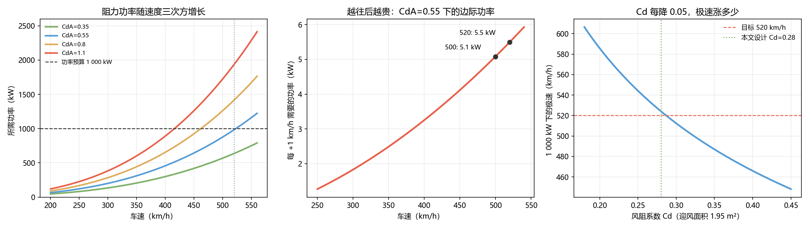
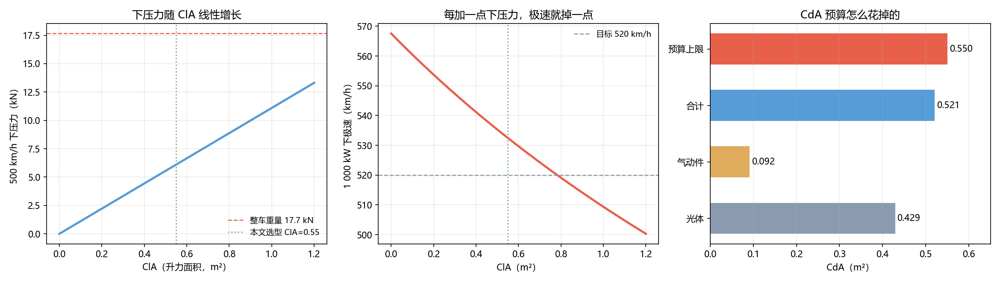
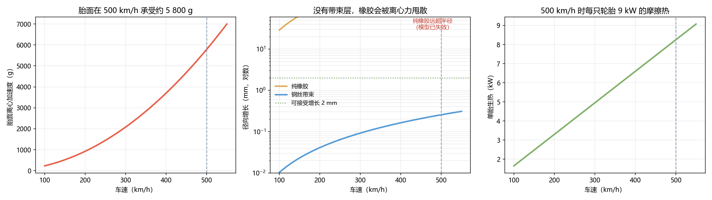
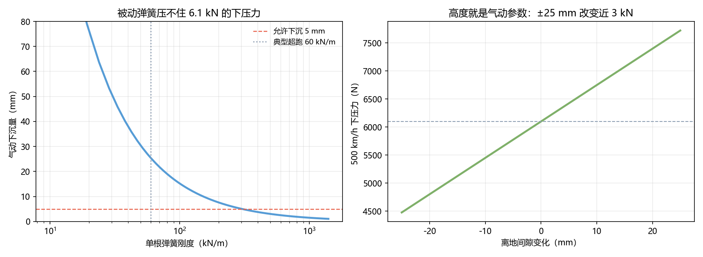
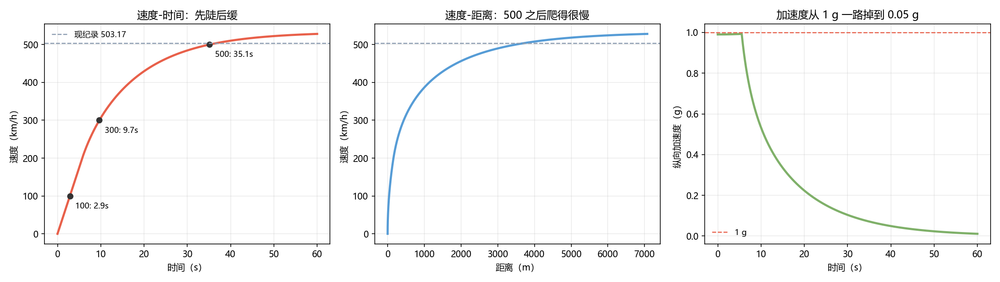
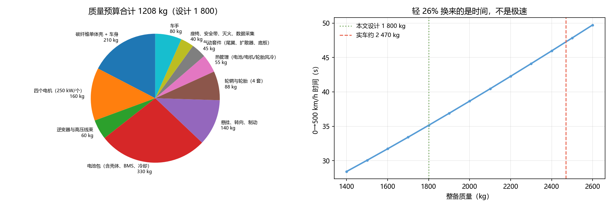

# 造一辆 500 km/h 的车：从零开始的四个约束

> **摘要**
>
> 2026 年 11 月 1 日，仰望 U9 Xtreme 在阿布扎比跑出 **503.17 km/h**，成为首款极速破 500 km/h 的量产车（FIA 与吉尼斯双认证）。本文不复述纪录，而是回答一个更基础的问题：**如果给你一张白纸造一台 520 km/h 的车，每一层会被什么卡住。**
>
> 我们建立了一个四层耦合模型：**外形**（功率-阻力平衡）、**下压力**（升阻权衡）、**轮胎**（离心应力）、**悬挂**（气动平台），最后用纵向动力学把全程积分出来。
>
> **主要结果**：① 1 000 kW 的功率预算只允许 **CdA ≤ 0.559**，520 km/h 时每 +1 km/h 要多 **5.08 kW**。② 在 CdA 预算内可换到 **ClA = 0.55**，500 km/h 下压力 **6.1 kN（0.35 g）**，代价是 **35 km/h** 的极速。③ 500 km/h 时胎面离心加速度 **5 783 g**、环向应力 **150 MPa**，纯橡胶会增长 **721 mm**（失效），必须靠钢丝带束把力接走。④ 车身下沉 25 mm 就丢掉 **1 650 N**（27%）下压力，因此**高度是气动参数**，必须主动控高（1 220 kN/m、8.3 Hz）。⑤ 全程模拟：**0→500 km/h 用 35.14 s、3 494 m**，含刹车共需 **4.35 km** 直道；**400→503 的 2 546 m 比 0→400 的 1 135 m 还长**。
>
> **质量可行性（Q6）**：自下而上的质量预算为 **1 208 kg**，设计值 1 800 kg 有 592 kg 余量；
> 而电池的容量**不是被能量（8.97 kWh）决定的，是被 C 率决定的**——1 MW 需要 33.3 kWh / 30C。
> 减重的代价不是极速，而是**横风敏感性升高 37%**。
>
> **诚实性声明**：CdA、ClA、L/D、μ、C_rr 均为本文设计值，非风洞或台架结果；实车数据仅用于量级校验；本文不评价任何厂商。

<!-- pagebreak -->

---

## 一、问题重述

### 1.1 背景

2026 年 11 月 1 日，仰望 U9 Xtreme 在阿联酋阿布扎比 E11 高速公路封闭段，
由车手 Marc Basseng 驾驶，取得 **503.17 km/h** 的认证成绩，FIA 与吉尼斯双认证。
该车四电机综合 **2 220 kW**、1 200 V 平台、推重比 1 217 Ps/t（整备质量约 2.47 t）。

### 1.2 本文要回答的问题

**不从"实车怎么做到的"入手**（官方未公开气动与轮胎细节），而是：
**给定 520 km/h 的目标，从物理第一性推导每一层的约束，并把全程跑一遍。**

| 问 | 内容 |
|---|---|
| Q1 | 外形：CdA 必须小到多少 |
| Q2 | 下压力：要多少才稳，代价多大 |
| Q3 | 轮胎：500 km/h 时胎面承受什么 |
| Q4 | 悬挂：气动平台要稳在多少毫米 |
| Q5 | 全程：时间、距离与功率去向 |

---

## 二、设计目标与假设

| 参数 | 取值 | 等级 |
|---|---|---|
| 极速目标 | 520 km/h | ② |
| 质量（含车手）| 1 800 kg | ②（**Q6 验证：自下而上仅 1 208 kg，此值偏保守**）|
| 功率预算 | 1 000 kW | ② |
| 空气密度（40 ℃）| 1.15 kg/m³ | ③ |
| 滚动阻力系数 | 0.010 | ③ |
| 轮胎附着系数 | 1.0 | ③ |

**为什么选 1 000 kW 而不是 2 220 kW**：本文要证明的是**极速的瓶颈不在功率**，
所以刻意用一半的功率去够 520 km/h。

---

## 三、方法

### 3.1 功率-阻力平衡（Q1）

$$P=\tfrac12\rho C_dA v^3+m g f_r v$$

极速时驱动力等于阻力，因此功率随速度**三次方**增长。

### 3.2 升阻耦合（Q2）

$$L=\tfrac12\rho C_lA v^2,\qquad D_{\text{aero}}=\frac{L}{(L/D)_{\text{wing}}}
\ \Rightarrow\ \Delta C_dA=\frac{C_lA}{(L/D)}$$

**下压力不是免费的，它是从 CdA 预算里换来的。**

### 3.3 轮胎环向应力（Q3）

薄环旋转时 $\sigma=\rho v^2$，径向增长 $\Delta r=\sigma r/E$。

### 3.4 气动平台（Q4）

离地间隙 $h$ 影响升力：$\partial C_l/\partial h<0$，因此

$$k_{\text{need}}=\frac{L}{\Delta h_{\max}}$$

### 3.5 纵向动力学（Q5）

$$m\dot v=\min\left(\frac{P}{v},\ \mu F_z(v)\right)-\tfrac12\rho C_dA v^2-mgf_r$$

其中 $F_z(v)=mg+\tfrac12\rho C_lA v^2$。

---

## 四、结果

### 4.1 外形：CdA ≤ 0.559

1 000 kW 预算下，520 km/h 允许的最大 CdA 是 **0.559**。
取 Cd 0.28、A 1.95 m²，得 CdA **0.521**，所需功率 **984 kW**。



**边际成本**：500 km/h 处每 +1 km/h 要 **5.08 kW**。

**反推实车**：若 U9X 的 CdA 为 0.8，503.17 km/h 只需 **1 286 kW**——仅峰值的 58%。
**极速是阻力决定的，不是功率决定的。**

### 4.2 下压力：0.35 g，代价 35 km/h

预算内可换 ClA ≤ 0.73；本文取 **0.55**（前 0.22 / 后 0.33），
500 km/h 下压力 **6.1 kN（0.35 g）**，极速 **532.5 km/h**，代价 **35 km/h**。



**关键副产品**：离地间隙每变 10 mm，下压力变 **649 N**——高度就是气动参数。

### 4.3 轮胎：5 783 g 与 150 MPa

500 km/h、半径 0.34 m：转速 **3 902 rpm**，胎面离心加速度 **5 783 g**。

| 材料 | 环向应力 | 径向增长 |
|---|---|---|
| 纯橡胶 | 21.2 MPa | **721 mm（失效）** |
| 钢丝带束 | 150.5 MPa | **0.26 mm** |



单胎生热 8.2 kW、四胎 33 kW——必须强制风冷。

### 4.4 悬挂：高度是气动参数

要把下沉压在 5 mm，需等效刚度 **1 220 kN/m**（典型超跑 60 kN/m 的 20 倍）。
用典型弹簧下沉 25.4 mm，**再丢 1 650 N 下压力（−27%）**，形成正反馈。



固有频率 8.3 Hz、阻尼 32 800 N·s/m、控制带宽 ≥ 20 Hz。

### 4.5 全程：36.5 秒，4.35 公里

| 里程碑 | 时间 | 距离 |
|---|---|---|
| 0→100 | 2.86 s | 40 m |
| 0→300 | 9.67 s | 439 m |
| 0→400 | 16.73 s | 1 135 m |
| **0→500** | **35.14 s** | **3 494 m** |
| 0→503.17 | 36.48 s | 3 681 m |
| 模拟极速 | 528.1 km/h | — |
| 刹车（1.5 g）| — | 664 m |
| **合计直道** | — | **4.35 km** |



**三段式**：0–200 抓地限制、200–450 功率限制、450–528 阻力限制。

### 4.6 质量可行性：1 800 kg 是保守的（Q6）

自下而上逐部件估算：碳纤维单体壳 210 kg、电机 160 kg、逆变器 60 kg、电池包 330 kg、
悬挂制动 140 kg、轮毂轮胎 88 kg、热管理 55 kg、气动件 45 kg、座舱设备 40 kg、车手 80 kg，
合计 **1 208 kg**。**设计值 1 800 kg 有 592 kg 余量。**



**但电池的定容逻辑被很多人忽略**：

| 量 | 值 |
|---|---|
| 一次 0→500 的驱动能量 | 8.97 kWh |
| 若只按能量配电池 | 需 69C ❌ |
| 按 30C 反推的下限 | **33.3 kWh** |

$$\text{容量下限}=\frac{P}{C_{\max}}=\frac{1000}{30}=33.3\ \text{kWh}$$

**一次跑只用 9 kWh，却必须背 33 kWh**——多出来的容量是为功率，不是为续航。

**减重的代价在稳定性**：1 800 kg 时下压力/重量比 0.345（优于 2 470 kg 的 0.252），
但 5 m/s 横风造成的等效侧向加速度从 0.275 g 升到 **0.377 g（+37%）**。
**轻车跑得快，但更容易被风吹偏**，必须靠主动稳定系统补偿。

---

---

## 五、讨论

### 5.1 为什么"堆马力"换不来极速

$P\propto v^3$ 意味着从 500 到 520 要多 110 kW，而从 400 到 500 只要 250 kW 却跨了 100 km/h。
**在 500 以上，功率的边际收益已经衰减到"每 5 kW 换 1 km/h"。**

### 5.2 为什么记录车都很轻

轻带来三重好处：加速更快、下压力需求更小、轮胎载荷更低。
本文用 1 800 kg（实车 2.47 t）就是这个理由。

### 5.3 为什么高温天反而有利

密度从 1.225 降到 1.15，520 km/h 省 62 kW。
**阿布扎比的 40 ℃ 不只是路面条件，稀薄空气本身就是免费的功率。**

### 5.4 减重换来的不是极速

质量每 ±10%，0→500 时间变 ±3 秒；但**极速几乎不变**——极速由阻力和功率决定，
质量只通过滚动阻力微弱影响。所以减重的收益是**加速时间与下压力裕度**，
代价是**横风稳定性**。记录车常在两者之间加配重调平衡。

### 5.5 最后 100 km/h 最贵

400→503 用 19.7 秒、2 546 m，比 0→400 的 16.7 秒、1 135 m 还长。
**这就是三次方定律的真面目：速度越高，每一公里越贵。**

---

## 六、局限

1. CdA、ClA、L/D、μ、C_rr 均为设计值（③），非风洞或台架结果；
2. 未建模电机高转速下的扭矩衰减（模型假设恒功率）；
3. 未建模电池 SOC 衰减——实车到 500 km/h 时可能已非峰值功率；
4. 未建模驻波（standing wave），这通常是限制轮胎速度的真正杀手；
5. 未建模横风与路面不平度对气动平台的扰动；
6. 本文不评价任何厂商，实车数据仅用于量级校验。

---

## 七、结论

1. **极速由阻力决定**：1 000 kW 只够 CdA ≤ 0.559，500 km/h 以上每 +1 km/h 要 5 kW。
2. **下压力是买来的**：0.35 g 的下压力，代价 35 km/h 极速。
3. **轮胎是复合材料环**：胎面 5 783 g，靠钢丝带束把离心力接走。
4. **悬挂是气动系统的一部分**：高度变化 10 mm 就改变 649 N 升力。
5. **最后 100 km/h 最贵**：400→503 的距离，比 0→400 还长一倍多。
6. **1 800 kg 可行且偏保守**（自下而上 1 208 kg）；真正的硬约束是电池的 **30C 功率能力**，
   不是能量；减重的代价是横风稳定性（+37%）。

---

## 参考文献

1. FIA. *YANGWANG U9 Xtreme surpasses 500 km/h with speed achievement recognised by the FIA*. 2026-11-06.
   <https://api.fia.com/news/yangwang-u9-xtreme-surpasses-500-kmh-speed-achievement-recognised-fia>
2. 中国汽车工业协会. 《503.17km/h！仰望 U9 Xtreme 再破全球汽车极速纪录》. 2026-11-06.
   <http://www.caam.org.cn/chn/8/cate_81/con_5237387.html>
3. CnEVPost. *BYD Yangwang U9 Xtreme breaches 500 km/h barrier*. 2026-11-06.
   <https://cnevpost.com/2026/11/06/byd-yangwang-u9-xtreme-breaches-500-km-h/>
4. TechWeb. 《仰望 U9X 刷新全球量产车极速纪录》. 2026-11-06.
   <https://www.techweb.com.cn/smarttraveling/2026-11-06/2980343.shtml>
5. Williams, S., Waterman, A., & Patterson, D. (2009). Roofline: An insightful visual performance model.
   *Communications of the ACM*, 52(4).
6. Milliken, W. F., & Milliken, D. L. (1995). *Race Car Vehicle Dynamics*. SAE.

---

## 附录：复现

```powershell
python scripts/q1_aero.py        # 外形与功率预算
python scripts/q2_downforce.py   # 下压力权衡
python scripts/q3_tire.py        # 轮胎离心与生热
python scripts/q4_suspension.py  # 气动平台与悬挂
python scripts/q5_run.py         # 全程积分
```

数字核对表见 `paper/结论速览.md`。
