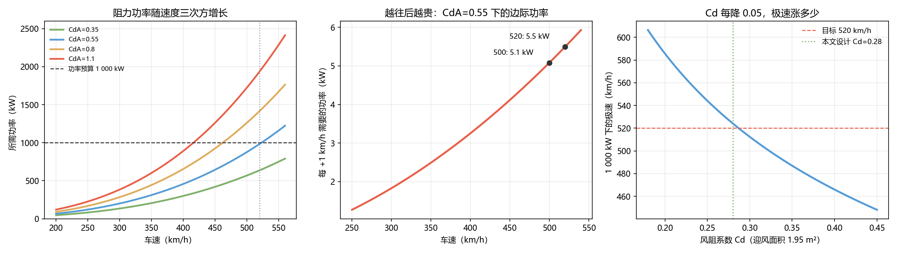

# Q1 结果：外形 —— 520 km/h 需要多小的 CdA

> 物理只有一条：极速时驱动力＝阻力，功率随速度**三次方**增长。
> $$P=\tfrac12\rho C_dA v^3+m g f_r v$$
> 假设：ρ=1.15 kg/m³（阿布扎比 40 ℃，③）、m=1800 kg、f_r=0.012（③）。

---

## 一、预算：1 000 kW 只够 CdA ≤ 0.559

| 量 | 值 |
|---|---|
| 目标速度 | 520 km/h = 144.4 m/s |
| CdA = 0.55 时所需功率 | **984 kW**（其中滚动阻力 31 kW）|
| **1 000 kW 允许的最大 CdA** | **0.559** |
| 若 CdA = 0.39（Cd 0.20）| 只需 706 kW，极速可到 586 km/h |
| 若 CdA = 0.682（Cd 0.35）| 需要 1 213 kW，1 000 kW 只能跑 487 km/h |

**⇒ 目标写死为：Cd ≤ 0.28、迎风面积 1.95 m²，即 CdA ≤ 0.55。**

这个数字是什么概念：量产超跑 CdA 通常 0.7–1.0，F1 约 1.5。
**要做到 0.55，外形必须走向"长尾 + 封闭座舱 + 无大翼"。**

---

## 二、边际成本：500 之后每 +1 km/h 要 5 kW

| 车速 | 每 +1 km/h 的功率 |
|---|---|
| 300 km/h | 1.83 kW |
| 400 km/h | 3.25 kW |
| 450 km/h | 4.12 kW |
| **500 km/h** | **5.08 kW** |
| 520 km/h | 5.50 kW |

$$\frac{dP}{dv}=\tfrac32\rho C_dA v^2$$

**从 500 加到 520，光空气就要多吃 110 kW。**
这就是为什么"破 500"是个门槛，而"520"是另一个台阶。

---

## 三、反推实车：峰值 2 220 kW，极速时大概只用了一半

仰望 U9X 峰值 2 220 kW、实测 503.17 km/h。若它的 CdA 在合理区间：

| 假设 CdA | 503.17 km/h 所需功率 | 占峰值 |
|---|---|---|
| 0.60 | 965 kW | 43% |
| 0.70 | 1 126 kW | 51% |
| **0.80** | **1 286 kW** | **58%** |
| 0.90 | 1 447 kW | 65% |
| 1.00 | 1 608 kW | 72% |

> ★ **结论**：极速时"用不到峰值功率"是正常现象——**极速是阻力决定的，不是功率决定的**。
> 峰值功率决定的是**加速段**和**余量**，不是极速本身。
> 这也解释了为什么堆到 3 000 马力仍然只跑到 503——**再多的马力也换不来更高的极速，除非先降 CdA。**

---

## 四、两个反直觉的细节

**① 天热反而更快。**
空气密度从 1.225（20 ℃）降到 1.15（40 ℃），520 km/h 所需功率从 1 046 kW 降到 984 kW——**省 62 kW**。
阿布扎比选在高温天跑，不只是路面条件，**稀薄的空气本身就是优势**。

**② Cd 降 0.05 的收益是递减的。**
| Cd | CdA | 1 000 kW 下极速 |
|---|---|---|
| 0.20 | 0.39 | 586 km/h |
| 0.25 | 0.487 | 544 km/h |
| **0.28** | **0.546** | **~527 km/h** |
| 0.30 | 0.585 | 512 km/h |
| 0.35 | 0.682 | 487 km/h |

从 0.35 降到 0.30 涨 25 km/h，从 0.25 降到 0.20 只涨 42 km/h 但工程代价陡增
（更长尾椎、更小迎风面积、更差的散热）。

---

## 五、本问确定的设计参数

| 参数 | 取值 | 依据 |
|---|---|---|
| Cd | **≤ 0.28** | 1 000 kW 跑 520 的必要条件 |
| 迎风面积 A | 1.95 m² | 单座窄体 |
| CdA | **≤ 0.55** | 上二者乘积 |
| 功率预算 | 1 000 kW | 本文设定（实车 2 220 kW 是量产冗余）|
| 极速（设计）| **527 km/h** | CdA 0.546、1 000 kW |

## 六、限制

- ρ、f_r、A 均为假设值（③），已做密度敏感性；
- Cd 0.28 是"能做到"的工程判断，不是风洞结果；
- 未考虑地面效应、横风、以及高速下轮胎变形带来的额外阻力。

## 七、落盘

`results/q1_aero.json`、`figs/q1_aero.png`、`python scripts/q1_aero.py`
