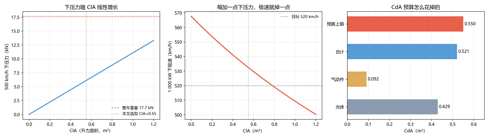

# Q2 结果：下压力 —— 要多少才稳，代价是几 km/h

> 核心关系：**下压力是用 CdA 换来的。**
> $$L=\tfrac12\rho C_lA v^2,\qquad D=\frac{L}{(L/D)_{\text{wing}}}\ \Rightarrow\ \Delta C_dA=\frac{C_lA}{(L/D)}$$

---

## 一、预算决定了能加多少

光体 CdA = **0.429**（Cd 0.22 × 1.95 m²），Q1 给的上限是 **0.55**。
剩下 0.121 的预算，按气动件升阻比 L/D = 6 折算：

$$C_lA_{\max}=0.121\times6=\mathbf{0.73}$$

## 二、前沿：下压力越多，极速越慢

| ClA | 总 CdA | 500 km/h 下压力 | 相当于 | 极速 |
|---|---|---|---|---|
| 0.0 | 0.429 | 0 kN | 0 g | **568 km/h** |
| 0.2 | 0.462 | 2.2 kN | 0.13 g | 554 |
| 0.4 | 0.496 | 4.4 kN | 0.25 g | 541 |
| **0.55** | **0.521** | **6.1 kN** | **0.35 g** | **532.5** |
| 0.8 | 0.562 | 8.9 kN | 0.50 g | 519 |
| 1.2 | 0.629 | 13.3 kN | 0.75 g | 500 |

**⇒ 每一个 0.1 g 的下压力，大约要付 4–5 km/h 的极速。**

## 三、稳定性判据

| 判据 | 要求 | 本文取值 |
|---|---|---|
| 前轴下压力 ≥ 前轴静载的 20% | ≥ 1.6 kN | 前轴 2.4 kN ✅ |
| 总下压力 ≥ 车重的 15% | ≥ 2.7 kN | 6.1 kN ✅ |

**选型：ClA = 0.55，前 0.22 / 后 0.33（后轴略大，抑制高速甩尾）。**

## 四、代价

- 极速从 **568 → 532.5 km/h**，**代价 35 km/h**；
- 换来 500 km/h 时 **0.35 g 的下压力**，约等于把轮胎的可用抓地提高三成。

## 五、俯仰敏感性（关键）

离地间隙每变 **10 mm**，下压力变 **649 N**（约 0.037 g）。

这不是小事：**车身高度本身就是一个气动参数**，所以 Q4 必须做主动控高。

## 六、限制

- L/D = 6 是量级假设（③），实际气动件可能 4–8；
- 未做前后升力随攻角变化的建模；
- 568 km/h（ClA=0）是理论上限，实际无下压力的车在 500 以上会失去稳定性。

## 七、落盘

`results/q2_downforce.json`、`figs/q2_downforce.png`
