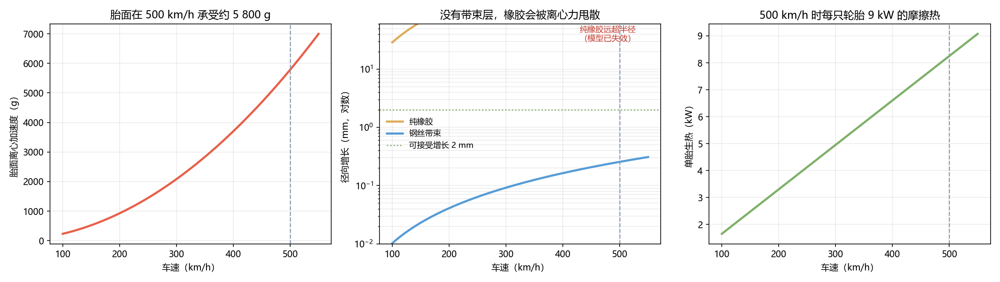

# Q3 结果：轮胎 —— 500 km/h 时胎面在承受什么

> 滚动半径 0.34 m，车速 500 km/h = 138.9 m/s。

---

## 一、三个吓人的数字

| 量 | 值 | 算式 |
|---|---|---|
| 转速 | **3 902 rpm**（408 rad/s）| $v/r$ |
| 胎面离心加速度 | **5 783 g** | $v^2/r$ |
| 单胎生热 | **8.2 kW**（四只 33 kW）| $C_{rr}F_zv$ |

**5 783 g** 是什么概念：一个 10 g 的胎面块，被甩出去的力相当于 58 kg。

## 二、为什么必须有带束层

薄环的环向应力 $\sigma=\rho v^2$，径向增长 $\Delta r=\sigma r/E$：

| 材料 | 环向应力 | 径向增长 | 判定 |
|---|---|---|---|
| 纯橡胶（E=10 MPa）| 21.2 MPa | **721 mm** | ❌ 模型失效——橡胶会被直接甩散 |
| 芳纶带束（E=80 GPa）| 27.8 MPa | 0.12 mm | ✅ |
| **钢丝带束（E=200 GPa）** | **150.5 MPa** | **0.26 mm** | ✅ 本文选型 |

> **橡胶的弹性模量比钢小四个数量级**，所以轮胎不是"一块橡胶"，
> 而是"一圈高强度纤维/钢丝把离心力接走，橡胶只负责接触"。
> 500 km/h 的轮胎，本质是一个**高速旋转的复合材料环**。

## 三、随速度的变化

| 车速 | 离心加速度 | 钢丝带束增长 |
|---|---|---|
| 200 km/h | 925 g | 0.04 mm |
| 300 km/h | 2 082 g | 0.09 mm |
| 400 km/h | 3 701 g | 0.16 mm |
| **500 km/h** | **5 783 g** | **0.26 mm** |
| 520 km/h | 6 255 g | 0.28 mm |

增长量很小（亚毫米级），但**应力已经到 150 MPa**——这是钢丝的疲劳问题，
不是"会不会鼓包"的问题。**速度等级的真正含义是疲劳寿命，不是尺寸变形。**

## 四、生热

单胎 8.2 kW、四只合计 **33 kW**——相当于一台小电暖器持续贴着轮胎。
这些热必须靠强制风冷带走，否则胎面温度会在几分钟内进入不可控区间。

> 这也是为什么高速记录车要"跑一次、换一套胎"，而不是连续跑。

## 五、设计要求

| 项 | 要求 |
|---|---|
| 结构 | 钢丝/芳纶复合带束，环向强度 ≥ 200 MPa 安全系数 |
| 增长 | 500 km/h 下径向增长 ≤ 1 mm（留 4× 余量）|
| 散热 | 强制风冷，单胎散热能力 ≥ 10 kW |
| 速度等级 | 按疲劳寿命标定，不是按峰值强度 |

## 六、限制

- 环向应力用薄环公式，未考虑胎体曲率与接触斑的局部应力集中；
- 生热系数 C_rr = 0.010 是假设（③），实际高速下可能更低；
- 未建模驻波（standing wave）——它通常是**限制速度的真正杀手**，需要实验数据。

## 七、落盘

`results/q3_tire.json`、`figs/q3_tire.png`
