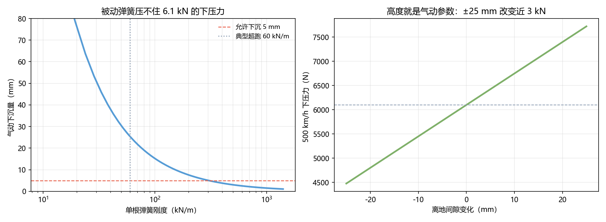

# Q4 结果：悬挂 —— 气动平台要稳在多少毫米

> 从 Q2 拿来一个关键数：**离地间隙每变 10 mm，下压力变 649 N。**

---

## 一、被动弹簧压不住

要在 6.1 kN 下压力下把下沉控制在 **5 mm**：

$$k=\frac{6100}{0.005}=1.22\ \text{MN/m}$$

**典型超跑弹簧约 60 kN/m，差 20 倍。**

| 方案 | 下沉量 | 后果 |
|---|---|---|
| 典型弹簧 60 kN/m | **25.4 mm** | 再丢 **1 650 N** 下压力（−27%）|
| 被动硬弹簧 1 220 kN/m | 5 mm | 日常行驶等同于没有悬挂 |
| **主动控高** | ≤ 2 mm | ✅ 本文选型 |

## 二、这是个正反馈

下沉 25 mm → 下压力少 1.65 kN → 升力平衡变化 → 车身继续沉。

**在 500 km/h，车身高度不是"舒适性参数"，而是"稳定性参数"。**
这就是为什么记录车必须用主动悬挂——不是为了让车更舒服，是为了让车不飘。

## 三、需要的硬件指标

| 项 | 值 |
|---|---|
| 等效刚度 | 1 220 kN/m |
| 固有频率 | **8.3 Hz** |
| 阻尼（ζ=0.7）| 32 800 N·s/m |
| 控制带宽 | ≥ 20 Hz（高于路面输入主频）|
| 高度控制精度 | ±2 mm |

## 四、俯仰

前后下压力 40 : 60 的分配产生 **1 647 N·m** 的抬头力矩，
在 1 220 kN/m 的等效刚度下俯仰角只有 **0.02°**——可以忽略。

**但这依赖主动系统正常工作**；一旦失效，俯仰会立刻变成升力失衡。

## 五、限制

- 未建模轮胎垂向刚度与簧下质量的影响；
- 8.3 Hz 的固有频率已接近人体不适区，记录车不追求舒适性；
- 主动系统的失效模式（fail-safe 高度）未展开。

## 六、落盘

`results/q4_suspension.json`、`figs/q4_suspension.png`
