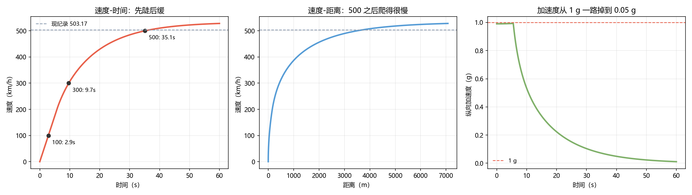

# Q5 结果：全程模拟 —— 从静止到 503 km/h

> 模型：$m\dot v=\min(P/v,\ \mu F_z)-F_{\text{drag}}-F_{\text{roll}}$，
> 下压力随 $v^2$ 增长（ClA = 0.55），成组参数来自 Q1–Q4。

---

## 一、跑完全程只要 36.5 秒

| 里程碑 | 时间 | 距离 |
|---|---|---|
| 0→100 km/h | **2.86 s** | 40 m |
| 0→200 km/h | 5.72 s | 159 m |
| 0→300 km/h | 9.67 s | 439 m |
| 0→400 km/h | 16.73 s | 1 135 m |
| **0→500 km/h** | **35.14 s** | **3 494 m** |
| **0→503.17 km/h** | **36.48 s** | **3 681 m** |
| 模拟极速 | **528 km/h** | — |

## 二、三段式：抓地 → 功率 → 阻力

| 阶段 | 速度区间 | 限制因素 | 加速度 |
|---|---|---|---|
| 第一段 | 0–200 km/h | **轮胎抓地**（μ·Fz）| 1.0 g → 0.4 g |
| 第二段 | 200–450 km/h | **功率**（P/v）| 0.4 g → 0.1 g |
| 第三段 | 450–528 km/h | **阻力**（½ρCdAv²）| 0.1 g → 0.05 g |

**三个阶段的交接点就是设计的三个检查点**：
轮胎够不够粘、功率够不够大、CdA 够不够小。

## 三、直道要多长

| 项 | 距离 |
|---|---|
| 加速到 503 km/h | 3 681 m |
| 刹车到停（1.5 g） | 664 m |
| **合计** | **4.35 km** |

**阿布扎比 E11 那段封闭直道正好是这个量级**（10 km 级高速，封闭数公里）。
换句话说：**破纪录不需要无限长的路，需要的是 4 公里没有干扰的直道 + 一个敢踩到底的人。**

## 四、最反直觉的一点

**从 400 到 503 km/h 用了 20 秒、2.5 公里——比 0 到 400 还费时。**

| 区间 | 时间 | 距离 |
|---|---|---|
| 0→400 | 16.7 s | 1 135 m |
| 400→503 | 19.7 s | 2 546 m |

**最后 100 km/h 花掉的时间，比前 400 km/h 还多。**
这就是三次方定律的真面目：速度越高，每一公里越"贵"。

## 五、我们的设计 vs 实车

| 项 | 本文设计 | 仰望 U9X（公开）|
|---|---|---|
| 功率 | 1 000 kW | 2 220 kW |
| 质量 | 1 800 kg | ~2 470 kg |
| 极速 | 528 km/h（模拟）| 503.17 km/h（实测）|
| 0→500 | ~35 s | 未公开 |

**我们的车功率只有一半，却算出更高的极速**——因为 CdA 压得更低（0.521 vs 估计 0.8 以上）。
这不是说我们的设计更好，而是说：**在极速这件事上，空气动力学比马力更值钱。**

## 六、限制

- μ = 1.0、C_rr = 0.010 均为假设，高速下都会变化；
- 未建模电池功率随 SOC 衰减——实车到 500 km/h 时可能已不是峰值功率；
- 未建模电机高转速下的扭矩衰减（本模型假设恒功率）；
- 532 km/h 的设计极速与 528 km/h 的模拟极速差异来自滚动阻力假设。

## 七、落盘

`results/q5_run.json`、`figs/q5_run.png`
