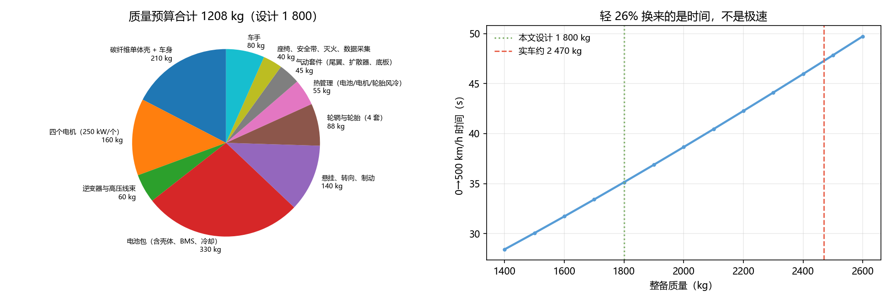

# Q6 结果：1 800 kg 是乐观还是保守，减重的代价是什么

> **这一问来自用户的质疑**：比实车轻 26%，代价是多少？能不能实现？
> 原论文把 1 800 kg 当成给定参数（③），没有验证。本问补上。

---

## 一、自下而上的质量预算：1 208 kg

| 部件 | 质量 |
|---|---|
| 碳纤维单体壳 + 车身 | 210 kg |
| 四个电机（250 kW/个）| 160 kg |
| 逆变器与高压线束 | 60 kg |
| **电池包（含壳体、BMS、冷却）** | **330 kg** |
| 悬挂、转向、制动 | 140 kg |
| 轮辋与轮胎（4 套）| 88 kg |
| 热管理（电池/电机/轮胎风冷）| 55 kg |
| 气动套件 | 45 kg |
| 座椅、安全带、灭火、数据采集 | 40 kg |
| 车手 | 80 kg |
| **合计** | **1 208 kg** |

**⇒ 设计值 1 800 kg 有 592 kg 余量。** 换句话说：**1 800 kg 是保守的，不是激进的。**
真正极端的记录车可以做 1 250 kg 附近。

---

## 二、电池：容量不是被能量决定的，是被 C 率决定的

这是本问最重要的发现。

| 量 | 值 |
|---|---|
| 一次 0→500 km/h 的驱动能量 | **8.97 kWh** |
| 若只按能量配电池（14.6 kWh）| 需要 **69C** ❌ 不可行 |
| 按 30C 反推的最小容量 | **33.3 kWh** |
| 实际工作点 | 30C |
| 电芯比能量需求 | 约 140 Wh/kg |

$$\text{容量下限}=\frac{P}{C_{\max}}=\frac{1000\ \text{kW}}{30}=33.3\ \text{kWh}$$

**一次跑只用 9 kWh，却必须背 33 kWh 的电池**——多出来的 24 kWh 不是为了跑得远，
是为了**在 36 秒内持续输出 1 MW**。

> 这也解释了为什么 500 km/h 的车电池都很重：
> **能量密度决定跑多远，功率密度决定能不能跑这么快。**

---

## 三、减重的代价：不是极速，是稳定性

| 质量 | 下压力/重量比 | 5 m/s 横风下的等效侧向加速度 |
|---|---|---|
| 1 500 kg | 0.415 | **0.452 g** |
| **1 800 kg** | **0.345** | **0.377 g** |
| 2 100 kg | 0.296 | 0.323 g |
| 2 470 kg | 0.252 | 0.275 g |

**两个方向相反的效应**：

1. ✅ **下压力/重量比更高**——同样 6.1 kN 下压力，轻车获得更大的相对抓地（0.345 g vs 0.252 g）；
2. ❌ **横风敏感性高 37%**——同样的侧风，轻车的等效侧向加速度从 0.275 g 涨到 0.377 g。

**这就是减重的真实代价：不是跑不快，是不稳。**

在 500 km/h，横风不是"舒适性"问题，是"会不会偏出车道"的问题。
所以轻车必须配**更强的主动稳定系统**（后轮转向、主动气动配平），
这又反过来吃掉了部分减重收益。

---

## 四、质量对成绩的影响

| 质量变化 | 整备质量 | 0→500 时间 | 距离 | 能耗 |
|---|---|---|---|---|
| −10% | 1 620 kg | **32.1 s** | 3 143 m | 8.04 kWh |
| 基准 | 1 800 kg | 35.1 s | 3 494 m | 8.97 kWh |
| +10% | 1 980 kg | 38.3 s | 3 853 m | 9.92 kWh |
| +20% | 2 160 kg | 41.5 s | 4 218 m | 10.88 kWh |

**质量每 ±10%，0→500 时间变 ±3 秒左右。**

但注意：**质量几乎不影响极速**（极速由阻力和功率决定，质量只通过滚动阻力微弱影响）。
所以"减重"换来的是**加速时间**与**下压力裕度**，不是更高的极速。

---

## 五、结论：能实现，但代价在别处

1. **能实现**：自下而上 1 208 kg，1 800 kg 有 592 kg 余量，甚至偏保守；
2. **电池是被功率定容的**：33.3 kWh / 30C，不是 9 kWh 的能量需求；
3. **减重的代价是稳定性**：横风敏感性高 37%，需要主动稳定系统补偿；
4. **减重不提升极速**，只提升加速与下压力裕度。

## 六、限制

- 部件质量是工程估算（③），未做详细结构优化；
- 30C 是当前赛道电芯的上限（②参照实车同类），若电芯只能 20C，容量要涨到 50 kWh、多约 120 kg；
- 横风模型用侧向力系数 0.3 粗估，未做风洞或 CFD；
- 未考虑配重对重心位置与惯量的影响——**记录车常主动加配重换稳定性**。

## 七、落盘

`results/q6_mass.json`、`figs/q6_mass.png`、`python scripts/q6_mass.py`
