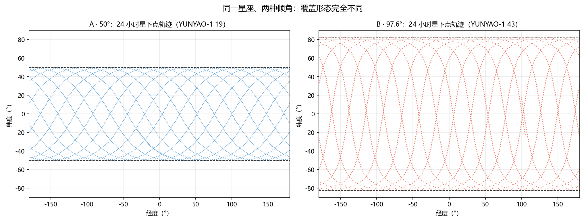
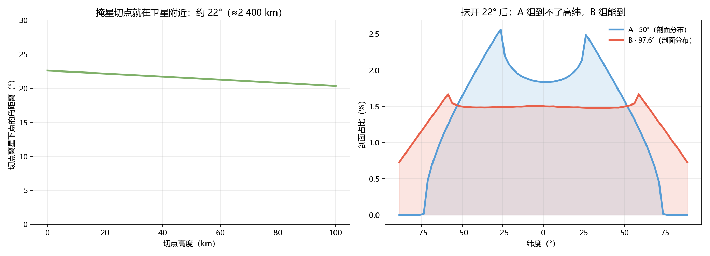
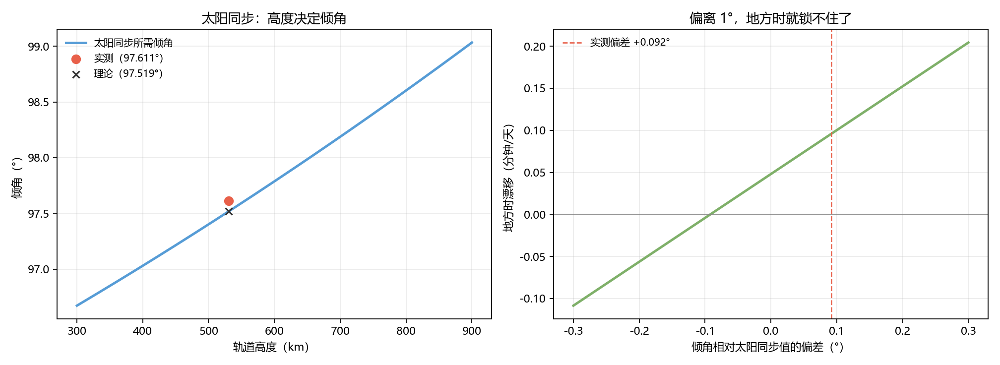
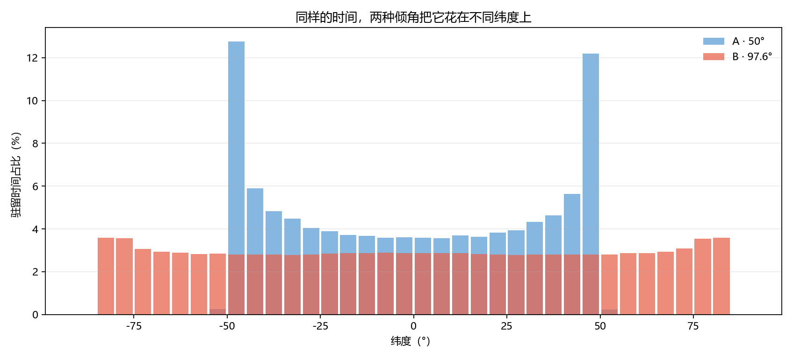
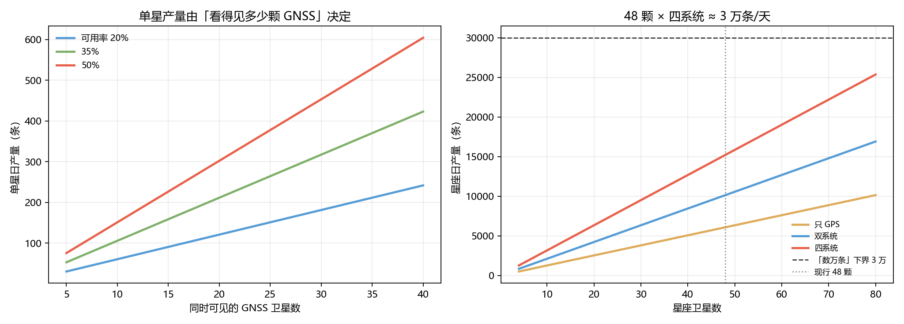

# 一个星座，两种倾角：掩星卫星为什么这样排

> **摘要**
>
> 2026 年 11 月 7 日，谷神星二号遥三把云遥一号 28 星等四颗卫星送入 535 km 太阳同步轨道。本文不复述发射，而是把已公开的九颗轨道根数摆在一起，回答一个设计问题：**为什么同一个星座要同时有 50° 和 97.6° 两套倾角。**
>
> **主要结果**：① 两组倾角的星下点最高纬度分别恰为 **49.98°** 与 **82.39°**，与"最高纬度 = 倾角"的几何关系一致；② 50° 组在中纬（20–50°）的驻留时间是 97.6° 组的 **2.05 倍**，但掩星切点离星下点约 **21.9°**，把这个优势抹开后**剖面密度只差 1.39 倍**；③ B 组实测倾角 97.611°，比 530.7 km 处的太阳同步理论值 97.519° **高 0.092°**，对应地方时每年 **17.5 分钟** 的漂移；④ 极区覆盖是倾角决定的硬上限——50° 组在 ≥70° 的驻留占比为 **0%**，97.6° 组为 **10.2%**；⑤ 用"可见 GNSS 数 × 2 × 每日圈数 × 可用率"估算，48 颗四系统星座的**事件数约 1.5 万/天**，按"一次事件两个产品"计约 **3 万/天**，与公开的"日均数万条廓线"一致。
>
> **诚实性声明**：星座设计意图官方未公开，本文是基于公开数据的**设计解释**；0.092° 的偏差属设计余量还是注入散布，公开资料无法分辨，本文不下结论。

<!-- pagebreak -->

---

## 一、问题重述

### 1.1 背景

2026 年 11 月 7 日 07:37，谷神星二号遥三在酒泉发射，将观澜试验星、云遥一号 28 星、
中北大学一号、钧天一号 06A 四颗卫星送入 **535 km 太阳同步轨道**。
云遥一号 28 星主载荷为 **GNSS 掩星海反一体化载荷**，可反演大气温湿压、电离层电子密度、
海面风速等参数。云遥宇航累计已发射 **48 颗**，是国内规模最大的掩星探测星座。

### 1.2 本文的问题

**不从"发了多少颗"入手**，而是从已公开的轨道根数里读出一个设计问题：

> 九颗星分成 50° 与 97.6° 两组，**为什么？**

| 问 | 内容 |
|---|---|
| Q1 | 倾角决定能覆盖到哪 |
| Q2 | 掩星为什么需要中低纬加密 |
| Q3 | 太阳同步怎么"锁"住地方时 |
| Q4 | 两套倾角怎么互补 |
| Q5 | 48 颗怎么撑起日均数万条廓线 |

---

## 二、数据

### 2.1 来源

| 项 | 来源 | 等级 |
|---|---|---|
| 发射时间、轨道高度、载荷 | 官方通稿与央广报道 | ① |
| 九颗卫星的轨道根数 | CelesTrak 公开 TLE（2026-11-09）| ① |
| 星座规模（48 颗、日均数万条）| 官方通稿 | ① |
| 本文算出的几何量与产量 | 两体 + J2 长期项传播 | ② |

### 2.2 两条数据缺口（必须写进正文）

1. **新发的四颗尚未编目**（发射仅 2 天），无法取 TLE；
2. **CelesTrak 批量下载被限流**（403），只能按名称查询——九颗是"可查到的全部"，不等于星座全貌。

### 2.3 实测根数

| 卫星 | 倾角 | 高度 | 周期 | 偏心率 |
|---|---|---|---|---|
| YUNYAO-1 18 | 50.014° | 486.3 km | 94.33 min | 0.00058 |
| YUNYAO-1 19 | 49.984° | 504.8 km | 94.72 min | 0.00055 |
| YUNYAO-1 20 | 49.977° | 504.5 km | 94.71 min | 0.00040 |
| YUNYAO-1 43 | 97.611° | 531.2 km | 95.26 min | 0.00145 |
| YUNYAO-1 44 | 97.610° | 530.8 km | 95.25 min | 0.00172 |
| YUNYAO-1 45 | 97.612° | 530.9 km | 95.25 min | 0.00162 |
| YUNYAO-1 46 | 97.612° | 531.2 km | 95.26 min | 0.00120 |
| YUNYAO-1 47 | 97.609° | 530.3 km | 95.24 min | 0.00163 |
| YUNYAO-1 48 | 97.610° | 530.1 km | 95.24 min | 0.00158 |

**组内倾角标准差：A 组 0.0161°，B 组 0.0012°。** 整齐到这个程度，只能是设计，不是发射散布。

---

## 三、方法

### 3.1 轨道传播

采用两体运动 + J2 长期项（不用 SGP4）：

$$\dot\Omega=-\tfrac32J_2\left(\frac{R_e}{p}\right)^2n\cos i,\qquad
\dot\omega=\tfrac34J_2\left(\frac{R_e}{p}\right)^2n\left(5\cos^2i-1\right)$$

**精度声明**：一天内位置误差约数十公里，对"最高纬度、覆盖带、驻留分布"这类统计量影响可忽略；
对瞬时点位不可用。

### 3.2 覆盖与驻留

星下点最高纬度由倾角决定；驻留时间按 2.5° 纬度带统计。

### 3.3 掩星几何

切点相对星下点的角距离：

$$\theta=\arccos\left(\frac{R_e+h_t}{R_e+h_{\text{LEO}}}\right)$$

### 3.4 太阳同步条件

$$\dot\Omega=+\frac{2\pi}{365.2422\ \text{day}}\approx0.9856\ \text{°/day}$$

### 3.5 产量模型

$$N_{\text{day}}=N_{\text{vis}}\times2\times\frac{24\times60}{T}\times\eta$$

---

## 四、结果

### 4.1 覆盖：最高纬度就是倾角

| | A · 50° | B · 97.6° |
|---|---|---|
| 最高纬度 | **49.98°** | **82.39°** |
| 每天圈数 | 15.20 | 15.12 |
| 赤道相邻轨迹 | 2 685 km | 2 650 km |



赤道缝隙几乎一样（2 685 vs 2 650 km），**形态完全不同**：A 在 ±50° 之间织毯子，B 扫条纹。

### 4.2 掩星：切点抹开 22°，优势从 2 倍降到 1.4 倍

$$\theta=\arccos\left(\frac{6378+30}{6378+530}\right)=21.93°\approx2\,442\ \text{km}$$

把驻留分布按 ±21.9° 抹开，得到剖面纬度分布：

| | 中纬 20–50° | ≥60° | ≥70° |
|---|---|---|---|
| A · 50° | **24.8%** | 4.0% | 0.5% |
| B · 97.6° | **17.8%** | 13.9% | 8.0% |

$$\text{中纬剖面密度比}=\frac{24.8\%}{17.8\%}=\mathbf{1.39\times}$$



**⇒ "低倾角让中纬密度翻倍"是错的；正确说法是"高约四成"。**

### 4.3 太阳同步：0.092° 的代价

| 量 | 值 |
|---|---|
| 平均高度 | 530.7 km |
| 理论倾角 | **97.519°** |
| 实测倾角 | **97.611°** |
| 偏差 | **+0.092°** |
| 地方时漂移 | **+17.5 分钟/年** |



### 4.4 互补：倾角是硬约束

| 纬度带 | A · 50° | B · 97.6° |
|---|---|---|
| 热带（<20°）| 65.2% | 61.5% |
| **中纬（20–50°）** | **34.5%** | 16.8% |
| 高纬（≥70°）| **0%** | **10.2%** |



### 4.5 产量：一个"数万条"能差 2–3 倍

| 场景 | 48 颗（条/天）|
|---|---|
| 只 GPS | 3 479–8 698 |
| 双系统 | 5 798–14 496 |
| **四系统** | **8 698–21 744** |

对账：四系统、η=35% ⇒ **事件数 15 221/天**；按"一次事件两个产品"计 **30 442/天** —— 与"数万条"一致。



---

## 五、讨论

### 5.1 为什么要两种倾角

- **97.6° 组**：全球覆盖 + 太阳同步（观测条件长期一致），负责"兜底"；
- **50° 组**：把中纬剖面密度抬高约四成，负责"加密"。

**倾角决定天花板，数量决定密度。** 极区那片空白，50° 组加多少颗都补不上。

### 5.2 为什么"2 倍"会缩水成"1.4 倍"

掩星不是"卫星脚下取样"，而是"离脚下 22° 的切点取样"。
**任何关于"覆盖密度"的结论，都必须先问一句：采样点离卫星有多远。**

### 5.3 0.092° 为什么不回答

两种解释都自洽：若是设计余量，可能为后续高度衰减留补偿（486 km 只需 97.35°）；
若是注入误差，0.09° 对运载偏大（常见 0.01–0.05°）。
**没有公开数据能分辨，所以只报数。**

### 5.4 "日均数万条"的口径

同一个星座，"日均产量"能差 2–3 倍：按事件 1.5 万，按产品（大气+电离层）3 万。
**这不代表任何一方造假，而是"条"这个单位本身缺限定词。**

---

## 六、局限

1. 传播器只用两体 + J2 长期项，一天内位置误差数十公里；
2. 只取到 9 颗（A 组 3 颗、B 组 6 颗），不等于星座全貌；
3. 掩星剖面分布用均匀核抹开，未建模 GNSS 真实几何；
4. $N_{\text{vis}}$、$\eta$ 为量级假设，非实测；
5. "一次事件两个产品"是行业口径，云遥的具体计数方式未公开；
6. 星座设计意图官方未公开，本文为基于数据的解释。

---

## 七、结论

1. **倾角决定覆盖上限**：50° 到 49.98°，97.6° 到 82.39°，公式与实测完全吻合；
2. **中纬密度优势是 1.39 倍，不是 2 倍**——切点会抹开 22°；
3. **太阳同步的容差很紧**：0.092° 的偏差 → 每年 17.5 分钟地方时漂移；
4. **两种倾角是互补而非重复**：一个加密中纬，一个兜底全球；
5. **"数万条"取决于怎么数**：事件 1.5 万，产品 3 万，两者都真。

---

## 参考文献

1. 中新网.《天津首颗本土研制商业气象卫星入轨》. 2026-11-07.
   <https://m.sohu.com/coo/zmtq/1098537623_123753>
2. 央广网.《谷神星二号飞行试验成功，多类型中小型载荷灵活部署》. 2026-11-08.
   <https://tech.cnr.cn/gstj/20261108/t20261108_527866197.shtml>
3. CelesTrak. *GP Element Sets*（YUNYAO 查询）. 2026-11-09.
   <https://celestrak.org/NORAD/elements/>
4. MDPI Remote Sensing.《Comparative Assessment of YUNYAO and COSMIC-2 Radio Occultation Bending-Angle Observations》. 2026.
   <https://www.mdpi.com/2072-4292/18/10/1566>
5. Vallado, D. A. (2013). *Fundamentals of Astrodynamics and Applications* (4th ed.). Microcosm Press.

---

## 附录：复现

```powershell
python scripts/orbit.py        # TLE 解析与传播自检
python scripts/q1_coverage.py  # 覆盖与最高纬度
python scripts/q2_occult.py    # 掩星几何与剖面分布
python scripts/q3_sso.py       # 太阳同步与地方时漂移
python scripts/q4_revisit.py   # 驻留分布与互补
python scripts/q5_yield.py     # 产量模型与对账
```

数字核对表见 `paper/结论速览.md`。
