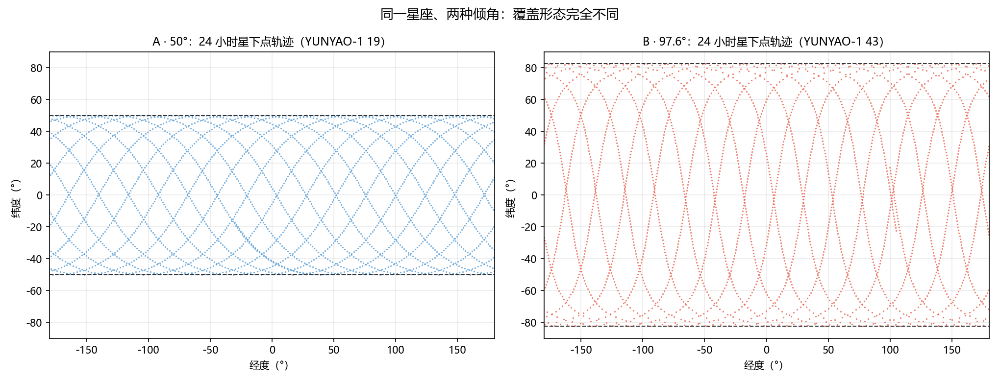

# Q1 结果：倾角决定能覆盖到哪

> 用 CelesTrak 实测根数做 24 小时星下点传播（两体 + J2 长期项）。
> 代表星：A 组取 YUNYAO-1 19（504.8 km），B 组取 YUNYAO-1 43（531.2 km）。

---

## 一、三组数字

| | A · 50° | B · 97.6° |
|---|---|---|
| 代表星 | YUNYAO-1 19 | YUNYAO-1 43 |
| 倾角 | 49.984° | 97.611° |
| 高度 | 504.8 km | 531.2 km |
| 周期 | 94.72 min | 95.26 min |
| **星下点最高纬度** | **49.98°** | **82.39°** |
| 每天圈数 | 15.20 | 15.12 |
| 赤道相邻轨迹 | 24.12° ≈ **2 685 km** | 23.81° ≈ **2 650 km** |

## 二、形态差别比数字更重要

**A 组（50°）**：轨迹在 ±50° 之间来回织，**50° 以上是空白**。
靠近南北 50° 时轨迹变得很密——那是轨道的折返点，卫星在那里掉头慢。

**B 组（97.6°）**：轨迹近乎竖直，从 -82° 扫到 +82°，**全球覆盖**。
赤道附近轨迹之间的缝最大，越往极区越密（经线收敛）。

> 两组的赤道缝隙几乎一样（2 685 vs 2 650 km），
> 但**覆盖形态完全不同**——一个"织毯子"，一个"扫条纹"。

## 三、倾角与最大纬度的关系

无侧视时，星下点最高纬度**恰好等于倾角**：

$$\varphi_{\max}=\begin{cases} i, & i\le 90°\\ 180°-i, & i>90°\end{cases}$$

- A：$i=49.98°$ → 49.98°（实测 49.98° ✅）
- B：$i=97.61°$ → $180-97.61=82.39°$（实测 82.39° ✅）

**这条对应关系是整期的地基**：倾角不是"倾多少度"，而是"能到多北"。

## 四、为什么 A 组的高度不一致

A 组三颗：486.3 / 504.8 / 504.5 km——**相差近 20 km**，而倾角几乎一样（±0.02°）。

同一轨道面内高度不同，通常意味着**同一批次内的分阶段部署**或**后期轨道调整**。
公开资料没说，这里只记录现象，不下结论。

## 五、限制

- 传播器只含两体 + J2 长期项，一天内位置误差约数十公里；
  对"最高纬度""覆盖带"这类统计量影响可忽略，对瞬时点位不可用；
- 未含大气阻力与短周期项；
- 只取了 9 颗中的代表星，A 组仅 3 颗，样本有限。

## 六、落盘

`results/q1_coverage.json`、`figs/q1_coverage.png`、`python scripts/q1_coverage.py`
