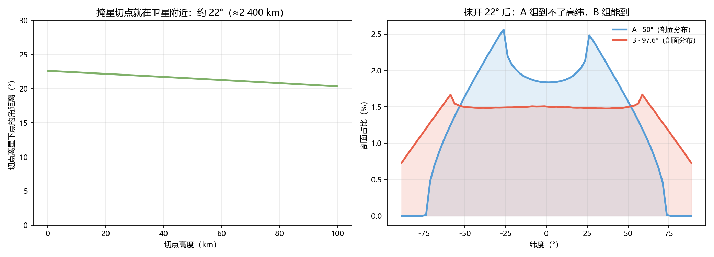

# Q2 结果：掩星为什么需要中低纬加密

> 两件事：① 切点离卫星脚下有多远；② 把这个"抹开"之后，两种倾角的剖面分布差多少。

---

## 一、几何：切点就在卫星附近

低轨接收机看到的掩星切点，是 GNSS 信号擦过大气最低点的位置：

$$\theta=\arccos\!\left(\frac{R_e+h_t}{R_e+h_{\text{LEO}}}\right)$$

530 km 高度时：

| 切点高度 | 角距离 |
|---|---|
| 0 km | 22.59° |
| 10 km | 22.37° |
| 30 km | **21.93°** |
| 60 km | 21.26° |
| 100 km | 20.32° |

**几乎与切点高度无关，稳定在 21–23°，地面距离约 2 400 km。**

## 二、推论：剖面纬度 ≈ 星下点 ±22°

一个掩星剖面采样的是"离卫星脚下 ±22°"的纬度带。
把 Q4 的驻留分布按这个宽度抹开，得到**剖面随纬度的分布**：

| 指标 | A · 50°（3 颗）| B · 97.6°（6 颗）| 倍数 |
|---|---|---|---|
| 中纬 20–50° 剖面占比 | **24.8%** | **17.8%** | **1.39×** |
| ≥60° 剖面占比 | 4.0% | **13.9%** | 0.29× |
| ≥70° 剖面占比 | 0.5% | **8.0%** | 0.06× |

## 三、最值得写的一处修正：优势从 2 倍降到 1.4 倍

Q4 里，A 组在中纬的**驻留时间**是 B 组的 **2.05 倍**。

但切点会抹开 22°，这个优势被摊薄：

$$\text{中纬剖面密度比} = \frac{24.8\%}{17.8\%}=\mathbf{1.39\times}$$

**⇒ "低倾角让中纬密度翻倍"是错的；正确说法是"高约四成"。**

这个修正很重要：**如果不算切点几何，就会把 2 倍的优势吹出去**。

## 四、极区差距依然显著

| | ≥60° | ≥70° |
|---|---|---|
| A | 4.0% | 0.5% |
| B | 13.9% | 8.0% |

**A 组在高纬几乎为零**——这是倾角决定的硬上限，抹开 22° 也救不回来
（50° + 22° = 72°，但密度已经衰减到 0.5%）。

## 五、本问的回答

1. **为什么掩星要中低纬**：剖面密度正比于卫星在该纬度的驻留时间；
   中低纬水汽多、反演价值高，而极轨在中纬只分到一半时间；
2. **为什么要两种倾角**：低倾角把中纬密度抬高约 40%，极轨补齐高纬；
3. **为什么两者不能互相替代**：倾角给的是**天花板**，数量给的是**密度**。

## 六、限制

- 抹开用的是均匀核（假设 GNSS 卫星方向各向同性），实际取决于 GNSS 星座几何；
- 未建模大气折射对切点高度的实际影响（只算了几何切线）；
- A 组仅 3 颗、B 组 6 颗，样本小；
- "剖面"只用几何近似，未做真实掩星事件模拟。

## 七、落盘

`results/q2_occult.json`、`figs/q2_occult.png`、`python scripts/q2_occult.py`
