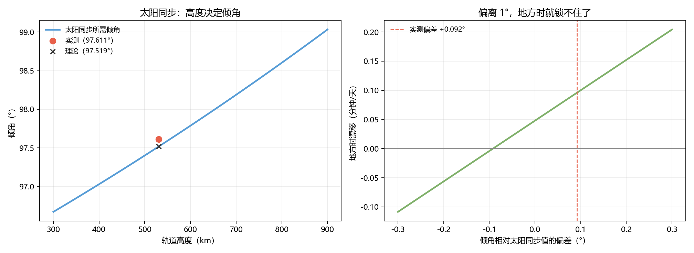

# Q3 结果：太阳同步 —— 怎么"锁"住地方时

> 地球不是球，是扁的。扁球体让轨道面慢慢进动——太阳同步就是**用这个进动去追太阳**。

---

## 一、推导

$$\dot\Omega=-\tfrac32 J_2\left(\frac{R_e}{a}\right)^2 n\cos i$$

太阳同步要求升交点每年恰好进动 360°（跟着太阳走）：

$$\dot\Omega=+\frac{2\pi}{365.2422\ \text{day}}\approx0.9856\ \text{°/day}$$

解出倾角与高度的关系：

$$\cos i=\frac{\dot\Omega}{-\tfrac32 J_2(R_e/a)^2 n}$$

| 高度 | 太阳同步所需倾角 |
|---|---|
| 300 km | 96.6° |
| 486.3 km | 97.350° |
| 504.8 km | 97.420° |
| **530.7 km** | **97.519°** |
| 700 km | 98.188° |
| 900 km | 98.8° |

**越高的轨道，需要的倾角越大**——因为进动率随高度快速衰减，得靠更强的逆行来补偿。

## 二、与实测对账

B 组 6 颗平均高度 **530.7 km**，理论倾角 **97.519°**；实测平均 **97.611°**。

$$\Delta i=+0.092°$$

**6 颗星之间的倾角散布只有 0.0012°（标准差），却集体比理论值高 0.09°**——
这说明 0.09° 不是随机散布，而是一个**系统性的偏置**。

## 三、这 0.092° 的代价

倾角偏大 ⇒ $\cos i$ 更负 ⇒ 进动更快 ⇒ 升交点跑在太阳前面：

| 量 | 值 |
|---|---|
| 多余进动 | **+0.012 °/天** |
| 地方时漂移 | **+0.048 分钟/天** |
| 一年累计 | **+17.5 分钟** |

十年后，这颗星的过境地方时会偏出约 **3 小时**。

## 四、为什么掩星星座也要太阳同步

不是只有光学遥感才需要 SSO。对掩星（RO）：

1. **观测条件一致**：同一地方时、同一太阳高度角 ⇒ 大气温度廓线的辐射背景稳定；
2. **数据可比**：不同日期、不同卫星的廓线可以放在一起做气候序列；
3. **长期业务化**：数据要接进数值天气预报，需要稳定的采样节律。

## 五、那 0.09° 是设计余量还是注入散布

**公开资料没说，本期只报数，不作答。** 但有两点可以摆出来：

- **若是设计余量**：偏高的倾角会让进动略快，可能是在给后续高度衰减留补偿空间
  （高度下降 → 所需倾角变小，见第一节表格）；
- **若是注入误差**：0.09° 对运载来说是偏大的偏差量级，通常入轨倾角精度在 0.01–0.05°。

两种解释都能自圆其说，**没有公开数据能分辨**。

## 六、限制

- 用平均高度对账，未逐星扣掉各自的高度差；
- J2 只是一阶长期项，未含高阶摄动与大气阻力；
- 地方时漂移按线性累计估算，实际会随高度变化。

## 七、落盘

`results/q3_sso.json`、`figs/q3_sso.png`、`python scripts/q3_sso.py`
