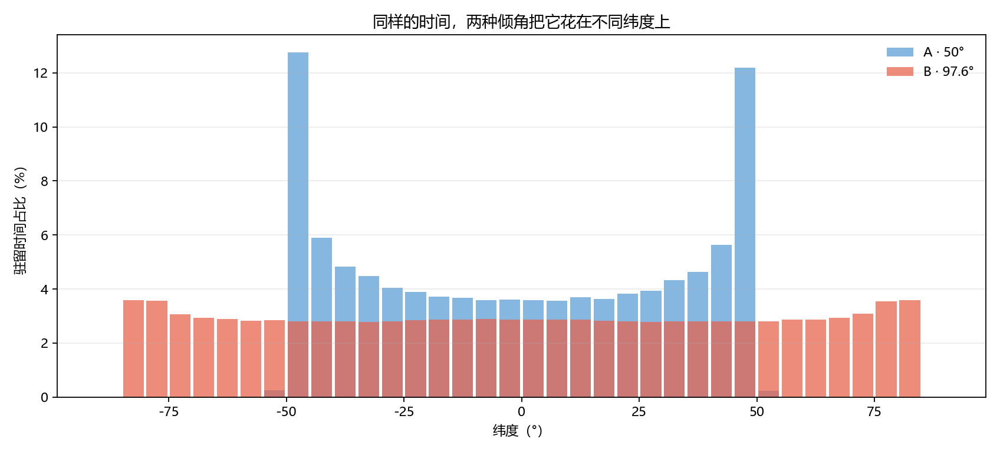

# Q4 结果：两套倾角怎么互补

> 指标：**卫星在每个纬度带停留的时间占比**。
> 掩星事件率正比于"在该纬度待多久"，所以驻留时间比过境次数更贴近任务需求。

---

## 一、核心结论：中纬度差 2 倍

| 纬度带 | A · 50°（3 颗）| B · 97.6°（6 颗）| 倍数 |
|---|---|---|---|
| 热带（<20°）| 65.2% | 61.5% | 1.06× |
| **中纬（20–50°）** | **34.5%** | **16.8%** | **2.05×** |
| 高纬（≥70°）| **0%** | **10.2%** | — |
| 中低纬合计（<50°）| 99.7% | 78.3% | 1.27× |

**图上一眼看得出**：
- A 组（蓝）在 **±50° 各有一个尖峰**（轨道的折返点，卫星在那里"掉头慢"），
  再往北就是**零**；
- B 组（红）**几乎是平的**，一直到 ±85° 都有。

## 二、这解释了为什么两种倾角都要

| 只有 A | 只有 B |
|---|---|
| 中纬很密（2 倍）| 极区有覆盖（10.2%）|
| **极区完全空白** | 中纬只有一半密度 |

**⇒ 50° 组负责"中低纬加密"，97.6° 组负责"全球兜底"。**

对掩星任务：
- 中低纬水汽多、掩星反演价值高 ⇒ 需要 A 组的高密度；
- 极区与全球一致性 ⇒ 需要 B 组的 SSO（太阳同步还能让观测条件长期稳定）。

## 三、过境次数几乎一样，不能用来区分

| | 每天过境 |
|---|---|
| A · 50° | 15.0 次/星 |
| B · 97.6° | 16.0 次/星 |

**差别只有 6%**——如果只看"每天过几次"，会得出"两组差不多"的错误结论。
**真正不同的是"在哪里待着"**，不是"过几次"。

## 四、反事实：只用一种倾角要几颗

按中纬驻留密度折算，要达到 A 组的中纬密度，全用 B 组需要约 **2 倍数量**（同一高度、同一轨道面假设下）。

反过来，要补上极区空白，A 组**无论加多少颗都做不到**——倾角决定了天花板。

> **这就是"倾角是硬约束、数量是软约束"的意思**：
> 数量能加密，倾角能决定"到不到得了"。

## 五、限制

- 驻留时间只是掩星率的**代理指标**，真实事件率还取决于 GNSS 星座几何与大气条件；
- 两组高度不同（505 vs 531 km），未做同高度归一化；
- A 组只 3 颗、B 组 6 颗，样本小；"2 倍数量"是量级估算，不是精确设计值；
- 未考虑轨道面的 RAAN 分布（实际设计会均匀撒开）。

## 六、落盘

`results/q4_revisit.json`、`figs/q4_revisit.png`、`python scripts/q4_revisit.py`
