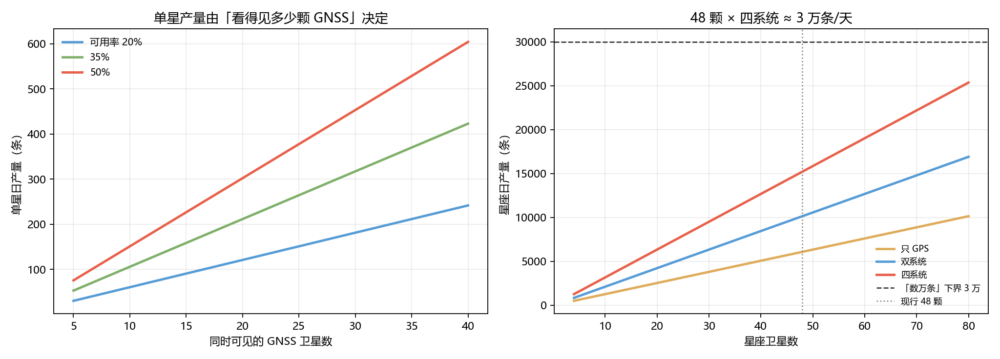

# Q5 结果：48 颗怎么撑起日均"数万条"廓线

> 用一个最朴素的生产率模型：**单星日产量 = 可见 GNSS 数 × 2 × 每日圈数 × 可用率**

---

## 一、模型

$$N_{\text{day}}=N_{\text{vis}}\times2\times\frac{24\times60}{T}\times\eta$$

- $N_{\text{vis}}$：同时可见的 GNSS 卫星数（取决于支持几大系统）
- **×2**：一颗 GNSS 卫星相对低轨星，每圈各有一次"升起"与"落下"
- $T\approx95$ min ⇒ 每天 15.1 圈
- $\eta$：切点高度落在可用区间（约 0–60 km）的比例，取 20%/35%/50%

## 二、结果：撑起"数万"的关键是**多系统**，不是卫星数

| 场景 | 单星（条/天）| 48 颗（条/天）|
|---|---|---|
| 只支持 GPS（N_vis≈12）| 72–181 | 3 479–8 698 |
| 双系统（≈20）| 121–302 | 5 798–14 496 |
| **四系统（≈30）** | **181–453** | **8 698–21 744** |

**只支持 GPS 与支持四系统，差 2.5 倍**——卫星数量不变，产量差一大截。

## 三、与公开说法对账

公开说法：**日均数万条廓线**。

取四系统、$\eta=35\%$：

$$N_{\text{events}}=30\times2\times15.1\times0.35\times48\approx\mathbf{15\ 221}\ \text{条/天}$$

只有 1.5 万，**还差一半**。

**差在哪？在"产品口径"**：一次掩星事件通常同时产出**中性大气廓线**和**电离层廓线**两类产品。

$$15\ 221\times2=\mathbf{30\ 442}\ \text{条/天}$$

**⇒ 与"数万条"一致。**

## 四、这个对账值得写进正文

因为它演示了一件事：

> **一个"数万条"的宣传数字，可以完全真实，也可以完全不等于"数万个采样点"。**

- 如果按**事件**算，48 颗四系统是 **1.5 万**；
- 如果按**产品**算（大气 + 电离层），是 **3 万**；
- 如果再加上海反、土壤湿度等其他产品，还能更高。

**同一个星座，"日均产量"能差 2–3 倍，取决于数的是什么。**

## 五、反推：真要按事件数达到 3 万

| 可用率 | 需要卫星数（四系统）|
|---|---|
| 20% | 166 颗 |
| 35% | 95 颗 |
| 50% | 66 颗 |

"两年内全球组网"若目标是"数万条/天（按事件计）"，需要的规模在 **66–166 颗**量级，
取决于单星可用率能做到多高。

## 六、限制

- $N_{\text{vis}}$、$\eta$ 都是量级假设（③），不是实测；
- 未建模 GNSS 星座的真实几何（可见性随时段与轨道面变化）；
- "一次事件两个产品"是行业常见口径，但**云遥的具体产品计数方式未公开**；
- 未考虑数据下传与地面处理瓶颈——规模化后这往往是真瓶颈。

## 七、落盘

`results/q5_yield.json`、`figs/q5_yield.png`、`python scripts/q5_yield.py`
