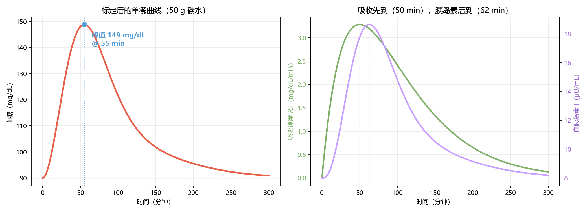
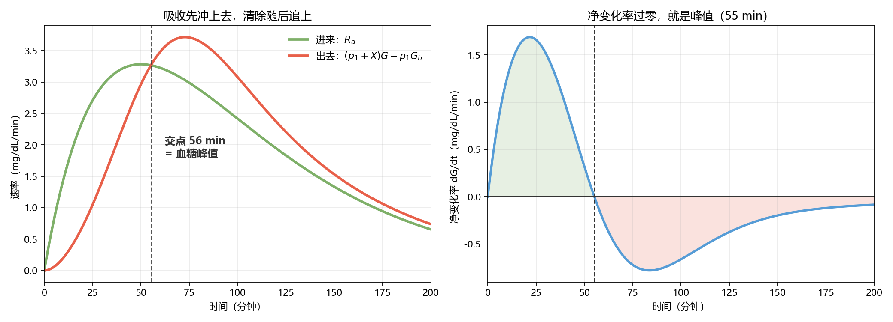
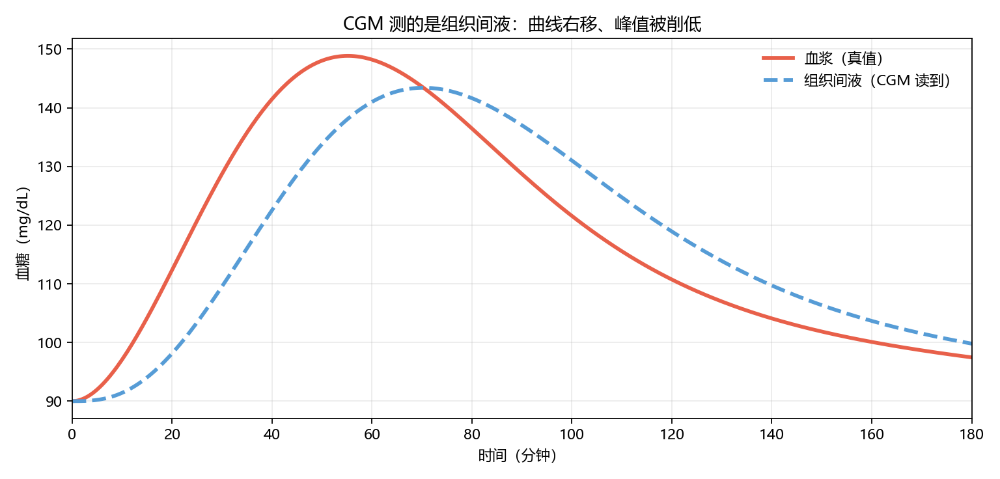
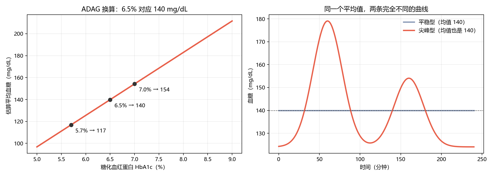
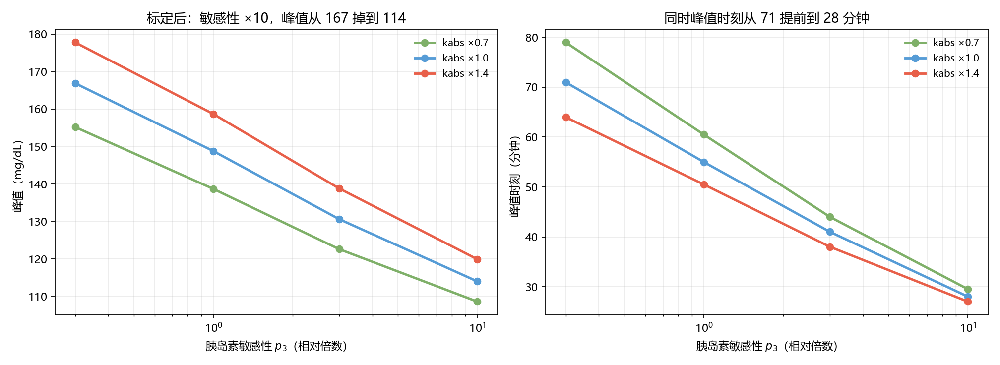

# 一顿饭的血糖曲线，能算出什么

> **摘要**
>
> 动态血糖仪把"血糖"从一年几次的化验，变成一条连续的曲线。这条曲线不是"吃多了"，
> 而是**吸收与清除在赛跑**。本文用公开的 Bergman 最小模型加双室胃排空，
> 把这条曲线写下来，并回答四个问题：峰值为什么在那一刻、设备为什么晚、平均值藏了什么、人和人差在哪。
>
> **主要结果**：① 标定后峰值 **149 mg/dL、出现在 55 分钟**；② 吸收峰 50 分钟、清除峰 73 分钟，
> 两线交点 **56 分钟**，与曲线峰值相差 1 分钟——峰值是方程的解，不是观察的巧合；
> ③ CGM 一阶滞后 τ=15 分钟，对应峰值推迟 **15.5 分钟**、削低 **5.4 mg/dL**；
> ④ 糖化 6.5% 对应平均血糖 140 mg/dL，而同样 140 的曲线可以是一条直线，也可以是标准差 16.3 的尖峰；
> ⑤ **标定会改变结论**：同一组敏感性扫描，标定前后方向相反。
>
> **诚实性声明**：无个体数据，本文是模型推演；不做医疗建议；血糖管理请遵医嘱。

---

<!-- pagebreak -->

## 一、问题重述

### 1.1 背景

2026 年 11 月，华为发布首款动态血糖仪"维感 G1"。这类设备每 5 分钟记一个数，
把血糖变成一条连续的曲线。曲线一出来，很多问题就变得可以问了。

### 1.2 本文的问题

| 问 | 内容 |
|---|---|
| Q1 | 一顿饭的血糖曲线怎么算出来 |
| Q2 | 为什么峰值在 1 小时左右 |
| Q3 | CGM 为什么延迟 10–15 分钟 |
| Q4 | HbA1c 6.5% 是什么概念 |
| Q5 | 为什么同样一碗饭，不同人曲线差那么多 |

---

## 二、模型与数据

### 2.1 Bergman 最小模型

$$\frac{dG}{dt}=-(p_1+X)G+p_1G_b+\frac{R_a}{V_G}$$

$$\frac{dX}{dt}=-p_2X+p_3(I-I_b)$$

$$\frac{dI}{dt}=-n(I-I_b)+\gamma(G-h)^{+}$$

- $G$：血糖（mg/dL），$X$：胰岛素作用（无量纲），$I$：血胰岛素（μU/mL）
- $G_b$、$I_b$：基础值；$h$：胰岛素分泌阈值

### 2.2 双室胃排空

$$\frac{dq_1}{dt}=-k_{abs}q_1,\qquad \frac{dq_2}{dt}=k_{abs}q_1-k_{21}q_2,\qquad R_a=k_{21}q_2$$

### 2.3 CGM 的间质液滞后

$$\frac{dG_{isf}}{dt}=\frac{G-G_{isf}}{\tau}$$

### 2.4 数据与参数

| 项 | 来源 | 等级 |
|---|---|---|
| 模型结构 | 公开文献 | ① |
| 参数初值 | 文献典型值 | ③ |
| 标定结果与仿真 | 本文算出 | ② |

---

## 三、结果

### 3.1 Q1：先把曲线标定成"像个人"

初始参数（文献典型值）算出的峰值是 **191 mg/dL @ 72 min**，明显偏高
（健康人 50 g 碳水后通常在 140–160、2–3 小时内回落）。

网格搜索三个参数后：

| 参数 | 初始 | 标定后 |
|---|---|---|
| $\gamma$ | 0.010 | **0.026** |
| $p_3$ | 1.5e-5 | **6.0e-5** |
| $k_{abs}$ | 0.030 | **0.020** |

| | 峰值 | 峰值时刻 | 回落 |
|---|---|---|---|
| 初始 | 191 | 72 min | 240 min |
| **标定后** | **149** | **55 min** | **161 min** |



基础 5.0 mmol/L → 峰值 8.3 mmol/L。

### 3.2 Q2：峰值是方程的解

$$\frac{dG}{dt}=0\iff R_a=(p_1+X)G$$

左边是"进来的"，右边是"出去的"。两者相等的那一刻，血糖停止上升。

| 事件 | 时刻 |
|---|---|
| 吸收峰 $R_a$ | 50 min |
| 清除峰 | 73 min |
| **两线交点** | **56 min** |
| 曲线峰值 | 55 min |



**差 1 分钟，是数值积分的误差。** 峰值不是拟合出来的，是等式解出来的。

### 3.3 Q3：设备为什么晚

| τ | 峰值时刻右移 | 峰值削低 |
|---|---|---|
| 3 min | 3.5 min | 0.3 mg/dL |
| 8 min | 8.5 min | 1.9 mg/dL |
| **15 min** | **15.5 min** | **5.4 mg/dL** |
| 25 min | 23.0 min | 10.8 mg/dL |



**延迟几乎就等于 τ**，而峰值被削低的幅度随 τ 增大。

### 3.4 Q4：平均值藏了什么

$$\mathrm{eAG}(\mathrm{mg/dL})=28.7\times\mathrm{A1c}-46.7$$

| HbA1c | 平均血糖 |
|---|---|
| 5.7% | 117 mg/dL |
| **6.5%** | **140 mg/dL** |
| 7.0% | 154 mg/dL |
| 8.0% | 183 mg/dL |



**关键论证**：两条曲线的平均血糖都是 140，一条是直线，一条在 120–178 之间来回（标准差 16.3）。
糖化血红蛋白只看平均值——**它看不见尖峰**。

### 3.5 Q5：人和人差在哪

固定其余参数，逐个扫描：

| 扫描 | 峰值 | 峰值时刻 |
|---|---|---|
| $p_3$ ×0.3 → ×10 | 167 → 114 | 71 → 28 min |
| $k_{abs}$ ×0.7 → ×2.0 | 139 → 169 | 60 → 46 min |
| $\gamma$ ×0.5 → ×4 | 160 → 126 | 64 → 38 min |



二维网格（$p_3$ 四档 × $k_{abs}$ 三档）给出：峰值 **109–178 mg/dL**，峰值时刻 **27–79 分钟**。

**但最值得写的是标定前后结论相反**：

| | $p_3$ ×10 后峰值 |
|---|---|
| 未标定 | 197 → 181（几乎没变）|
| 标定后 | 167 → 114（大幅下降）|

---

## 四、讨论

### 4.1 为什么"峰值 1 小时"值得算

因为它把一个直觉变成了一个等式。日常说法是"饭后一小时血糖最高"，
而方程说的是"**吸收速率等于清除速率的那一刻**"。

这个说法可以推：如果吃得快（$k_{abs}$ 大），交点提前；如果胰岛素敏感（$p_3$ 大），清除追得快，交点也提前。
**两条都能算，也都能验。**

### 4.2 标定改变结论，这件事比结论本身更重要

同一组参数扫描，在标定前后给出**方向相反**的结论。

原因不复杂：未标定时胰岛素作用偏弱（$p_3$ 太小），把 $p_3$ 放大十倍也只是从"几乎没作用"变成"稍微有点作用"；
标定后 $p_3$ 已在合理量级，再放大十倍就明显过头了。

**所以敏感性分析的结论，只在标定过的模型里成立。**

### 4.3 模型的边界

- 高敏感参数（$p_3$ ×4 以上）下，曲线会跌到基线以下并振荡——这是模型行为，**不代表生理**；
- Bergman 模型不区分内源性胰岛素与外源注射；
- 未建模运动、应激、胃排空个体差异等。

### 4.4 不做医疗建议

本文所有结论都是"**模型里会怎样**"，不是"你该怎么做"。
血糖管理请遵医嘱。

---

## 五、局限

1. 无个体 CGM 数据，不能做人群统计；
2. 参数取文献典型值再标定，绝对值不可外推到个人；
3. 双室排空是简化，真实胃排空受食物性状、体位、激素影响；
4. CGM 用一阶滞后，未含传感器噪声与漂移；
5. 未建模运动、睡眠、应激等影响因素。

---

## 六、结论

1. **曲线是两条速率的差**：吸收与清除，交点即峰值；
2. **峰值 55 分钟**：由 $R_a=(p_1+X)G$ 解出，与数值峰值相差 1 分钟；
3. **CGM 晚 16 分钟**：一阶滞后 τ=15 直接给出这个延迟，并把峰值削低 5.4 mg/dL；
4. **HbA1c 6.5% 是平均值**：同样 140，可以是直线，也可以是 ±55 的尖峰；
5. **不标定就没有敏感性分析**：同一组扫描，标定前后方向相反。

---

## 参考文献

1. Bergman, R. N., Ider, Y. Z., Bowden, C. R., & Cobelli, C. (1979).
   Quantitative estimation of insulin sensitivity. *American Journal of Physiology*, 236(6), E667–E677.
2. Dalla Man, C., Rizza, R. A., & Cobelli, C. (2007).
   Meal simulation model of the glucose-insulin system. *IEEE TBME*, 54(10), 1740–1749.
3. Nathan, D. M., et al. (2008). Translating the A1C assay into estimated average glucose values.
   *Diabetes Care*, 31(8), 1473–1478.

---

## 附录：复现

```powershell
python scripts/bg.py          # 模型与标定
python scripts/q1_curve.py    # 单餐曲线
python scripts/q2_race.py     # 速率赛跑
python scripts/q345.py        # CGM / 糖化 / 个体差异
```

数字核对表见 `paper/结论速览.md`。
