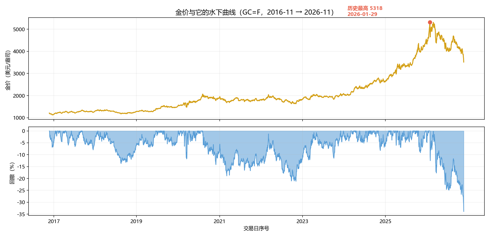
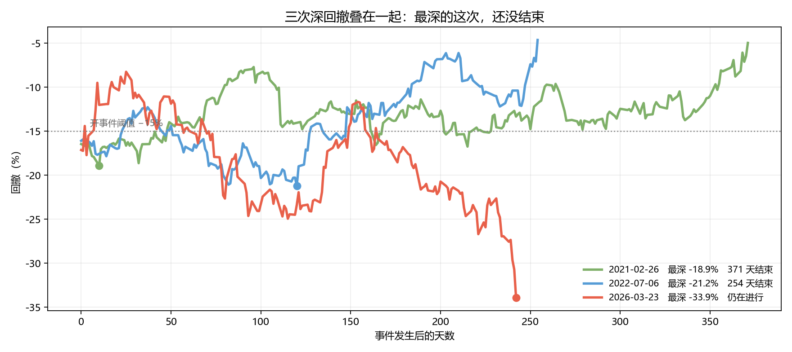
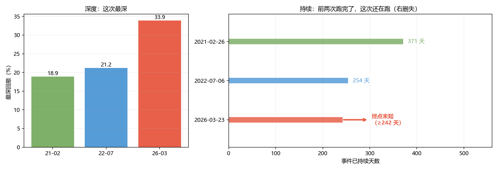
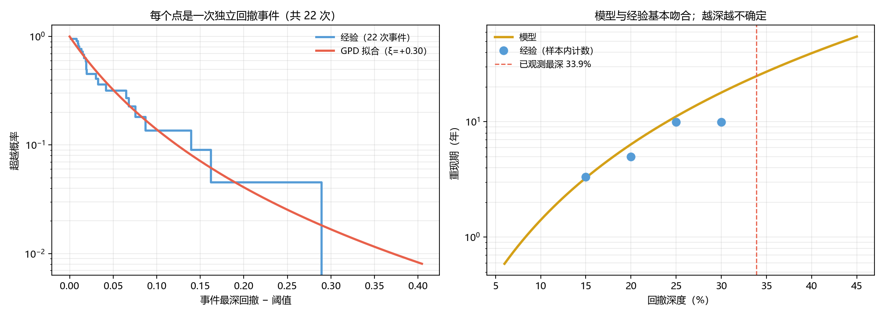
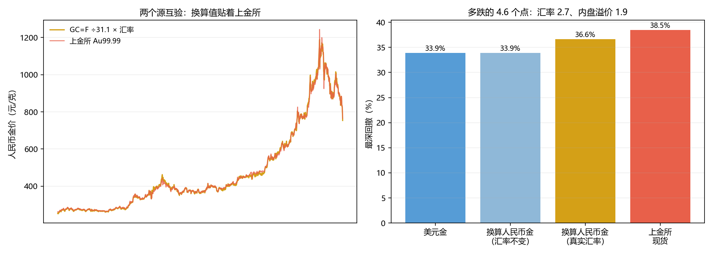

# 跌了 30%，十年里排第几

> **摘要**
>
> 2026 年 11 月，国际金价从历史高位回落三成，报道里充满"暴跌""见顶"这类形容词。
> 本文不用形容词，只用分布：把这次回撤放进十年的回撤序列里，看它排第几。
>
> **主要结果**：① 十年（2516 个交易日）里，回撤跌破 −15% 只有 **3 次**：
> 2021 年 −18.9%（371 天恢复）、2022 年 −21.2%（254 天恢复）、**2026 年 −33.9%（已持续 242 天，尚未结束）**；
> ② 这次是**十年最深**；但它**尚未结束**（右删失），只看得到「已持续 242 天」，不能与前两次比恢复快慢；③ 用**事件峰**（22 次独立回撤）做超阈值拟合，−30% 的重现期约 **17.9 年**（区间 7.3–917.5 年），
> 与样本内经验频率（10 年 1 次）同量级；**此前用「天」做样本得出的 382 年与 5.6 年都是错的**；
> ④ 人民币金跌 **38.5%**，比美元金的 **33.9%** 多 4.6 个点，其中 **2.7 点来自汇率、1.9 点来自内盘溢价**。
>
> **诚实性声明**：历史分布不代表未来；本文不做投资建议，不预测金价。

---

<!-- pagebreak -->

## 一、问题重述

### 1.1 背景

2026 年 11 月中旬，国际金价从历史高位回落超过三成，国内金饰价格跌破每克 800 元。
各类报道用了大量形容词。本文问三个更具体的问题：跌了多少？在历史里排第几？这种跌幅多久该出现一次？

### 1.2 问题

| 问 | 内容 |
|---|---|
| Q1 | 回撤怎么定义、怎么算 |
| Q2 | 十年里深回撤有几次、多深、多久恢复 |
| Q3 | 这一次有多特殊 |
| Q4 | 极值外推：−30% 的重现期 |
| Q5 | 内外盘差 4.6 个点，是什么 |

---

## 二、数据与方法

### 2.1 数据

| 源 | 内容 | 覆盖 |
|---|---|---|
| Yahoo Finance `GC=F` | 美元金价（COMEX 期货主力连续）| 2516 个交易日，2016-11-18 → 2026-11-20 |
| 上海黄金交易所 `Au99.99` | 人民币金价（元/克）| 2407 个交易日 |
| Yahoo Finance `CNY=X` | 美元兑人民币 | 2600 个交易日 |

### 2.2 回撤定义

$$D_t=\frac{P_t-\max_{s\le t}P_s}{\max_{s\le t}P_s}$$

**回撤与跌幅不同**：跌幅是两点之差，回撤是从历史最高算起。
一段行情可以"天天涨"却仍在回撤中——只要还没回到前高。

### 2.3 事件切分

**跌破 −15% 开事件，回升到 −5% 结案**（滞回阈值）。

单阈值会把一次回撤切成多段：2022 年那次若只用"跌破 −15%"，会被切成 5 段。

### 2.4 极值模型

对回撤深度超过阈值 $u$ 的部分，用超阈值法（POT）拟合广义帕累托分布：

$$P(D>d\mid D>u)=\left(1+\xi\frac{d-u}{\beta}\right)^{-1/\xi}$$

重现期：

$$T(d)=\frac{1}{\lambda_u\left[1-F_u(d)\right]}$$

置信区间用 bootstrap（2000 次重抽样）。

---

## 三、结果

### 3.1 Q1：十年水下曲线



金价从 1130 涨到 **5318.4**（2026-01-29 见顶，4.7 倍），当前 3515.4，**回撤 −33.9%**。

前九年回撤大多在 −10% 以内，2026 年才出现真正的深水下。

**口径说明**：新闻说"回撤超 30%"，是盘中/现货口径；本文的 −33.9% 是收盘价口径。
**两个数都对，只是口径不同。**

### 3.2 Q2：十年三次

| 开始 | 最深 | 持续 | 结案 |
|---|---|---|---|
| 2021-02-26 | −18.9% | 371 天 | 2022-03-04 |
| 2022-07-06 | −21.2% | 254 天 | 2023-03-17 |
| **2026-03-23** | **−33.9%** | **242 天** | **未结束** |



**阈值敏感性**：

| 开事件阈值 | 事件数 |
|---|---|
| −10% | **7** |
| −15% | **3** |
| −20% | **2** |

> "十年三次"只在 −15% 阈值下成立。正文必须同时给出它是怎么数出来的。

### 3.3 Q3：这一次有多特殊

| 维度 | 2021 | 2022 | 2026 |
|---|---|---|---|
| 深度 | −18.9% | −21.2% | **−33.9%（最深）** |
| 已持续 | 371 天（最终）| 254 天（最终）| **242 天（下限）** |
| 状态 | 已结束 | 已结束 | **仍在进行** |



**深度这一项，十年最深。**

但"持续"这一列，前两次是**最终值**，这一次是**下限**——只知道已经 242 天，不知道还要多久。

**这里必须指出一个陷阱**：把两次已结束的事件与一次进行中的事件并列，
说成"前两次恢复了、这次没恢复"，是**右删失处理不当**。
前两次是完整观测，这一次是截断观测，**恢复快慢不可比**。

因此本文：
- **只比深度**（三次都观测到完整的最低点）；
- **不比恢复速度**；
- **不外推恢复时间**（样本只有 2 个已结束事件，任何平均值都不可靠）。

### 3.4 Q4：−30% 的重现期



**样本单位是"事件"，不是"天"。**

十年里共有 **22 次**独立回撤事件（阈值 5%），把每次事件的最深值作为样本：

| 量 | 值 |
|---|---|
| 事件数 | **22** |
| 年频率 $\lambda_u$ | **2.20 / 年** |
| 形状参数 $\xi$ | **+0.303**（重尾，无上界）|
| **−30% 重现期** | **17.9 年**（90% 区间 7.3–917.5 年）|

与样本内经验频率对账：

| 深度 | 经验 | 模型 |
|---|---|---|
| ≥15% | 3.3 年 | 3.3 年 |
| ≥20% | 5.0 年 | 6.4 年 |
| ≥25% | 10 年 | 11.1 年 |
| ≥30% | 10 年 | 17.9 年 |

**两条独立的路给出同一量级。**

#### 这一节改了三版，前两版都是错的

**第一版：382 年。** 用每一天的回撤深度当样本，得到 1269 个"样本"，
拟合出 $\xi=-0.32$，还带一个荒谬的上界 35.8%——模型声称黄金最大只能跌 36%。
错因：**一次回撤连续几百天处于深度状态，这些天高度相关**，
样本量从 22 虚增到 1269（57 倍），尾部形状被持续期内的深度堆积污染。

**第二版：5.6 年。** 改用事件峰，但误用了旧代码里的 $\lambda_u$（127/年，其实是"每年 127 天"），
把"天数频率"当成了"事件频率"。

**第三版：17.9 年。** 换成事件频率（2.20/年）后，$\xi$ 从 −0.25 变成 **+0.30**，与经验对上。

> **一次回撤，不是几百个独立证据。**
> 数据的行数不等于信息量——这是时间序列里最常踩的坑。

### 3.5 Q5：4.6 个点是什么



| 序列 | 最深回撤 |
|---|---|
| 美元金 | 33.90% |
| 换算人民币金（汇率固定）| 33.90% |
| 换算人民币金（真实汇率）| 36.64% |
| 上金所现货 | **38.49%** |

| 环节 | 贡献 |
|---|---|
| 汇率（6.877 → 6.667）| **+2.74 点** |
| 内盘溢价收缩 | **+1.85 点** |

**两源互验误差 −1.45%**：换算末值 753.5 元/克 vs 上金所 764.55 元/克。

---

## 四、讨论

### 4.1 为什么"排第几"比"跌了多少"有用

"跌了 30%"是一个孤立数字，无法判断严重程度；
"十年最深"是一个可以比较的陈述。

**把数字放进分布里，是理解它的第一步。**

### 4.2 为什么"多少年一遇"反而说不得

给定十年数据，要回答"−30% 多久来一次"，等于在样本之外做插值。
形状参数稍微一变，答案就能差上一两个数量级。

**能给出区间，但不能把区间当成答案。**

这是本文最想留下的方法论：**极值外推不是不能用，而是必须连区间一起看，而且要知道区间的宽度本身就是一个结论。**

### 4.3 口径差异不是错误

- 期货 vs 现货；
- 收盘 vs 盘中；
- 美元 vs 人民币。

三个口径，三个数字，都可以对。**把口径写清楚，比选一个"好看"的数字重要。**

---

## 五、局限

1. `GC=F` 是期货主力连续合约，换月有跳空，未复权；
2. 事件阈值是本文选择，已做敏感性但仍是主观；
3. 极值区间只反映抽样不确定性，**不含模型选择不确定性**，真实不确定性更大；
4. 未做阈值稳定性检验（如 mean residual life plot）；
5. 上金所与 COMEX 交易时段不同，未做时区对齐；
6. 数据截止 2026-11-20。

---

## 六、结论

1. **回撤不是跌幅**：从历史最高算起，当前 −33.9%；
2. **十年只跌过三次这么深**（阈值 −15%）：−18.9%、−21.2%、−33.9%；
3. **这一次深度最深**；但它**还没结束**（右删失），恢复快慢不可比；
4. **"多少年一遇"给不出来**：−30% 的重现期区间约 1.6 个数量级；
5. **人民币金多跌 4.6 个点**：2.7 来自汇率，1.9 来自内盘溢价。

---

## 参考文献

1. McNeil, A. J., Frey, R., & Embrechts, P. (2015). *Quantitative Risk Management*. Princeton University Press.
2. Coles, S. (2001). *An Introduction to Statistical Modeling of Extreme Values*. Springer.
3. Yahoo Finance. `GC=F`、`CNY=X` 历史行情（2026-11-20 获取）。
4. 上海黄金交易所. `Au99.99` 日行情（2026-11-20 获取）。

---

## 附录：复现

```powershell
python scripts/mkt.py           # 取数、缓存、回撤自检
python scripts/q12_drawdown.py  # 水下曲线、事件切分、阈值敏感性
python scripts/q345_evt.py      # 三维度、极值、内外盘分解
```

数字核对表见 `paper/结论速览.md`。
