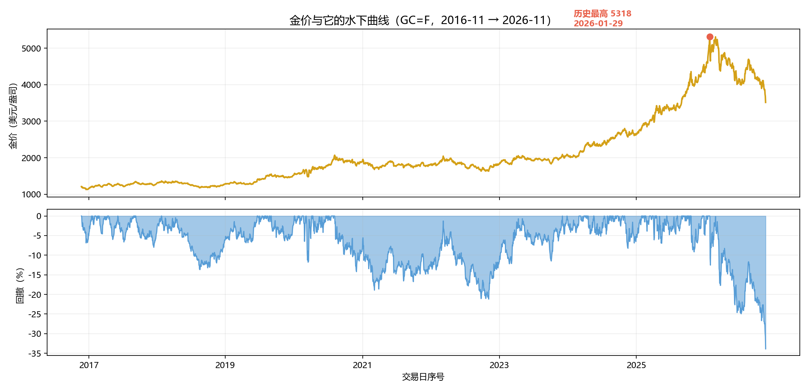
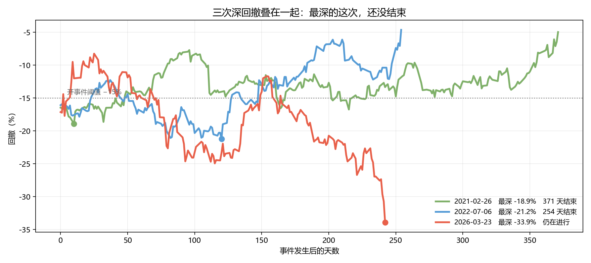

# Q1 + Q2 结果：回撤的定义与十年三次的账本

---

## Q1：回撤怎么定义、怎么算

### 1.1 定义

$$D_t=\frac{P_t-\max_{s\le t}P_s}{\max_{s\le t}P_s}$$

**回撤不是"跌幅"**：跌幅是两天之间的变化，回撤是**从历史最高点算起**跌了多少。
一段行情可以"每天都涨"但仍处于回撤中——只要还没回到前高。

### 1.2 水下曲线

十年金价从 1130 涨到 **5318.4**（2026-01-29 见顶，4.7 倍），
当前 3515.4，回撤 **−33.9%**。

水下曲线一眼可见：**前九年回撤大多在 −10% 以内，2026 这一年才出现真正的深水下。**

### 1.3 为什么用收盘价

盘中价不可复现（不同数据源、不同时点），收盘价可以。
新闻里说"回撤超 30%"是盘中/现货口径，本文的 −33.9% 是**收盘价口径**——
**两个数都对，只是口径不同。**

---

## Q2：十年三次的账本

### 2.1 事件切分规则

**跌破 −15% 开事件，回升到 −5% 结案**（滞回阈值，避免在阈值附近反复触发）。

如果只用单阈值（跌破就记一次），同一个事件会被切成好几段——
本文初版就踩了这个坑：2022 年那次被切成了 5 段。

### 2.2 三次事件

| 开始 | 最深 | 最深日期 | 持续 | 结案 |
|---|---|---|---|---|
| 2021-02-26 | −18.9% | 2021-03-08 | 371 天 | 2022-03-04 |
| 2022-07-06 | −21.2% | 2022-11-03 | 254 天 | 2023-03-17 |
| **2026-03-23** | **−33.9%** | **2026-11-20** | **242 天** | **未结束** |

把三次按"事件发生后的第几天"对齐叠画：
**前两次的曲线在第 254、371 天回到水面，这一次在第 242 天还在往下走。**

### 2.3 阈值敏感性（必须报告）

| 开事件阈值 | 事件数 | 各次深度 |
|---|---|---|
| −10% | **7 次** | −11.8 / −13.7 / −11.5 / −12.5 / −18.9 / −21.2 / −33.9 |
| **−15%** | **3 次** | −18.9 / −21.2 / −33.9 |
| −20% | **2 次** | −21.2 / −33.9 |

**"十年三次"这个说法只在 −15% 阈值下成立。**
换成 −10% 是七次，换成 −20% 是两次。

> **所以正文不能只说"三次"，必须同时给出它是怎么数出来的。**

---

## 三、限制

1. `GC=F` 是期货主力连续合约，换月有微小跳空，未复权；
2. 事件切分阈值是本文选择（③），已做敏感性；
3. 数据截止 2026-11-20；
4. 未考虑分红/持有成本（黄金无分红，此项影响小）。

## 四、落盘

`results/q12_drawdown.json`、`figs/q1_underwater.png`、`figs/q2_episodes.png`、
`python scripts/q12_drawdown.py`
