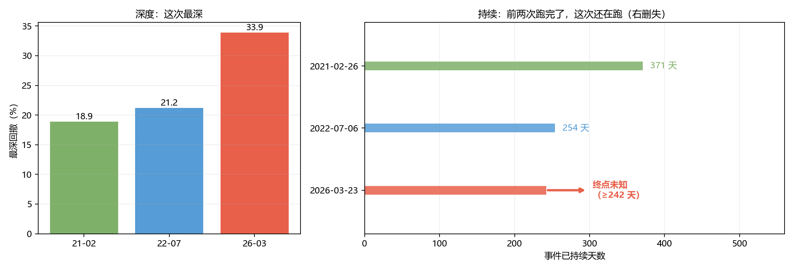

# Q3 结果：这一次有多特殊

> 两个维度可以比：**深度**、**持续时的下限**。
> 第三个维度（恢复快慢）**不能比**——因为这一次还没结束。

---

## 一、三次事件的账本

| 开始 | 最深 | 已持续 | 状态 |
|---|---|---|---|
| 2021-02-26 | −18.9% | 371 天 | 已结束（2022-03-04）|
| 2022-07-06 | −21.2% | 254 天 | 已结束（2023-03-17）|
| **2026-03-23** | **−33.9%** | **242 天** | **仍在进行** |

---

## 二、能比的两个维度

| 维度 | 这一次 | 结论 |
|---|---|---|
| **深度** | −33.9% | **十年最深**（前两次 −18.9 / −21.2）|
| **已持续** | 242 天 | 已超过 2022 那次的第 242 天位置，但**还不到 371** |

**深度是可比较的**：三次都观测到了完整的最低点。
**持续时间只是下限**：这一次只知道 ≥242 天。

---

## 三、为什么不能说"恢复也创了纪录"

这是一个**右删失**（right-censoring）问题。

| 事件 | 我们知道的 |
|---|---|
| 2021 那次 | 持续了 **371 天**，然后恢复（终点已知）|
| 2022 那次 | 持续了 **254 天**，然后恢复（终点已知）|
| 2026 那次 | 已经持续 **242 天**，**终点未知** |

前两次是**完整观测**，这一次是**截断观测**。

如果把它们并列，说"前两次恢复了，这次没恢复"，就等于
**把跑完全程的人和还在跑的人并列，然后说"这个人跑不下来"**。

**正确的陈述只有一句**：

> 到数据截止日（2026-11-20）为止，这次回撤已经持续 242 天，仍未结束。

**错误的陈述有三句**（初版都写了，已全部改掉）：

- ❌ "唯一没回来的"
- ❌ "恢复也创了纪录"
- ❌ 用前两次的 312.5 天去推"还要多久"

---

## 四、那能不能估个"大概还要多久"

可以算，但**不能当结论**：

- 已结束的事件只有 **2 个**，平均持续 **312.5 天**；
- 按这个平均数，还要两个多月；
- **但样本量是 2**。两个点的平均值，不足以支撑任何外推。

如果真要做生存分析（Kaplan-Meier），3 个样本里 1 个删失，估出的生存曲线几乎是一条竖线——
**信息量太低，不值得画。**

> **所以：不估。** 只报"已经 242 天，尚未结束"。

---

## 五、限制

1. 样本只有 3 个事件，其中 1 个右删失；
2. 事件起点与持续天数都依赖阈值（−15%），换阈值会改变；
3. `GC=F` 是期货主力连续合约，换月跳空未复权；
4. 数据截止 2026-11-20，此后变化未纳入。

## 六、落盘

`results/q3_special.json`、`figs/q3_special.png`、`python scripts/q345_evt.py`
