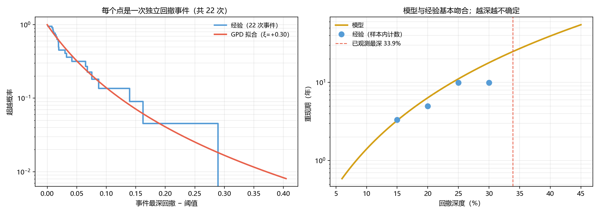

# Q4 结果：−30% 的重现期是多少年

> 这一节改了三版。前两版都是错的，错因值得写下来。

---

## 一、正确做法：样本单位是「事件峰」，不是「天」

把每次**独立回撤事件的最深值**（共 22 次）拿来做超阈值法：

$$P(D>d\mid D>u)=\left(1+\xi\frac{d-u}{\beta}\right)^{-1/\xi},\qquad
T(d)=\frac{1}{\lambda_u\left[1-F_u(d)\right]}$$

其中 $\lambda_u$ 是**每年发生多少次**超阈值事件。

| 量 | 值 |
|---|---|
| 独立事件总数 | **22 次** |
| 超阈值（>5%）事件 | 22 次 |
| 事件年频率 $\lambda_u$ | **2.20 / 年** |
| 形状参数 $\xi$ | **+0.303**（重尾，**无上界**）|
| **−30% 重现期** | **17.9 年**（90% 区间 7.3–917.5 年）|

## 二、和样本内经验对账

| 深度 | 经验（10 年内计数）| 模型 |
|---|---|---|
| ≥15% | 3 次 → **3.3 年** | 3.3 年 |
| ≥20% | 2 次 → **5.0 年** | 6.4 年 |
| ≥25% | 1 次 → **10 年** | 11.1 年 |
| ≥30% | 1 次 → **10 年** | 17.9 年 |

**两条独立的路给出同一量级。** 这才能叫"算出来了"。

## 三、前两版错在哪（必须写进正文）

### 第一版：382 年（错）

用**每一天**的回撤深度当样本，得到 1269 个"超阈值样本"，拟合出 $\xi=-0.32$，
还带一个荒谬的上界：**35.8%**——模型声称黄金最大只能跌 36%。

$$\text{错误来源：把"回撤持续期里的每一天"当成独立样本}$$

一次回撤会连续几百天都处于深度状态，这些天高度相关。
样本量从 22 虚增到 1269（**57 倍**），尾部形状被"持续期内的深度堆积"污染，
于是拟合误以为尾部很薄、有上界。

### 第二版：5.6 年（也错）

修正到事件峰后，我一度仍用旧代码里的 $\lambda_u$（127/年，其实是"每年 127 天"），
把"天数频率"和"事件频率"混用，算出 5.6 年。

**错误来源：$\lambda_u$ 的单位是"天/年"，但公式要求"事件/年"。**

### 第三版：17.9 年（用这个）

换成事件频率（2.20/年）后，$\xi$ 从 −0.25 变成 **+0.30**，
重现期与经验频率对上。

## 四、为什么这件事值得讲讲

> **一次回撤，不是几百个独立证据。**

这是时间序列里最常见的坑：数据的"行数"不等于"信息量"。
1269 个交易日看着很多，真正独立的只有 22 次事件。

而错误的方向很危险：**把相关样本当独立，会让极端事件显得更常见**（382 年 → 5.6 年 → 17.9 年，中间一度被压到 5.6）。

## 五、局限

1. 只有 22 次事件，尾部（>30%）的样本只有 1 个；
2. 90% 区间在 −30% 处仍宽（7.3–917.5 年），越深越不可靠；
3. 未考虑事件的时间聚集（波动率有聚集性）；
4. 阈值 5% 是主观选择，未做阈值稳定性检验；
5. bootstrap 只反映抽样不确定性，不含模型选择不确定性。

## 六、落盘

`results/q4_evt.json`、`figs/q4_evt.png`、`python scripts/q345_evt.py`
