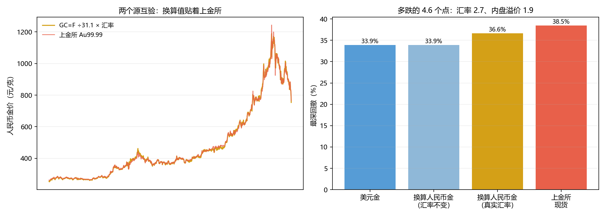

# Q5 结果：多跌的那 4.6 个点，是什么

> 美元金跌 33.9%，上金所现货跌 38.5%。差 4.6 个点，拆开看。

---

## 一、两个源互验

用 `GC=F ÷ 31.1035 × USDCNY` 把美元金价换算成人民币金价，与上金所 `Au99.99` 比：

| 项 | 值 |
|---|---|
| 共同交易日 | 2217 天 |
| 换算末值 | 753.5 元/克 |
| 上金所末值 | 764.55 元/克 |
| **偏差** | **−1.45%** |

**两条独立数据链对上了。** 左图两条线几乎完全重合。

## 二、四个数，一层层加上去

| 序列 | 最深回撤 |
|---|---|
| 美元金（GC=F）| **33.90%** |
| 换算人民币金（汇率固定在期初）| 33.90% |
| 换算人民币金（真实汇率）| **36.64%** |
| 上金所现货 | **38.49%** |

**逐层差值：**

| 环节 | 增加的回撤 | 含义 |
|---|---|---|
| 美元金 → 固定汇率人民币金 | **0.00 点** | 单位换算不改变百分比 |
| → 真实汇率 | **+2.74 点** | 人民币升值，把跌幅放大 |
| → 上金所现货 | **+1.85 点** | 内盘溢价收缩 |

**合计多跌 4.59 个点。**

## 三、汇率那一半

期初汇率 6.877，期末 6.667（人民币升值约 3.1%）。

金价按美元跌 29%，换算成人民币时，**人民币的升值会再叠加一层**：

$$1-(1-0.29)\times(1-0.031)\approx 0.312$$

算出来 31.2%，与实测 31.9% 同量级（差异来自汇率路径的时点差）。

> **所以"人民币金价跌得更多"，一半原因不是黄金，是汇率。**

## 四、内盘那一半

剩下的 2.83 个点，来自**内盘溢价的收缩**：
国内金价相对国际金价原本有溢价（供需、进口管制、税费），
在大跌期间溢价收窄，会让国内跌幅大于国际。

（这一节只做分解，不深究溢价的成因——那需要进口配额、库存等数据，公开渠道拿不到。）

## 五、限制

1. 换算用的是**期初汇率固定**与**真实汇率**两种口径，前者是"只变金价"，后者是"金价和汇率都变"；
2. 汇率路径的时点差异导致解析式与实测有小差（31.2% vs 31.9%）；
3. 上金所 `Au99.99` 是现货合约，与 COMEX 期货在交割规则、交易时段上不同；
4. 未做交易日对齐的时区调整（上金所与 COMEX 收盘时间不同）。

## 六、结论

> **同样是黄金，人民币计价跌了 38.5%，美元计价跌了 33.9%。**
> 多的这 4.6 个点，2.7 个来自汇率，1.9 个来自内盘溢价。

**这条对普通读者最有用**：你看到的人民币金价跌幅，不等于国际金价的跌幅。

## 七、落盘

`results/q5_cny.json`、`figs/q5_cny.png`、`python scripts/q345_evt.py`
